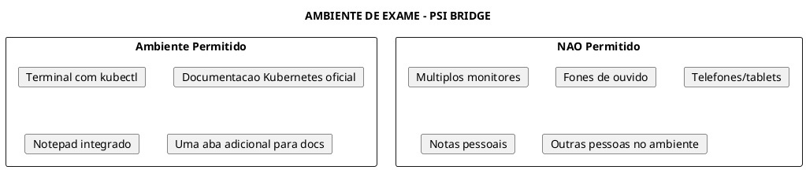
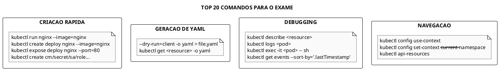
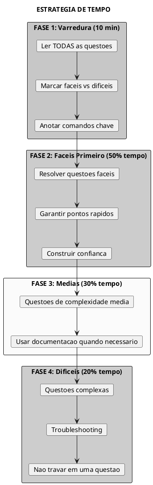
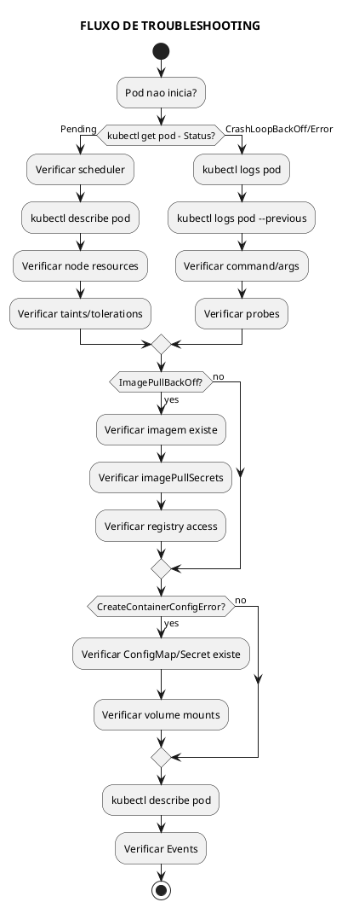

# Miscelanea e Dicas para os Exames

> **Certificacoes**: KCNA, KCSA, CKAD, CKA, CKS

## Configuracao do Ambiente de Exame

### Antes do Exame

```admonish warning title="Preparacao Essencial"
1. **Testar sua conexao** de internet com antecedencia
2. **Usar Chrome ou Chromium** (navegadores suportados)
3. **Desabilitar extensoes** do navegador
4. **Fechar todas as aplicacoes** desnecessarias
5. **Documento de identificacao** valido em ingles
6. **Ambiente silencioso** e bem iluminado
7. **Mesa limpa** - apenas agua em copo transparente
```

### Ambiente do Exame



### Links Permitidos Durante o Exame

```admonish info title="Documentacao Oficial Permitida"
- https://kubernetes.io/docs/
- https://kubernetes.io/blog/
- https://helm.sh/docs/ (para CKAD/CKA)
- https://github.com/kubernetes/ (apenas documentacao)

**Dica**: Marque as paginas importantes nos favoritos antes do exame!
```

---

## Aliases e Configuracoes Uteis

### Aliases Essenciais do kubectl

```bash
# Adicionar ao ~/.bashrc ou ~/.bash_profile

# Alias basico (ja configurado no exame)
alias k=kubectl

# Aliases para recursos comuns
alias kgp='kubectl get pods'
alias kgs='kubectl get svc'
alias kgd='kubectl get deployments'
alias kgn='kubectl get nodes'
alias kgns='kubectl get namespaces'

# Aliases com output wide
alias kgpw='kubectl get pods -o wide'
alias kgsw='kubectl get svc -o wide'
alias kgdw='kubectl get deployments -o wide'

# Aliases para todos namespaces
alias kgpa='kubectl get pods -A'
alias kgsa='kubectl get svc -A'
alias kgda='kubectl get deployments -A'

# Aliases para describe
alias kdp='kubectl describe pod'
alias kds='kubectl describe svc'
alias kdd='kubectl describe deployment'
alias kdn='kubectl describe node'

# Aliases para delete
alias kdelp='kubectl delete pod'
alias kdels='kubectl delete svc'
alias kdeld='kubectl delete deployment'

# Aliases para logs
alias kl='kubectl logs'
alias klf='kubectl logs -f'

# Aliases para exec
alias kex='kubectl exec -it'

# Aliases para apply/create
alias ka='kubectl apply -f'
alias kc='kubectl create'
alias kcf='kubectl create -f'

# Alias para dry-run
alias kdr='kubectl --dry-run=client -o yaml'

# Alias para contextos
alias kctx='kubectl config get-contexts'
alias kuse='kubectl config use-context'
alias kns='kubectl config set-context --current --namespace'
```

### Configuracao de Auto-Complete

```bash
# Habilitar auto-complete para kubectl (ja configurado no exame)
source <(kubectl completion bash)

# Auto-complete para o alias k
complete -o default -F __start_kubectl k

# Verificar se esta funcionando
k get p<TAB>  # deve completar para "pods"
```

### Variaveis de Ambiente Uteis

```bash
# Namespace padrao
export NS=default
alias kn='kubectl -n $NS'

# Editor padrao (vim e o padrao no exame)
export KUBE_EDITOR=vim
# ou
export EDITOR=vim

# Contexto atual
export CTX=$(kubectl config current-context)

# Desabilitar paginacao do kubectl
export KUBECONFIG=~/.kube/config

# Para debug de API
export KUBECONFIG_DEBUG=true
```

### Configuracao do Vim para YAML

```bash
# Adicionar ao ~/.vimrc (util para o exame)
cat >> ~/.vimrc << 'EOF'
" Configuracoes para YAML
set tabstop=2
set shiftwidth=2
set expandtab
set autoindent
set smartindent
syntax on
set number
set paste

" Highlight de sintaxe YAML
autocmd FileType yaml setlocal ts=2 sts=2 sw=2 expandtab
EOF
```

---

## Cheat Sheet de Comandos

### Comandos Mais Usados nos Exames



### Criacao Rapida de Recursos

```bash
# Pod
kubectl run nginx --image=nginx
kubectl run nginx --image=nginx --port=80
kubectl run nginx --image=nginx --env="VAR=value"
kubectl run nginx --image=nginx --labels="app=web,env=prod"
kubectl run nginx --image=nginx --restart=Never  # Pod unico
kubectl run nginx --image=nginx --restart=OnFailure  # Job
kubectl run nginx --image=nginx --dry-run=client -o yaml > pod.yaml

# Deployment
kubectl create deployment nginx --image=nginx
kubectl create deployment nginx --image=nginx --replicas=3
kubectl create deployment nginx --image=nginx --port=80
kubectl create deployment nginx --image=nginx --dry-run=client -o yaml > deploy.yaml

# Service
kubectl expose pod nginx --port=80 --target-port=8080
kubectl expose deployment nginx --port=80 --type=NodePort
kubectl expose deployment nginx --port=80 --type=ClusterIP --name=nginx-svc
kubectl create service clusterip nginx --tcp=80:80
kubectl create service nodeport nginx --tcp=80:80 --node-port=30080

# ConfigMap
kubectl create configmap my-config --from-literal=key1=value1
kubectl create configmap my-config --from-file=config.txt
kubectl create configmap my-config --from-env-file=app.env

# Secret
kubectl create secret generic my-secret --from-literal=password=123
kubectl create secret generic my-secret --from-file=ssh-key=~/.ssh/id_rsa
kubectl create secret docker-registry my-reg --docker-server=... --docker-username=...
kubectl create secret tls my-tls --cert=cert.pem --key=key.pem

# ServiceAccount
kubectl create serviceaccount my-sa

# Role/RoleBinding
kubectl create role pod-reader --verb=get,list,watch --resource=pods
kubectl create rolebinding read-pods --role=pod-reader --user=john
kubectl create rolebinding read-pods --role=pod-reader --serviceaccount=default:my-sa

# ClusterRole/ClusterRoleBinding
kubectl create clusterrole pod-reader --verb=get,list,watch --resource=pods
kubectl create clusterrolebinding read-pods --clusterrole=pod-reader --user=john

# Job
kubectl create job my-job --image=busybox -- echo "Hello"

# CronJob
kubectl create cronjob my-cron --image=busybox --schedule="*/5 * * * *" -- echo "Hello"

# Namespace
kubectl create namespace my-ns

# Quota
kubectl create quota my-quota --hard=pods=10,services=5

# PriorityClass
kubectl create priorityclass high-priority --value=1000
```

### Geracao de YAML

```bash
# Sempre usar --dry-run=client -o yaml para gerar templates

# Pod
kubectl run nginx --image=nginx --dry-run=client -o yaml > pod.yaml

# Deployment
kubectl create deployment nginx --image=nginx --dry-run=client -o yaml > deploy.yaml

# Service
kubectl expose deployment nginx --port=80 --dry-run=client -o yaml > svc.yaml

# Job
kubectl create job test --image=busybox --dry-run=client -o yaml -- echo hello > job.yaml

# CronJob
kubectl create cronjob test --image=busybox --schedule="*/1 * * * *" --dry-run=client -o yaml > cron.yaml

# Exportar recurso existente
kubectl get deployment nginx -o yaml > nginx-deploy.yaml
kubectl get pod nginx -o yaml > nginx-pod.yaml
```

### Debugging e Troubleshooting

```bash
# Ver eventos do cluster
kubectl get events
kubectl get events --sort-by='.lastTimestamp'
kubectl get events -A --sort-by='.lastTimestamp'
kubectl get events --field-selector type=Warning

# Descrever recursos
kubectl describe pod <pod-name>
kubectl describe node <node-name>
kubectl describe deployment <deploy-name>

# Logs
kubectl logs <pod-name>
kubectl logs <pod-name> -c <container-name>  # multi-container
kubectl logs <pod-name> --previous  # container anterior
kubectl logs <pod-name> -f  # follow
kubectl logs <pod-name> --tail=100  # ultimas 100 linhas
kubectl logs -l app=nginx  # por label

# Exec
kubectl exec <pod-name> -- ls /
kubectl exec <pod-name> -- cat /etc/config
kubectl exec -it <pod-name> -- /bin/sh
kubectl exec -it <pod-name> -c <container> -- /bin/bash

# Debug de rede
kubectl exec -it <pod-name> -- nslookup kubernetes
kubectl exec -it <pod-name> -- wget -O- http://service-name
kubectl exec -it <pod-name> -- curl http://service-name

# Port-forward
kubectl port-forward pod/<pod-name> 8080:80
kubectl port-forward svc/<svc-name> 8080:80
kubectl port-forward deployment/<deploy-name> 8080:80

# Top (metricas)
kubectl top nodes
kubectl top pods
kubectl top pods --containers

# Ver API resources
kubectl api-resources
kubectl api-resources --namespaced=true
kubectl api-resources --namespaced=false
kubectl api-versions

# Explain (documentacao)
kubectl explain pod
kubectl explain pod.spec
kubectl explain pod.spec.containers
kubectl explain pod.spec.containers.resources
kubectl explain deployment.spec.strategy
```

### Navegacao e Contextos

```bash
# Ver contextos
kubectl config get-contexts
kubectl config current-context

# Mudar contexto
kubectl config use-context <context-name>

# Mudar namespace padrao
kubectl config set-context --current --namespace=<namespace>

# Criar contexto
kubectl config set-context my-context --cluster=my-cluster --user=my-user --namespace=my-ns

# Ver configuracao
kubectl config view
kubectl config view --minify  # apenas contexto atual
```

### Manipulacao de Recursos

```bash
# Editar
kubectl edit deployment nginx
kubectl edit pod nginx  # cuidado: recria o pod

# Patch
kubectl patch deployment nginx -p '{"spec":{"replicas":3}}'
kubectl patch pod nginx -p '{"metadata":{"labels":{"app":"v2"}}}'

# Scale
kubectl scale deployment nginx --replicas=5
kubectl scale --replicas=3 -f deploy.yaml

# Rollout
kubectl rollout status deployment nginx
kubectl rollout history deployment nginx
kubectl rollout undo deployment nginx
kubectl rollout undo deployment nginx --to-revision=2
kubectl rollout restart deployment nginx
kubectl rollout pause deployment nginx
kubectl rollout resume deployment nginx

# Set
kubectl set image deployment/nginx nginx=nginx:1.21
kubectl set env deployment/nginx ENV_VAR=value
kubectl set resources deployment/nginx -c=nginx --limits=cpu=200m,memory=512Mi
kubectl set serviceaccount deployment nginx my-sa

# Label
kubectl label pod nginx app=web
kubectl label pod nginx app-  # remove label
kubectl label pod nginx app=v2 --overwrite

# Annotate
kubectl annotate pod nginx description="my pod"
kubectl annotate pod nginx description-  # remove

# Taint (nodes)
kubectl taint node node1 key=value:NoSchedule
kubectl taint node node1 key:NoSchedule-  # remove

# Cordon/Uncordon
kubectl cordon node1
kubectl uncordon node1

# Drain
kubectl drain node1 --ignore-daemonsets --delete-emptydir-data
```

---

## Atalhos de Teclado no Terminal

### Vim (Editor Padrao no Exame)

```admonish tip title="Comandos Essenciais do Vim"
**Modo Normal:**
- `i` - Entrar modo de insercao
- `Esc` - Voltar ao modo normal
- `dd` - Deletar linha
- `yy` - Copiar linha
- `p` - Colar
- `u` - Desfazer
- `Ctrl+r` - Refazer
- `/texto` - Buscar
- `n` - Proxima ocorrencia
- `:%s/old/new/g` - Substituir em todo arquivo
- `:wq` - Salvar e sair
- `:q!` - Sair sem salvar
- `:set paste` - Modo paste (evita auto-indent)
- `gg` - Ir para inicio
- `G` - Ir para fim
- `:42` - Ir para linha 42
```

### Bash

```admonish tip title="Atalhos Bash"
- `Ctrl+c` - Cancelar comando
- `Ctrl+d` - Sair/EOF
- `Ctrl+l` - Limpar tela
- `Ctrl+a` - Inicio da linha
- `Ctrl+e` - Fim da linha
- `Ctrl+u` - Apagar ate inicio
- `Ctrl+k` - Apagar ate fim
- `Ctrl+w` - Apagar palavra anterior
- `Ctrl+r` - Busca reversa no historico
- `!!` - Repetir ultimo comando
- `!$` - Ultimo argumento do comando anterior
- `Tab` - Auto-complete
- `Tab Tab` - Listar opcoes
```

---

## Estrategias para o Exame

### Gerenciamento de Tempo



### Dicas por Certificacao

#### KCNA (Kubernetes and Cloud Native Associate)

```admonish info title="KCNA - Dicas"
**Formato**: 60 questoes multipla escolha, 90 minutos, 75% para passar

**Foco**:
- Conceitos Cloud Native (CNCF, containers, microservices)
- Arquitetura do Kubernetes
- Recursos basicos (Pod, Deployment, Service)
- Observabilidade e seguranca basica

**Estudo**:
- Documentacao oficial do Kubernetes
- CNCF Landscape
- Nao requer pratica hands-on
```

#### KCSA (Kubernetes and Cloud Native Security Associate)

```admonish info title="KCSA - Dicas"
**Formato**: 60 questoes multipla escolha, 90 minutos, 75% para passar

**Foco**:
- Os 4Cs da seguranca (Cloud, Cluster, Container, Code)
- Supply chain security
- Network policies
- RBAC basico
- Pod Security Standards

**Estudo**:
- Kubernetes Security documentation
- CIS Benchmarks
- OWASP guidelines
```

#### CKAD (Certified Kubernetes Application Developer)

```admonish tip title="CKAD - Dicas"
**Formato**: 15-20 questoes praticas, 2 horas, 66% para passar

**Foco**:
- Criar e configurar Pods, Deployments, Services
- ConfigMaps e Secrets
- Probes (liveness, readiness, startup)
- Jobs e CronJobs
- Multi-container patterns
- Helm basico

**Comandos-chave**:
```bash
kubectl run --dry-run=client -o yaml
kubectl create deployment --dry-run=client -o yaml
kubectl expose --dry-run=client -o yaml
kubectl set image/env/resources
```

**Tempo**: ~6 minutos por questao
```

#### CKA (Certified Kubernetes Administrator)

```admonish tip title="CKA - Dicas"
**Formato**: 15-20 questoes praticas, 2 horas, 66% para passar

**Foco**:
- Troubleshooting (30% da prova!)
- Cluster installation/upgrade
- Networking (Services, Ingress, NetworkPolicies)
- Storage (PV, PVC, StorageClass)
- etcd backup/restore
- RBAC

**Comandos-chave**:
```bash
kubeadm init/join/upgrade
kubectl drain/cordon/uncordon
kubectl logs/describe/get events
etcdctl snapshot save/restore
```

**Tempo**: ~6 minutos por questao
```

#### CKS (Certified Kubernetes Security Specialist)

```admonish tip title="CKS - Dicas"
**Formato**: 15-20 questoes praticas, 2 horas, 67% para passar

**Pre-requisito**: CKA valido

**Foco**:
- System hardening (AppArmor, Seccomp)
- Supply chain security (Trivy, image scanning)
- Runtime security (Falco)
- Network Policies avancadas
- Pod Security Standards/Admission
- Audit logging
- mTLS

**Ferramentas importantes**:
- trivy, kubesec, kube-bench
- Falco, AppArmor, Seccomp
- gVisor, Kata containers
```

### Erros Comuns a Evitar

```admonish warning title="Erros Frequentes"
1. **Esquecer de mudar namespace**: Sempre verificar `kubectl config get-contexts`

2. **Nao verificar contexto**: Trocar para o contexto correto antes de cada questao

3. **YAML com indentacao errada**: Usar `kubectl apply --dry-run=server` para validar

4. **Esquecer de salvar arquivo**: `:wq` no vim

5. **Nao ler a questao completa**: Detalhes importantes podem estar no final

6. **Gastar muito tempo em uma questao**: Marcar e voltar depois

7. **Nao usar a documentacao**: Ela esta la para ajudar!

8. **Esquecer --dry-run=client -o yaml**: Sempre gerar YAML primeiro

9. **Nao verificar se recurso foi criado**: `kubectl get` apos criar

10. **Digitar nomes errados**: Copiar nomes da questao
```

---

## Links Uteis para Estudo

### Documentacao Oficial

```admonish info title="Links Importantes"
**Kubernetes**:
- [Kubernetes Docs](https://kubernetes.io/docs/)
- [Kubernetes Tasks](https://kubernetes.io/docs/tasks/)
- [Kubernetes Reference](https://kubernetes.io/docs/reference/)
- [kubectl Cheat Sheet](https://kubernetes.io/docs/reference/kubectl/cheatsheet/)

**Certificacoes**:
- [KCNA](https://training.linuxfoundation.org/certification/kubernetes-cloud-native-associate/)
- [KCSA](https://training.linuxfoundation.org/certification/kubernetes-and-cloud-native-security-associate-kcsa/)
- [CKAD](https://training.linuxfoundation.org/certification/certified-kubernetes-application-developer-ckad/)
- [CKA](https://training.linuxfoundation.org/certification/certified-kubernetes-administrator-cka/)
- [CKS](https://training.linuxfoundation.org/certification/certified-kubernetes-security-specialist/)

**Curriculos dos Exames**:
- [KCNA Curriculum](https://github.com/cncf/curriculum/blob/master/KCNA_Curriculum.pdf)
- [KCSA Curriculum](https://github.com/cncf/curriculum/blob/master/KCSA_Curriculum.pdf)
- [CKAD Curriculum](https://github.com/cncf/curriculum/blob/master/CKAD_Curriculum.pdf)
- [CKA Curriculum](https://github.com/cncf/curriculum/blob/master/CKA_Curriculum.pdf)
- [CKS Curriculum](https://github.com/cncf/curriculum/blob/master/CKS_Curriculum.pdf)
```

### Ferramentas de Pratica

```admonish tip title="Ambientes de Pratica"
**Gratuitos**:
- [Killercoda](https://killercoda.com/) - Labs interativos
- [Play with Kubernetes](https://labs.play-with-k8s.com/)
- [Minikube](https://minikube.sigs.k8s.io/)
- [Kind](https://kind.sigs.k8s.io/)

**Pagos (com simulados)**:
- [Killer.sh](https://killer.sh/) - Incluido na compra do exame
- [KodeKloud](https://kodekloud.com/)
- [A Cloud Guru](https://acloudguru.com/)
```

---

## Troubleshooting Rapido

### Fluxo de Debug



### Comandos de Debug Rapido

```bash
# Sequencia padrao de debug
kubectl get pods                           # Status geral
kubectl describe pod <pod-name>            # Detalhes e eventos
kubectl logs <pod-name>                    # Logs do container
kubectl logs <pod-name> --previous         # Logs do container anterior
kubectl get events --sort-by='.lastTimestamp'  # Eventos recentes

# Debug de node
kubectl get nodes                          # Status dos nodes
kubectl describe node <node-name>          # Detalhes do node
kubectl top nodes                          # Recursos dos nodes

# Debug de service
kubectl get endpoints <service-name>       # Endpoints do service
kubectl describe svc <service-name>        # Detalhes do service

# Debug de rede dentro do pod
kubectl exec -it <pod-name> -- nslookup <service-name>
kubectl exec -it <pod-name> -- wget -O- <service-name>

# Debug de DNS
kubectl exec -it <pod-name> -- cat /etc/resolv.conf
kubectl exec -it <pod-name> -- nslookup kubernetes.default
```

---

## Templates Rapidos

### Pod Basico

```yaml
{{#include assets/pod/pod-nginx-3.yaml}}
```

### Pod com Recursos e Probes

```yaml
{{#include assets/pod/pod-app-1.yaml}}
```

### Deployment

```yaml
{{#include assets/deployment/deployment-nginx-1.yaml}}
```

### Service

```yaml
{{#include assets/service/service-nginx.yaml}}
```

### ConfigMap

```yaml
{{#include assets/configmap/configmap-my-config.yaml}}
```

### Secret

```yaml
{{#include assets/secrets/secret-my-secret.yaml}}
```

### PVC

```yaml
{{#include assets/persistent-volumes/persistentvolumeclaim-my-pvc-1.yaml}}
```

### NetworkPolicy

```yaml
{{#include assets/network-policy/networkpolicy-deny-all-1.yaml}}
```

### Role e RoleBinding

```yaml
{{#include assets/rbac/role-pod-reader-3.yaml}}
```

---

## Geracao Rapida de YAML com kubectl

### Templates com kubectl

```bash
# Pod basico
kubectl run nginx --image=nginx --dry-run=client -o yaml

# Pod com porta
kubectl run nginx --image=nginx --port=80 --dry-run=client -o yaml

# Pod com comando
kubectl run busybox --image=busybox --dry-run=client -o yaml -- sleep 3600

# Pod com limites
kubectl run nginx --image=nginx --dry-run=client -o yaml \
  --requests='cpu=100m,memory=128Mi' \
  --limits='cpu=200m,memory=256Mi'

# Deployment
kubectl create deployment nginx --image=nginx --replicas=3 --dry-run=client -o yaml

# Service ClusterIP
kubectl create service clusterip nginx --tcp=80:80 --dry-run=client -o yaml

# Service NodePort
kubectl create service nodeport nginx --tcp=80:80 --node-port=30080 --dry-run=client -o yaml

# ConfigMap
kubectl create configmap my-config \
  --from-literal=key1=value1 \
  --from-literal=key2=value2 \
  --dry-run=client -o yaml

# ConfigMap de arquivo
kubectl create configmap my-config \
  --from-file=config.txt \
  --dry-run=client -o yaml

# Secret
kubectl create secret generic my-secret \
  --from-literal=username=admin \
  --from-literal=password=secret \
  --dry-run=client -o yaml

# Secret TLS
kubectl create secret tls my-tls \
  --cert=cert.pem \
  --key=key.pem \
  --dry-run=client -o yaml

# Job
kubectl create job my-job --image=busybox --dry-run=client -o yaml -- echo "hello"

# CronJob
kubectl create cronjob my-cron \
  --image=busybox \
  --schedule="0 * * * *" \
  --dry-run=client -o yaml -- echo "hello"

# ServiceAccount
kubectl create serviceaccount my-sa --dry-run=client -o yaml

# Role
kubectl create role pod-reader \
  --verb=get,list,watch \
  --resource=pods \
  --dry-run=client -o yaml

# RoleBinding
kubectl create rolebinding pod-reader-binding \
  --role=pod-reader \
  --serviceaccount=default:my-sa \
  --dry-run=client -o yaml

# ClusterRole
kubectl create clusterrole node-reader \
  --verb=get,list,watch \
  --resource=nodes \
  --dry-run=client -o yaml

# ClusterRoleBinding
kubectl create clusterrolebinding node-reader-binding \
  --clusterrole=node-reader \
  --serviceaccount=default:my-sa \
  --dry-run=client -o yaml

# Ingress (requer mais configuracao, use explain)
kubectl create ingress my-ingress \
  --rule="host/path=service:port" \
  --dry-run=client -o yaml

# Quota
kubectl create quota my-quota \
  --hard=pods=10,services=5 \
  --dry-run=client -o yaml
```

### Usando kubectl explain

```bash
# Ver campos de um recurso
kubectl explain pod
kubectl explain pod.spec
kubectl explain pod.spec.containers
kubectl explain pod.spec.containers.resources
kubectl explain pod.spec.containers.livenessProbe

# Ver estrutura completa
kubectl explain deployment --recursive

# Exemplos uteis
kubectl explain pod.spec.volumes                    # Tipos de volumes
kubectl explain pod.spec.affinity                   # Afinidade
kubectl explain deployment.spec.strategy            # Estrategias de update
kubectl explain service.spec.type                   # Tipos de service
kubectl explain ingress.spec.rules                  # Regras de ingress
kubectl explain networkpolicy.spec                  # Network policies
```

---

## Referencias

- [Kubernetes Documentation](https://kubernetes.io/docs/)
- [kubectl Cheat Sheet](https://kubernetes.io/docs/reference/kubectl/cheatsheet/)
- [Linux Foundation Training](https://training.linuxfoundation.org/)
- [CNCF Curriculum](https://github.com/cncf/curriculum)

### Arquivos Relacionados

- [Kubectl](tools/kubectl.md) - Comandos detalhados do kubectl
- [Kubeadm](tools/kubeadm.md) - Instalacao e upgrade de clusters
- [Troubleshooting](maintenance/Troubleshooting.md) - Debug detalhado
- [RBAC](security/RBAC.md) - Controle de acesso

---

## Snippets Úteis

### Variáveis de Ambiente do Pod (Downward API)

```yaml
{{#include assets/misc/env-pod-info.yaml}}
```

### Variáveis de Ambiente dos Recursos

```yaml
{{#include assets/misc/env-resources.yaml}}
```

### Configuração Kind (Multi-Node)

```yaml
{{#include assets/misc/kind-config.yaml}}
```
