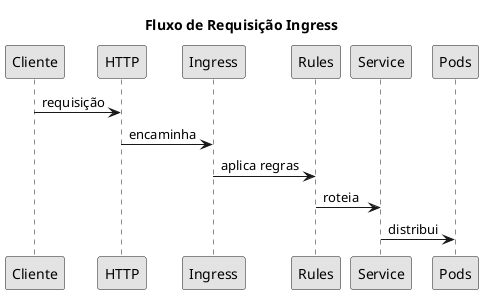

# Segurança de Ingress

<span class="badge badge-cks">CKS</span> <span class="badge badge-cka">CKA</span>

---

## O que é Ingress?

```admonish info title="Ingress"
Ingress é um recurso que gerencia acesso HTTP/HTTPS externo aos serviços do cluster. Funciona como um proxy reverso com regras de roteamento.
```



### Arquitetura

| Componente | Descrição |
|------------|-----------|
| **Ingress Resource** | Regras declarativas de roteamento |
| **Ingress Controller** | Implementação que processa as regras |
| **Backend Service** | Services que recebem o tráfego |

```admonish note title="Feature Freeze"
Ingress está em feature freeze e será substituído pelo [Gateway API](../networking/gateway-api.md) para casos de uso avançados.
```

---

## Tipos de Roteamento

### Path-Based (por caminho)

| pathType | Comportamento | Exemplo |
|----------|---------------|---------|
| `Prefix` | Match por prefixo | `/api` casa com `/api`, `/api/v1` |
| `Exact` | Match exato | `/api` casa apenas com `/api` |
| `ImplementationSpecific` | Depende do controller | Varia |

### Path-Based Routing

```yaml
{{#include ../assets/security/ingress/path-based-ingress.yaml}}
```

### Host-Based Routing

```yaml
{{#include ../assets/security/ingress/host-based-ingress.yaml}}
```

---

## TLS/HTTPS

### Criar Certificado Self-Signed

```bash
# Gerar certificado e chave
openssl req -x509 -newkey rsa:4096 \
  -keyout key.pem -out cert.pem \
  -days 365 -nodes \
  -subj "/CN=myapp.example.com"

# Criar Secret TLS
kubectl create secret tls my-tls-secret \
  --cert=cert.pem \
  --key=key.pem
```

### Forçar HTTPS

```yaml
{{#include ../assets/security/ingress/force-https-ingress.yaml}}
```

### Testar TLS

```bash
# Testar com resolve (quando não há DNS)
curl -vk https://myapp.example.com \
  --resolve myapp.example.com:443:<INGRESS_IP>
```

---

## Controles de Segurança

### Basic Auth

```admonish tip title="Basic Auth"
Útil para proteger endpoints administrativos ou ambientes de staging.
```

```bash
# Criar arquivo htpasswd
htpasswd -c auth admin

# Criar secret
kubectl create secret generic basic-auth --from-file=auth
```

```yaml
{{#include ../assets/security/ingress/basic-auth-ingress.yaml}}
```

### Whitelist de IPs

```admonish warning title="IP Whitelist"
Restrinja acesso apenas a IPs confiáveis em endpoints sensíveis.
```

```yaml
{{#include ../assets/security/ingress/ip-whitelist-ingress.yaml}}
```

### Rate Limiting

```yaml
{{#include ../assets/security/ingress/rate-limited-ingress.yaml}}
```

### Security Headers

```admonish important title="Headers de Segurança"
Headers HTTP de segurança protegem contra ataques como XSS, clickjacking e MIME sniffing.
```

```yaml
{{#include ../assets/security/ingress/security-headers-ingress.yaml}}
```

### OAuth2 Authentication

```yaml
{{#include ../assets/security/ingress/oauth-ingress.yaml}}
```

---

## Comandos Úteis

```bash
# Criar ingress via CLI
kubectl create ingress my-ingress \
  --class=nginx \
  --rule="myapp.com/api=api-svc:80" \
  --rule="myapp.com/web=web-svc:80"

# Criar ingress com TLS
kubectl create ingress secure-ingress \
  --class=nginx \
  --rule="myapp.com/*=web-svc:80,tls=my-tls-secret"

# Verificar apiVersion do Ingress
kubectl api-resources | grep -i ingress

# Listar ingress classes disponíveis
kubectl get ingressclass

# Ver detalhes do ingress
kubectl describe ingress my-ingress
```

---

## Troubleshooting

### Ingress não roteia tráfego

```bash
# 1. Verificar Ingress Controller está rodando
kubectl get pods -n ingress-nginx

# 2. Verificar logs do controller
kubectl logs -n ingress-nginx -l app.kubernetes.io/name=ingress-nginx

# 3. Verificar se IngressClass existe
kubectl get ingressclass

# 4. Verificar endpoints do backend service
kubectl get endpoints <service-name>
```

### Certificado TLS não funciona

```bash
# Verificar secret existe
kubectl get secret <tls-secret> -o yaml

# Verificar dados do certificado
kubectl get secret <tls-secret> -o jsonpath='{.data.tls\.crt}' | base64 -d | openssl x509 -text
```

---

## Dicas para o Exame CKS

```admonish tip title="Dicas CKS - Ingress"
1. **Forçar HTTPS**: Use annotation `ssl-redirect: "true"`
2. **IP Whitelist**: Annotation `whitelist-source-range`
3. **Rate Limiting**: Protege contra DoS
4. **Security Headers**: HSTS, X-Frame-Options, etc.
5. **Basic Auth**: Para endpoints administrativos
```

### Annotations Importantes (NGINX)

| Annotation | Uso |
|------------|-----|
| `nginx.ingress.kubernetes.io/ssl-redirect` | Forçar HTTPS |
| `nginx.ingress.kubernetes.io/whitelist-source-range` | Restringir IPs |
| `nginx.ingress.kubernetes.io/limit-rps` | Rate limiting |
| `nginx.ingress.kubernetes.io/auth-type` | Tipo de autenticação |
| `nginx.ingress.kubernetes.io/configuration-snippet` | Configuração custom |

---

## Referências

- [Gateway API](../networking/gateway-api.md) - Substituição do Ingress
- [NetworkPolicy](network-policy.md) - Segurança de rede L3/L4
- [Ingress Networking](../networking/ingress.md) - Conceitos gerais de Ingress
