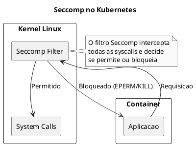
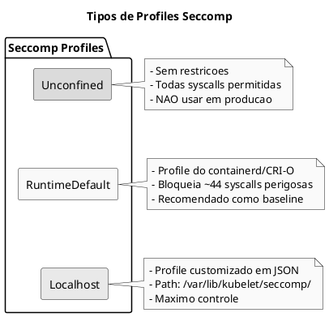
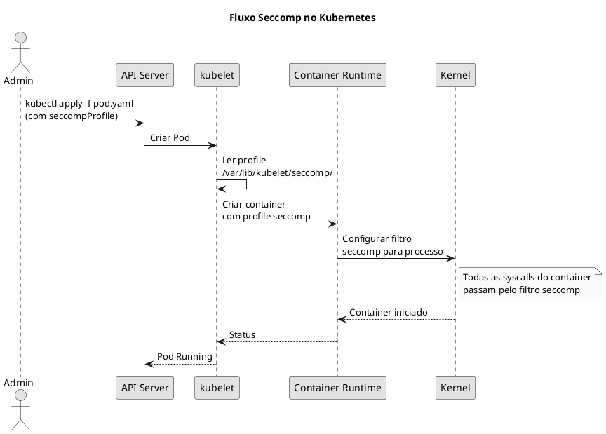

# Seccomp

> **Certificacoes**: CKS (importante para Minimize Microservice Vulnerabilities)

## Conceitos Fundamentais

O **Seccomp** (Secure Computing Mode) e um recurso de seguranca do kernel Linux que restringe as system calls que um processo pode executar. No contexto do Kubernetes, isso permite limitar significativamente a superficie de ataque de containers.

```admonish info title="O que sao System Calls?"
System calls (syscalls) sao a interface entre programas em user space e o kernel. Existem mais de 300 syscalls no Linux, mas a maioria das aplicacoes usa apenas uma fracao delas. Seccomp permite bloquear syscalls desnecessarias.
```



## Tipos de Profiles Seccomp

O Kubernetes suporta tres tipos de profiles Seccomp:

| Tipo | Descricao | Uso |
|------|-----------|-----|
| `RuntimeDefault` | Profile padrao do container runtime | Recomendado para producao |
| `Localhost` | Profile customizado do node | Controle fino de syscalls |
| `Unconfined` | Sem restricoes | Apenas para debug/desenvolvimento |



## RuntimeDefault

O profile `RuntimeDefault` e fornecido pelo container runtime (containerd, CRI-O) e bloqueia syscalls perigosas como:

- `reboot` - Reiniciar o sistema
- `mount` - Montar filesystems
- `setns` - Alterar namespaces
- `ptrace` - Debug de processos
- `kexec_load` - Carregar novo kernel

```yaml
{{#include ../assets/security/seccomp/pod-seccomp-runtimedefault.yaml}}
```

```admonish tip title="Habilitando RuntimeDefault por Padrao"
A partir do Kubernetes 1.27, voce pode habilitar o RuntimeDefault para todos os Pods usando o feature gate `SeccompDefault` no kubelet:

kubelet --seccomp-default=true
```

## Localhost Profile

Profiles customizados permitem controle granular sobre quais syscalls sao permitidas.

### Estrutura do Profile JSON

```json
{
  "defaultAction": "SCMP_ACT_ERRNO",
  "architectures": [
    "SCMP_ARCH_X86_64",
    "SCMP_ARCH_X86",
    "SCMP_ARCH_AARCH64"
  ],
  "syscalls": [
    {
      "names": [
        "read",
        "write",
        "open",
        "close",
        "stat",
        "fstat",
        "mmap",
        "exit_group"
      ],
      "action": "SCMP_ACT_ALLOW"
    }
  ]
}
```

### Acoes Disponiveis

| Acao | Descricao |
|------|-----------|
| `SCMP_ACT_ALLOW` | Permite a syscall |
| `SCMP_ACT_ERRNO` | Retorna erro (EPERM) |
| `SCMP_ACT_KILL` | Mata o processo imediatamente |
| `SCMP_ACT_KILL_PROCESS` | Mata todo o processo |
| `SCMP_ACT_TRAP` | Envia SIGSYS |
| `SCMP_ACT_LOG` | Permite mas loga a syscall |

### Aplicando Profile Localhost

```yaml
{{#include ../assets/security/seccomp/pod-seccomp-localhost.yaml}}
```

```admonish warning title="Caminho do Profile"
O campo `localhostProfile` e relativo ao diretorio `/var/lib/kubelet/seccomp/`. Se o profile estiver em `/var/lib/kubelet/seccomp/profiles/audit.json`, use `profiles/audit.json`.
```

## Criando Profiles Customizados

### Passo 1: Criar o Diretorio no Node

```bash
# Em cada node do cluster
sudo mkdir -p /var/lib/kubelet/seccomp/profiles
```

### Passo 2: Profile de Auditoria

Comece com um profile que apenas loga syscalls para entender o que a aplicacao precisa:

```json
{
  "defaultAction": "SCMP_ACT_LOG"
}
```

Salve em `/var/lib/kubelet/seccomp/profiles/audit.json`.

### Passo 3: Aplicar e Monitorar

```yaml
{{#include ../assets/security/seccomp/pod-seccomp-audit.yaml}}
```

Monitore os logs do sistema:

```bash
# Ver syscalls sendo usadas
sudo tail -f /var/log/syslog | grep -i seccomp

# Ou usando journalctl
sudo journalctl -f | grep -i seccomp

# Ou dmesg
sudo dmesg -w | grep -i seccomp
```

### Passo 4: Criar Profile Restritivo

Baseado na auditoria, crie um profile que permite apenas as syscalls necessarias:

```json
{
  "defaultAction": "SCMP_ACT_ERRNO",
  "architectures": [
    "SCMP_ARCH_X86_64"
  ],
  "syscalls": [
    {
      "names": [
        "accept4", "access", "arch_prctl", "bind", "brk",
        "clone", "close", "connect", "dup2", "epoll_create1",
        "epoll_ctl", "epoll_pwait", "execve", "exit_group",
        "fcntl", "fstat", "futex", "getdents64", "getpid",
        "getrandom", "getsockname", "getsockopt", "ioctl",
        "listen", "lseek", "madvise", "mmap", "mprotect",
        "munmap", "nanosleep", "newfstatat", "openat",
        "pipe2", "pread64", "prlimit64", "read", "readlink",
        "recvfrom", "rt_sigaction", "rt_sigprocmask",
        "rt_sigreturn", "sched_getaffinity", "sched_yield",
        "sendfile", "sendto", "set_robust_list", "set_tid_address",
        "setgid", "setgroups", "setsockopt", "setuid", "sigaltstack",
        "socket", "statfs", "uname", "write", "writev"
      ],
      "action": "SCMP_ACT_ALLOW"
    }
  ]
}
```

## Profiles por Container

Voce pode aplicar profiles diferentes para cada container no mesmo Pod:

```yaml
{{#include ../assets/security/seccomp/pod-seccomp-multi-container.yaml}}
```

## Profile que Bloqueia Syscalls Especificas

Exemplo de profile que bloqueia `chmod`:

```json
{
  "defaultAction": "SCMP_ACT_ALLOW",
  "syscalls": [
    {
      "names": ["chmod", "fchmod", "fchmodat"],
      "action": "SCMP_ACT_ERRNO"
    }
  ]
}
```

```yaml
{{#include ../assets/security/seccomp/pod-seccomp-violation.yaml}}
```

## Comandos Uteis

```bash
# Listar syscalls disponiveis no sistema
ausyscall --dump

# Ver syscalls usadas por um processo
strace -c -p <PID>

# Verificar se seccomp esta habilitado no kernel
grep SECCOMP /boot/config-$(uname -r)

# Ver status do seccomp de um container
kubectl exec <pod> -- cat /proc/1/status | grep -i seccomp

# Criar diretorio para profiles
sudo mkdir -p /var/lib/kubelet/seccomp/profiles

# Copiar profile para o node
scp profile.json node:/var/lib/kubelet/seccomp/profiles/

# Verificar profile aplicado
kubectl get pod <pod> -o jsonpath='{.spec.securityContext.seccompProfile}'
```

## Troubleshooting

### Pod nao Inicia com Profile Localhost

```admonish failure title="Erro: cannot load seccomp profile"
**Causa**: Profile nao existe no path especificado no node.

**Solucao**:
1. Verifique se o arquivo existe em `/var/lib/kubelet/seccomp/<path>`
2. Verifique permissoes do arquivo (deve ser legivel pelo kubelet)
3. Verifique a sintaxe JSON do profile
```

### Aplicacao Morre com SIGKILL

```admonish failure title="Erro: Container killed by signal 31 (SIGSYS)"
**Causa**: Syscall bloqueada pelo profile Seccomp.

**Solucao**:
1. Use profile de auditoria primeiro
2. Identifique a syscall necessaria nos logs
3. Adicione a syscall ao profile
```

### Verificando Status do Seccomp

```bash
# Dentro do container
cat /proc/1/status | grep Seccomp
# Seccomp:        2  (2 = filter mode, 0 = disabled)
# Seccomp_filters: 1

# Ver numero do modo
# 0 - SECCOMP_MODE_DISABLED
# 1 - SECCOMP_MODE_STRICT
# 2 - SECCOMP_MODE_FILTER
```

## Dicas para o Exame CKS

```admonish tip title="Dicas CKS"
1. **Memorize os tipos**: `RuntimeDefault`, `Localhost`, `Unconfined`
2. **Lembre do path**: Profiles Localhost ficam em `/var/lib/kubelet/seccomp/`
3. **Sintaxe**: `securityContext.seccompProfile` pode ser no Pod ou Container level
4. **RuntimeDefault e seguro**: Na duvida, use RuntimeDefault
5. **Auditoria primeiro**: Use `SCMP_ACT_LOG` para descobrir syscalls necessarias
```

## Arquitetura Seccomp no Kubernetes



## Comparacao: Seccomp vs AppArmor vs SELinux

| Caracteristica | Seccomp | AppArmor | SELinux |
|----------------|---------|----------|---------|
| Granularidade | Syscalls | Paths/Capabilities | Labels/Contextos |
| Performance | Alta | Media | Media |
| Complexidade | Media | Media | Alta |
| Padrao no K8s | Sim (RuntimeDefault) | Por profile | Por policy |
| Escopo | Processo | Processo | Sistema |

## Best Practices

1. **Sempre use RuntimeDefault como minimo** - Nunca deixe Pods em producao como Unconfined
2. **Teste profiles em staging** - Profiles muito restritivos podem quebrar aplicacoes
3. **Use auditoria** - Comece com `SCMP_ACT_LOG` para entender a aplicacao
4. **Documente profiles customizados** - Mantenha registro de porque cada syscall e necessaria
5. **Automatize deployment de profiles** - Use DaemonSets ou tools como `security-profiles-operator`

## Recursos Adicionais

- [Kubernetes Seccomp Documentation](https://kubernetes.io/docs/tutorials/security/seccomp/)
- [OCI Runtime Spec - Seccomp](https://github.com/opencontainers/runtime-spec/blob/main/config-linux.md#seccomp)
- [Security Profiles Operator](https://github.com/kubernetes-sigs/security-profiles-operator)


---

### Pod com Seccomp

```yaml
{{#include ../assets/security/seccomp/seccomp-teste.yaml}}
```
