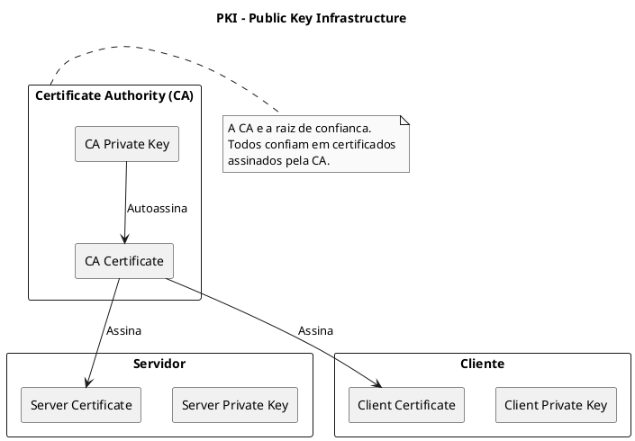
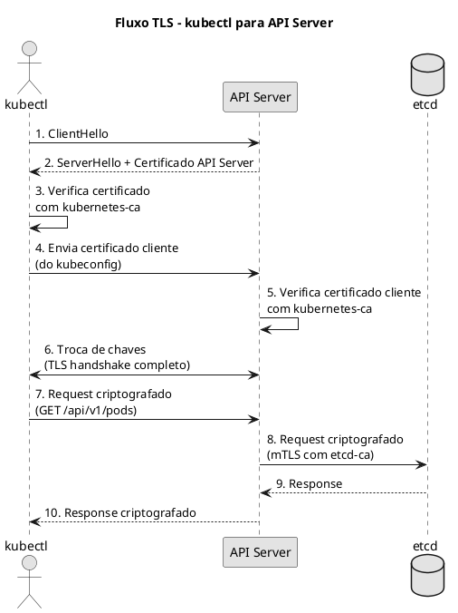

# TLS e Certificados

> **Certificacoes**: CKS (Cluster Hardening), CKA (Cluster Architecture)

## Conceitos Fundamentais

### Criptografia

| Tipo | Descricao | Uso |
|------|-----------|-----|
| **Simetrica** | Mesma chave para criptografar e descriptografar | Comunicacao rapida |
| **Assimetrica** | Chave publica para criptografar, privada para descriptografar | TLS, certificados |

### Convencoes de Nomenclatura

| Extensao | Tipo | Conteudo |
|----------|------|----------|
| `.crt`, `.pem` | Certificado (chave publica) | Pode ser compartilhado |
| `.key`, `*-key.pem` | Chave privada | NUNCA compartilhar |
| `.csr` | Certificate Signing Request | Solicitacao de assinatura |



## PKI do Kubernetes

O Kubernetes utiliza uma infraestrutura PKI complexa onde cada componente possui seus proprios certificados.

```plantuml,format=png
@startuml

skinparam monochrome true
skinparam backgroundColor white
skinparam defaultFontName monospace

title Certificados do Kubernetes

package "Certificate Authorities" {
    rectangle "kubernetes-ca\n/etc/kubernetes/pki/ca.crt" as k8sca #lightblue
    rectangle "etcd-ca\n/etc/kubernetes/pki/etcd/ca.crt" as etcdca #lightgreen
    rectangle "front-proxy-ca\n/etc/kubernetes/pki/front-proxy-ca.crt" as fpca #lightyellow
}

package "API Server Certificates" {
    rectangle "kube-apiserver\n/etc/kubernetes/pki/apiserver.crt" as apiserver
    rectangle "apiserver-kubelet-client\n/etc/kubernetes/pki/apiserver-kubelet-client.crt" as apikubelet
    rectangle "apiserver-etcd-client\n/etc/kubernetes/pki/apiserver-etcd-client.crt" as apietcd
}

package "Control Plane Certificates" {
    rectangle "kube-controller-manager" as kcm
    rectangle "kube-scheduler" as sched
    rectangle "front-proxy-client" as fpc
}

package "etcd Certificates" {
    rectangle "etcd-server\n/etc/kubernetes/pki/etcd/server.crt" as etcdserver
    rectangle "etcd-peer\n/etc/kubernetes/pki/etcd/peer.crt" as etcdpeer
    rectangle "etcd-healthcheck-client" as etcdhc
}

k8sca --> apiserver
k8sca --> apikubelet
k8sca --> kcm
k8sca --> sched

etcdca --> etcdserver
etcdca --> etcdpeer
etcdca --> etcdhc
etcdca --> apietcd

fpca --> fpc

@enduml
```



## Certificados dos Componentes

### Mapeamento Completo

| Componente | Certificado | Chave | CA |
|------------|-------------|-------|-----|
| **API Server** | `/etc/kubernetes/pki/apiserver.crt` | `/etc/kubernetes/pki/apiserver.key` | kubernetes-ca |
| **API Server (etcd client)** | `/etc/kubernetes/pki/apiserver-etcd-client.crt` | `/etc/kubernetes/pki/apiserver-etcd-client.key` | etcd-ca |
| **API Server (kubelet client)** | `/etc/kubernetes/pki/apiserver-kubelet-client.crt` | `/etc/kubernetes/pki/apiserver-kubelet-client.key` | kubernetes-ca |
| **Controller Manager** | Via kubeconfig | Via kubeconfig | kubernetes-ca |
| **Scheduler** | Via kubeconfig | Via kubeconfig | kubernetes-ca |
| **etcd Server** | `/etc/kubernetes/pki/etcd/server.crt` | `/etc/kubernetes/pki/etcd/server.key` | etcd-ca |
| **etcd Peer** | `/etc/kubernetes/pki/etcd/peer.crt` | `/etc/kubernetes/pki/etcd/peer.key` | etcd-ca |
| **kubelet** | `/var/lib/kubelet/pki/kubelet.crt` | `/var/lib/kubelet/pki/kubelet.key` | kubernetes-ca |
| **Front Proxy** | `/etc/kubernetes/pki/front-proxy-client.crt` | `/etc/kubernetes/pki/front-proxy-client.key` | front-proxy-ca |

### Estrutura de Diretorios

```bash
/etc/kubernetes/
├── pki/
│   ├── ca.crt                        # Kubernetes CA
│   ├── ca.key                        # Kubernetes CA (chave privada)
│   ├── apiserver.crt                 # API Server
│   ├── apiserver.key
│   ├── apiserver-kubelet-client.crt  # API Server -> Kubelet
│   ├── apiserver-kubelet-client.key
│   ├── apiserver-etcd-client.crt     # API Server -> etcd
│   ├── apiserver-etcd-client.key
│   ├── front-proxy-ca.crt            # Front Proxy CA
│   ├── front-proxy-ca.key
│   ├── front-proxy-client.crt        # Front Proxy Client
│   ├── front-proxy-client.key
│   ├── sa.key                        # Service Account Key
│   ├── sa.pub                        # Service Account Public Key
│   └── etcd/
│       ├── ca.crt                    # etcd CA
│       ├── ca.key
│       ├── server.crt                # etcd Server
│       ├── server.key
│       ├── peer.crt                  # etcd Peer
│       ├── peer.key
│       ├── healthcheck-client.crt    # Health Check
│       └── healthcheck-client.key
├── admin.conf                        # kubeconfig admin
├── controller-manager.conf           # kubeconfig controller-manager
├── scheduler.conf                    # kubeconfig scheduler
└── kubelet.conf                      # kubeconfig kubelet
```

## Comandos OpenSSL

### Gerar Chave Privada

```bash
# RSA 2048 bits (minimo recomendado)
openssl genrsa -out server.key 2048

# RSA 4096 bits (mais seguro)
openssl genrsa -out server.key 4096

# ECDSA (mais rapido, igualmente seguro)
openssl ecparam -name prime256v1 -genkey -noout -out server.key
```

### Gerar CSR (Certificate Signing Request)

```bash
# CSR simples
openssl req -new -key server.key -out server.csr \
  -subj "/CN=kube-apiserver"

# CSR com multiplos SANs
openssl req -new -key apiserver.key -out apiserver.csr \
  -subj "/CN=kube-apiserver" \
  -config <(cat <<EOF
[req]
req_extensions = v3_req
distinguished_name = req_distinguished_name

[req_distinguished_name]

[v3_req]
basicConstraints = CA:FALSE
keyUsage = nonRepudiation, digitalSignature, keyEncipherment
subjectAltName = @alt_names

[alt_names]
DNS.1 = kubernetes
DNS.2 = kubernetes.default
DNS.3 = kubernetes.default.svc
DNS.4 = kubernetes.default.svc.cluster.local
IP.1 = 10.96.0.1
IP.2 = 192.168.1.100
EOF
)
```

### Assinar Certificado com CA

```bash
# Assinar CSR com CA
openssl x509 -req -in server.csr \
  -CA ca.crt -CAkey ca.key \
  -CAcreateserial \
  -out server.crt \
  -days 365 \
  -extensions v3_req \
  -extfile <(cat <<EOF
[v3_req]
basicConstraints = CA:FALSE
keyUsage = nonRepudiation, digitalSignature, keyEncipherment
subjectAltName = @alt_names

[alt_names]
DNS.1 = kubernetes
DNS.2 = kubernetes.default
IP.1 = 10.96.0.1
EOF
)
```

### Inspecionar Certificados

```bash
# Ver informacoes do certificado
openssl x509 -in cert.crt -text -noout

# Ver apenas o Subject
openssl x509 -in cert.crt -noout -subject

# Ver apenas os SANs
openssl x509 -in cert.crt -noout -ext subjectAltName

# Ver data de expiracao
openssl x509 -in cert.crt -noout -dates

# Ver issuer (quem assinou)
openssl x509 -in cert.crt -noout -issuer

# Verificar se certificado foi assinado pela CA
openssl verify -CAfile ca.crt server.crt
```

### Verificar Chave e Certificado

```bash
# Verificar se chave e certificado combinam
openssl x509 -in server.crt -noout -modulus | openssl md5
openssl rsa -in server.key -noout -modulus | openssl md5
# Os hashes devem ser iguais
```

## kubeadm certs

O `kubeadm` fornece comandos para gerenciar certificados do cluster.

### Verificar Expiracao

```bash
# Ver expiracao de todos os certificados
kubeadm certs check-expiration

# Saida exemplo:
# CERTIFICATE                EXPIRES                  RESIDUAL TIME
# admin.conf                 Jan 09, 2027 00:00 UTC   364d
# apiserver                  Jan 09, 2027 00:00 UTC   364d
# apiserver-etcd-client      Jan 09, 2027 00:00 UTC   364d
# apiserver-kubelet-client   Jan 09, 2027 00:00 UTC   364d
# controller-manager.conf    Jan 09, 2027 00:00 UTC   364d
# etcd-healthcheck-client    Jan 09, 2027 00:00 UTC   364d
# etcd-peer                  Jan 09, 2027 00:00 UTC   364d
# etcd-server                Jan 09, 2027 00:00 UTC   364d
# front-proxy-client         Jan 09, 2027 00:00 UTC   364d
# scheduler.conf             Jan 09, 2027 00:00 UTC   364d
```

### Renovar Certificados

```bash
# Renovar TODOS os certificados
kubeadm certs renew all

# Renovar certificado especifico
kubeadm certs renew apiserver
kubeadm certs renew apiserver-etcd-client
kubeadm certs renew apiserver-kubelet-client
kubeadm certs renew controller-manager.conf
kubeadm certs renew scheduler.conf
kubeadm certs renew admin.conf
kubeadm certs renew etcd-healthcheck-client
kubeadm certs renew etcd-peer
kubeadm certs renew etcd-server
kubeadm certs renew front-proxy-client
```

```admonish warning title="Reiniciar Componentes"
Apos renovar certificados, voce DEVE reiniciar os componentes do control plane:

- Se usando static pods: `mv /etc/kubernetes/manifests/*.yaml /tmp/ && sleep 30 && mv /tmp/*.yaml /etc/kubernetes/manifests/`
- Se usando systemd: `systemctl restart kubelet`
```

### Gerar Novos Certificados

```bash
# Gerar CSR para novo componente
kubeadm certs generate-csr \
  --cert-dir /etc/kubernetes/pki \
  --kubeconfig-dir /etc/kubernetes
```

## Rotacao Automatica de Certificados

### Kubelet Certificate Rotation

O kubelet pode rotacionar seus proprios certificados automaticamente.

```yaml
{{#include ../assets/security/kubeletconfiguration.yaml}}
```

```bash
# Verificar se rotacao esta habilitada
kubectl get nodes -o jsonpath='{range .items[*]}{.metadata.name}{"\t"}{.status.conditions[?(@.type=="Ready")].message}{"\n"}{end}'

# Ver certificados do kubelet
ls -la /var/lib/kubelet/pki/
```

### API Server Certificate Rotation

```admonish info title="Rotacao do API Server"
Os certificados do API Server NAO rotacionam automaticamente. Voce deve:
1. Usar `kubeadm certs renew` antes da expiracao
2. Reiniciar o API Server manualmente
3. Considerar usar external CA para certificados de longa duracao
```

## Fluxo de Comunicacao TLS



## Criando Certificados para Novos Usuarios

### Passo 1: Gerar Chave e CSR

```bash
# Gerar chave privada para o usuario
openssl genrsa -out john.key 2048

# Gerar CSR
openssl req -new -key john.key -out john.csr \
  -subj "/CN=john/O=developers"
```

### Passo 2: Criar CertificateSigningRequest no Kubernetes

```yaml
{{#include ../assets/security/certificatesigningrequest-john-csr.yaml}}
```

```bash
# Codificar CSR em base64
cat john.csr | base64 | tr -d '\n'

# Aplicar o CSR
kubectl apply -f john-csr.yaml
```

### Passo 3: Aprovar o CSR

```bash
# Listar CSRs pendentes
kubectl get csr

# Aprovar o CSR
kubectl certificate approve john-csr

# Ou negar
kubectl certificate deny john-csr
```

### Passo 4: Obter o Certificado

```bash
# Extrair o certificado assinado
kubectl get csr john-csr -o jsonpath='{.status.certificate}' | base64 -d > john.crt
```

### Passo 5: Criar kubeconfig

```bash
# Adicionar ao kubeconfig
kubectl config set-credentials john \
  --client-certificate=john.crt \
  --client-key=john.key

kubectl config set-context john-context \
  --cluster=kubernetes \
  --user=john

kubectl config use-context john-context
```

## Troubleshooting

### Certificado Expirado

```admonish failure title="Erro: x509: certificate has expired"
**Causa**: Certificado passou da data de validade.

**Solucao**:
1. Verificar expiracao: `kubeadm certs check-expiration`
2. Renovar: `kubeadm certs renew all`
3. Reiniciar control plane
```

### Certificado Nao Confiavel

```admonish failure title="Erro: x509: certificate signed by unknown authority"
**Causa**: Certificado nao foi assinado pela CA esperada.

**Solucao**:
1. Verificar CA: `openssl verify -CAfile ca.crt server.crt`
2. Verificar se CA correta esta configurada
3. Regenerar certificado com CA correta
```

### SAN Incorreto

```admonish failure title="Erro: x509: certificate is valid for X, not Y"
**Causa**: O hostname/IP usado nao esta nos SANs do certificado.

**Solucao**:
1. Ver SANs: `openssl x509 -in cert.crt -noout -ext subjectAltName`
2. Regenerar certificado com SANs corretos
```

### Verificar Problemas de Certificado

```bash
# Verificar certificado do API Server
echo | openssl s_client -connect localhost:6443 2>/dev/null | openssl x509 -text

# Verificar certificado do etcd
echo | openssl s_client -connect localhost:2379 -CAfile /etc/kubernetes/pki/etcd/ca.crt 2>/dev/null | openssl x509 -text

# Verificar cadeia de certificados
openssl verify -CAfile /etc/kubernetes/pki/ca.crt /etc/kubernetes/pki/apiserver.crt
```

## Dicas para o Exame CKS/CKA

```admonish tip title="Dicas para o Exame"
1. **Localizacao dos certificados**: Memorize `/etc/kubernetes/pki/`
2. **Verificar expiracao**: `kubeadm certs check-expiration`
3. **Renovar**: `kubeadm certs renew all`
4. **OpenSSL basico**: Saiba usar `openssl x509 -text -noout`
5. **CN e O**: CN = Common Name (usuario), O = Organization (grupo)
6. **CSR API**: Saiba criar e aprovar CertificateSigningRequests
```

## Best Practices

1. **Use certificados de curta duracao** - Prefira 1 ano ou menos
2. **Automatize rotacao** - Configure rotacao automatica no kubelet
3. **Monitore expiracao** - Configure alertas antes da expiracao
4. **Proteja chaves privadas** - Permissoes 600, nunca commitar em Git
5. **Use CAs separadas** - kubernetes-ca, etcd-ca, front-proxy-ca
6. **Documente o processo** - Mantenha runbook de renovacao

## Recursos Adicionais

- [Kubernetes PKI Certificates](https://kubernetes.io/docs/setup/best-practices/certificates/)
- [kubeadm certs](https://kubernetes.io/docs/reference/setup-tools/kubeadm/kubeadm-certs/)
- [Certificate Signing Requests](https://kubernetes.io/docs/reference/access-authn-authz/certificate-signing-requests/)
