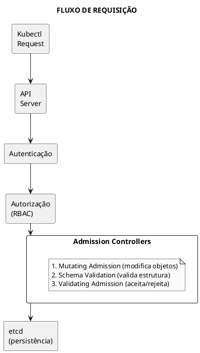
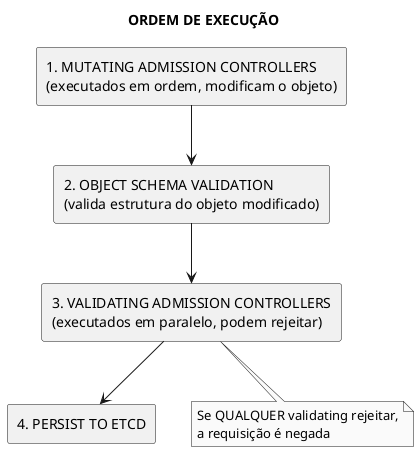
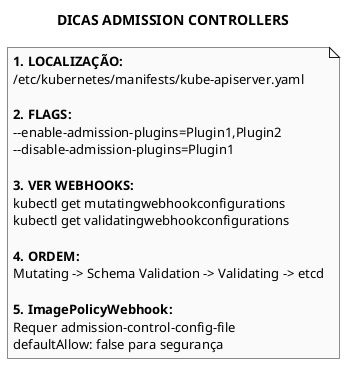

# Admission Controllers

```admonish info title="Certificações"
CKS (30%), CKA (5%)
```

## 📖 Conceitos Fundamentais

### O que são Admission Controllers

**Admission Controllers** são plugins que interceptam requisições ao API Server após autenticação e autorização, mas antes da persistência no etcd. Permitem validar, modificar ou rejeitar objetos.



### Tipos de Admission Controllers

| Tipo | Descrição | Exemplos |
|------|-----------|----------|
| **Mutating** | Modifica o objeto antes de validação | MutatingAdmissionWebhook, DefaultStorageClass |
| **Validating** | Valida e aceita/rejeita sem modificar | ValidatingAdmissionWebhook, PodSecurity |
| **Ambos** | Pode modificar E validar | LimitRanger, ResourceQuota |

### Ordem de Execução



## 📋 Admission Controllers Comuns

### Lista de Controllers Importantes

| Controller | Tipo | Descrição |
|------------|------|-----------|
| **NamespaceLifecycle** | Validating | Impede operações em namespaces sendo deletados |
| **LimitRanger** | Mutating/Validating | Aplica defaults de recursos |
| **ServiceAccount** | Mutating | Injeta service account em pods |
| **DefaultStorageClass** | Mutating | Define storage class padrão |
| **ResourceQuota** | Validating | Valida cotas de recursos |
| **PodSecurity** | Validating | Aplica Pod Security Standards |
| **NodeRestriction** | Validating | Limita o que kubelet pode modificar |
| **MutatingAdmissionWebhook** | Mutating | Chama webhooks externos |
| **ValidatingAdmissionWebhook** | Validating | Chama webhooks externos |

### Controllers Habilitados por Padrão

```bash
# Ver controllers habilitados
kube-apiserver -h | grep enable-admission-plugins

# Default (K8s 1.28+):
# CertificateApproval, CertificateSigning, CertificateSubjectRestriction,
# DefaultIngressClass, DefaultStorageClass, DefaultTolerationSeconds,
# LimitRanger, MutatingAdmissionWebhook, NamespaceLifecycle, NodeRestriction,
# PersistentVolumeClaimResize, PodSecurity, Priority, ResourceQuota,
# RuntimeClass, ServiceAccount, StorageObjectInUseProtection,
# TaintNodesByCondition, ValidatingAdmissionPolicy, ValidatingAdmissionWebhook
```

## 🔧 Habilitar/Desabilitar Controllers

### Configuração no API Server

```yaml
{{#include ../assets/security/hardening/kube-apiserver-admission.yaml}}
```

### Verificar Controllers Ativos

```bash
# Via API Server pod
kubectl exec -n kube-system kube-apiserver-controlplane -- \
  kube-apiserver -h | grep admission

# Via processo
ps aux | grep kube-apiserver | grep admission
```

## 📡 Dynamic Admission Control (Webhooks)

### MutatingAdmissionWebhook

```yaml
{{#include ../assets/security/hardening/mutating-webhook-config.yaml}}
```

### ValidatingAdmissionWebhook

```yaml
{{#include ../assets/security/hardening/validating-webhook-config.yaml}}
```

### Estrutura do AdmissionReview

```json
// Request enviada ao webhook
{
  "apiVersion": "admission.k8s.io/v1",
  "kind": "AdmissionReview",
  "request": {
    "uid": "705ab4f5-6393-11e8-b7cc-42010a800002",
    "kind": {"group":"","version":"v1","kind":"Pod"},
    "resource": {"group":"","version":"v1","resource":"pods"},
    "namespace": "default",
    "operation": "CREATE",
    "object": {
      "apiVersion": "v1",
      "kind": "Pod",
      "metadata": {"name": "my-pod"},
      "spec": { ... }
    },
    "oldObject": null,
    "dryRun": false
  }
}

// Response esperada
{
  "apiVersion": "admission.k8s.io/v1",
  "kind": "AdmissionReview",
  "response": {
    "uid": "705ab4f5-6393-11e8-b7cc-42010a800002",
    "allowed": true,  // ou false para rejeitar
    // Para Mutating - patches em JSONPatch format
    "patchType": "JSONPatch",
    "patch": "W3sib3AiOiJhZGQiLCJwYXRoIjoiL21ldGFkYXRhL2xhYmVscy9pbmplY3RlZCIsInZhbHVlIjoidHJ1ZSJ9XQ==",
    // Para Validating - mensagem de erro
    "status": {
      "code": 403,
      "message": "Image from untrusted registry"
    }
  }
}
```

## 🖼️ ImagePolicyWebhook

### Configuração

```yaml
{{#include ../assets/security/hardening/imagepolicy-admission-config.yaml}}
```

```yaml
{{#include ../assets/security/hardening/imagepolicy-kubeconfig.yaml}}
```

```yaml
{{#include ../assets/security/hardening/kube-apiserver-imagepolicy.yaml}}
```

## 🔍 Troubleshooting

### Webhook não funciona

```bash
# 1. Verificar webhook está registrado
kubectl get mutatingwebhookconfigurations
kubectl get validatingwebhookconfigurations

# 2. Verificar serviço do webhook
kubectl get svc -n webhook-system

# 3. Testar conectividade
kubectl run test --rm -it --image=busybox -- wget -O- https://webhook-service.webhook-system.svc:443/health

# 4. Ver logs do webhook
kubectl logs -n webhook-system deploy/webhook-server

# 5. Verificar certificados
kubectl get secret -n webhook-system webhook-tls -o yaml
```

### Requisição rejeitada

```bash
# Ver motivo no erro
kubectl apply -f pod.yaml 2>&1 | grep -i admission

# Verificar eventos
kubectl get events --field-selector type=Warning

# Testar com dry-run
kubectl apply -f pod.yaml --dry-run=server
```

### Webhook causa timeout

```yaml
{{#include ../assets/security/hardening/webhook-timeout-fix.yaml}}
```

## 💡 Dicas para Exame CKS

### Comandos Essenciais



## 📚 Referências

### Links Internos
- [kube-apiserver](../cluster-components/kube-apiserver.md)
- [Pod Security Admission](pod-security-admission.md)
- [Open Policy Agent](open-policy-agent.md)
- [Supply Chain Security](supply-chain-security.md)

### Documentação Oficial
- [Admission Controllers](https://kubernetes.io/docs/reference/access-authn-authz/admission-controllers/)
- [Dynamic Admission Control](https://kubernetes.io/docs/reference/access-authn-authz/extensible-admission-controllers/)
- [ValidatingAdmissionPolicy](https://kubernetes.io/docs/reference/access-authn-authz/validating-admission-policy/)

---

> **Resumo**: Admission Controllers interceptam requisições após autenticação/autorização. Mutating modifica objetos, Validating aceita/rejeita. Webhooks permitem lógica customizada. Para CKS: habilitar via `--enable-admission-plugins`, ImagePolicyWebhook com `defaultAllow: false`, verificar webhooks com `kubectl get mutatingwebhookconfigurations`.
