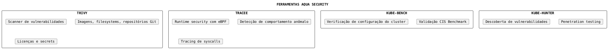
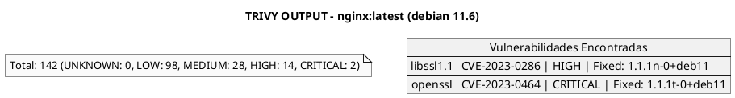
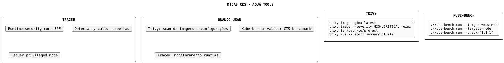

# Aqua Security Tools

## Visão Geral

Aqua Security fornece diversas ferramentas open source para segurança de containers e Kubernetes.



---

## Trivy

### O que é?

Trivy é um scanner de segurança all-in-one para vulnerabilidades, misconfigurações, secrets e licenças.

### Instalação

```bash
# Via apt
sudo apt-get install trivy

# Via brew
brew install trivy

# Via script
curl -sfL https://raw.githubusercontent.com/aquasecurity/trivy/main/contrib/install.sh | sh -s -- -b /usr/local/bin
```

### Scan de Imagens

```bash
# Scan básico
trivy image nginx:latest

# Scan com severidade mínima
trivy image --severity HIGH,CRITICAL nginx:latest

# Output em JSON
trivy image --format json -o results.json nginx:latest

# Ignorar vulnerabilidades não fixadas
trivy image --ignore-unfixed nginx:latest

# Scan de imagem local
trivy image --input myimage.tar
```

### Scan de Filesystem

```bash
# Scan de diretório
trivy fs /path/to/project

# Scan de Dockerfile
trivy config Dockerfile

# Scan de manifestos Kubernetes
trivy config k8s/
```

### Scan de Kubernetes

```bash
# Scan do cluster
trivy k8s --report summary cluster

# Scan de namespace específico
trivy k8s -n production --report summary

# Scan com saída detalhada
trivy k8s --report all
```

### Saída do Trivy



---

## Tracee

### O que é?

Tracee é uma ferramenta de runtime security que usa eBPF para detectar comportamentos suspeitos em tempo real.

### Execução com Docker

```bash
# Modo básico
docker run --name tracee -it --rm \
  --pid=host \
  --cgroupns=host \
  --privileged \
  -v /etc/os-release:/etc/os-release-host:ro \
  -v /var/run:/var/run:ro \
  aquasec/tracee:latest

# Com filtros específicos
docker run --name tracee -it --rm \
  --pid=host \
  --cgroupns=host \
  --privileged \
  -v /etc/os-release:/etc/os-release-host:ro \
  -v /var/run:/var/run:ro \
  aquasec/tracee:latest \
  --filter event=execve
```

### Deploy no Kubernetes

```yaml
{{#include ../assets/aqua-security/tracee-daemonset.yaml}}
```

### Eventos Detectados

| Evento | Descrição |
|--------|-----------|
| `execve` | Execução de processo |
| `open` | Abertura de arquivo |
| `write` | Escrita em arquivo |
| `connect` | Conexão de rede |
| `ptrace` | Debugging de processo |
| `security_file_open` | Acesso a arquivo sensível |

---

## Kube-bench

### O que é?

Kube-bench verifica se o cluster Kubernetes está configurado de acordo com o CIS Kubernetes Benchmark.

### Instalação

```bash
# Download do binário
curl -L https://github.com/aquasecurity/kube-bench/releases/download/v0.6.15/kube-bench_0.6.15_linux_amd64.tar.gz -o kube-bench.tar.gz
tar -xvf kube-bench.tar.gz
```

### Execução

```bash
# Executar no control plane
sudo ./kube-bench run --targets=master

# Executar em worker node
sudo ./kube-bench run --targets=node

# Verificar check específico
sudo ./kube-bench run --targets=master --check="1.1.1,1.1.2"

# Output em JSON
sudo ./kube-bench run --json --json-output results.json
```

### Execução como Job no Kubernetes

```yaml
{{#include ../assets/aqua-security/kube-bench-job.yaml}}
```

### Saída do Kube-bench

```plaintext
[INFO] 1 Master Node Security Configuration
[INFO] 1.1 Master Node Configuration Files
[PASS] 1.1.1 Ensure that the API server pod specification file permissions are set to 644
[FAIL] 1.1.2 Ensure that the API server pod specification file ownership is set to root:root
[WARN] 1.1.3 Ensure that the controller manager pod specification file permissions are set to 644

== Summary ==
45 checks PASS
10 checks FAIL
5 checks WARN
```

---

## Kube-hunter

### O que é?

Kube-hunter é uma ferramenta de penetration testing para clusters Kubernetes.

### Execução

```bash
# Como container
docker run -it --rm aquasec/kube-hunter

# Modo network scan
docker run -it --rm aquasec/kube-hunter --remote <IP>

# Modo interno (de dentro do cluster)
kubectl run kube-hunter --image=aquasec/kube-hunter -- --pod
```

### Vulnerabilidades Detectadas

| Categoria | Exemplo |
|-----------|---------|
| Information Disclosure | API Server acessível anonimamente |
| Remote Code Execution | Exec habilitado em pods |
| Privilege Escalation | Service account com permissões excessivas |
| Access to Sensitive Data | Secrets expostos |

---

## Integração em CI/CD

### Exemplo com GitHub Actions

```yaml
{{#include ../assets/aqua-security/trivy-github-action.yaml}}
```

---

## Dicas para o Exame CKS



---

## Referências

- [Supply Chain Security](supply-chain-security.md)
- [CIS Benchmark](cis-benchmark.md)
- [Monitoring Logging](monitoring-logging.md)
- [Runtime Classes](runtime-classes.md)
