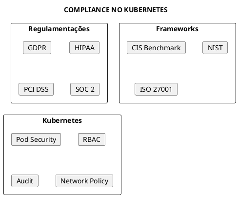
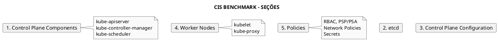
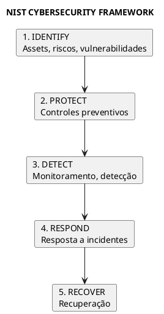
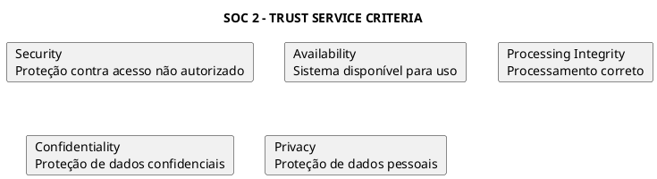
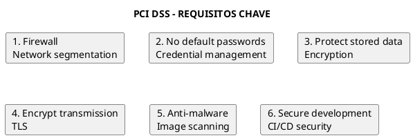
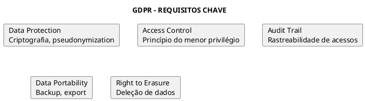
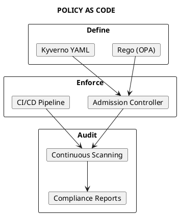
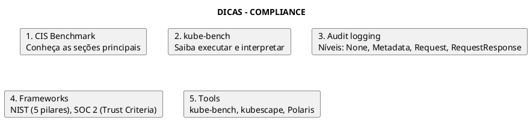

# Compliance e Security Frameworks

```admonish info title="Certificações"
KCSA (10%), CKS (5%)
```

## Conceitos Fundamentais

### O que é Compliance?

Compliance é o conjunto de práticas para garantir que uma organização siga regulamentações, padrões e políticas de segurança aplicáveis.



### Por que Compliance é Importante?

- **Legal**: Evitar multas e penalidades
- **Confiança**: Demonstrar segurança para clientes
- **Risco**: Reduzir exposição a ataques
- **Governança**: Controle e visibilidade

---

## CIS Kubernetes Benchmark

### O que é o CIS Benchmark?

O Center for Internet Security (CIS) publica benchmarks de configuração segura para diversas plataformas, incluindo Kubernetes.



### Níveis do CIS Benchmark

| Nível | Descrição | Impacto |
|-------|-----------|---------|
| **Level 1** | Configurações básicas de segurança | Baixo impacto operacional |
| **Level 2** | Configurações avançadas | Pode impactar funcionalidade |

### kube-bench

Ferramenta para verificar conformidade com CIS Benchmark.

```bash
# Executar kube-bench (como container)
docker run --pid=host -v /etc:/etc:ro -v /var:/var:ro \
  -t aquasec/kube-bench:latest run --targets=master

# Como Job no cluster
kubectl apply -f https://raw.githubusercontent.com/aquasecurity/kube-bench/main/job.yaml

# Ver resultados
kubectl logs -l app=kube-bench

# Targets específicos
kube-bench run --targets=node
kube-bench run --targets=etcd
kube-bench run --targets=controlplane
kube-bench run --targets=policies
```

### Exemplos de Verificações CIS

#### 1.1 - API Server

```yaml
{{#include ../assets/security/compliance-example-1.yaml}}
```

#### 1.2 - etcd

```yaml
{{#include ../assets/security/compliance-example-2.yaml}}
```

#### 4.1 - Worker Nodes (kubelet)

```yaml
{{#include ../assets/security/compliance-example-3.yaml}}
```

---

## NIST Cybersecurity Framework

### Os Cinco Pilares



### Mapeamento para Kubernetes

| Pilar | Controles K8s |
|-------|---------------|
| **Identify** | Asset inventory, RBAC audit, vulnerability scanning |
| **Protect** | RBAC, Network Policy, Pod Security, Encryption |
| **Detect** | Audit logs, Falco, monitoring, alerting |
| **Respond** | Incident response, pod isolation, RBAC revoke |
| **Recover** | Backup/restore, disaster recovery |

---

## SOC 2

### Trust Service Criteria



### Controles K8s para SOC 2

| Critério | Controles Kubernetes |
|----------|---------------------|
| **Security** | RBAC, Network Policy, Pod Security, Audit |
| **Availability** | HA control plane, PDB, HPA, multi-zone |
| **Processing Integrity** | Admission controllers, validation |
| **Confidentiality** | Encryption, Secrets management |
| **Privacy** | Data isolation, RBAC, audit logging |

---

## PCI DSS

### Requisitos Principais

Para ambientes que processam dados de cartão de crédito.



### Implementação em Kubernetes

| Requisito PCI | Implementação K8s |
|---------------|-------------------|
| **Network segmentation** | Network Policies, namespaces |
| **Access control** | RBAC, ServiceAccounts |
| **Encryption** | TLS, encryption at rest, secrets |
| **Logging** | Audit logs, centralized logging |
| **Vulnerability management** | Image scanning, admission policies |

---

## HIPAA

### Requisitos para Dados de Saúde

| Requisito | Implementação K8s |
|-----------|-------------------|
| **Access controls** | RBAC granular |
| **Audit controls** | Audit logging habilitado |
| **Integrity** | Image signing, admission control |
| **Transmission security** | mTLS, Network Policy |
| **Encryption** | Encryption at rest |

---

## GDPR

### Requisitos para Dados Pessoais (EU)



### Implementação em Kubernetes

| Requisito | Controle K8s |
|-----------|--------------|
| **Data Protection** | Encryption at rest, secrets management |
| **Access Control** | RBAC, namespaces, Network Policy |
| **Audit Trail** | Audit logs, Falco |
| **Breach Notification** | Alerting, incident response |

---

## Ferramentas de Compliance

### Scanning e Validação

| Ferramenta | Função | Framework |
|------------|--------|-----------|
| **kube-bench** | CIS Benchmark scanning | CIS |
| **kubescape** | Multi-framework scanning | NSA, MITRE, CIS |
| **Polaris** | Best practices validation | Custom |
| **Starboard** | Security reports | Multiple |
| **Trivy** | Vulnerability + config scan | Multiple |

### kubescape

```bash
# Instalar kubescape
curl -s https://raw.githubusercontent.com/kubescape/kubescape/master/install.sh | /bin/bash

# Scan com NSA framework
kubescape scan framework nsa

# Scan com CIS Benchmark
kubescape scan framework cis-v1.23-t1.0.1

# Scan específico de namespace
kubescape scan framework nsa --include-namespaces production

# Export HTML report
kubescape scan framework nsa --format html --output report.html
```

### Polaris

```bash
# Instalar Polaris
kubectl apply -f https://github.com/FairwindsOps/polaris/releases/latest/download/dashboard.yaml

# Acessar dashboard
kubectl port-forward -n polaris svc/polaris-dashboard 8080:80

# CLI scan
polaris audit --audit-path ./manifests/
```

---

## Audit Logging

### Configuração de Audit

```yaml
{{#include ../assets/security/policy-1.yaml}}
```

### Níveis de Audit

| Nível | O que registra |
|-------|----------------|
| **None** | Nada |
| **Metadata** | Request metadata (user, timestamp, resource) |
| **Request** | Metadata + request body |
| **RequestResponse** | Metadata + request + response bodies |

### Habilitar Audit no API Server

```yaml
{{#include ../assets/security/compliance-example-5.yaml}}
```

---

## Compliance as Code

### Policy as Code



### OPA/Gatekeeper Policy

```yaml
{{#include ../assets/security/constrainttemplate-k8srequiredlabels.yaml}}
```

### Kyverno Policy

```yaml
{{#include ../assets/security/clusterpolicy-require-labels.yaml}}
```

---

## Relatórios de Compliance

### Gerando Evidências

```bash
# Exportar RBAC atual
kubectl get roles,rolebindings,clusterroles,clusterrolebindings -A -o yaml > rbac-export.yaml

# Exportar Network Policies
kubectl get networkpolicies -A -o yaml > networkpolicies.yaml

# Exportar Pod Security
kubectl get pods -A -o jsonpath='{range .items[*]}{.metadata.namespace}/{.metadata.name}: {.spec.securityContext}{"\n"}{end}'

# Audit logs (se habilitado)
cat /var/log/kubernetes/audit.log | jq .
```

### Dashboard de Compliance

```bash
# Starboard operator
kubectl apply -f https://raw.githubusercontent.com/aquasecurity/starboard/main/deploy/static/starboard.yaml

# Ver relatórios
kubectl get vulnerabilityreports -A
kubectl get configauditreports -A
kubectl get ciskubebenchreports -A
```

---

## Dicas para o Exame



### Conceitos-Chave

| Conceito | Lembrar |
|----------|---------|
| **CIS Benchmark** | L1 = básico, L2 = avançado |
| **kube-bench** | Ferramenta para validar CIS |
| **NIST** | Identify, Protect, Detect, Respond, Recover |
| **Audit levels** | None < Metadata < Request < RequestResponse |
| **Policy as Code** | OPA/Gatekeeper, Kyverno |

---

## Referências

### Documentação
- [CIS Benchmarks](https://www.cisecurity.org/benchmark/kubernetes)
- [NIST Cybersecurity Framework](https://www.nist.gov/cyberframework)
- [Kubernetes Audit](https://kubernetes.io/docs/tasks/debug/debug-cluster/audit/)

### Arquivos Relacionados
- [CIS Benchmark](cis-benchmark.md)
- [Audit](audit.md)
- [RBAC](rbac.md)
- [Pod Security Admission](pod-security-admission.md)
- [Open Policy Agent](open-policy-agent.md)
- [KCSA](../certifications/kcsa.md)
