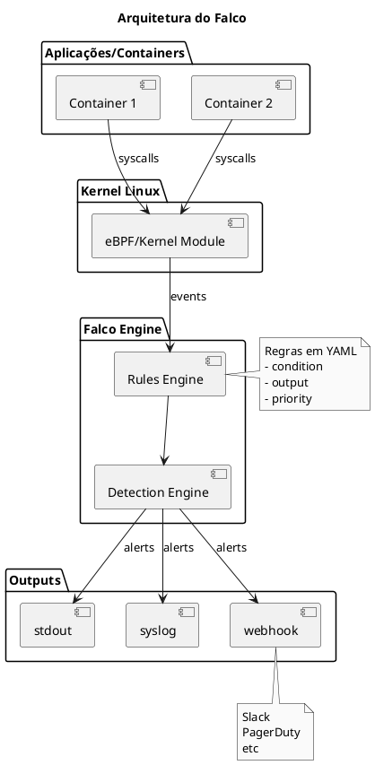

# Falco - Runtime Security

<span class="badge badge-cks">CKS</span>

---

## O que é Falco?

```admonish info title="Falco"
Falco é uma ferramenta de runtime security da CNCF que detecta comportamentos anômalos e ameaças em containers e hosts em tempo real, usando syscalls do kernel Linux.
```

### Características

| Aspecto | Descrição |
|---------|-----------|
| **Tipo** | Runtime threat detection |
| **Nível** | Syscalls do kernel |
| **Projeto** | CNCF Graduated |
| **Uso** | Detecção de ameaças em tempo real |

### Arquitetura



---

## Instalação

### Via Helm (Recomendado)

```bash
# Adicionar repositório
helm repo add falcosecurity https://falcosecurity.github.io/charts
helm repo update

# Instalar Falco
helm install falco falcosecurity/falco \
  --namespace falco \
  --create-namespace \
  --set driver.kind=ebpf \
  --set falcosidekick.enabled=true

# Verificar instalação
kubectl get pods -n falco
```

### Via DaemonSet (Manual)

```yaml
{{#include ../assets/falco/daemonset.yaml}}
```

---

## Regras do Falco

### Estrutura de uma Regra

```yaml
{{#include ../assets/falco/rule-estrutura.yaml}}
```

### Exemplo: Detectar Shell em Container

```yaml
{{#include ../assets/falco/rule-terminal-shell.yaml}}
```

### Exemplo: Detectar Escrita em /etc

```yaml
{{#include ../assets/falco/rule-write-etc.yaml}}
```

### Exemplo: Detectar Acesso a Secrets

```yaml
{{#include ../assets/falco/rule-sensitive-files.yaml}}
```

---

## Macros e Listas

### Macros (Condições Reutilizáveis)

```yaml
{{#include ../assets/falco/macros.yaml}}
```

### Listas

```yaml
{{#include ../assets/falco/lists.yaml}}
```

---

## Regras Comuns para CKS

### Detectar Container Privilegiado

```yaml
{{#include ../assets/falco/rule-privileged-container.yaml}}
```

### Detectar Crypto Mining

```yaml
{{#include ../assets/falco/rule-crypto-mining.yaml}}
```

### Detectar Reverse Shell

```yaml
{{#include ../assets/falco/rule-reverse-shell.yaml}}
```

---

## Integração com Kubernetes Audit

### Configurar API Server

```yaml
{{#include ../assets/falco/kube-apiserver-audit.yaml}}
```

### Webhook Config para Falco

```yaml
{{#include ../assets/falco/audit-webhook.yaml}}
```

### Regras de Audit no Falco

```yaml
{{#include ../assets/falco/rule-k8s-secret-access.yaml}}
```

```yaml
{{#include ../assets/falco/rule-k8s-pod-exec.yaml}}
```

---

## Falcosidekick - Alertas

### Configurar Outputs

```yaml
{{#include ../assets/falco/falcosidekick-values.yaml}}
```

### Outputs Disponíveis

| Output | Uso |
|--------|-----|
| Slack | Notificações de equipe |
| PagerDuty | Alertas críticos |
| Elasticsearch | Análise de logs |
| Prometheus | Métricas |
| Loki | Logs agregados |
| AWS CloudWatch | Cloud AWS |
| Webhook | Integração customizada |

---

## Comandos Úteis

```bash
# Ver logs do Falco
kubectl logs -n falco -l app=falco -f

# Ver regras ativas
kubectl exec -n falco -it <falco-pod> -- falco --list

# Testar regra
kubectl exec -n falco -it <falco-pod> -- \
  falco -r /etc/falco/falco_rules.yaml --dry-run

# Validar configuração
kubectl exec -n falco -it <falco-pod> -- \
  falco --validate /etc/falco/falco.yaml

# Carregar novas regras
kubectl create configmap falco-rules \
  --from-file=custom_rules.yaml \
  -n falco
```

---

## Troubleshooting

### Falco não inicia

```bash
# Verificar driver
kubectl exec -n falco -it <falco-pod> -- \
  ls /sys/module/falco

# Verificar logs
kubectl logs -n falco <falco-pod> --previous

# Problemas comuns:
# - Kernel headers não instalados
# - Driver incompatível com kernel
# - Usar driver eBPF em vez de kernel module
```

### Muitos falsos positivos

```yaml
# Criar exceção
- rule: Terminal shell in container
  append: true
  condition: and not container.image.repository = "debug-image"
```

### Performance

```yaml
# Limitar syscalls monitorados
syscall_event_drops:
  actions:
    - log
  rate: 0.03333
  max_burst: 1000
```

---

## Dicas para o Exame CKS

```admonish tip title="Dicas CKS - Falco"
1. **Instalação**: Saiba instalar via Helm ou DaemonSet
2. **Regras**: Entenda a estrutura (condition, output, priority)
3. **Macros**: Saiba usar macros para condições comuns
4. **Audit integration**: Saiba configurar webhook do API Server
5. **Outputs**: Conheça as opções de alertas
```

### Cenários Comuns no Exame

1. **Instalar Falco** no cluster
2. **Criar regra customizada** para detectar comportamento específico
3. **Integrar com Kubernetes Audit** via webhook
4. **Analisar alertas** e identificar ameaças

---

## Referências

- [Falco Documentation](https://falco.org/docs/)
- [Falco Rules Reference](https://falco.org/docs/rules/supported-fields/)
- [Audit](audit.md) - Kubernetes Audit Logging
- [Monitoring Logging](monitoring-logging.md) - Monitoramento e Logging
