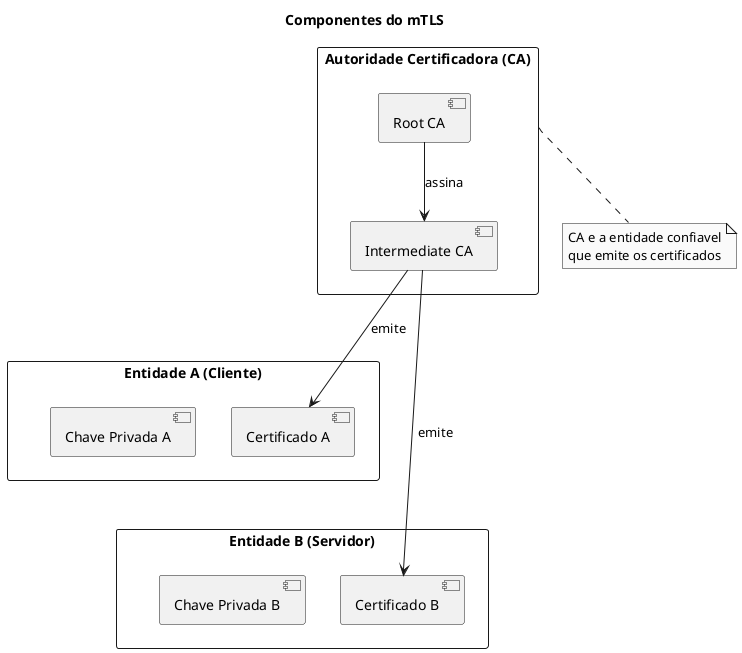
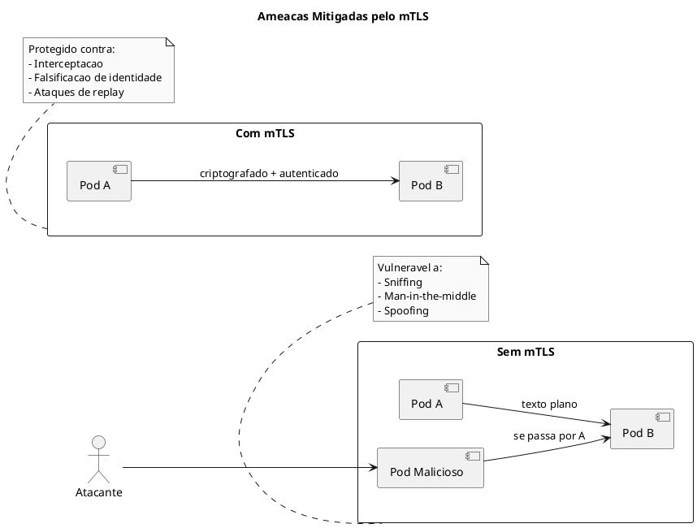
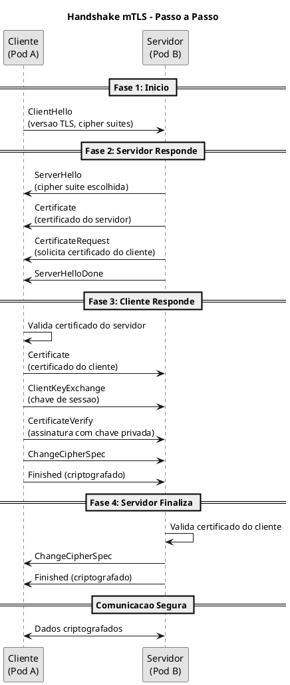
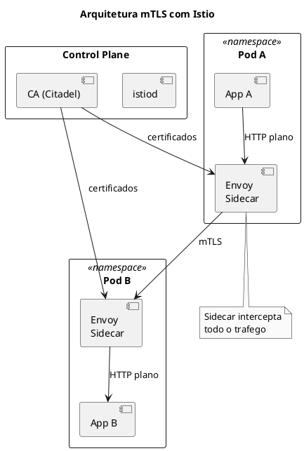
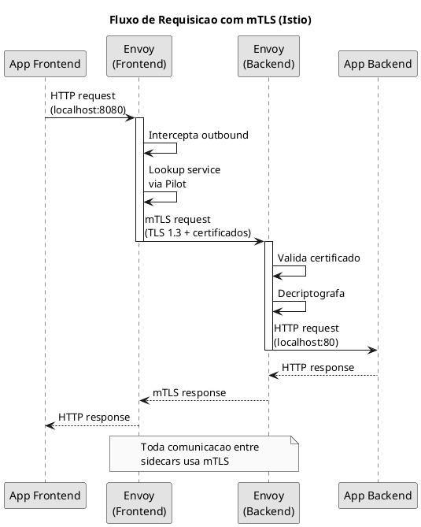
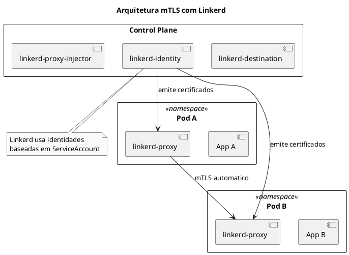
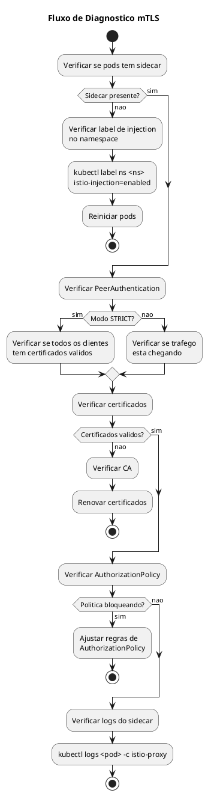
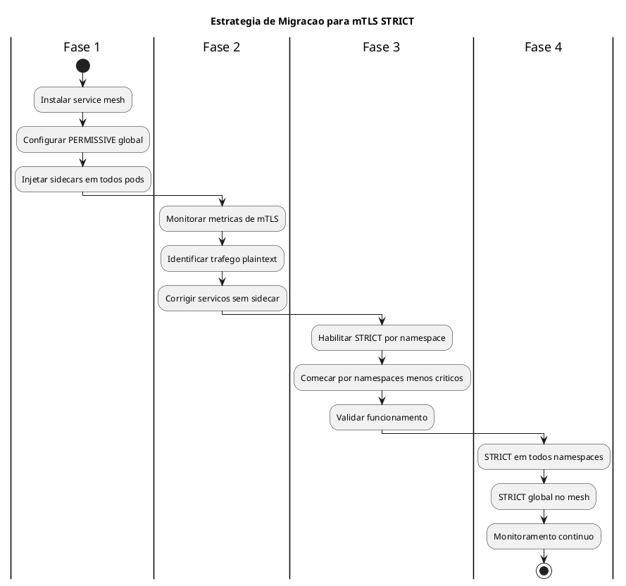

# mTLS (Mutual TLS)

> **Certificacoes**: CKS (Cluster Hardening, System Hardening)

O mTLS (mutual TLS ou TLS mutuo) e um mecanismo de seguranca que garante autenticacao bidirecional entre cliente e servidor. Diferente do TLS tradicional, onde apenas o servidor apresenta um certificado, no mTLS ambas as partes devem apresentar e validar certificados, garantindo que a comunicacao ocorra apenas entre entidades autorizadas.

## Indice

- [Conceitos Fundamentais](#conceitos-fundamentais)
- [Por que mTLS e Importante](#por-que-mtls-e-importante)
- [Como Funciona a Autenticacao Mutua](#como-funciona-a-autenticacao-mutua)
- [Implementacao com Istio](#implementacao-com-istio)
- [Implementacao com Linkerd](#implementacao-com-linkerd)
- [Implementacao com Cilium](#implementacao-com-cilium)
- [Implementacao Manual](#implementacao-manual)
- [Comandos Uteis](#comandos-uteis)
- [Troubleshooting](#troubleshooting)
- [Dicas para o Exame CKS](#dicas-para-o-exame-cks)
- [Referencias](#referencias)

---

## Conceitos Fundamentais

### O que e mTLS?

mTLS (mutual TLS) e uma extensao do protocolo TLS onde:

1. **TLS Tradicional**: Apenas o servidor apresenta certificado ao cliente
2. **mTLS**: Tanto cliente quanto servidor apresentam certificados um ao outro

```admonish info title="Diferenca entre TLS e mTLS"
- **TLS**: Cliente verifica servidor (ex: navegador verificando site HTTPS)
- **mTLS**: Cliente e servidor verificam um ao outro (comunicacao pod-to-pod)
```

### Componentes do mTLS



### Terminologia Importante

| Termo | Descricao |
|-------|-----------|
| **CA (Certificate Authority)** | Entidade que emite e assina certificados |
| **Root CA** | CA raiz, topo da cadeia de confianca |
| **Intermediate CA** | CA intermediaria, assina certificados de entidades finais |
| **Certificate** | Documento digital que vincula identidade a chave publica |
| **Private Key** | Chave secreta usada para decriptografia e assinatura |
| **CSR** | Certificate Signing Request - requisicao de assinatura |
| **SPIFFE** | Framework de identidade para workloads |
| **SVID** | SPIFFE Verifiable Identity Document |

---

## Por que mTLS e Importante

### Ameacas que mTLS Mitiga



### Beneficios de Seguranca

1. **Confidencialidade**: Dados criptografados em transito
2. **Integridade**: Deteccao de alteracoes nos dados
3. **Autenticacao**: Verificacao de identidade bidirecional
4. **Nao-Repudio**: Prova criptografica de comunicacao

### Modelo Zero Trust

```admonish tip title="Zero Trust e mTLS"
O mTLS e fundamental para implementar **Zero Trust** em Kubernetes:
- Nunca confiar, sempre verificar
- Toda comunicacao deve ser autenticada
- Menor privilegio possivel
- Assumir que a rede esta comprometida
```

---

## Como Funciona a Autenticacao Mutua

### Handshake mTLS



### Validacao de Certificados

Durante o handshake, cada parte verifica:

1. **Cadeia de Confianca**: Certificado assinado por CA confiavel
2. **Validade**: Certificado nao expirado
3. **Revogacao**: Certificado nao revogado (CRL/OCSP)
4. **Identidade**: Subject/SAN corresponde a entidade esperada

```admonish warning title="Importante para o Exame"
No CKS, voce deve entender que a **validacao da cadeia de certificados** e crucial.
Se a CA nao for confiavel por ambas as partes, o handshake falha.
```

---

## Implementacao com Istio

O Istio e a forma mais comum de implementar mTLS em Kubernetes, usando um **sidecar proxy (Envoy)** que intercepta todo o trafego.

### Arquitetura Istio mTLS



### Habilitando Istio Injection

```yaml
{{#include ../assets/security/namespace-secure-app.yaml}}
```

### Modos de mTLS no Istio

| Modo | Descricao | Uso |
|------|-----------|-----|
| **STRICT** | Aceita apenas mTLS | Producao |
| **PERMISSIVE** | Aceita mTLS e texto plano | Migracao |
| **DISABLE** | Desabilita mTLS | Debug |

### PeerAuthentication - Nivel Mesh

```yaml
{{#include ../assets/certificates/istio-peerauthentication-mesh.yaml}}
```

Este recurso habilita mTLS STRICT para **todo o mesh** quando aplicado no namespace `istio-system`.

### PeerAuthentication - Nivel Namespace

```yaml
{{#include ../assets/certificates/istio-peerauthentication-namespace.yaml}}
```

### PeerAuthentication - Nivel Workload

```yaml
{{#include ../assets/certificates/istio-peerauthentication-workload.yaml}}
```

### PeerAuthentication - Modo Permissivo (Migracao)

```yaml
{{#include ../assets/certificates/istio-peerauthentication-permissive.yaml}}
```

```admonish tip title="Estrategia de Migracao"
1. Comece com modo **PERMISSIVE** em todo o mesh
2. Verifique se todos os servicos tem sidecar
3. Monitore metricas de trafego mTLS vs plaintext
4. Mude para **STRICT** namespace por namespace
```

### DestinationRule para mTLS

```yaml
{{#include ../assets/certificates/istio-destinationrule-mtls.yaml}}
```

### Exemplo Completo com Istio

```yaml
{{#include ../assets/certificates/istio-secure-app-example.yaml}}
```

### Fluxo de Comunicacao com Istio



---

## Implementacao com Linkerd

Linkerd e uma alternativa mais leve ao Istio, com mTLS habilitado **por padrao**.

### Arquitetura Linkerd



### Instalacao do Linkerd

```bash
# Instalar CLI
curl -sL https://run.linkerd.io/install | sh

# Verificar pre-requisitos
linkerd check --pre

# Instalar CRDs
linkerd install --crds | kubectl apply -f -

# Instalar control plane
linkerd install | kubectl apply -f -

# Verificar instalacao
linkerd check
```

### Habilitando mTLS com Linkerd

```yaml
{{#include ../assets/security/namespace-secure-app-1.yaml}}
```

### Verificando mTLS no Linkerd

```bash
# Ver estado do mTLS
linkerd viz edges deployment -n secure-app

# Dashboard (se instalado)
linkerd viz dashboard
```

### Exemplo de Deployment com Linkerd

```yaml
{{#include ../assets/deployment/deployment-web-app.yaml}}
```

```admonish info title="Linkerd vs Istio"
- **Linkerd**: Mais simples, mTLS por padrao, menor footprint
- **Istio**: Mais recursos, maior complexidade, mais configuravel
```

---

## Implementacao com Cilium

Cilium oferece mTLS atraves do recurso **CiliumNetworkPolicy** com autenticacao.

### mTLS com Cilium

```yaml
{{#include ../assets/cilium/ciliumnetworkpolicy-mtls.yaml}}
```

### Habilitando Mutual Authentication no Cilium

```bash
# Habilitar mutual authentication via Helm
helm upgrade cilium cilium/cilium \
  --namespace kube-system \
  --set authentication.mutual.spire.enabled=true \
  --set authentication.mutual.spire.install.enabled=true
```

```admonish note title="Cilium e SPIRE"
O Cilium usa SPIRE (SPIFFE Runtime Environment) para gerenciar identidades
e certificados, implementando mTLS de forma transparente.
```

---

## Implementacao Manual

Para cenarios onde service mesh nao e uma opcao, voce pode implementar mTLS manualmente.

### Gerando Certificados com OpenSSL

```bash
# 1. Criar CA
openssl genrsa -out ca.key 4096
openssl req -new -x509 -days 365 -key ca.key -out ca.crt \
  -subj "/CN=My CA/O=MyOrg"

# 2. Criar chave e CSR para servico
openssl genrsa -out server.key 2048
openssl req -new -key server.key -out server.csr \
  -subj "/CN=my-service.default.svc.cluster.local/O=MyOrg"

# 3. Assinar certificado do servico
openssl x509 -req -in server.csr -CA ca.crt -CAkey ca.key \
  -CAcreateserial -out server.crt -days 365

# 4. Criar certificado para cliente
openssl genrsa -out client.key 2048
openssl req -new -key client.key -out client.csr \
  -subj "/CN=my-client/O=MyOrg"
openssl x509 -req -in client.csr -CA ca.crt -CAkey ca.key \
  -CAcreateserial -out client.crt -days 365
```

### Criando Secrets com Certificados

```bash
# Secret para o servidor
kubectl create secret generic server-tls \
  --from-file=tls.crt=server.crt \
  --from-file=tls.key=server.key \
  --from-file=ca.crt=ca.crt

# Secret para o cliente
kubectl create secret generic client-tls \
  --from-file=tls.crt=client.crt \
  --from-file=tls.key=client.key \
  --from-file=ca.crt=ca.crt
```

### Pod com Certificados Montados

```yaml
{{#include ../assets/certificates/pod-mtls-certs.yaml}}
```

### Configuracao de Aplicacao para mTLS

```yaml
{{#include ../assets/deployment/deployment-secure-server.yaml}}
```

### Usando cert-manager para Automacao

```yaml
{{#include ../assets/security/issuer-mtls-issuer.yaml}}
```

---

## Comandos Uteis

### Verificacao de mTLS com Istio

```bash
# Verificar se mTLS esta habilitado
istioctl x authz check <pod-name> -n <namespace>

# Ver configuracao de mTLS
kubectl get peerauthentication -A

# Ver DestinationRules
kubectl get destinationrule -A

# Analisar configuracao do proxy
istioctl proxy-config secret <pod-name> -n <namespace>

# Ver certificados do sidecar
istioctl proxy-config secret <pod-name> -n <namespace> -o json | \
  jq '.dynamicActiveSecrets[0].secret.tlsCertificate.certificateChain.inlineBytes' -r | \
  base64 -d | openssl x509 -text -noout

# Verificar metricas de mTLS
kubectl exec -n istio-system deploy/prometheus -- \
  curl -s 'localhost:9090/api/v1/query?query=istio_tcp_connections_opened_total'
```

### Verificacao de mTLS com Linkerd

```bash
# Verificar conexoes mTLS
linkerd viz edges deployment -n <namespace>

# Ver estado do proxy
linkerd viz stat deploy -n <namespace>

# Verificar identidade
linkerd viz authz -n <namespace>
```

### Debug de Certificados

```bash
# Ver certificado de um pod
kubectl exec <pod> -- cat /etc/certs/tls.crt | openssl x509 -text -noout

# Verificar cadeia de certificados
openssl verify -CAfile ca.crt server.crt

# Testar conexao mTLS
openssl s_client -connect <host>:443 \
  -cert client.crt -key client.key -CAfile ca.crt

# Ver expiracao de certificado
kubectl exec <pod> -- cat /etc/certs/tls.crt | \
  openssl x509 -enddate -noout
```

---

## Troubleshooting

### Problemas Comuns

```admonish warning title="Erro: connection reset by peer"
**Causa**: mTLS STRICT habilitado, mas cliente nao tem sidecar.

**Solucao**:
1. Verificar se namespace tem label de injection
2. Usar modo PERMISSIVE temporariamente
3. Adicionar sidecar ao pod cliente
```

```admonish warning title="Erro: certificate verify failed"
**Causa**: CA diferente entre cliente e servidor.

**Solucao**:
1. Verificar se ambos usam mesma CA
2. Checar validade dos certificados
3. Verificar se certificado nao foi revogado
```

```admonish warning title="Erro: RBAC: access denied"
**Causa**: AuthorizationPolicy bloqueando trafego.

**Solucao**:
1. Verificar AuthorizationPolicy com `istioctl authz check`
2. Checar se principal do cliente esta autorizado
3. Revisar regras de RBAC
```

### Fluxo de Diagnostico



### Comandos de Debug

```bash
# Ver logs do sidecar (Istio)
kubectl logs <pod> -c istio-proxy -f

# Ver configuracao do proxy
istioctl proxy-config all <pod> -n <namespace>

# Verificar se mTLS esta ativo na conexao
kubectl exec <pod> -c istio-proxy -- \
  curl -s localhost:15000/stats | grep ssl

# Debug com tcpdump (verificar se trafego esta criptografado)
kubectl debug -it <pod> --image=nicolaka/netshoot -- \
  tcpdump -i eth0 -w /tmp/capture.pcap

# Verificar estado do mesh
istioctl analyze -n <namespace>
```

---

## Dicas para o Exame CKS

```admonish exam title="Pontos Importantes para o CKS"
1. **Entenda a diferenca** entre TLS e mTLS
2. **Saiba configurar** PeerAuthentication no Istio (STRICT/PERMISSIVE)
3. **Conheca os modos** de mTLS e quando usar cada um
4. **Pratique** troubleshooting de certificados
5. **Memorize** comandos istioctl para verificar mTLS
```

### Cenarios Comuns no Exame

1. **Habilitar mTLS STRICT** para um namespace
2. **Verificar** se comunicacao esta usando mTLS
3. **Debug** de conexoes que falham apos habilitar mTLS
4. **Criar certificados** manualmente para mTLS

### Best Practices

### Recomendacoes de Producao

1. **Sempre usar STRICT** em producao
2. **Implementar rotacao automatica** de certificados
3. **Monitorar metricas** de TLS handshake
4. **Combinar com NetworkPolicy** para defesa em profundidade
5. **Documentar excecoes** de modo PERMISSIVE

### Estrategia de Migracao



---

## Referencias

### Documentacao Oficial

- [Istio Security - mTLS](https://istio.io/latest/docs/concepts/security/#mutual-tls-authentication)
- [Linkerd - Automatic mTLS](https://linkerd.io/2.14/features/automatic-mtls/)
- [Cilium - Mutual Authentication](https://docs.cilium.io/en/stable/networking/servicemesh/mutual-authentication/mutual-authentication/)
- [Kubernetes TLS](https://kubernetes.io/docs/concepts/cluster-administration/certificates/)

### SPIFFE/SPIRE

- [SPIFFE Documentation](https://spiffe.io/docs/latest/)
- [SPIRE Getting Started](https://spiffe.io/docs/latest/spire-about/)

### Recursos de Estudo CKS

- [CKS Exam Curriculum](https://github.com/cncf/curriculum/blob/master/CKS_Curriculum.md)
- [Killer Shell CKS](https://killer.sh/cks)

### Artigos e Tutoriais

- [Zero Trust Security in Kubernetes](https://www.cncf.io/blog/2020/08/13/zero-trust-security-kubernetes/)
- [mTLS Deep Dive](https://www.cloudflare.com/learning/access-management/what-is-mutual-tls/)

---

## Arquivos Relacionados

- [TLS em Kubernetes](./TLS.md)
- [Cilium](./Cilium.md)
- [Network Policy](./network-policy.md)
- [Certificates API](./certificate-api.md)
- [Service Account](./service-account.md)
