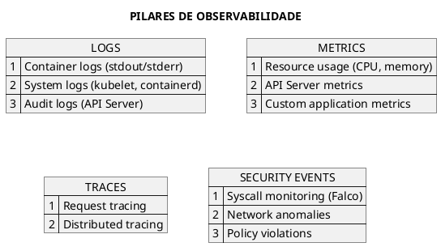
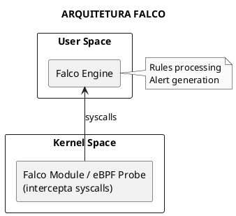
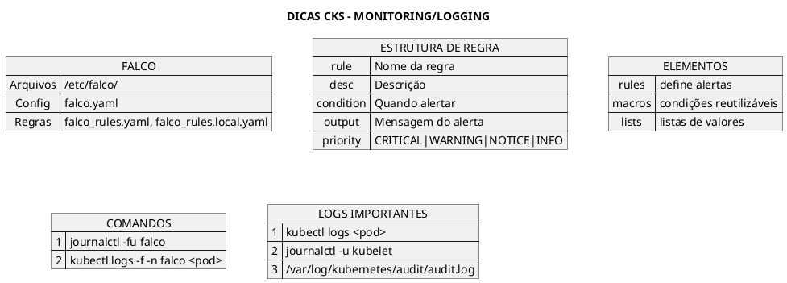

# Monitoring e Logging de Segurança

## Conceitos Fundamentais

### Por que Monitorar?

Monitoramento de segurança é essencial para detectar comportamentos anômalos, responder a incidentes e manter compliance.



---

## Falco

### O que é Falco?

Falco é uma ferramenta de runtime security que monitora syscalls para detectar comportamentos anômalos em containers e hosts.



### Instalação

```bash
# Adicionar repositório
helm repo add falcosecurity https://falcosecurity.github.io/charts
helm repo update

# Instalar Falco
helm install falco falcosecurity/falco \
  --namespace falco \
  --create-namespace
```

### Arquivos de Configuração

```plaintext
/etc/falco/
├── falco.yaml           # Configuração principal
├── falco_rules.yaml     # Regras padrão
├── falco_rules.local.yaml  # Regras customizadas
└── rules.d/             # Diretório para regras adicionais
```

---

## Regras do Falco

### Estrutura de uma Regra

```yaml
{{#include ../assets/security/monitoring/falco-rule-example.yaml}}
```

### Macros

```yaml
{{#include ../assets/security/monitoring/falco-macros.yaml}}
```

### Lists

```yaml
{{#include ../assets/security/monitoring/falco-lists.yaml}}
```

### Prioridades

| Prioridade | Descrição |
|------------|-----------|
| **EMERGENCY** | Sistema inutilizável |
| **ALERT** | Ação imediata necessária |
| **CRITICAL** | Condição crítica |
| **ERROR** | Condição de erro |
| **WARNING** | Condição de aviso |
| **NOTICE** | Normal mas significativo |
| **INFO** | Informativo |
| **DEBUG** | Debug |

---

## Exemplos de Regras Falco

### Detectar Shell em Container

```yaml
{{#include ../assets/security/monitoring/falco-rule-shell-container.yaml}}
```

### Detectar Escrita em Diretórios Sensíveis

```yaml
{{#include ../assets/security/monitoring/falco-rule-sensitive-dirs.yaml}}
```

### Detectar Acesso a Secrets do Kubernetes

```yaml
{{#include ../assets/security/monitoring/falco-rule-k8s-secrets.yaml}}
```

### Detectar Reverse Shell

```yaml
{{#include ../assets/security/monitoring/falco-rule-reverse-shell.yaml}}
```

---

## Comandos Falco

```bash
# Ver logs do Falco
journalctl -fu falco

# Ver alertas em tempo real
kubectl logs -f -n falco <falco-pod>

# Testar regras
falco -r /etc/falco/falco_rules.yaml --dry-run

# Validar arquivo de regras
falco --validate /etc/falco/my_rules.yaml

# Executar com regras específicas
falco -r /etc/falco/falco_rules.yaml -r /etc/falco/my_rules.yaml
```

---

## Logging do Cluster

### Container Logs

```bash
# Logs do container
kubectl logs <pod-name>
kubectl logs <pod-name> -c <container-name>
kubectl logs <pod-name> --previous
kubectl logs -f <pod-name>  # Follow

# Logs de todos os pods de um deployment
kubectl logs -l app=myapp
```

### System Logs

```bash
# Logs do kubelet
journalctl -u kubelet -f

# Logs do containerd
journalctl -u containerd -f

# Logs do sistema
journalctl -xeu kubelet
```

### Audit Logs

```bash
# Localização padrão (depende da configuração)
/var/log/kubernetes/audit/audit.log

# Ver eventos de audit
tail -f /var/log/kubernetes/audit/audit.log | jq

# Filtrar por verbo
cat audit.log | jq 'select(.verb == "create")'

# Filtrar por recurso
cat audit.log | jq 'select(.objectRef.resource == "secrets")'
```

---

## Centralizando Logs

### Stack EFK (Elasticsearch + Fluentd + Kibana)

```yaml
{{#include ../assets/security/monitoring/fluentd-daemonset.yaml}}
```

### Loki + Promtail + Grafana

```bash
# Instalar via Helm
helm repo add grafana https://grafana.github.io/helm-charts
helm install loki grafana/loki-stack \
  --namespace logging \
  --create-namespace \
  --set grafana.enabled=true
```

---

## Métricas de Segurança

### kube-state-metrics

```bash
# Instalar
helm install kube-state-metrics prometheus-community/kube-state-metrics \
  --namespace monitoring

# Métricas úteis para segurança:
# - kube_pod_container_status_running
# - kube_pod_status_phase
# - kube_deployment_status_replicas_unavailable
# - kube_networkpolicy_spec_ingress_rules
```

### Prometheus Rules para Segurança

```yaml
{{#include ../assets/security/monitoring/prometheus-security-rules.yaml}}
```

---

## Dicas para o Exame CKS



---

## Referências

- [Audit](audit.md)
- [Seccomp](seccomp.md)
- [AppArmor](apparmor.md)
- [Runtime Classes](runtime-classes.md)
- [Observabilidade](../observability/observabilidade.md)
