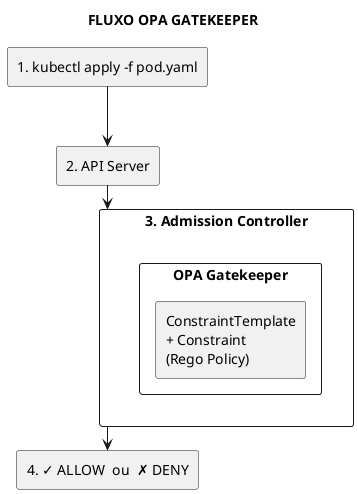
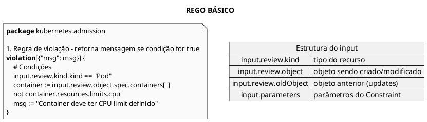
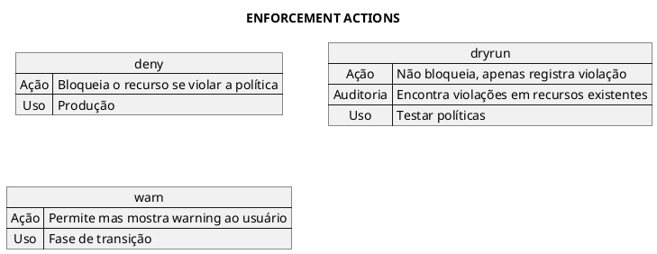
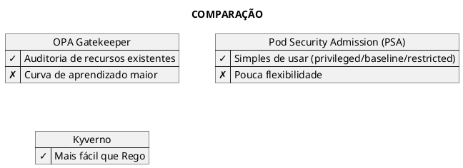
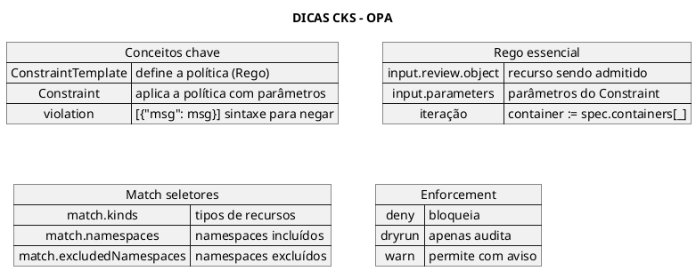

# OPA Gatekeeper

## Conceitos Fundamentais

### O que é OPA?

OPA (Open Policy Agent) é um motor de políticas open-source de propósito geral. No contexto Kubernetes, usa-se o **Gatekeeper**, que integra OPA ao admission controller.



### Componentes Principais

| Componente | Descrição |
|------------|-----------|
| **OPA** | Motor de políticas genérico |
| **Gatekeeper** | Integração OPA + Kubernetes Admission |
| **Rego** | Linguagem declarativa para políticas |
| **ConstraintTemplate** | Define o schema da política (Rego) |
| **Constraint** | Instância da política com parâmetros |

---

## Instalação do Gatekeeper

### Via kubectl

```bash
# Instalar Gatekeeper (versão estável)
kubectl apply -f https://raw.githubusercontent.com/open-policy-agent/gatekeeper/release-3.14/deploy/gatekeeper.yaml

# Verificar instalação
kubectl get pods -n gatekeeper-system

# Componentes instalados:
# - gatekeeper-audit-xxx (auditoria de recursos existentes)
# - gatekeeper-controller-manager-xxx (webhook de admissão)
```

### Via Helm

```bash
helm repo add gatekeeper https://open-policy-agent.github.io/gatekeeper/charts
helm install gatekeeper/gatekeeper --name-template=gatekeeper --namespace gatekeeper-system --create-namespace
```

### Verificar CRDs

```bash
kubectl get crd | grep gatekeeper

# CRDs importantes:
# constrainttemplates.templates.gatekeeper.sh
# configs.config.gatekeeper.sh
```

---

## Rego - Linguagem de Políticas

### Sintaxe Básica



### Operadores Rego

```plaintext
# Igualdade
x == y

# Atribuição
x := "value"

# Negação
not condition

# Iteração (comprehension)
container := input.review.object.spec.containers[_]

# Contains
contains(string, substring)

# Regex
re_match("pattern", string)

# Set membership
"admin" == input.review.userInfo.groups[_]
```

---

## ConstraintTemplate

### Estrutura

```yaml
{{#include ../assets/security/opa/constrainttemplate-requiredlabels.yaml}}
```

### Exemplo: Bloquear Latest Tag

```yaml
{{#include ../assets/security/opa/constrainttemplate-blocklatesttag.yaml}}
```

### Exemplo: Requerer Limites de Recursos

```yaml
{{#include ../assets/security/opa/constrainttemplate-requirelimits.yaml}}
```

---

## Constraint

### Estrutura

```yaml
{{#include ../assets/security/opa/constraint-requiredlabels.yaml}}
```

### Enforcement Actions



---

## Exemplos Práticos Completos

### Exemplo 1: Bloquear Privileged Containers

```yaml
{{#include ../assets/security/opa/block-privileged.yaml}}
```

### Exemplo 2: Restringir Registries

```yaml
{{#include ../assets/security/opa/allowed-registries.yaml}}
```

---

## Auditoria e Monitoramento

### Verificar Violações Existentes

```bash
# O Gatekeeper audita recursos existentes
kubectl describe constraint <constraint-name>

# Exemplo de output:
# Status:
#   Violations:
#   - enforcementAction: deny
#     kind: Pod
#     name: bad-pod
#     namespace: default
#     message: Container deve ter CPU limit
```

### Verificar Status do Gatekeeper

```bash
# Status geral
kubectl get constrainttemplates
kubectl get constraints

# Verificar se constraints estão sincronizadas
kubectl get constraint -o jsonpath='{.items[*].status.byPod}'
```

---

## Comandos Úteis

```bash
# Listar ConstraintTemplates
kubectl get constrainttemplates

# Listar Constraints (todas)
kubectl get constraints

# Detalhes de um Constraint específico
kubectl describe k8srequiredlabels require-team-label

# Ver violações
kubectl get k8srequiredlabels require-team-label -o yaml

# Testar política (dry-run do kubectl)
kubectl apply -f pod.yaml --dry-run=server -v=5
```

---

## Troubleshooting

### Constraint Não Funciona

```bash
# Verificar se ConstraintTemplate foi aceito
kubectl get constrainttemplate <name> -o yaml

# Verificar erros no Rego
kubectl describe constrainttemplate <name>
# Procurar por: status.byPod.errors

# Verificar se Constraint está ativo
kubectl get constraint <name> -o yaml
# status.totalViolations deve estar presente
```

### Webhook Timeout

```bash
# Verificar pods do Gatekeeper
kubectl get pods -n gatekeeper-system

# Verificar logs
kubectl logs -n gatekeeper-system deploy/gatekeeper-controller-manager

# Verificar webhook configuration
kubectl get validatingwebhookconfigurations gatekeeper-validating-webhook-configuration
```

---

## Gatekeeper vs PSA vs Kyverno



---

## Alternativa: Kyverno

Kyverno é uma alternativa ao Gatekeeper que usa YAML nativo (sem Rego):

### ClusterPolicy Exemplo (Kyverno)

```yaml
{{#include ../assets/kyverno/clusterpolicy.yaml}}
```

---

## Dicas para o Exame CKS



---

## Referências

- [Admission Controllers](admission-controllers.md)
- [Pod Security Admission](pod-security-admission.md)
- [RBAC](rbac.md)
- [Supply Chain Security](supply-chain-security.md)
