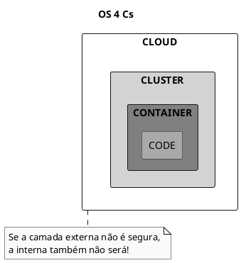
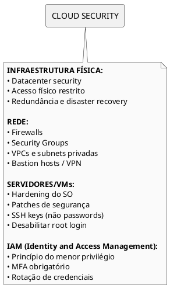
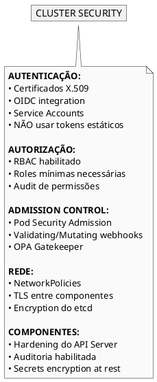
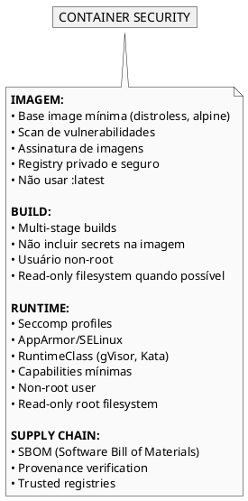
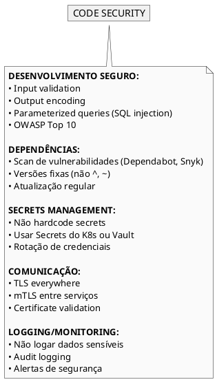
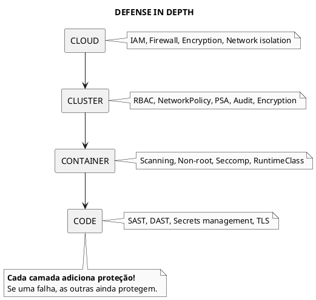
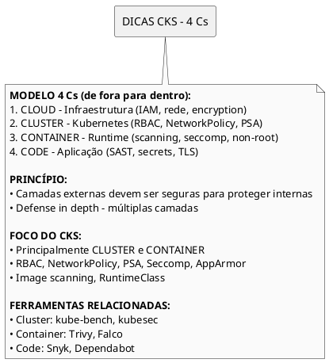

# Os Quatro Cs da Segurança Cloud Native

<span class="badge badge-cks">CKS</span> <span class="badge badge-kcsa">KCSA</span>

---

## Visão Geral

```admonish info title="Defense in Depth"
O modelo dos **4Cs** representa as camadas de segurança em aplicações cloud native. Cada camada depende da segurança da camada exterior - uma falha em uma camada externa compromete todas as internas.
```



### As 4 Camadas

| Camada | Escopo | Exemplos de Controles |
|--------|--------|----------------------|
| **Cloud** | Infraestrutura | VPC, IAM, Encryption at rest |
| **Cluster** | Kubernetes | RBAC, NetworkPolicy, PSA |
| **Container** | Runtime | Image scanning, non-root, seccomp |
| **Code** | Aplicação | SAST, DAST, secrets management |

---

## 1. Cloud (Infraestrutura)

```admonish note title="Responsabilidade Compartilhada"
Em cloud pública, a segurança é compartilhada entre provider e cliente. Conheça os limites!
```



### Controles Essenciais

| Controle | Descrição | Ferramentas |
|----------|-----------|-------------|
| **Encryption at rest** | Dados em disco criptografados | KMS, EBS encryption |
| **Encryption in transit** | TLS para toda comunicação | Certificates, mTLS |
| **Network isolation** | VPCs, subnets privadas | VPC, Security Groups |
| **IAM policies** | Menor privilégio | IAM Roles, Policies |
| **Audit logging** | Registro de todas ações | CloudTrail, Stackdriver |
| **Firewall rules** | Apenas portas necessárias | Security Groups, NACLs |

### Checklist Cloud

- [ ] Encryption at rest habilitado para discos
- [ ] TLS 1.2+ para toda comunicação
- [ ] VPC com subnets privadas para workloads
- [ ] IAM com menor privilégio
- [ ] Audit logging ativo
- [ ] Firewall permite apenas portas necessárias

---

## 2. Cluster (Kubernetes)

```admonish warning title="Componentes Críticos"
API Server, etcd, kubelet e controller-manager são alvos prioritários. Proteja-os!
```



### Controles Essenciais

| Controle | Descrição | Documentação |
|----------|-----------|--------------|
| **RBAC** | Autorização baseada em roles | [RBAC](rbac.md) |
| **NetworkPolicy** | Segmentação de rede L3/L4 | [NetworkPolicy](network-policy.md) |
| **Pod Security** | Restrições de segurança em Pods | [PSA](pod-security-admission.md) |
| **Audit logging** | Auditoria de ações no cluster | [Audit](audit.md) |
| **etcd encryption** | Secrets criptografados | [Encryption](encryption-at-rest.md) |
| **API Server** | Anonymous auth desabilitado | [Hardening](hardening.md) |

### Componentes a Proteger

```plantuml,format=png
@startuml
skinparam monochrome true

title COMPONENTES DO CLUSTER

package "CONTROL PLANE" {
  component "kube-apiserver" as api {
  }
  note right of api
    • Porta 6443 (apenas HTTPS)
    • Autenticação/Autorização
    • Audit logging
  end note
  
  component "etcd" as etcd {
  }
  note right of etcd
    • Criptografia de dados
    • Acesso restrito
    • Backup seguro
  end note
  
  component "kube-controller-manager" as cm {
  }
  note right of cm : Bind em 127.0.0.1
  
  component "kube-scheduler" as sched {
  }
  note right of sched : Bind em 127.0.0.1
}

package "WORKER NODES" {
  component "kubelet" as kubelet {
  }
  note right of kubelet
    • Anonymous auth disabled
    • Authorization mode Webhook
  end note
  
  component "kube-proxy" as proxy {
  }
  note right of proxy : Métricas não expostas
}
@enduml
```



### Checklist Cluster

- [ ] RBAC configurado com menor privilégio
- [ ] NetworkPolicy default deny em namespaces sensíveis
- [ ] Pod Security Admission em modo enforce
- [ ] Audit logging ativo
- [ ] etcd com encryption at rest
- [ ] API Server com anonymous-auth=false
- [ ] Kubelet com authorization-mode=Webhook

---

## 3. Container

```admonish tip title="Shift Left"
Segurança de container começa no build - não espere até runtime!
```



### Controles Essenciais

| Controle | Descrição | Ferramentas |
|----------|-----------|-------------|
| **Image scanning** | Vulnerabilidades conhecidas | Trivy, Grype, Snyk |
| **Non-root user** | Container não roda como root | USER no Dockerfile |
| **Minimal base** | Imagem mínima | Distroless, scratch |
| **No secrets** | Sem credenciais na imagem | Secrets, Vault |
| **Immutable** | Sistema de arquivos read-only | securityContext |
| **Signed images** | Verificação de origem | Cosign, Notary |

### SecurityContext Seguro

```yaml
{{#include ../assets/security/secure-pod.yaml}}
```

### Checklist Container

- [ ] Imagens escaneadas antes do deploy
- [ ] Containers rodam como non-root
- [ ] Base images mínimas (distroless/alpine)
- [ ] Sem secrets hardcoded nas imagens
- [ ] readOnlyRootFilesystem: true
- [ ] Imagens assinadas e verificadas

---

## 4. Code (Aplicação)

```admonish important title="Última Linha de Defesa"
Mesmo com todas as camadas anteriores seguras, código vulnerável pode ser explorado.
```



### Controles Essenciais

| Controle | Descrição | Ferramentas |
|----------|-----------|-------------|
| **SAST** | Análise estática de código | SonarQube, Semgrep |
| **DAST** | Teste dinâmico em runtime | OWASP ZAP, Burp |
| **SCA** | Análise de dependências | Dependabot, Snyk |
| **Secrets scanning** | Detectar secrets no código | git-secrets, truffleHog |
| **Code review** | Revisão humana | PRs com aprovação |

### OWASP Top 10

Vulnerabilidades mais comuns a evitar:
1. Injection (SQL, NoSQL, LDAP)
2. Broken Authentication
3. Sensitive Data Exposure
4. XML External Entities (XXE)
5. Broken Access Control

### Checklist Code

- [ ] SAST integrado no CI/CD
- [ ] Dependências atualizadas e escaneadas
- [ ] Secrets scanning em commits
- [ ] Code review obrigatório
- [ ] Testes de segurança automatizados

---

## Defense in Depth



```admonish tip title="Princípio"
Se uma camada falhar, as outras ainda protegem. Nunca confie em apenas uma camada!
```

---

## Dicas para o Exame CKS



```admonish tip title="Foco CKS"
O exame CKS foca principalmente nas camadas **Cluster** e **Container**. Domine RBAC, NetworkPolicy, PSA, image scanning e securityContext.
```

### O que cai no CKS por Camada

| Camada | Tópicos CKS |
|--------|-------------|
| Cloud | Conceitual apenas |
| **Cluster** | RBAC, NetworkPolicy, Audit, PSA, Hardening |
| **Container** | Image scanning, securityContext, seccomp, AppArmor |
| Code | Supply chain security, image signing |

---

## Referências

- [Primitivos de Segurança](primitivos-seguranca.md)
- [RBAC](rbac.md)
- [NetworkPolicy](network-policy.md)
- [Pod Security Admission](pod-security-admission.md)
- [Seccomp](seccomp.md)
- [AppArmor](apparmor.md)
- [Supply Chain Security](supply-chain-security.md)
- [Hardening](hardening.md)
