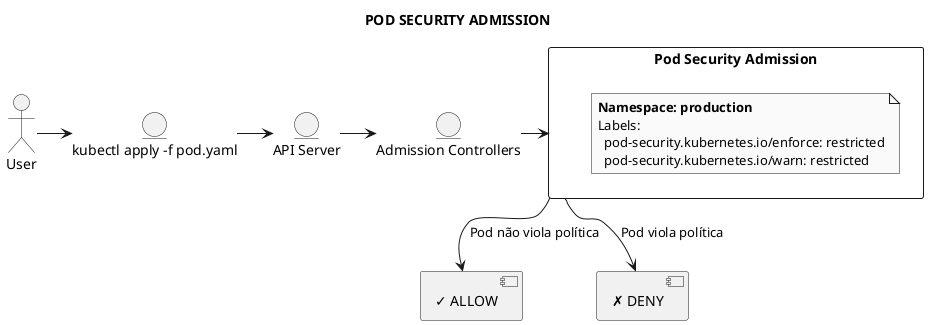
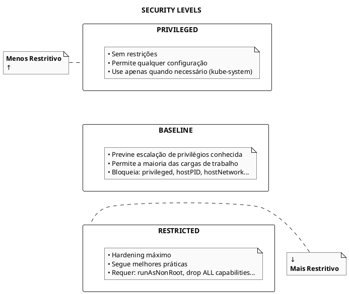
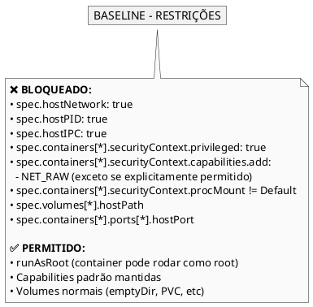
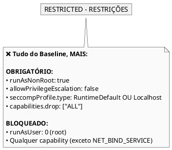
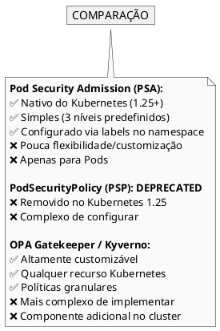
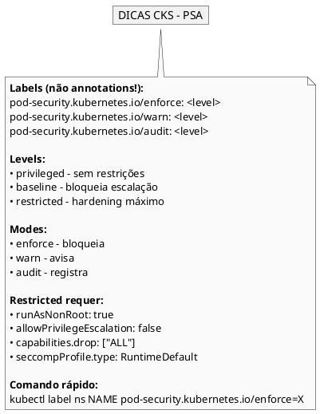

# Pod Security Admission (PSA)

## Conceitos Fundamentais

### O que é Pod Security Admission?

Pod Security Admission (PSA) é o mecanismo nativo do Kubernetes para aplicar padrões de segurança a Pods. Substituiu o deprecated PodSecurityPolicy (PSP) a partir do Kubernetes 1.25.



### Pod Security Standards



### Modos de Operação

| Modo | Comportamento |
|------|---------------|
| **enforce** | Rejeita Pods que violam a política |
| **audit** | Registra violações no audit log, mas permite |
| **warn** | Mostra warning ao usuário, mas permite |

---

## Configuração por Namespace

### Via Labels

PSA é configurado através de **labels** no namespace (não annotations!).

```bash
# Formato das labels
pod-security.kubernetes.io/<MODE>: <LEVEL>
pod-security.kubernetes.io/<MODE>-version: <VERSION>
```

### Aplicar via kubectl

```bash
# Enforce baseline
kubectl label namespace production pod-security.kubernetes.io/enforce=baseline

# Warn + Audit restricted
kubectl label namespace production pod-security.kubernetes.io/warn=restricted
kubectl label namespace production pod-security.kubernetes.io/audit=restricted

# Especificar versão
kubectl label namespace production pod-security.kubernetes.io/enforce-version=v1.28

# Remover label
kubectl label namespace production pod-security.kubernetes.io/enforce-

# Ver labels do namespace
kubectl get namespace production --show-labels
```

### Exemplo Completo de Namespace

```yaml
{{#include ../assets/security/psa/namespace-production.yaml}}
```

---

## Pod Security Standards em Detalhes

### Privileged

Sem restrições - permite qualquer configuração.

```yaml
{{#include ../assets/security/psa/privileged-pod.yaml}}
```

### Baseline

Bloqueia escalação de privilégios conhecida.



### Restricted

Hardening máximo seguindo melhores práticas.



### Pod Compliant com Restricted

```yaml
{{#include ../assets/security/psa/restricted-compliant.yaml}}
```

---

## Configuração Global (Cluster-wide)

### Via AdmissionConfiguration

Para definir padrões no cluster inteiro, configure o kube-apiserver.

```yaml
{{#include ../assets/security/psa/admission-configuration.yaml}}
```

### Configurar no kube-apiserver

```yaml
{{#include ../assets/security/psa/kube-apiserver-psa.yaml}}
```

---

## Exemptions (Isenções)

### Tipos de Exemptions

```yaml
{{#include ../assets/security/psa/exemptions.yaml}}
```

---

## Comandos Úteis

### Verificar PSA no Cluster

```bash
# Verificar se PSA está habilitado
kubectl exec -n kube-system kube-apiserver-<node> -- \
  kube-apiserver -h | grep enable-admission

# Listar namespaces com PSA configurado
kubectl get namespaces -o custom-columns=\
'NAME:.metadata.name,ENFORCE:.metadata.labels.pod-security\.kubernetes\.io/enforce,WARN:.metadata.labels.pod-security\.kubernetes\.io/warn'
```

### Testar Antes de Aplicar

```bash
# Dry-run com validação PSA
kubectl apply -f pod.yaml --dry-run=server

# Ver warning sem criar
kubectl create -f pod.yaml --dry-run=server
```

### Ver Audit Logs

```bash
# Violações aparecem no audit log do API server
# Procure por eventos com:
# annotations:
#   pod-security.kubernetes.io/audit-violations: ...
```

---

## Exemplos Práticos

### Exemplo 1: Namespace Seguro para Produção

```yaml
{{#include ../assets/security/psa/namespace-restricted.yaml}}
```

```bash
# Criar namespace
kubectl apply -f namespace.yaml

# Tentar criar pod não-compliant
kubectl run test --image=nginx -n production
# Error: pods "test" is forbidden: violates PodSecurity "restricted:v1.28"
```

### Exemplo 2: Migração Gradual

```yaml
{{#include ../assets/security/psa/namespace-migration.yaml}}
```

### Exemplo 3: Deployment Compliant

```yaml
{{#include ../assets/security/psa/secure-deployment.yaml}}
```

---

## Troubleshooting

### Pod Rejeitado

```bash
# Erro típico
Error from server (Forbidden): error when creating "pod.yaml": 
pods "test" is forbidden: violates PodSecurity "restricted:latest": 
allowPrivilegeEscalation != false (container "app" must set 
securityContext.allowPrivilegeEscalation=false), 
runAsNonRoot != true (pod or container "app" must set 
securityContext.runAsNonRoot=true)

# Solução: Adicionar campos requeridos
spec:
  securityContext:
    runAsNonRoot: true
  containers:
  - securityContext:
      allowPrivilegeEscalation: false
```

### Verificar Violações Existentes

```bash
# Ver warnings ao descrever namespace
kubectl describe namespace production

# Ver eventos relacionados a PSA
kubectl get events --field-selector reason=FailedCreate -A
```

---

## PSA vs PodSecurityPolicy vs OPA



---

## Dicas para o Exame CKS



---

## Referências

- [AppArmor](apparmor.md)
- [Seccomp](seccomp.md)
- [Open Policy Agent](open-policy-agent.md)
- [Hardening](hardening.md)
- [Pod](../workloads/pod.md)
