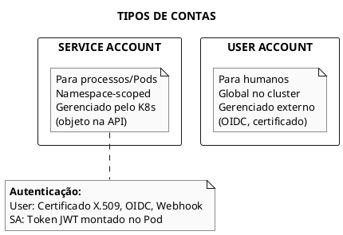
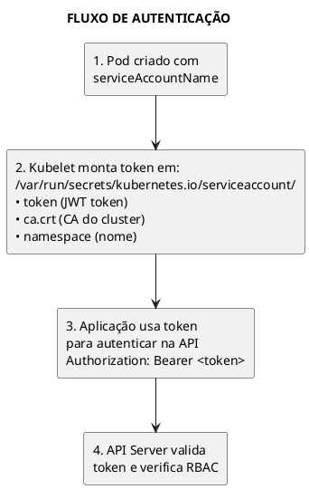
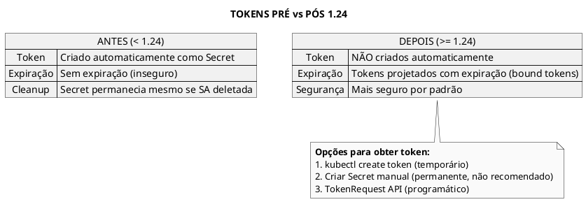
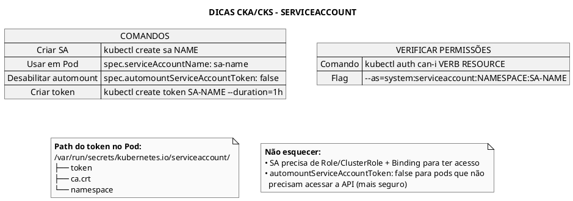

# ServiceAccount

## Conceitos Fundamentais

### O que é ServiceAccount?

ServiceAccount fornece uma identidade para processos rodando em Pods. Permite que aplicações se autentiquem com a API do Kubernetes e outros serviços.



### ServiceAccount Padrão

Todo namespace tem uma ServiceAccount `default` criada automaticamente:

```bash
# Ver ServiceAccounts
kubectl get serviceaccounts
# NAME      SECRETS   AGE
# default   0         10d

# Detalhes
kubectl describe sa default
```

### Como ServiceAccount é Usada



---

## Criação de ServiceAccount

### Via kubectl

```bash
# Criar ServiceAccount
kubectl create serviceaccount my-app-sa

# Criar em namespace específico
kubectl create serviceaccount my-app-sa -n production

# Criar com dry-run (ver YAML)
kubectl create serviceaccount my-app-sa --dry-run=client -o yaml
```

### Via YAML

```yaml
{{#include ../assets/rbac/serviceaccount-basic.yaml}}
```

---

## Tokens de ServiceAccount


### ServiceAccount com Token

```yaml
{{#include ../assets/serviceaccount/serviceaccount-with-token.yaml}}
```
### Mudanças a partir do Kubernetes 1.24



### Criar Token Temporário

```bash
# Token com duração padrão (1 hora)
kubectl create token my-app-sa

# Token com duração específica
kubectl create token my-app-sa --duration=3600s   # 1 hora
kubectl create token my-app-sa --duration=24h     # 24 horas
kubectl create token my-app-sa --duration=8760h   # 1 ano

# Token para uso com audience específica
kubectl create token my-app-sa --audience=api.example.com
```

### Criar Token Permanente (Secret)

```admonish warning title="Não recomendado para produção"
use apenas quando necessário.
```

```yaml
{{#include ../assets/rbac/secret-serviceaccount-token.yaml}}
```

```bash
# Recuperar token do Secret
kubectl get secret my-app-sa-token -o jsonpath='{.data.token}' | base64 -d
```

---

## Usar ServiceAccount em Pods

### Pod com ServiceAccount

```yaml
{{#include ../assets/rbac/pod-with-serviceaccount.yaml}}
```

### Desabilitar Automount

```yaml
{{#include ../assets/rbac/pod-disable-automount.yaml}}
```

### Usar em Deployment

```yaml
{{#include ../assets/rbac/deployment-with-serviceaccount.yaml}}
```

---

## ServiceAccount com RBAC

### Exemplo Completo: SA com Permissões

```yaml
{{#include ../assets/rbac/serviceaccount-pod-reader-complete.yaml}}
```

### Verificar Permissões da SA

```bash
# Verificar o que a SA pode fazer
kubectl auth can-i --list --as=system:serviceaccount:default:pod-reader-sa

# Verificar permissão específica
kubectl auth can-i get pods --as=system:serviceaccount:default:pod-reader-sa
```

---

## Acessar API de Dentro do Pod

### Usando curl

```bash
# Variáveis de ambiente configuradas automaticamente
# KUBERNETES_SERVICE_HOST e KUBERNETES_SERVICE_PORT

# No Pod:
# Token
TOKEN=$(cat /var/run/secrets/kubernetes.io/serviceaccount/token)

# CA
CA=/var/run/secrets/kubernetes.io/serviceaccount/ca.crt

# Namespace
NAMESPACE=$(cat /var/run/secrets/kubernetes.io/serviceaccount/namespace)

# Requisição à API
curl --cacert $CA \
     -H "Authorization: Bearer $TOKEN" \
     https://${KUBERNETES_SERVICE_HOST}:${KUBERNETES_SERVICE_PORT}/api/v1/namespaces/${NAMESPACE}/pods
```

### Usando kubectl no Pod

```bash
# kubectl usa automaticamente as credenciais montadas
kubectl get pods
```

---

## Comandos Úteis

```bash
# Listar ServiceAccounts
kubectl get serviceaccounts -A
kubectl get sa -A

# Criar ServiceAccount
kubectl create sa my-sa

# Descrever SA
kubectl describe sa my-sa

# Ver qual SA um Pod usa
kubectl get pod <pod-name> -o jsonpath='{.spec.serviceAccountName}'

# Criar token
kubectl create token my-sa

# Criar token com duração
kubectl create token my-sa --duration=72h

# Ver token dentro do Pod
kubectl exec <pod> -- cat /var/run/secrets/kubernetes.io/serviceaccount/token

# Atribuir SA a deployment existente
kubectl set serviceaccount deployment my-deploy my-sa
```

---

## Image Pull Secrets com ServiceAccount

### Associar Pull Secret à SA

```yaml
{{#include ../assets/rbac/serviceaccount-imagepullsecrets.yaml}}
```

```bash
# Criar secret de registry
kubectl create secret docker-registry my-registry-secret \
  --docker-server=registry.example.com \
  --docker-username=user \
  --docker-password=pass

# Associar à SA existente
kubectl patch serviceaccount my-sa \
  -p '{"imagePullSecrets": [{"name": "my-registry-secret"}]}'
```

---

## Troubleshooting

### Pod Não Consegue Acessar API

```bash
# 1. Verificar se token está montado
kubectl exec <pod> -- ls -la /var/run/secrets/kubernetes.io/serviceaccount/

# 2. Verificar ServiceAccount do Pod
kubectl get pod <pod> -o jsonpath='{.spec.serviceAccountName}'

# 3. Verificar permissões da SA
kubectl auth can-i get pods --as=system:serviceaccount:<namespace>:<sa-name>

# 4. Verificar RoleBinding
kubectl get rolebindings -A | grep <sa-name>
kubectl get clusterrolebindings | grep <sa-name>
```

### Token Expirado

```bash
# Tokens projetados são renovados automaticamente pelo kubelet
# Se usando Secret manual, o token nunca expira mas é menos seguro

# Verificar claims do token
kubectl exec <pod> -- cat /var/run/secrets/kubernetes.io/serviceaccount/token | \
  cut -d. -f2 | base64 -d 2>/dev/null | jq .
```

### automountServiceAccountToken Não Funciona

```bash
# Verificar se está definido no Pod E/OU na ServiceAccount
# Pod.spec tem precedência sobre ServiceAccount.spec
kubectl get pod <pod> -o jsonpath='{.spec.automountServiceAccountToken}'
kubectl get sa <sa> -o jsonpath='{.automountServiceAccountToken}'
```


### Pod sem Token Automático

```yaml
{{#include ../assets/serviceaccount/pod-with-serviceaccount-automount-false.yaml}}
```
---

## Dicas para os Exames



---

## Referências

- [RBAC](rbac.md)
- [Certificate API](certificate-api.md)
- [Secrets](../configuration/secrets.md)
- [Pod](../workloads/pod.md)


---

### ServiceAccount Básico

```yaml
{{#include ../assets/serviceaccount/serviceaccount-test.yaml}}
```
