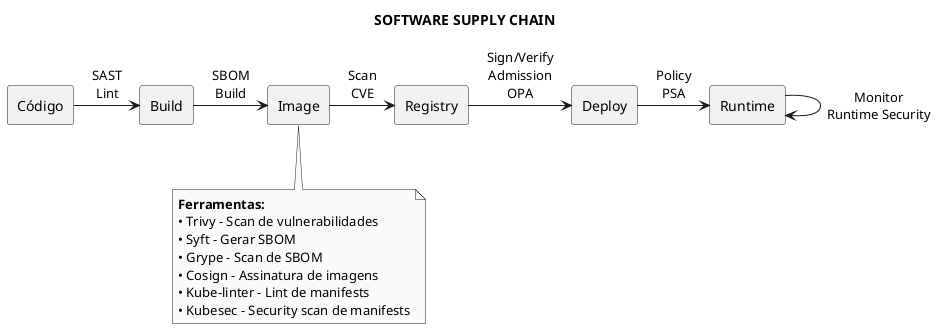
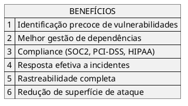
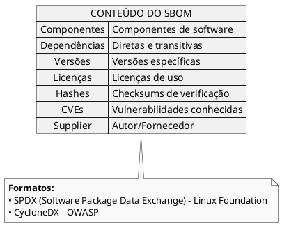
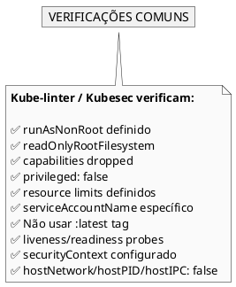
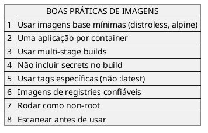
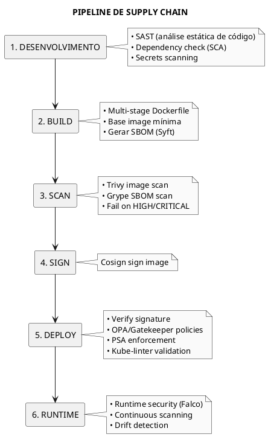
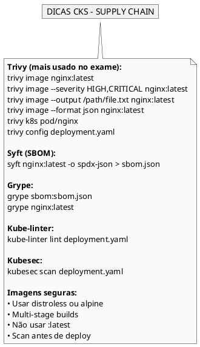

# Supply Chain Security

## Conceitos Fundamentais

### O que é Supply Chain Security?

Supply Chain Security no contexto de containers envolve proteger todo o processo desde o desenvolvimento do código até a execução em produção. Isso inclui validação de imagens, dependências, configurações e infraestrutura.



### Benefícios



---

## SBOM - Software Bill of Materials

### O que é SBOM?

SBOM é uma lista completa de componentes que compõem um software - funciona como uma "receita" da imagem.



### Syft - Gerar SBOM

```bash
# Instalar Syft
curl -sSfL https://raw.githubusercontent.com/anchore/syft/main/install.sh | sh -s -- -b /usr/local/bin

# Gerar SBOM de imagem (formato SPDX JSON)
syft docker.io/nginx:latest -o spdx-json > nginx-sbom.json

# Formato CycloneDX
syft docker.io/nginx:latest -o cyclonedx-json > nginx-sbom-cyclonedx.json

# SBOM de imagem local
syft nginx:latest -o spdx-json > nginx-sbom.json

# SBOM de diretório
syft dir:/path/to/app -o spdx-json

# SBOM com mais detalhes
syft nginx:latest -o syft-json --scope all-layers
```

### BOM (Kubernetes SBOM tool)

```bash
# Gerar SBOM com bom
bom generate -i registry.k8s.io/kube-apiserver:v1.28.0 --format json > apiserver-sbom.json

# Ver outline do SBOM
bom document outline apiserver-sbom.json
```

---

## Scan de Vulnerabilidades

### Trivy

Trivy é uma ferramenta versátil para scan de imagens, filesystem, configs e clusters.

```bash
# Instalar Trivy
curl -sfL https://raw.githubusercontent.com/aquasecurity/trivy/main/contrib/install.sh | sh -s -- -b /usr/local/bin

# Scan de imagem
trivy image nginx:latest

# Scan com severidade específica
trivy image --severity HIGH,CRITICAL nginx:latest

# Scan e salvar output
trivy image --severity HIGH --output /root/results.txt nginx:latest

# Scan em formato JSON
trivy image --format json --output results.json nginx:latest

# Scan de imagem local (tar)
trivy image --input image.tar

# Ignorar vulnerabilidades unfixed
trivy image --ignore-unfixed nginx:latest
```

### Trivy - Scan de Kubernetes

```bash
# Scan de todo o cluster
trivy k8s --report summary all

# Scan de namespace específico
trivy k8s -n production --report summary all

# Scan de recurso específico
trivy k8s pod/nginx
trivy k8s deployment/my-app

# Scan de manifest YAML
trivy config deployment.yaml

# Scan de Dockerfile
trivy config Dockerfile

# Scan de Helm chart
trivy config ./my-chart
```

### Grype - Scan de SBOM

```bash
# Instalar Grype
curl -sSfL https://raw.githubusercontent.com/anchore/grype/main/install.sh | sh -s -- -b /usr/local/bin

# Scan de SBOM
grype sbom:nginx-sbom.json

# Output JSON
grype sbom:nginx-sbom.json -o json > vulnerabilities.json

# Scan direto de imagem
grype nginx:latest

# Filtrar por severidade
grype nginx:latest --only-fixed --fail-on high
```

---

## Análise Estática de Manifests

### Kube-linter

```bash
# Instalar kube-linter
curl -L https://github.com/stackrox/kube-linter/releases/download/v0.6.4/kube-linter-linux -o /usr/local/bin/kube-linter
chmod +x /usr/local/bin/kube-linter

# Lint de manifest
kube-linter lint deployment.yaml

# Lint de diretório
kube-linter lint ./manifests/

# Lint de Helm chart
kube-linter lint ./my-chart/

# Com config customizada
kube-linter lint --config kube-linter-config.yaml deployment.yaml

# Listar checks disponíveis
kube-linter checks list
```

### Kubesec

```bash
# Instalar kubesec
curl -sSL https://github.com/controlplaneio/kubesec/releases/download/v2.13.0/kubesec_linux_amd64.tar.gz | tar xz
mv kubesec /usr/local/bin/

# Scan de manifest
kubesec scan deployment.yaml

# Scan via API online
curl -sSX POST --data-binary @deployment.yaml https://v2.kubesec.io/scan

# Output JSON
kubesec scan deployment.yaml --format json
```

### O que Verificam



---

## Imagens Seguras

### Minimizar Footprint



### Exemplo: Multi-stage Build

```dockerfile
# Stage 1: Build
FROM golang:1.21-alpine AS builder
WORKDIR /app
COPY go.mod go.sum ./
RUN go mod download
COPY . .
RUN CGO_ENABLED=0 GOOS=linux go build -o main .

# Stage 2: Runtime (distroless)
FROM gcr.io/distroless/static-debian11
COPY --from=builder /app/main /
USER nonroot:nonroot
ENTRYPOINT ["/main"]
```

### Verificar Imagens Base

```bash
# Verificar imagem base de uma imagem
docker history nginx:latest

# Trivy para analisar camadas
trivy image --list-all-pkgs nginx:latest

# Verificar se imagem é distroless
trivy image gcr.io/distroless/static-debian11
# Deve ter pouquíssimos ou nenhum pacote
```

---

## Assinatura de Imagens

### Cosign

```bash
# Instalar Cosign
curl -LO https://github.com/sigstore/cosign/releases/download/v2.2.0/cosign-linux-amd64
mv cosign-linux-amd64 /usr/local/bin/cosign
chmod +x /usr/local/bin/cosign

# Gerar par de chaves
cosign generate-key-pair

# Assinar imagem
cosign sign --key cosign.key my-registry/my-image:tag

# Verificar assinatura
cosign verify --key cosign.pub my-registry/my-image:tag

# Assinar com keyless (usando OIDC)
cosign sign my-registry/my-image:tag

# Verificar assinatura keyless
cosign verify my-registry/my-image:tag
```

---

## ImagePolicyWebhook

### Admission Controller para Imagens

```yaml
{{#include ../assets/security/supply-chain/imagepolicy-webhook.yaml}}
```

### Habilitar no API Server

```yaml
{{#include ../assets/security/supply-chain/apiserver-imagepolicy.yaml}}
```

---

## Workflow de Supply Chain



---

## Dicas para o Exame CKS



---

## Referências

- [Pod Security Admission](pod-security-admission.md)
- [Open Policy Agent](open-policy-agent.md)
- [Hardening](hardening.md)
- [Admission Controllers](admission-controllers.md)
