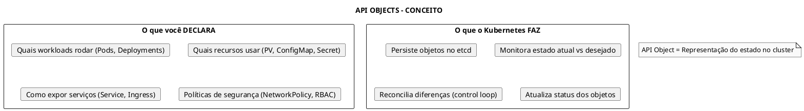
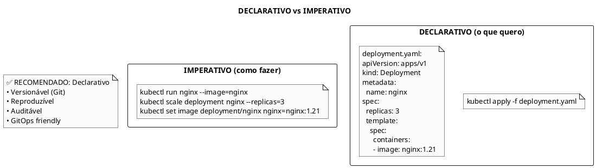
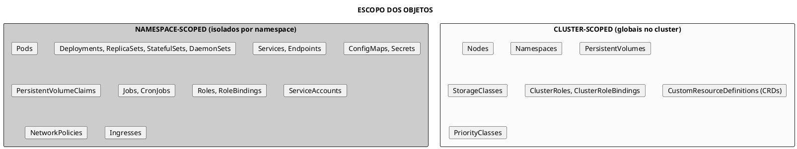
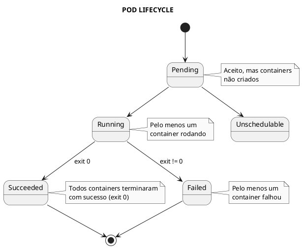

# API Objects

```admonish info title="Certificações"
KCNA (18%), CKA (25%), CKAD (25%), CKS (10%)
```

## 📖 Conceitos Fundamentais

### O que são API Objects

API Objects são entidades persistentes no sistema Kubernetes que representam o estado do cluster. Tudo no Kubernetes é um objeto: Pods, Services, Deployments, Secrets, etc.



### Declarativo vs Imperativo



## 📋 Estrutura de um Object

### Campos Obrigatórios

Todo objeto Kubernetes DEVE ter estes campos:

```yaml
../assets/api-objects/pod-campos-obrigatorios.yaml}}
```

### Anatomia Completa

```yaml
../assets/api-objects/deployment-anatomia-completa.yaml}}
```

## 🏷️ Metadata

### Labels

Labels são pares key-value usados para **identificar** e **selecionar** objetos:

```yaml
../assets/api-objects/metadata-labels.yaml}}
```

**Convenções recomendadas** (app.kubernetes.io):

| Label | Descrição |
|-------|-----------|
| `app.kubernetes.io/name` | Nome da aplicação |
| `app.kubernetes.io/instance` | Nome único da instância |
| `app.kubernetes.io/version` | Versão da aplicação |
| `app.kubernetes.io/component` | Componente dentro da aplicação |
| `app.kubernetes.io/part-of` | Aplicação de maior nível |
| `app.kubernetes.io/managed-by` | Ferramenta que gerencia |

### Selectors

```yaml
../assets/api-objects/selectors.yaml}}
```

```bash
# Selecionar com kubectl
kubectl get pods -l app=nginx
kubectl get pods -l 'environment in (prod,staging)'
kubectl get pods -l 'app=nginx,tier!=backend'
kubectl get pods -l 'release'  # label existe
kubectl get pods -l '!deprecated'  # label não existe
```

### Annotations

Annotations armazenam **metadata não-identificadora**:

```yaml
../assets/api-objects/metadata-annotations.yaml}}
```

**Diferença Labels vs Annotations**:

| Aspecto | Labels | Annotations |
|---------|--------|-------------|
| **Propósito** | Identificar/Selecionar | Metadata adicional |
| **Uso em selectors** | ✅ Sim | ❌ Não |
| **Tamanho** | Limitado (63 chars) | Até 256KB |
| **Indexado no etcd** | ✅ Sim | ❌ Não |

## 📦 Tipos de Objetos

### Por Escopo



### Por Categoria

| Categoria | Objetos |
|-----------|---------|
| **Workloads** | Pod, Deployment, ReplicaSet, StatefulSet, DaemonSet, Job, CronJob |
| **Networking** | Service, Ingress, NetworkPolicy, Endpoints |
| **Storage** | PersistentVolume, PersistentVolumeClaim, StorageClass |
| **Configuration** | ConfigMap, Secret |
| **Security** | ServiceAccount, Role, RoleBinding, ClusterRole, ClusterRoleBinding |
| **Scheduling** | PriorityClass, LimitRange, ResourceQuota |

## 🔄 Ciclo de Vida

### Estados de um Pod



### Owner References e Garbage Collection

```yaml
../assets/api-objects/owner-references.yaml}}
```

**Garbage Collection Policies**:

| Policy | Comportamento |
|--------|---------------|
| `Foreground` | Owner bloqueado até dependentes deletados |
| `Background` | Owner deletado imediatamente, dependentes em background |
| `Orphan` | Dependentes não são deletados |

```bash
# Deletar deployment mantendo ReplicaSets/Pods
kubectl delete deployment nginx --cascade=orphan

# Deletar deployment e todos dependentes (padrão)
kubectl delete deployment nginx
```

## 📋 Comandos Essenciais

```bash
# Criar objeto
kubectl apply -f object.yaml        # Declarativo (recomendado)
kubectl create -f object.yaml       # Imperativo

# Ler objeto
kubectl get pods
kubectl get pod nginx -o yaml       # YAML completo
kubectl get pod nginx -o json       # JSON
kubectl describe pod nginx          # Descrição legível

# Atualizar objeto
kubectl apply -f object.yaml        # Apply (merge)
kubectl replace -f object.yaml      # Replace (substitui tudo)
kubectl edit pod nginx              # Editar interativamente
kubectl patch pod nginx -p '{"spec":{"containers":[{"name":"nginx","image":"nginx:1.22"}]}}'

# Deletar objeto
kubectl delete pod nginx
kubectl delete -f object.yaml
kubectl delete pods --all           # Todos no namespace

# Labels
kubectl label pod nginx env=prod
kubectl label pod nginx env-        # Remove label
kubectl get pods -l env=prod

# Annotations
kubectl annotate pod nginx description="Web server"
kubectl annotate pod nginx description-

# Ver estrutura do objeto
kubectl explain pod
kubectl explain pod.spec.containers
kubectl explain pod --recursive
```

## 💡 Dicas para Exame

### Estrutura Básica

```plantuml,format=png
@startuml
skinparam monochrome true
skinparam backgroundColor white

title DICAS - API OBJECTS

rectangle "1️⃣ CAMPOS OBRIGATÓRIOS" {
  note as n1
    apiVersion, kind, metadata.name, spec
  end note
}

rectangle "2️⃣ DESCOBRIR apiVersion" {
  note as n2
    kubectl api-resources | grep <recurso>
  end note
}

rectangle "3️⃣ DESCOBRIR spec" {
  note as n3
    kubectl explain <recurso>.spec
  end note
}

rectangle "4️⃣ GERAR YAML" {
  note as n4
    kubectl create <recurso> ... --dry-run=client -o yaml
  end note
}

rectangle "5️⃣ VALIDAR ANTES DE APLICAR" {
  note as n5
    kubectl apply -f file.yaml --dry-run=server
  end note
}

rectangle "6️⃣ LABELS vs ANNOTATIONS" {
  note as n6
    Labels: para selecionar (app=nginx)
    Annotations: para metadata (description="...")
  end note
}

@enduml
```



### Selectors Rápidos

```bash
# Igualdade
kubectl get pods -l app=nginx

# Conjunto
kubectl get pods -l 'app in (nginx,apache)'

# Negação
kubectl get pods -l app!=nginx

# Existência
kubectl get pods -l release

# Múltiplos
kubectl get pods -l 'app=nginx,environment=prod'
```

## 📚 Referências

### Links Internos
- [API](api/api.md)
- [Metadata](fundamentals/metadata.md)
- [Namespace](fundamentals/namespace.md)
- [Pod](workloads/pod.md)
- [Deployment](workloads/deployment.md)
- [kubectl](tools/kubectl.md)

### Documentação Oficial
- [Understanding Kubernetes Objects](https://kubernetes.io/docs/concepts/overview/working-with-objects/kubernetes-objects/)
- [Labels and Selectors](https://kubernetes.io/docs/concepts/overview/working-with-objects/labels/)
- [Annotations](https://kubernetes.io/docs/concepts/overview/working-with-objects/annotations/)
- [Field Selectors](https://kubernetes.io/docs/concepts/overview/working-with-objects/field-selectors/)
- [Owners and Dependents](https://kubernetes.io/docs/concepts/overview/working-with-objects/owners-dependents/)

---

> **Resumo**: API Objects são entidades persistentes que representam estado no Kubernetes. Campos obrigatórios: apiVersion, kind, metadata.name, spec. Labels são para identificação/seleção; Annotations para metadata adicional. Objetos podem ser namespace-scoped ou cluster-scoped. Owner References controlam garbage collection. Use `kubectl explain` para descobrir estrutura e `--dry-run=client -o yaml` para gerar YAML.
