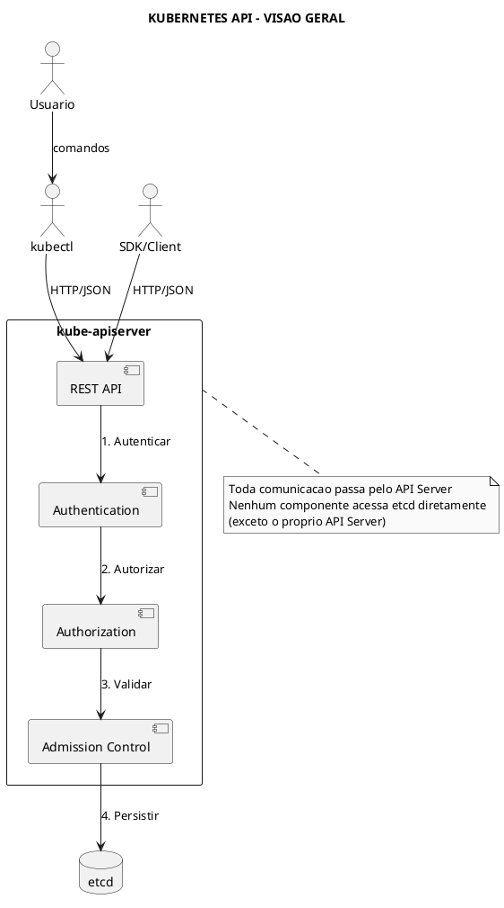
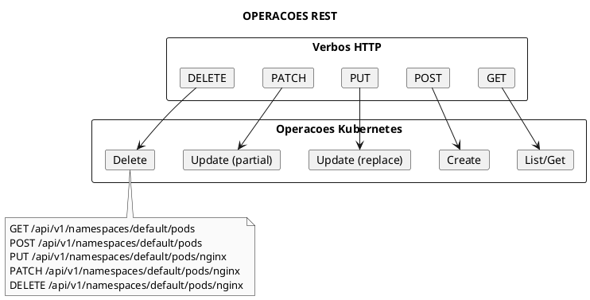
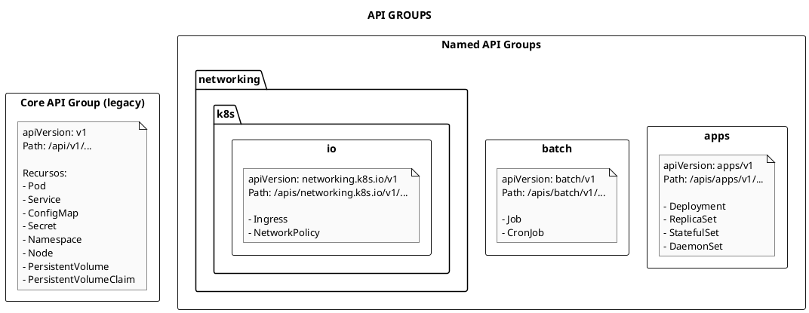
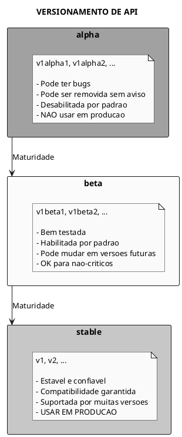
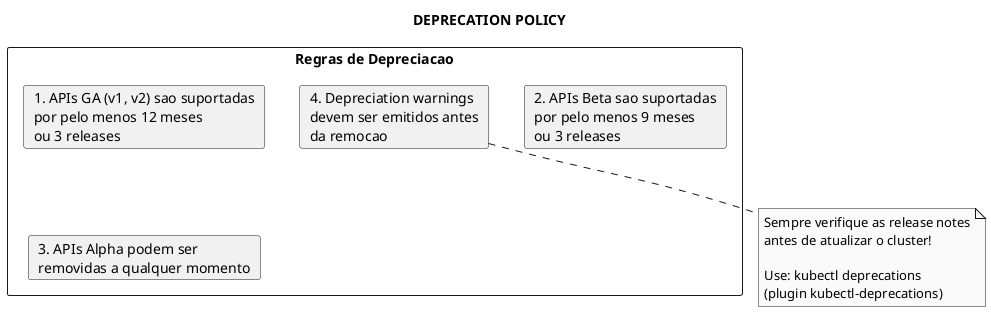
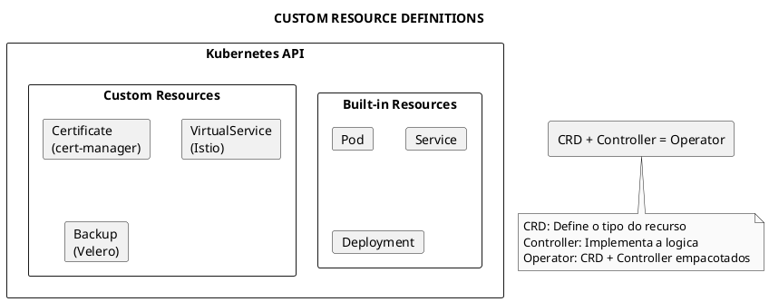
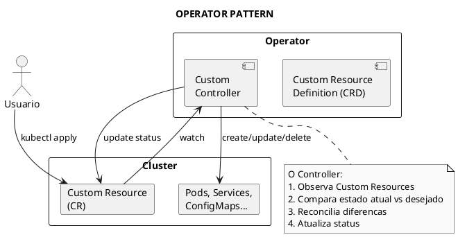
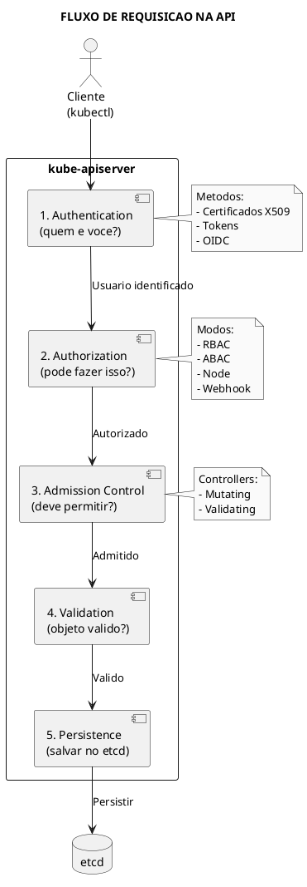
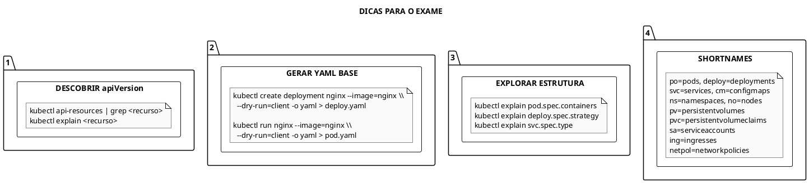

# API do Kubernetes

> **Certificacoes**: CKA (25%), CKAD (20%), KCNA (15%)

## Conceitos Fundamentais

### O que e a Kubernetes API?

A API do Kubernetes e o coracao do sistema. Todas as operacoes e comunicacoes entre componentes sao feitas atraves de chamadas RESTful a API do kube-apiserver.



### RESTful API

A API do Kubernetes segue os principios REST:



### Estrutura da URL da API

```plaintext
/apis/{GROUP}/{VERSION}/namespaces/{NAMESPACE}/{RESOURCE}/{NAME}

Exemplos:
/api/v1/namespaces/default/pods                    # Lista pods
/api/v1/namespaces/default/pods/nginx              # Pod especifico
/apis/apps/v1/namespaces/default/deployments       # Lista deployments
/apis/apps/v1/namespaces/default/deployments/web   # Deployment especifico

Recursos cluster-scoped (sem namespace):
/api/v1/nodes                                      # Lista nodes
/api/v1/namespaces                                 # Lista namespaces
/apis/rbac.authorization.k8s.io/v1/clusterroles    # ClusterRoles
```


### Estrutura de um Objeto

```yaml
{{#include ../assets/api/api-object-structure.yaml}}
```
---

## API Groups e Versoes


### Exemplo de API Groups

```yaml
{{#include ../assets/api/api-groups-example.yaml}}
```
### Core API Group vs Named API Groups



### Versionamento de API



### Tabela de API Groups Principais

| API Group | apiVersion | Recursos Principais | Exam Weight |
|-----------|------------|---------------------|-------------|
| core | v1 | Pod, Service, ConfigMap, Secret, Namespace, PV, PVC | Alto |
| apps | apps/v1 | Deployment, ReplicaSet, StatefulSet, DaemonSet | Alto |
| batch | batch/v1 | Job, CronJob | Medio |
| networking.k8s.io | networking.k8s.io/v1 | Ingress, NetworkPolicy, IngressClass | Alto |
| rbac.authorization.k8s.io | rbac.authorization.k8s.io/v1 | Role, RoleBinding, ClusterRole, ClusterRoleBinding | Alto |
| storage.k8s.io | storage.k8s.io/v1 | StorageClass, CSIDriver, CSINode | Medio |
| autoscaling | autoscaling/v2 | HorizontalPodAutoscaler | Medio |
| policy | policy/v1 | PodDisruptionBudget | Baixo |
| certificates.k8s.io | certificates.k8s.io/v1 | CertificateSigningRequest | Medio (CKS) |
| apiextensions.k8s.io | apiextensions.k8s.io/v1 | CustomResourceDefinition | Medio |

---

## Comandos Essenciais

### Explorando a API

```bash
# Listar todos os recursos da API
kubectl api-resources

# Listar apenas recursos namespaced
kubectl api-resources --namespaced=true

# Listar apenas recursos cluster-scoped
kubectl api-resources --namespaced=false

# Filtrar por API group
kubectl api-resources --api-group=apps
kubectl api-resources --api-group=batch
kubectl api-resources --api-group=networking.k8s.io

# Listar todas as versoes de API disponiveis
kubectl api-versions

# Ver versoes de um grupo especifico
kubectl api-versions | grep apps
kubectl api-versions | grep networking

# Ver estrutura de um recurso
kubectl explain pod
kubectl explain pod.spec
kubectl explain pod.spec.containers
kubectl explain pod.spec.containers.resources
kubectl explain deployment.spec.strategy

# Ver estrutura recursiva (util para referencia rapida)
kubectl explain pod --recursive
kubectl explain deployment --recursive | head -100
```

### Descobrindo apiVersion

```bash
# Para saber qual apiVersion usar, consulte api-resources
kubectl api-resources | grep -i deployment
# NAME         SHORTNAMES   APIVERSION   NAMESPACED   KIND
# deployments  deploy       apps/v1      true         Deployment

kubectl api-resources | grep -i pod
# NAME   SHORTNAMES   APIVERSION   NAMESPACED   KIND
# pods   po           v1           true         Pod

kubectl api-resources | grep -i ingress
# NAME          SHORTNAMES   APIVERSION                 NAMESPACED   KIND
# ingresses     ing          networking.k8s.io/v1       true         Ingress

# Dica: shortnames para comandos rapidos
kubectl get deploy    # igual a kubectl get deployments
kubectl get po        # igual a kubectl get pods
kubectl get svc       # igual a kubectl get services
kubectl get cm        # igual a kubectl get configmaps
kubectl get ns        # igual a kubectl get namespaces
kubectl get no        # igual a kubectl get nodes
kubectl get pv        # igual a kubectl get persistentvolumes
kubectl get pvc       # igual a kubectl get persistentvolumeclaims
```

### Acessando a API Diretamente

```bash
# Iniciar proxy local para API (sem autenticacao)
kubectl proxy --port=8080 &

# Acessar API via curl
curl http://localhost:8080/api/v1/namespaces/default/pods
curl http://localhost:8080/apis/apps/v1/namespaces/default/deployments

# Ver todos os paths disponiveis
curl http://localhost:8080/

# Parar o proxy
kill %1

# Acesso direto com certificados (producao)
kubectl config view --minify -o jsonpath='{.clusters[0].cluster.server}'
# Retorna: https://192.168.1.10:6443

# Usando token de ServiceAccount
TOKEN=$(kubectl create token default)
curl -k -H "Authorization: Bearer $TOKEN" \
  https://192.168.1.10:6443/api/v1/namespaces/default/pods
```

---

## Deprecation Policy

### Politica de Depreciacao do Kubernetes



### Exemplos de Migracoes Comuns

```bash
# Verificar APIs depreciadas em uso
kubectl get --raw /metrics | grep apiserver_requested_deprecated_apis

# Converter manifests antigos
# De: extensions/v1beta1 Ingress
# Para: networking.k8s.io/v1 Ingress

# Verificar qual versao usar
kubectl api-resources | grep ingress

# Exemplo: HPA v1 para v2
# Antigo: autoscaling/v1
# Novo: autoscaling/v2
```

### Tabela de Migracoes Importantes

| Recurso | API Antiga | API Atual | Removida em |
|---------|------------|-----------|-------------|
| Ingress | extensions/v1beta1 | networking.k8s.io/v1 | 1.22 |
| Ingress | networking.k8s.io/v1beta1 | networking.k8s.io/v1 | 1.22 |
| CronJob | batch/v1beta1 | batch/v1 | 1.25 |
| HPA | autoscaling/v2beta2 | autoscaling/v2 | 1.26 |
| PodSecurityPolicy | policy/v1beta1 | (removido, usar PSA) | 1.25 |
| CSIDriver | storage.k8s.io/v1beta1 | storage.k8s.io/v1 | 1.22 |

---

## Custom Resources (CRDs)

### O que sao Custom Resources?

Custom Resources estendem a API do Kubernetes com novos tipos de objetos.



### Exemplo de CRD

```yaml
../assets/api/crd-example.yaml}}
```

### Comandos para CRDs

```bash
# Listar CRDs instalados
kubectl get crd
kubectl get customresourcedefinitions

# Ver detalhes de um CRD
kubectl describe crd certificates.cert-manager.io

# Listar Custom Resources
kubectl get certificates
kubectl get cert  # se shortname definido

# CRDs populares que voce pode encontrar
kubectl get crd | grep -E "cert-manager|istio|argo|prometheus"
```

### Operators Pattern



---

## API Request Flow

### Fluxo de uma Requisicao



---

## Dicas para o Exame

### CKA/CKAD - Comandos Rapidos



### Tabela de Referencia Rapida

```bash
# Campos obrigatorios em todo objeto
apiVersion:  # kubectl api-resources | grep <tipo>
kind:        # Tipo do recurso
metadata:
  name:      # Nome unico no namespace
spec:        # Estado desejado

# Gerar YAML rapidamente
kubectl create deployment web --image=nginx --dry-run=client -o yaml
kubectl create service clusterip web --tcp=80:80 --dry-run=client -o yaml
kubectl create configmap app-config --from-literal=key=value --dry-run=client -o yaml
kubectl create secret generic app-secret --from-literal=pass=123 --dry-run=client -o yaml
kubectl create job my-job --image=busybox --dry-run=client -o yaml
kubectl create cronjob my-cron --image=busybox --schedule="*/5 * * * *" --dry-run=client -o yaml

# Validar YAML antes de aplicar
kubectl apply -f manifest.yaml --dry-run=server
kubectl apply -f manifest.yaml --dry-run=client

# Diff antes de aplicar
kubectl diff -f manifest.yaml
```

---

## Troubleshooting da API

### Problemas Comuns

```bash
# Erro: "error: unable to recognize": apiVersion incorreto
kubectl api-resources | grep <tipo>

# Erro: "no matches for kind": recurso nao existe
kubectl api-versions
kubectl get crd  # se for custom resource

# Erro: "forbidden": problema de RBAC
kubectl auth can-i create pods
kubectl auth can-i create pods --as=system:serviceaccount:default:mysa

# Ver eventos do API Server
kubectl get events --field-selector involvedObject.kind=Pod

# Verificar saude da API
kubectl get --raw='/readyz'
kubectl get --raw='/healthz'
kubectl get --raw='/livez'

# Ver metricas da API
kubectl get --raw='/metrics' | grep apiserver_request
```

### Debug de Requisicoes

```bash
# Ver requisicoes HTTP do kubectl
kubectl get pods -v=8

# Niveis de verbosidade:
# -v=0  Apenas output normal
# -v=1  Mostra request URL
# -v=6  Mostra headers
# -v=8  Mostra request/response body
# -v=9  Mostra tudo incluindo curl commands
```

---

## Referencias

### Links Internos

- [API Objects](api/api-objects.md) - Estrutura dos objetos
- [RBAC](security/rbac.md) - Autorizacao
- [Admission Controllers](security/admission-controllers.md) - Controle de admissao
- [kubectl](tools/kubectl.md) - Linha de comando

### Documentacao Oficial

- [Kubernetes API Overview](https://kubernetes.io/docs/reference/using-api/)
- [API Conventions](https://github.com/kubernetes/community/blob/master/contributors/devel/sig-architecture/api-conventions.md)
- [Deprecation Policy](https://kubernetes.io/docs/reference/using-api/deprecation-policy/)
- [Extending the API](https://kubernetes.io/docs/concepts/extend-kubernetes/api-extension/)
- [API Reference](https://kubernetes.io/docs/reference/kubernetes-api/)

---

### Referência de API Groups e Versions

```yaml
{{#include ../assets/api/api-versions-table.yaml}}
```

---

> **Resumo**: A API do Kubernetes e RESTful e acessada via kube-apiserver. APIs sao organizadas em groups (core, apps, batch, etc.) e versionadas (alpha, beta, stable). Use `kubectl api-resources` para descobrir recursos e `kubectl explain` para ver estrutura. CRDs permitem estender a API com Custom Resources. Toda requisicao passa por Authentication, Authorization e Admission Control antes de ser persistida no etcd.
