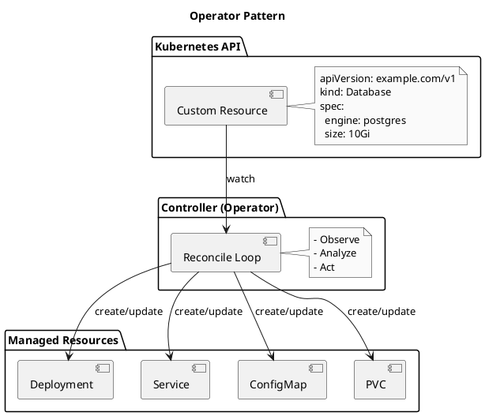
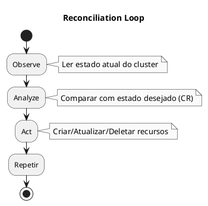

# CRDs e Operators

<span class="badge badge-cka">CKA</span> <span class="badge badge-ckad">CKAD</span>

---

## Custom Resource Definitions (CRDs)

```admonish info title="CRDs"
CRDs (Custom Resource Definitions) permitem estender a API do Kubernetes com novos tipos de recursos. Você define a estrutura e o Kubernetes gerencia o armazenamento e a API.
```

### Por que usar CRDs?

| Aspecto | Descrição |
|---------|-----------|
| **Extensibilidade** | Adicionar recursos customizados à API |
| **Consistência** | Usar kubectl e RBAC normalmente |
| **Declarativo** | Mesmo padrão dos recursos nativos |
| **Integração** | Funciona com Helm, GitOps, etc. |

### Estrutura de um CRD

```yaml
{{#include ../assets/crds-operators/crd-backup.yaml}}
```

### Criar e Usar CRD

```bash
# Criar o CRD
kubectl apply -f backup-crd.yaml

# Verificar CRD criado
kubectl get crd backups.example.com

# Agora pode criar recursos do tipo Backup
kubectl apply -f my-backup.yaml

# Listar backups
kubectl get backups
kubectl get bkp  # shortName
```

### Exemplo de Custom Resource

```yaml
{{#include ../assets/crds-operators/cr-backup-example.yaml}}
```

---

## CRD com Validação Avançada

### Validação com OpenAPI Schema

```yaml
{{#include ../assets/crds-operators/crd-database-validation.yaml}}
```

### Status Subresource

```yaml
{{#include ../assets/crds-operators/crd-status-subresource.yaml}}
```

### Additional Printer Columns

```yaml
{{#include ../assets/crds-operators/crd-printer-columns.yaml}}
```

---

## Operators

```admonish tip title="Operators"
Operators são aplicações que usam CRDs e controllers para automatizar operações complexas. Seguem o padrão "human operator" - codificam conhecimento operacional.
```

### Operator Pattern



### Reconciliation Loop



---

## Operators Populares

### Prometheus Operator

```yaml
{{#include ../assets/crds-operators/prometheus-servicemonitor.yaml}}
```

### Cert-Manager

```yaml
{{#include ../assets/crds-operators/certmanager-certificate.yaml}}
```

### Strimzi (Kafka)

```yaml
{{#include ../assets/crds-operators/strimzi-kafka.yaml}}
```

---

## Instalar Operators

### Via OperatorHub (OLM)

```bash
# Instalar OLM
curl -sL https://github.com/operator-framework/operator-lifecycle-manager/releases/download/v0.25.0/install.sh | bash -s v0.25.0

# Ver operators disponíveis
kubectl get packagemanifest -n olm
```

```yaml
{{#include ../assets/crds-operators/olm-subscription.yaml}}
```

### Via Helm

```bash
# Exemplo: cert-manager
helm repo add jetstack https://charts.jetstack.io
helm install cert-manager jetstack/cert-manager \
  --namespace cert-manager \
  --create-namespace \
  --set installCRDs=true
```

### Via kubectl apply

```bash
# Exemplo: metrics-server
kubectl apply -f https://github.com/kubernetes-sigs/metrics-server/releases/latest/download/components.yaml
```

---

## Criar Operator Simples

### Usando Kubebuilder

```bash
# Instalar kubebuilder
curl -L -o kubebuilder https://go.kubebuilder.io/dl/latest/$(go env GOOS)/$(go env GOARCH)
chmod +x kubebuilder && mv kubebuilder /usr/local/bin/

# Criar projeto
mkdir my-operator && cd my-operator
kubebuilder init --domain example.com --repo my-operator

# Criar API (CRD + Controller)
kubebuilder create api --group apps --version v1 --kind Application

# Implementar controller
# Edit: controllers/application_controller.go

# Gerar manifests
make manifests

# Instalar CRDs
make install

# Rodar controller localmente
make run
```

### Usando Operator SDK

```bash
# Instalar operator-sdk
brew install operator-sdk

# Criar projeto
operator-sdk init --domain example.com --repo my-operator

# Criar API
operator-sdk create api --group apps --version v1 --kind Application --resource --controller

# Build e deploy
make docker-build docker-push IMG=myregistry/my-operator:v1
make deploy IMG=myregistry/my-operator:v1
```

---

## Comandos Úteis

```bash
# Listar CRDs
kubectl get crd

# Detalhes de um CRD
kubectl describe crd backups.example.com

# Ver recursos de um CRD
kubectl get backups -A

# Deletar CRD (e todos os CRs!)
kubectl delete crd backups.example.com

# Ver API groups
kubectl api-resources | grep example.com

# Verificar se operator está rodando
kubectl get pods -n <operator-namespace>
kubectl logs -n <operator-namespace> <operator-pod>
```

---

## Troubleshooting

### CRD não aparece

```bash
# Verificar se foi criado
kubectl get crd | grep <name>

# Ver eventos
kubectl describe crd <name>

# Problemas comuns:
# - Schema inválido
# - Conflito de nome
```

### Controller não reconcilia

```bash
# Ver logs do controller
kubectl logs -n <namespace> <controller-pod> -f

# Verificar RBAC
kubectl auth can-i --as=system:serviceaccount:<ns>:<sa> get <resource>

# Problemas comuns:
# - RBAC insuficiente
# - Erro no código do controller
```

---

## Dicas para os Exames

```admonish tip title="Dicas CKA/CKAD"
1. **CRD define o schema**, CR é a instância
2. **Saiba ler CRDs** para entender a estrutura
3. **kubectl get crd** lista todos os CRDs
4. **Operators automatizam** operações complexas
5. **Não precisa criar operators** no exame, mas saber usar
```

### O que cai no Exame

- **CKA**: Instalar operators, entender CRDs, usar recursos de operators
- **CKAD**: Usar CRDs e CRs de operators existentes

---

## Referências

- [Custom Resources](https://kubernetes.io/docs/concepts/extend-kubernetes/api-extension/custom-resources/)
- [Operator Pattern](https://kubernetes.io/docs/concepts/extend-kubernetes/operator/)
- [OperatorHub.io](https://operatorhub.io/)
- [API Objects](../api/api-objects.md) - Objetos da API
