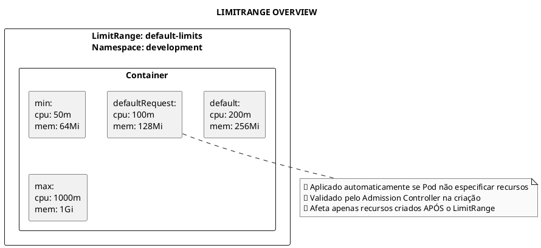
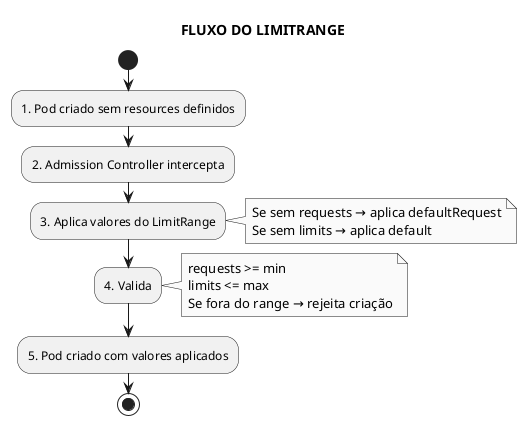
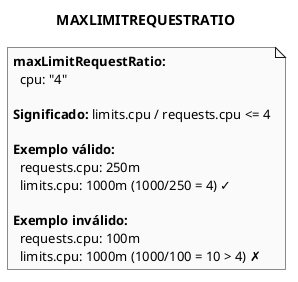
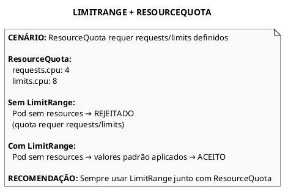

# LimitRange

```admonish info title="Certificações"
CKA (10%), CKAD (10%)
```

## Conceitos Fundamentais

### O que é LimitRange

LimitRange define valores padrão, mínimos e máximos de recursos (CPU, memória) para Containers, Pods e PVCs em um namespace. É aplicado pelo Admission Controller durante a criação de recursos.



### LimitRange vs ResourceQuota

| LimitRange | ResourceQuota |
|------------|---------------|
| Define limites por objeto (Pod/Container) | Define limites totais do namespace |
| Define valores padrão | Não define valores padrão |
| min/max por recurso | Total agregado |
| Namespace-scoped | Namespace-scoped |

### Tipos de LimitRange

| Tipo | Campos Disponíveis | Descrição |
|------|-------------------|-----------|
| `Container` | min, max, default, defaultRequest | Por container |
| `Pod` | min, max | Por pod (soma de todos containers) |
| `PersistentVolumeClaim` | min, max | Por PVC |

### Como Funciona



---

## Comandos Essenciais

### Gerenciar LimitRanges

```bash
# Listar LimitRanges
kubectl get limitranges
kubectl get limits      # forma curta

# Listar em namespace específico
kubectl get limitranges -n development

# Descrever LimitRange
kubectl describe limitrange <name> -n <namespace>

# Ver YAML
kubectl get limitrange <name> -o yaml

# Criar via arquivo
kubectl apply -f limitrange.yaml

# Deletar LimitRange
kubectl delete limitrange <name>
```

### Verificar Aplicação

```bash
# Ver se Pod teve recursos aplicados
kubectl get pod <name> -o yaml | grep -A10 resources

# Ver eventos de rejeição
kubectl get events -n <namespace> | grep -i limit
```

---

## Exemplos Práticos


### LimitRange para Pod

```yaml
{{#include ../assets/limitrange/limitrange-pod-test.yaml}}
```
### LimitRange para Container

```yaml
{{#include ../assets/limitrange/limitrange-container-test.yaml}}
```
### LimitRange para Containers (Mais Comum)

```yaml
{{#include ../assets/limit-range/limitrange-container.yaml}}
```

### LimitRange para Pods

```yaml
{{#include ../assets/limit-range/limitrange-pod.yaml}}
```

### LimitRange para PVCs

```yaml
{{#include ../assets/limit-range/limitrange-pvc.yaml}}
```

### LimitRange Completo

```yaml
{{#include ../assets/limit-range/limitrange-completo.yaml}}
```

### Pod Sem Resources (Valores Aplicados Automaticamente)

```yaml
{{#include ../assets/limit-range/pod-sem-resources.yaml}}
```

### Pod Com Resources Parciais

```yaml
{{#include ../assets/limit-range/pod-recursos-parciais.yaml}}
```

### Pod Que Viola LimitRange

```yaml
{{#include ../assets/limit-range/pod-viola-limitrange.yaml}}
```

---

## Max Limit Request Ratio

### Conceito

Controla a razão máxima entre limits e requests.



```yaml
{{#include ../assets/limit-range/limitrange-ratio.yaml}}
```

---

## Interação com ResourceQuota



```yaml
{{#include ../assets/limit-range/namespace-com-limitrange-quota.yaml}}
```

---

## Troubleshooting

### Problema: Pod Rejeitado por Violar Limites

```bash
# Ver erro detalhado
kubectl describe pod <pod-name>

# Ou ver eventos
kubectl get events -n <namespace> --sort-by=.metadata.creationTimestamp

# Mensagens comuns:
# - "minimum cpu usage per Container is X, but request is Y"
# - "maximum memory usage per Container is X, but limit is Y"

# Verificar LimitRange atual
kubectl describe limitrange -n <namespace>
```

### Problema: Valores Padrão Não Aplicados

```bash
# Verificar se LimitRange existe no namespace
kubectl get limitrange -n <namespace>

# LimitRange só afeta recursos criados APÓS sua criação
# Pods existentes NÃO são atualizados

# Recriar Pod para aplicar novos limites
kubectl delete pod <name> -n <namespace>
kubectl apply -f pod.yaml
```

### Problema: Pod Não Consegue Ser Agendado

```bash
# Se LimitRange define requests muito altos:
kubectl describe pod <pod-name>
# "Insufficient cpu" ou "Insufficient memory"

# Verificar recursos disponíveis nos nodes
kubectl describe nodes | grep -A5 "Allocated resources"

# Ajustar defaultRequest no LimitRange
```

### Verificar Recursos Aplicados

```bash
# Ver recursos que foram aplicados ao Pod
kubectl get pod <name> -o jsonpath='{.spec.containers[*].resources}'

# Ver de forma formatada
kubectl get pod <name> -o yaml | grep -A10 resources:
```

---

## Dicas para o Exame

### CKA/CKAD

```admonish tip title="Dicas CKA/CKAD"
1. **Tipos de LimitRange**: Container, Pod, PersistentVolumeClaim

2. **Campos do tipo Container**:
   - `default`: limits padrão
   - `defaultRequest`: requests padrão
   - `min`: mínimo permitido
   - `max`: máximo permitido

3. **Tipo Pod NÃO tem**: default e defaultRequest

4. **Validação acontece na criação**: Pods existentes não são afetados

5. **Sempre usar com ResourceQuota**: Para evitar rejeição de Pods sem resources
```

### Comandos Úteis para o Exame

```bash
# Ver LimitRanges
kubectl get limitranges -n <namespace>

# Descrever LimitRange
kubectl describe limitrange <name> -n <namespace>

# Ver se Pod teve recursos aplicados
kubectl get pod <name> -o yaml | grep -A10 resources
```

```yaml
# Criar LimitRange básico rapidamente
{{#include ../assets/limit-range/limitrange-quick.yaml}}
```

```bash
# Aplicar o LimitRange
kubectl apply -f limitrange-quick.yaml
```

### Template Rápido: LimitRange

```yaml
{{#include ../assets/limit-range/template-limitrange.yaml}}
```

---

## Referências

- [Kubernetes - LimitRange](https://kubernetes.io/docs/concepts/policy/limit-range/)
- [Kubernetes - Configure Default Memory Requests and Limits](https://kubernetes.io/docs/tasks/administer-cluster/manage-resources/memory-default-namespace/)
- [Kubernetes - Configure Default CPU Requests and Limits](https://kubernetes.io/docs/tasks/administer-cluster/manage-resources/cpu-default-namespace/)

### Arquivos Relacionados

- [ResourceQuota](resource-quota.md) - Quotas totais do namespace
- [Namespace](fundamentals/namespace.md) - Organização por namespace
- [Pod Resources](../workloads/pod.md) - Requests e Limits em Pods
- [Multi Tenancy](../security/multi-tenancy.md) - Isolamento multi-tenant


---

### LimitRange para PVC

```yaml
{{#include ../assets/limitrange/limitrange-pvc-test.yaml}}
```
