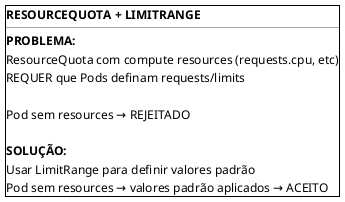

# ResourceQuota

```admonish info title="Certificações"
CKA (10%), CKAD (10%)
```

## Conceitos Fundamentais

### O que é ResourceQuota

ResourceQuota define limites agregados de recursos computacionais e objetos que podem existir em um namespace. Permite controlar o consumo total de recursos por namespace.

```plantuml,format=png
!include ../assets/diagrams/configuration/resource-quota-resourcequota-overview.puml
```

### ResourceQuota vs LimitRange

| ResourceQuota | LimitRange |
|---------------|------------|
| Limites **totais** do namespace | Limites **por objeto** |
| Não define valores padrão | Define valores padrão |
| Agregado de todos os recursos | Individual (Container/Pod/PVC) |
| `requests.cpu: 4` = total | `max.cpu: 2` = por container |

### Tipos de Recursos Controlados

```plantuml,format=png
!include ../assets/diagrams/configuration/resource-quota-recursos-controlados.puml
```

---

## Comandos Essenciais

### Gerenciar ResourceQuotas

```bash
# Listar ResourceQuotas
kubectl get resourcequotas
kubectl get quota         # forma curta

# Listar em namespace específico
kubectl get quota -n development

# Ver detalhes (usado vs limite)
kubectl describe quota <name> -n <namespace>

# Ver YAML
kubectl get quota <name> -o yaml

# Criar via arquivo
kubectl apply -f resourcequota.yaml

# Criar rapidamente
kubectl create quota my-quota --hard=pods=10,services=5 -n development

# Deletar ResourceQuota
kubectl delete quota <name>
```

### Verificar Uso

```bash
# Ver uso atual vs limite
kubectl describe resourcequota <name> -n <namespace>

# Output:
# Name:            team-quota
# Namespace:       development
# Resource         Used  Hard
# --------         ----  ----
# pods             5     10
# requests.cpu     2     4
# requests.memory  4Gi   8Gi
```

---

## Exemplos Práticos


### ResourceQuota Básica

```yaml
{{#include ../assets/resourcequota/resourcequota-test.yaml}}
```
### ResourceQuota de Compute

```yaml
{{#include ../assets/resource-quota/compute-quota.yaml}}
```

### ResourceQuota de Objetos

```yaml
{{#include ../assets/resource-quota/object-quota.yaml}}
```

### ResourceQuota de Storage

```yaml
{{#include ../assets/resource-quota/storage-quota.yaml}}
```

### ResourceQuota Completo

```yaml
{{#include ../assets/resource-quota/complete-quota.yaml}}
```

### ResourceQuota com Scopes

```yaml
{{#include ../assets/resource-quota/scopes-quota.yaml}}
```

### Scopes Disponíveis

| Scope | Descrição |
|-------|-----------|
| `Terminating` | Pods com `activeDeadlineSeconds` definido |
| `NotTerminating` | Pods sem `activeDeadlineSeconds` |
| `BestEffort` | Pods QoS BestEffort (sem requests/limits) |
| `NotBestEffort` | Pods QoS não-BestEffort |
| `PriorityClass` | Pods com PriorityClass específica |

### ResourceQuota com PriorityClass

```yaml
{{#include ../assets/resource-quota/priority-class-quota.yaml}}
```

---

## ResourceQuota + LimitRange (Uso Recomendado)

### Por que Usar Juntos?



### Exemplo Completo

```yaml
{{#include ../assets/resource-quota/complete-example.yaml}}
```

---

## Troubleshooting

### Problema: Pod Rejeitado por Quota

```bash
# Ver erro detalhado
kubectl describe pod <pod-name>

# Mensagens comuns:
# "exceeded quota: team-quota"
# "must specify limits.cpu"
# "must specify requests.memory"

# Ver uso atual da quota
kubectl describe quota -n <namespace>

# Solução 1: Adicionar resources ao Pod
# Solução 2: Aumentar quota
# Solução 3: Adicionar LimitRange
```

### Problema: Quota Não Mostra Uso Correto

```bash
# Verificar se recursos estão no namespace correto
kubectl get pods -n <namespace>

# Verificar resources dos pods
kubectl get pods -n <namespace> -o json | jq '.items[].spec.containers[].resources'

# Forçar recálculo (deletar e recriar quota)
kubectl delete quota <name> -n <namespace>
kubectl apply -f quota.yaml
```

### Verificar Capacidade Restante

```bash
# Ver quota detalhada
kubectl describe quota -n <namespace>

# Calcular quanto resta
# Exemplo: Hard: 10, Used: 7 → Disponível: 3
```

### Problema: Pod Pendente por Falta de Resources

```bash
# Se quota esgotada, pods ficam Pending
kubectl get pods -n <namespace>

# Verificar eventos
kubectl get events -n <namespace> --sort-by=.metadata.creationTimestamp

# Opções:
# 1. Deletar pods não usados
# 2. Reduzir resources de pods existentes
# 3. Aumentar quota (se permitido)
```

---

## Dicas para o Exame

### CKA/CKAD

```admonish tip title="Dicas CKA/CKAD"
1. **Criar quota rapidamente**:
   ```bash
   kubectl create quota my-quota --hard=pods=10,services=5 -n <ns>
   ```

2. **Ver uso atual**:
   ```bash
   kubectl describe quota -n <namespace>
   ```

3. **Quota com compute resources requer LimitRange**:
   - Pods sem requests/limits serão rejeitados
   - Sempre usar LimitRange junto

4. **Scopes**: BestEffort, NotBestEffort, Terminating, NotTerminating

5. **Count de recursos**:
   ```yaml
{{#include ../assets/configuration/resource-quota-example-1.yaml}}
```
```

### Comandos Úteis para o Exame

```bash
# Criar quota rápida
kubectl create quota my-quota --hard=pods=10,requests.cpu=4 -n development

# Ver quotas
kubectl get quota -n <namespace>

# Ver uso detalhado
kubectl describe quota <name> -n <namespace>

# Ver todos recursos e uso
kubectl describe quota -n <namespace>

# Criar namespace com quota
kubectl create ns team-a
kubectl create quota team-a-quota --hard=pods=20,services=10 -n team-a
```

### Template Rápido: ResourceQuota

```yaml
{{#include ../assets/resource-quota/template-quota.yaml}}
```

---

## Referências

- [Kubernetes - Resource Quotas](https://kubernetes.io/docs/concepts/policy/resource-quotas/)
- [Kubernetes - Configure Quotas for API Objects](https://kubernetes.io/docs/tasks/administer-cluster/quota-api-object/)
- [Kubernetes - Configure Memory and CPU Quotas](https://kubernetes.io/docs/tasks/administer-cluster/manage-resources/quota-memory-cpu-namespace/)

### Arquivos Relacionados

- [LimitRange](limit-range.md) - Limites por objeto
- [Namespace](fundamentals/namespace.md) - Organização por namespace
- [Multi Tenancy](../security/multi-tenancy.md) - Isolamento multi-tenant
- [Scheduling](../workloads/scheduling.md) - QoS classes e PriorityClass

---

### ResourceQuota com LimitRange (Importante!)

```plantuml,format=png
!include ../assets/diagrams/configuration/resource-quota-diagram-3.puml
```
