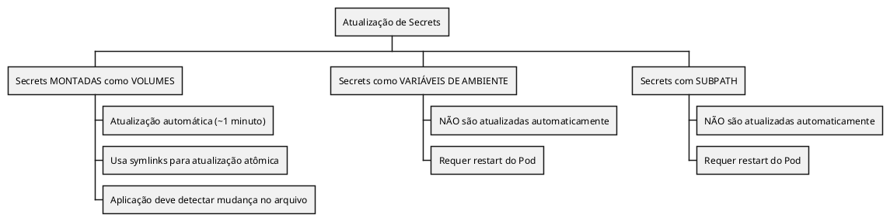

# Secrets

```admonish info title="Certificações"
CKA (10%), CKAD (15%), CKS (20%)
```

## Conceitos Fundamentais

### O que são Secrets

Secrets armazenam dados sensíveis como senhas, tokens e chaves. Os dados são codificados em base64 (não criptografados por padrão).

```plantuml,format=png
!include ../assets/diagrams/configuration/secrets-secrets-overview.puml
```

### Tipos de Secrets

| Tipo | Descrição | Uso |
|------|-----------|-----|
| `Opaque` | Dados arbitrários (padrão) | Senhas, tokens |
| `kubernetes.io/tls` | Certificado TLS | Ingress, mTLS |
| `kubernetes.io/dockerconfigjson` | Credenciais Docker | Pull de imagens privadas |
| `kubernetes.io/basic-auth` | Autenticação básica | Usuário/senha |
| `kubernetes.io/ssh-auth` | Chave SSH | Git, SSH |
| `kubernetes.io/service-account-token` | Token ServiceAccount | Automático |

### Formas de Usar Secrets

```plantuml,format=png
!include ../assets/diagrams/configuration/secrets-formas-de-consumir-secrets.puml
```

---

## Comandos Essenciais

### Criar Secrets

```bash
# Secret genérica de literal
kubectl create secret generic my-secret --from-literal=password=mypass123

# Secret de arquivo
kubectl create secret generic my-secret --from-file=./credentials.txt

# Secret de arquivo com chave específica
kubectl create secret generic my-secret --from-file=key=./file.txt

# Secret TLS (certificado)
kubectl create secret tls my-tls-secret --cert=tls.crt --key=tls.key

# Secret Docker Registry
kubectl create secret docker-registry my-registry \
  --docker-server=https://index.docker.io/v1/ \
  --docker-username=myuser \
  --docker-password=mypass \
  --docker-email=me@example.com

# Com dry-run para YAML
kubectl create secret generic my-secret --from-literal=key=value --dry-run=client -o yaml

# Via arquivo YAML
kubectl apply -f secret.yaml
```

### Gerenciar Secrets

```bash
# Listar Secrets
kubectl get secrets
kubectl get secret      # singular também funciona

# Ver Secrets de todos os namespaces
kubectl get secrets -A

# Descrever Secret (não mostra dados)
kubectl describe secret <name>

# Ver YAML do Secret (dados em base64)
kubectl get secret <name> -o yaml

# Decodificar valor específico
kubectl get secret <name> -o jsonpath='{.data.password}' | base64 -d

# Editar Secret
kubectl edit secret <name>
```

### Deletar Secrets

```bash
# Deletar Secret
kubectl delete secret <name>

# Deletar por arquivo
kubectl delete -f secret.yaml
```

---

## Exemplos Práticos

### Secret Opaque (Genérica)

```yaml
{{#include ../assets/secrets/secret-opaque.yaml}}
```

### Codificar/Decodificar Base64

```admonish important title="Importante"
Use `-n` no echo para não incluir newline no valor codificado.
```

```bash
# Codificar
echo -n 'mysecretpassword' | base64
# Output: bXlzZWNyZXRwYXNzd29yZA==

# Decodificar
echo 'bXlzZWNyZXRwYXNzd29yZA==' | base64 -d
# Output: mysecretpassword
```

### Pod com Variável de Ambiente (valueFrom)

```yaml
{{#include ../assets/secrets/pod-env-valuefrom.yaml}}
```

### Pod com Todas as Variáveis (envFrom)

```yaml
{{#include ../assets/secrets/pod-envfrom.yaml}}
```

### Pod com Volume

```yaml
{{#include ../assets/secrets/pod-volume.yaml}}
```

### Pod com Volume (Items Específicos)

```yaml
{{#include ../assets/secrets/pod-volume-items.yaml}}
```

### Secret TLS para Ingress

```yaml
{{#include ../assets/secrets/secret-tls-ingress.yaml}}
```

### Secret Docker Registry

```yaml
{{#include ../assets/secrets/secret-docker-registry.yaml}}
```

```bash
# Criar secret Docker via comando
kubectl create secret docker-registry my-registry \
  --docker-server=myprivateregistry.com \
  --docker-username=myuser \
  --docker-password=mypass
```

### Secret Imutável

```yaml
{{#include ../assets/secrets/secret-imutavel.yaml}}
```

---

## Segurança de Secrets

### Problemas de Segurança

```plantuml,format=png
!include ../assets/diagrams/configuration/secrets-problemas-de-segurança.puml
```

### RBAC para Secrets

```yaml
{{#include ../assets/secrets/rbac-secrets.yaml}}
```

### Volumes vs Environment Variables

```plantuml,format=png
!include ../assets/diagrams/configuration/secrets-volumes-vs-env-vars.puml
```


### Secret como Volume

```yaml
{{#include ../assets/secrets/pod-with-secrets-volume.yaml}}
```
### Secret como Volume (items específicos)

```yaml
{{#include ../assets/secrets/pod-with-secrets-volume-items.yaml}}
```
---

## Atualização de Secrets

### Comportamento



---

## Troubleshooting

### Problema: Secret Não Encontrada

```bash
# Verificar se Secret existe
kubectl get secret <name>

# Verificar namespace
kubectl get secret <name> -n <namespace>

# Verificar se Pod está no mesmo namespace
kubectl get pod <pod-name> -o yaml | grep namespace
```

### Problema: Valor Incorreto

```bash
# Ver valor decodificado
kubectl get secret <name> -o jsonpath='{.data.<key>}' | base64 -d

# Verificar se usou -n ao codificar (sem newline)
echo -n 'value' | base64  # Correto
echo 'value' | base64     # Incorreto (inclui \n)
```

### Problema: Secret Não Atualiza no Pod

```bash
# Se usando variáveis de ambiente, restartar Pod
kubectl delete pod <name>

# Se usando volume com subPath, restartar Pod
kubectl rollout restart deployment/<name>

# Se usando volume normal, aguardar ~1 minuto
```

### Verificar Secret Dentro do Pod

```bash
# Ver variáveis de ambiente
kubectl exec <pod> -- env | grep -i secret

# Ver arquivos de secret montados
kubectl exec <pod> -- ls -la /path/to/secret
kubectl exec <pod> -- cat /path/to/secret/<key>
```

---

## Dicas para o Exame

### CKS

```admonish tip title="Dicas CKS"
1. **Base64 não é seguro**: Sempre mencionar Encryption at Rest

2. **Encryption at Rest**:
   - Configurar EncryptionConfiguration
   - Usar provider: aescbc, kms, ou secretbox

3. **RBAC para Secrets**: Restringir quem pode ler/criar secrets

4. **Preferir volumes a env vars** para dados sensíveis

5. **defaultMode: 0400** para permissões restritivas
```

### CKAD

```admonish tip title="Dicas CKAD"
1. **Criar Secret rápido**:
   ```bash
   kubectl create secret generic my-secret --from-literal=pass=123
   ```

2. **Decodificar Secret**:
   ```bash
   kubectl get secret <name> -o jsonpath='{.data.key}' | base64 -d
   ```

3. **Três formas de consumir**:
   - `env.valueFrom.secretKeyRef`
   - `envFrom.secretRef`
   - `volumes.secret`

4. **stringData** no YAML: valores em texto plano
```

### CKA

```admonish tip title="Dicas CKA"
1. **imagePullSecrets**: Para registries privados

2. **Secret TLS**: `kubectl create secret tls`

3. **Secrets são namespace-scoped**
```

### Comandos Úteis para o Exame

```bash
# Criar secret genérica
kubectl create secret generic my-secret --from-literal=user=admin --from-literal=pass=123

# Criar secret de arquivo
kubectl create secret generic my-secret --from-file=ssh-key=./id_rsa

# Criar secret TLS
kubectl create secret tls my-tls --cert=tls.crt --key=tls.key

# Criar secret Docker
kubectl create secret docker-registry my-reg \
  --docker-server=registry.io \
  --docker-username=user \
  --docker-password=pass

# Ver secret decodificada
kubectl get secret my-secret -o jsonpath='{.data.pass}' | base64 -d

# Injetar em Deployment
kubectl set env deployment/<name> --from=secret/<secret-name>
```

### Template Rápido: Pod com Secret

```yaml
{{#include ../assets/secrets/pod-template-rapido.yaml}}
```

---

## Referências

- [Kubernetes - Secrets](https://kubernetes.io/docs/concepts/configuration/secret/)
- [Kubernetes - Managing Secrets](https://kubernetes.io/docs/tasks/configmap-secret/managing-secret-using-kubectl/)
- [Kubernetes - Encrypting Secret Data at Rest](https://kubernetes.io/docs/tasks/administer-cluster/encrypt-data/)

### Arquivos Relacionados

- [ConfigMap](configmap.md) - Para dados não sensíveis
- [etcd Encryption](../security/etcd.md) - Encryption at Rest
- [RBAC](../security/rbac.md) - Controle de acesso
- [ServiceAccount](../security/service-account.md) - Tokens automáticos


---

### Pod com Secret via Env

```yaml
{{#include ../assets/secrets/pod-with-secrets-env-value.yaml}}
```


---

### Pod com Secret via envFrom

```yaml
{{#include ../assets/secrets/pod-with-secrets-envfrom.yaml}}
```


---

### Deployment com imagePullSecrets

```yaml
{{#include ../assets/secrets/deploy-with-imagepullsecrets.yaml}}
```
