# Cloud Native

```admonish info title="Certificações"
KCNA (16%)
```

## Conceitos Fundamentais

### O que é Cloud Native?

Cloud Native é uma abordagem para construir e executar aplicações que exploram ao máximo as vantagens do modelo de computação em nuvem.

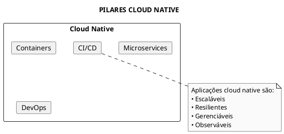

### Definição da CNCF

A **Cloud Native Computing Foundation (CNCF)** define Cloud Native como:

> "Tecnologias cloud native capacitam organizações a construir e executar aplicações escaláveis em ambientes modernos e dinâmicos como nuvens públicas, privadas e híbridas. Containers, service meshes, microservices, infraestrutura imutável e APIs declarativas exemplificam essa abordagem."

---

## CNCF - Cloud Native Computing Foundation

### O que é a CNCF?

- Fundação open-source parte da Linux Foundation
- Hospeda projetos críticos como Kubernetes, Prometheus, Envoy
- Define padrões e promove adoção de tecnologias cloud native

### Estágios de Projetos CNCF

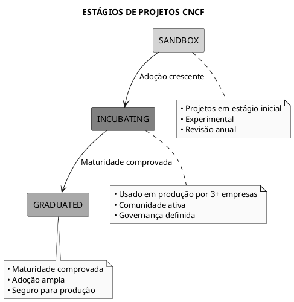

### Projetos Graduated (Memorizar para KCNA)

| Projeto | Função | Categoria |
|---------|--------|-----------|
| **Kubernetes** | Orquestração de containers | Orchestration |
| **Prometheus** | Monitoramento e métricas | Observability |
| **Envoy** | Service proxy | Service Mesh |
| **CoreDNS** | DNS para clusters | Networking |
| **containerd** | Container runtime | Runtime |
| **Helm** | Package manager | App Definition |
| **Jaeger** | Distributed tracing | Observability |
| **Fluentd** | Logging | Observability |
| **Harbor** | Container registry | Registry |
| **etcd** | Key-value store | Database |
| **Argo** | GitOps/Workflows | CI/CD |
| **Flux** | GitOps | CI/CD |

### Projetos Incubating Importantes

| Projeto | Função |
|---------|--------|
| **OpenTelemetry** | Telemetria unificada |
| **Linkerd** | Service mesh |
| **gRPC** | RPC framework |
| **NATS** | Messaging |
| **Falco** | Runtime security |
| **Keda** | Event-driven autoscaling |

---

## 12-Factor App

Metodologia para construir aplicações SaaS modernas. Essencial para KCNA.

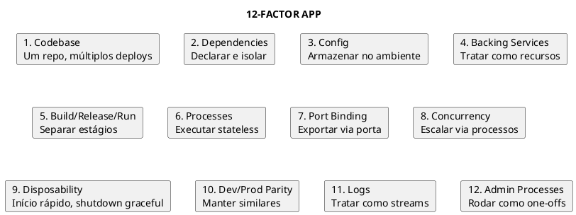

### Mapeamento para Kubernetes

| Factor | Implementação no Kubernetes |
|--------|----------------------------|
| **1. Codebase** | Container image versionada |
| **2. Dependencies** | Dockerfile com todas deps |
| **3. Config** | ConfigMaps e Secrets |
| **4. Backing Services** | Services externos via DNS |
| **5. Build/Release/Run** | CI/CD pipeline |
| **6. Processes** | Pods stateless |
| **7. Port Binding** | containerPort + Service |
| **8. Concurrency** | HPA, replicas |
| **9. Disposability** | Probes, graceful shutdown |
| **10. Dev/Prod Parity** | Namespaces, Helm values |
| **11. Logs** | stdout/stderr → Fluentd |
| **12. Admin** | Jobs, kubectl exec |

---

## Microservices

### Microservices vs Monolith

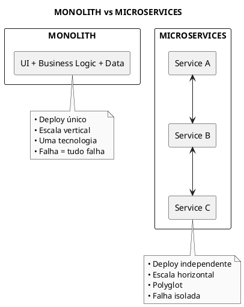

### Características de Microservices

| Característica | Descrição |
|----------------|-----------|
| **Independência** | Deploy, escala e falha independentes |
| **Single Responsibility** | Cada serviço faz uma coisa bem |
| **Comunicação via API** | REST, gRPC, mensageria |
| **Dados descentralizados** | Cada serviço tem seu banco |
| **Automação** | CI/CD é essencial |

### Padrões de Comunicação

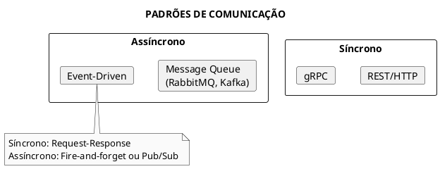

---

## Service Mesh

### O que é Service Mesh?

Camada de infraestrutura dedicada para comunicação service-to-service.

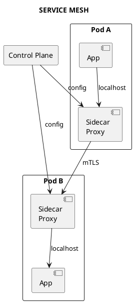

### Funcionalidades

| Funcionalidade | Descrição |
|----------------|-----------|
| **mTLS** | Criptografia e autenticação entre serviços |
| **Traffic Management** | Routing, load balancing, canary |
| **Observability** | Métricas, traces, logs |
| **Resilience** | Retries, circuit breaker, timeout |

### Service Meshes Populares

| Service Mesh | Características |
|--------------|-----------------|
| **Istio** | Mais features, mais complexo |
| **Linkerd** | Mais simples, CNCF graduated |
| **Cilium** | Baseado em eBPF, alto desempenho |

---

## Serverless

### Conceito

Modelo onde o provedor gerencia a infraestrutura e escala automaticamente, incluindo scale-to-zero.

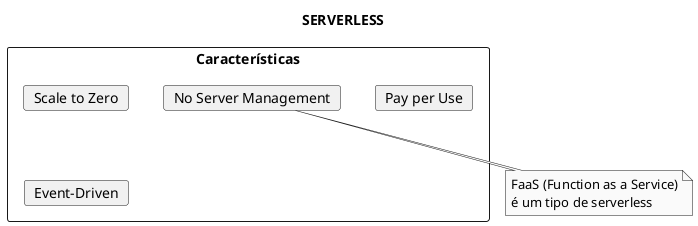

### Serverless no Kubernetes

| Projeto | Descrição |
|---------|-----------|
| **Knative** | Plataforma serverless para K8s (CNCF) |
| **OpenFaaS** | Functions as a Service |
| **Kubeless** | Funções serverless nativas |
| **KEDA** | Event-driven autoscaling |

### Knative Components

| Componente | Função |
|------------|--------|
| **Serving** | Auto-scaling, routing, scale-to-zero |
| **Eventing** | Event sources, triggers, channels |

---

## GitOps

### Princípios GitOps

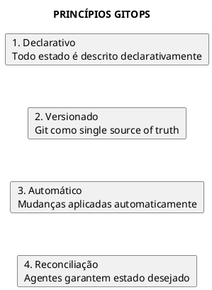

### Fluxo GitOps

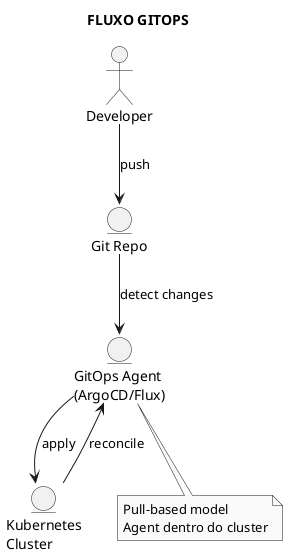

### Ferramentas GitOps

| Ferramenta | Status CNCF | Características |
|------------|-------------|-----------------|
| **ArgoCD** | Graduated | UI rica, multi-cluster |
| **Flux** | Graduated | Mais leve, helm/kustomize nativo |

---

## CI/CD

### Continuous Integration (CI)

```plaintext
CI = Build + Test automaticamente a cada commit

Objetivo:
- Detectar erros cedo
- Manter código sempre integrável
- Feedback rápido
```

### Continuous Delivery vs Deployment

| Aspecto | Continuous Delivery | Continuous Deployment |
|---------|--------------------|-----------------------|
| **Deploy para Prod** | Manual (aprovação) | Automático |
| **Risco** | Menor | Maior |
| **Velocidade** | Média | Alta |

### Pipeline Típico

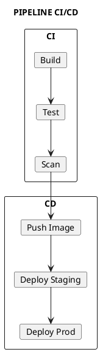

### Ferramentas CI/CD

| Categoria | Ferramentas |
|-----------|-------------|
| **CI** | Jenkins, GitHub Actions, GitLab CI, CircleCI |
| **CD** | ArgoCD, Flux, Spinnaker |
| **Cloud Native CI** | Tekton (CNCF) |

---

## Autoscaling

### Tipos de Autoscaling

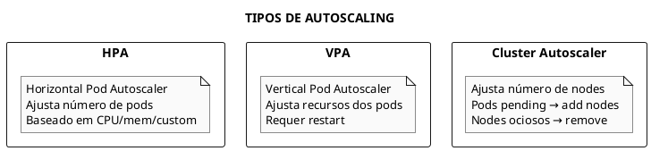

### Quando Usar

| Tipo | Quando Usar |
|------|-------------|
| **HPA** | Apps stateless, carga variável |
| **VPA** | Otimizar requests, apps stateful |
| **Cluster Autoscaler** | Workloads dinâmicos em cloud |
| **KEDA** | Event-driven, scale-to-zero |

---

## Observabilidade

### Os Três Pilares

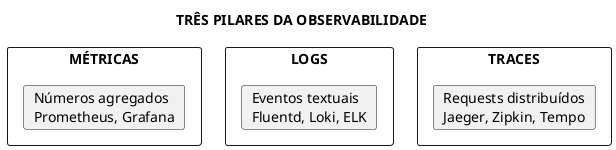

### OpenTelemetry

Padrão unificado para telemetria (métricas, logs, traces).

```plaintext
OpenTelemetry = OpenTracing + OpenCensus

Componentes:
- SDKs para instrumentação
- Collector para processar dados
- Exporters para backends
```

---

## Papéis e Responsabilidades

### SRE - Site Reliability Engineering

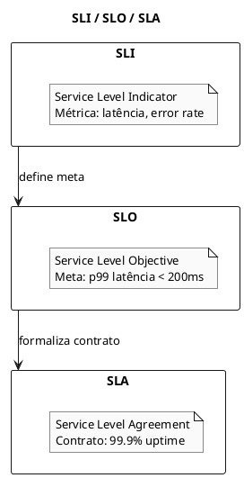

### Papéis Cloud Native

| Papel | Foco |
|-------|------|
| **DevOps Engineer** | Automação, CI/CD, infraestrutura |
| **SRE** | Confiabilidade, SLOs, incident response |
| **Platform Engineer** | Plataforma interna, developer experience |
| **Cloud Architect** | Design de infraestrutura cloud |

---

## Dicas para o Exame KCNA

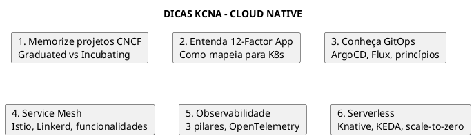

### Conceitos-Chave para Memorizar

| Conceito | Lembrar |
|----------|---------|
| **CNCF** | Linux Foundation, projetos graduated |
| **12-Factor** | Config no ambiente, processes stateless |
| **GitOps** | Git = source of truth, reconciliação |
| **Service Mesh** | Sidecar proxy, mTLS, traffic management |
| **Observability** | Métricas + Logs + Traces |
| **Serverless** | Scale-to-zero, event-driven |

---

## Referências

### Documentação
- [CNCF](https://www.cncf.io/)
- [12-Factor App](https://12factor.net/)
- [CNCF Landscape](https://landscape.cncf.io/)

### Arquivos Relacionados
- [KCNA](certifications/kcna.md) - Guia completo KCNA
- [Arquitetura](fundamentals/arquitetura.md) - Arquitetura Kubernetes
- [Observabilidade](observability/observabilidade.md) - Pilares da observabilidade
- [Helm](tools/helm.md) - Package manager
- [HPA](workloads/horizontal-pod-autoscaler.md) - Autoscaling
