# Containers

> **Certificacoes**: KCNA (16%), CKA (5%)

## Conceitos Fundamentais

### O que sao Containers?

Containers sao unidades padronizadas de software que empacotam codigo e todas as suas dependencias para que a aplicacao execute de forma rapida e confiavel em diferentes ambientes computacionais.

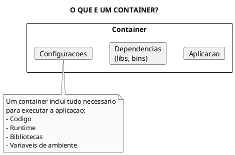

### Caracteristicas Principais

| Caracteristica | Descricao |
|----------------|-----------|
| **Isolamento** | Processos separados do host e de outros containers |
| **Portabilidade** | Executa identicamente em qualquer ambiente |
| **Leveza** | Compartilha kernel do host, sem SO completo |
| **Imutabilidade** | Imagem nao muda apos criada |
| **Efemero** | Pode ser destruido e recriado rapidamente |

---

## Containers vs Maquinas Virtuais

### Comparacao Arquitetural

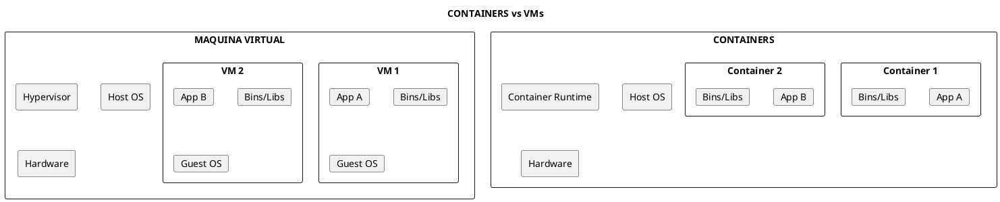

### Diferencas Detalhadas

| Aspecto | Containers | Maquinas Virtuais |
|---------|------------|-------------------|
| **Inicializacao** | Segundos | Minutos |
| **Tamanho** | MBs | GBs |
| **Isolamento** | Nivel de processo | Nivel de hardware |
| **SO** | Compartilha kernel | SO completo por VM |
| **Performance** | Near-native | Overhead do hypervisor |
| **Densidade** | 100s por host | 10s por host |
| **Portabilidade** | Alta (imagem padrao) | Media (depende do hypervisor) |
| **Seguranca** | Isolamento menor | Isolamento maior |

### Quando Usar Cada Um

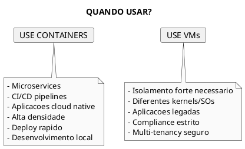

---

## Tecnologias Linux Fundamentais

### Namespaces

Namespaces fornecem isolamento de recursos do sistema para processos.

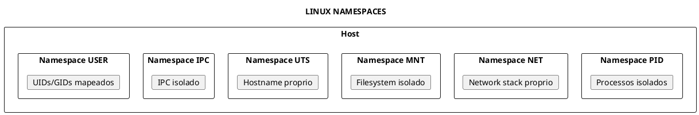

### Tipos de Namespaces

| Namespace | Isolamento | Descricao |
|-----------|------------|-----------|
| **PID** | Processos | Container ve apenas seus processos (PID 1) |
| **NET** | Rede | Interface de rede, IPs, portas proprias |
| **MNT** | Filesystem | Pontos de montagem isolados |
| **UTS** | Hostname | Nome de host e dominio proprios |
| **IPC** | Comunicacao | Filas de mensagens, semaforos |
| **USER** | Usuarios | Mapeamento de UIDs (rootless containers) |
| **CGROUP** | cgroups | Hierarquia de cgroups propria |

### Comandos para Explorar Namespaces

```bash
# Listar namespaces de um processo
ls -la /proc/self/ns/

# Ver namespaces de um container (usando crictl)
crictl inspect <container-id> | jq '.info.runtimeSpec.linux.namespaces'

# Criar processo em novo namespace
unshare --pid --mount-proc --fork bash

# Entrar no namespace de outro processo
nsenter -t <PID> -n ip addr
```

### Control Groups (cgroups)

Cgroups limitam e contabilizam recursos usados por processos.

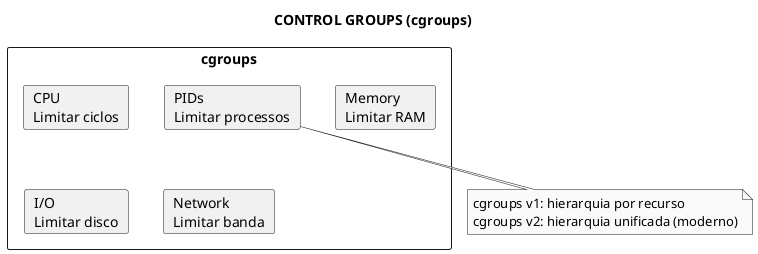

### Recursos Controlados por cgroups

| Controlador | Funcao | Exemplo |
|-------------|--------|---------|
| **cpu** | Tempo de CPU | Limitar a 50% de um core |
| **cpuset** | Pinning de CPU | Usar apenas cores 0-3 |
| **memory** | Memoria RAM | Limitar a 512MB |
| **blkio** | I/O de disco | Limitar IOPS |
| **pids** | Numero de processos | Max 100 processos |
| **devices** | Acesso a devices | Bloquear /dev/sda |

### Comandos para Explorar cgroups

```bash
# Ver hierarquia de cgroups (v2)
cat /proc/self/cgroup

# Ver limites de memoria de um container
cat /sys/fs/cgroup/system.slice/containerd.service/memory.max

# Ver uso de CPU
cat /sys/fs/cgroup/cpu.stat

# Listar controllers disponiveis
cat /sys/fs/cgroup/cgroup.controllers
```

---

## Open Container Initiative (OCI)

### O que e a OCI?

A **Open Container Initiative** e uma estrutura de governanca da Linux Foundation para criar padroes abertos para containers.

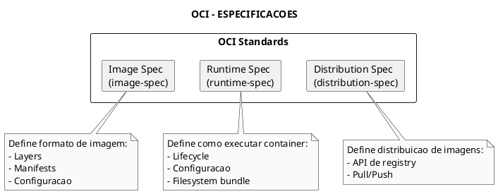

### Especificacoes OCI

| Especificacao | Descricao | Arquivo |
|---------------|-----------|---------|
| **Runtime Spec** | Como executar um container | `config.json` |
| **Image Spec** | Formato de imagens | `manifest.json`, layers |
| **Distribution Spec** | API de registries | HTTP API para pull/push |

### OCI Runtime Spec - config.json

```json
{
  "ociVersion": "1.0.2",
  "process": {
    "terminal": false,
    "user": { "uid": 0, "gid": 0 },
    "args": ["nginx", "-g", "daemon off;"],
    "env": ["PATH=/usr/local/sbin:/usr/local/bin:/usr/sbin:/usr/bin"],
    "cwd": "/"
  },
  "root": {
    "path": "rootfs",
    "readonly": false
  },
  "mounts": [
    { "destination": "/proc", "type": "proc", "source": "proc" }
  ],
  "linux": {
    "namespaces": [
      { "type": "pid" },
      { "type": "network" },
      { "type": "mount" }
    ],
    "resources": {
      "memory": { "limit": 536870912 },
      "cpu": { "shares": 1024 }
    }
  }
}
```

### Beneficios dos Padroes OCI

| Beneficio | Descricao |
|-----------|-----------|
| **Interoperabilidade** | Imagens funcionam em qualquer runtime OCI |
| **Portabilidade** | Mover containers entre plataformas |
| **Ecossistema** | Ferramentas diferentes funcionam juntas |
| **Vendor-neutral** | Nao dependencia de um fornecedor |

---

## Container Runtimes

### Hierarquia de Runtimes

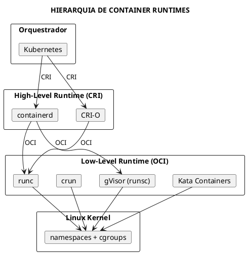

### High-Level Runtimes (CRI)

Implementam a Container Runtime Interface do Kubernetes.

| Runtime | Descricao | Uso |
|---------|-----------|-----|
| **containerd** | Runtime padrao, spin-off do Docker | Padrao em K8s |
| **CRI-O** | Runtime leve especifico para K8s | OpenShift |

### Low-Level Runtimes (OCI)

Executam containers seguindo a especificacao OCI.

| Runtime | Descricao | Seguranca |
|---------|-----------|-----------|
| **runc** | Runtime de referencia OCI | Padrao |
| **crun** | Runtime em C, mais rapido | Padrao |
| **gVisor** | Kernel em userspace | Alta (sandbox) |
| **Kata Containers** | VMs leves | Muito alta |
| **Firecracker** | microVMs | Alta (AWS Lambda) |

### Container Runtime Interface (CRI)

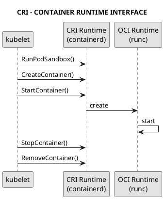

### Operacoes CRI Principais

| Operacao | Descricao |
|----------|-----------|
| `RunPodSandbox` | Criar sandbox (namespace, rede) |
| `StopPodSandbox` | Parar sandbox |
| `RemovePodSandbox` | Remover sandbox |
| `CreateContainer` | Criar container no sandbox |
| `StartContainer` | Iniciar container |
| `StopContainer` | Parar container |
| `RemoveContainer` | Remover container |
| `ListContainers` | Listar containers |
| `ContainerStatus` | Status de um container |
| `ExecSync` | Executar comando |
| `Attach` | Conectar a stdin/stdout |
| `PortForward` | Port forwarding |

---

## Container Images

### Anatomia de uma Imagem

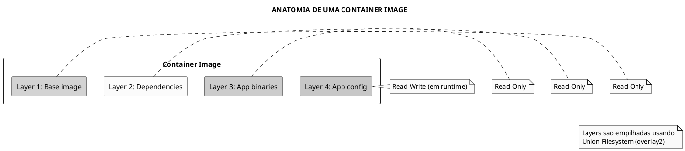

### Componentes de uma Imagem OCI

| Componente | Descricao |
|------------|-----------|
| **Manifest** | Lista de layers e configuracao |
| **Config** | Metadados (CMD, ENV, EXPOSE) |
| **Layers** | Tarballs comprimidos do filesystem |
| **Index** | Multi-arch manifest list |

### Image Manifest Exemplo

```json
{
  "schemaVersion": 2,
  "mediaType": "application/vnd.oci.image.manifest.v1+json",
  "config": {
    "mediaType": "application/vnd.oci.image.config.v1+json",
    "digest": "sha256:abc123...",
    "size": 1470
  },
  "layers": [
    {
      "mediaType": "application/vnd.oci.image.layer.v1.tar+gzip",
      "digest": "sha256:def456...",
      "size": 27098156
    },
    {
      "mediaType": "application/vnd.oci.image.layer.v1.tar+gzip",
      "digest": "sha256:ghi789...",
      "size": 1024
    }
  ]
}
```

### Image Tags e Digests

```bash
# Referencia por tag (mutavel)
nginx:1.25
nginx:latest

# Referencia por digest (imutavel)
nginx@sha256:abc123def456...

# Tag completa
registry.example.com/myapp/frontend:v1.2.3
```

```admonish warning title="Importante para Producao"
Sempre use digests ou tags especificas em producao. A tag `latest` e mutavel e pode causar inconsistencias.
```

---

## Container Registries

### O que e um Registry?

Um registry e um servico para armazenar e distribuir container images.

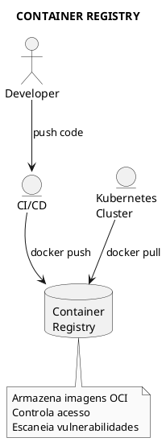

### Registries Populares

| Registry | Tipo | Caracteristicas |
|----------|------|-----------------|
| **Docker Hub** | Publico/Privado | Mais popular, rate limits |
| **Google Container Registry (GCR)** | Cloud | Integrado com GCP |
| **Amazon ECR** | Cloud | Integrado com AWS |
| **Azure Container Registry** | Cloud | Integrado com Azure |
| **Harbor** | Self-hosted | CNCF graduated, scanning |
| **Quay.io** | Publico/Privado | Red Hat, scanning |
| **GitHub Container Registry** | Publico/Privado | Integrado com GitHub |

### Configurar Registry Privado no Kubernetes

```yaml
../assets/secrets/secret-regcred.yaml}}
```

```yaml
../assets/pod/pod-app.yaml}}
```

### Comandos de Registry

```bash
# Fazer login em registry
docker login registry.example.com

# Push de imagem
docker push registry.example.com/myapp:v1

# Pull de imagem
docker pull registry.example.com/myapp:v1

# Inspecionar imagem remota
skopeo inspect docker://registry.example.com/myapp:v1

# Copiar entre registries
skopeo copy docker://source/image:tag docker://dest/image:tag
```

---

## Seguranca de Containers

### Superficie de Ataque

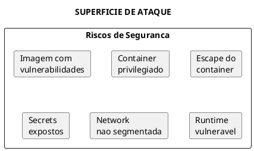

### Melhores Praticas de Seguranca

| Pratica | Descricao |
|---------|-----------|
| **Imagens minimas** | Use distroless ou scratch |
| **Nao root** | Execute como usuario nao privilegiado |
| **Read-only rootfs** | Previne modificacoes |
| **Sem privilegios** | Evite `privileged: true` |
| **Scan de imagens** | Trivy, Clair, Snyk |
| **Assinatura de imagens** | Cosign, Notary |
| **Network policies** | Isolar comunicacao |

### Dockerfile Seguro

```dockerfile
# Use imagem base minima
FROM gcr.io/distroless/base-debian12:nonroot

# Nao execute como root
USER nonroot:nonroot

# Copie apenas binarios necessarios
COPY --chown=nonroot:nonroot app /app

# Defina apenas porta necessaria
EXPOSE 8080

# Use ENTRYPOINT, nao CMD
ENTRYPOINT ["/app"]
```

### Pod Seguro no Kubernetes

```yaml
../assets/pod/pod-secure-pod-2.yaml}}
```

---

## Comandos Uteis

### Inspecao de Containers

```bash
# Listar containers (crictl - Kubernetes)
crictl ps
crictl ps -a  # incluir parados

# Inspecionar container
crictl inspect <container-id>

# Ver logs
crictl logs <container-id>
crictl logs -f <container-id>  # follow

# Executar comando
crictl exec -it <container-id> sh

# Ver uso de recursos
crictl stats

# Listar imagens
crictl images

# Pull de imagem
crictl pull nginx:1.25
```

### Inspecao com Ferramentas Linux

```bash
# Ver namespaces de um processo
ls -la /proc/<PID>/ns/

# Ver cgroups
cat /proc/<PID>/cgroup

# Ver capabilities
cat /proc/<PID>/status | grep Cap

# Ver limites de recursos
cat /proc/<PID>/limits

# Entrar no namespace de processo
nsenter -t <PID> -a bash

# Ver mounts
cat /proc/<PID>/mounts
```

---

## Troubleshooting

### Problemas Comuns

| Problema | Causa | Solucao |
|----------|-------|---------|
| Container nao inicia | Imagem nao encontrada | Verificar nome da imagem e registry |
| OOMKilled | Memoria excedida | Aumentar limits de memoria |
| CrashLoopBackOff | App falhando | Verificar logs do container |
| ImagePullBackOff | Credenciais invalidas | Verificar imagePullSecrets |
| Container lento | Falta de recursos | Verificar requests/limits |

### Comandos de Debug

```bash
# Ver eventos do pod
kubectl describe pod <pod-name>

# Ver logs do container
kubectl logs <pod-name> -c <container-name>

# Logs anteriores (se reiniciou)
kubectl logs <pod-name> --previous

# Executar shell no container
kubectl exec -it <pod-name> -- /bin/sh

# Ver metricas de uso
kubectl top pod <pod-name>

# Debug com container efemero (K8s 1.25+)
kubectl debug <pod-name> -it --image=busybox
```

---

## Dicas para o Exame

### KCNA

```admonish tip title="Dicas KCNA"
- Entenda a diferenca entre containers e VMs
- Saiba o que sao namespaces e cgroups (conceitual)
- Conheca os padroes OCI (runtime-spec, image-spec)
- Memorize: containerd e o runtime padrao do Kubernetes
- Entenda o papel do CRI (Container Runtime Interface)
```

### CKA

```admonish tip title="Dicas CKA"
- Saiba usar `crictl` para debug de containers
- Entenda como verificar o runtime configurado no cluster
- Conheca imagePullSecrets para registries privados
- Saiba configurar SecurityContext basico
```

### Conceitos-Chave para Memorizar

| Conceito | Lembrar |
|----------|---------|
| **Namespace** | Isolamento de recursos (PID, NET, MNT) |
| **cgroups** | Limitacao de recursos (CPU, memoria) |
| **OCI** | Padrao para imagens e runtime |
| **CRI** | Interface entre kubelet e runtime |
| **containerd** | Runtime padrao do Kubernetes |
| **runc** | Runtime OCI de referencia |

---

## Referencias

### Documentacao Oficial

- [OCI Runtime Specification](https://github.com/opencontainers/runtime-spec)
- [OCI Image Specification](https://github.com/opencontainers/image-spec)
- [containerd Documentation](https://containerd.io/docs/)
- [Kubernetes Container Runtimes](https://kubernetes.io/docs/setup/production-environment/container-runtimes/)

### Arquivos Relacionados

- [Docker](fundamentals/docker.md) - Docker e Dockerfiles
- [crictl](crictl.md) - Ferramenta CLI para CRI
- [Runtime Classes](security/runtime-classes.md) - RuntimeClass no Kubernetes
- [Pod Security](security/pod-security-admission.md) - Seguranca de Pods
- [Cloud Native](fundamentals/cloud-native.md) - Conceitos Cloud Native

---

## Exemplos de Pods com Containers

### Pod com Custom Command

```yaml
{{#include ../assets/containers/pod-custom-command.yaml}}
```

### Pod com Environment Variables

```yaml
{{#include ../assets/containers/pod-env-example.yaml}}
```

### Pod com ImagePullPolicy

```yaml
{{#include ../assets/containers/pod-image-pull-policy.yaml}}
```

### Pod com ImagePullSecrets

```yaml
{{#include ../assets/containers/pod-image-pull-secrets.yaml}}
```

