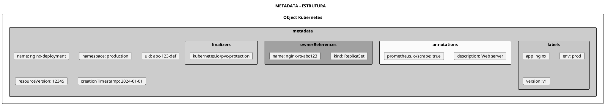
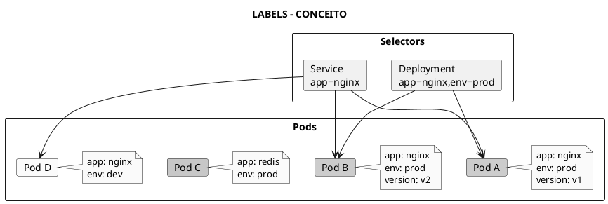
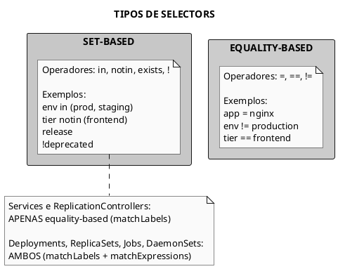
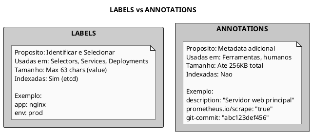
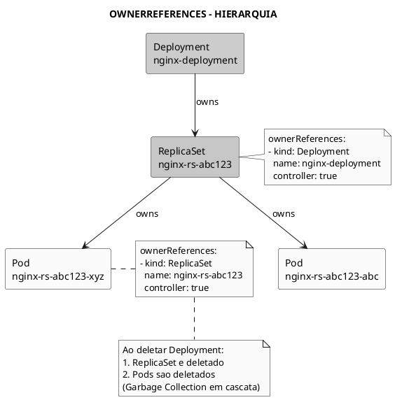
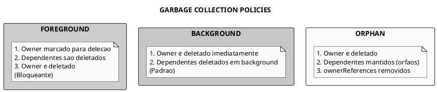
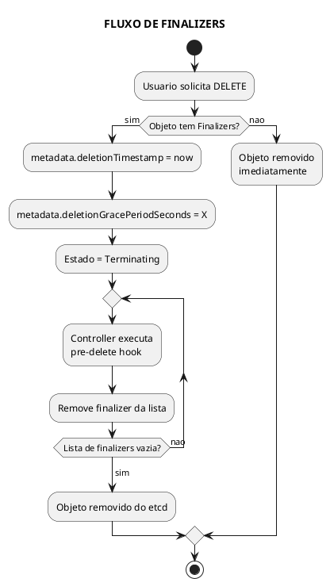
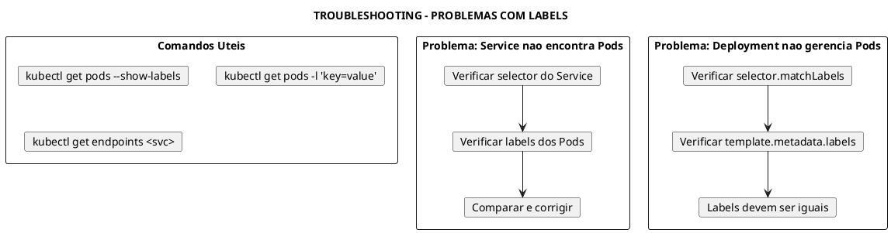
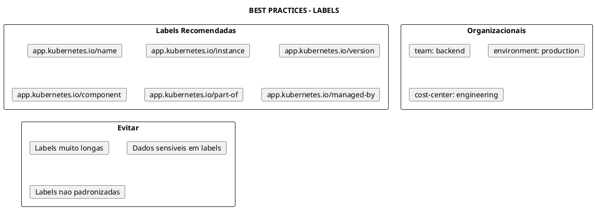

# Metadata

> **Certificacoes**: CKAD (15%), CKA (10%), KCNA (8%), CKS (5%)

## Conceitos Fundamentais

### O que e Metadata

Metadata sao informacoes que descrevem e identificam objetos Kubernetes. Incluem campos como name, namespace, labels, annotations, uid, resourceVersion, entre outros.



### Campos do Metadata

| Campo | Descricao | Mutavel | Exemplo |
|-------|-----------|---------|---------|
| `name` | Nome unico no namespace | Nao | `nginx-deployment` |
| `namespace` | Namespace do recurso | Nao | `production` |
| `uid` | Identificador unico global | Nao | `abc-123-def-456` |
| `resourceVersion` | Versao para concorrencia | Auto | `12345` |
| `generation` | Versao da spec | Auto | `3` |
| `creationTimestamp` | Data de criacao | Nao | `2024-01-01T00:00:00Z` |
| `labels` | Key-value para selecao | Sim | `app: nginx` |
| `annotations` | Key-value para metadata | Sim | `description: ...` |
| `ownerReferences` | Referencias ao owner | Sim | `kind: ReplicaSet` |
| `finalizers` | Hooks pre-delecao | Sim | `kubernetes.io/pvc-protection` |

## Labels

### O que sao Labels

Labels sao pares key-value usados para **identificar** e **selecionar** objetos. Sao a base do modelo de selecao do Kubernetes.



### Sintaxe de Labels

```yaml
../assets/metadata/labels-sintaxe.yaml}}
```

**Regras de sintaxe**:

| Elemento | Regras |
|----------|--------|
| **Key (prefixo)** | Opcional, DNS subdomain, max 253 chars |
| **Key (nome)** | Obrigatorio, max 63 chars, [a-z0-9A-Z], `-`, `_`, `.` |
| **Value** | Max 63 chars, pode ser vazio, [a-z0-9A-Z], `-`, `_`, `.` |

```admonish warning title="Atencao"
- Keys devem comecar e terminar com caractere alfanumerico
- Values podem ser vazios
- Prefixos `kubernetes.io/` e `k8s.io/` sao reservados
```

### Labels Recomendadas

O Kubernetes define labels padrao para melhor organizacao:

```yaml
../assets/metadata/labels-recomendadas.yaml}}
```

| Label | Descricao | Exemplo |
|-------|-----------|---------|
| `app.kubernetes.io/name` | Nome da aplicacao | `mysql` |
| `app.kubernetes.io/instance` | Instancia unica | `mysql-prod` |
| `app.kubernetes.io/version` | Versao atual | `8.0` |
| `app.kubernetes.io/component` | Componente na arquitetura | `database` |
| `app.kubernetes.io/part-of` | App de nivel superior | `wordpress` |
| `app.kubernetes.io/managed-by` | Ferramenta de gerenciamento | `helm` |

### Deployment com Labels

```yaml
../assets/metadata/deployment-com-labels.yaml}}
```

### Service com Selector

```yaml
../assets/metadata/service-com-labels.yaml}}
```

## Selectors

### Tipos de Selectors

O Kubernetes suporta dois tipos de selectors:



### Sintaxe de Selectors

```yaml
../assets/metadata/seletores-labels.yaml}}
```

### Exemplos com kubectl

```bash
# EQUALITY-BASED SELECTORS

# Igualdade
kubectl get pods -l app=nginx
kubectl get pods -l 'app==nginx'

# Desigualdade
kubectl get pods -l 'app!=nginx'

# Multiplos (AND logico)
kubectl get pods -l 'app=nginx,env=prod'

# SET-BASED SELECTORS

# In (OR dentro do conjunto)
kubectl get pods -l 'env in (prod,staging)'
kubectl get pods -l 'app in (nginx,apache,httpd)'

# NotIn
kubectl get pods -l 'env notin (dev,test)'

# Exists (label existe, qualquer valor)
kubectl get pods -l 'release'
kubectl get pods -l 'app.kubernetes.io/version'

# DoesNotExist (label nao existe)
kubectl get pods -l '!deprecated'
kubectl get pods -l '!temp'

# COMBINADOS
kubectl get pods -l 'app=nginx,env in (prod,staging),!deprecated'
```

### Selector em Recursos

```yaml
../assets/service/service-nginx-service-1.yaml}}
```

### Operadores de matchExpressions

| Operador | Descricao | Exemplo |
|----------|-----------|---------|
| `In` | Valor esta na lista | `env In [prod, staging]` |
| `NotIn` | Valor nao esta na lista | `env NotIn [dev]` |
| `Exists` | Label existe (qualquer valor) | `release Exists` |
| `DoesNotExist` | Label nao existe | `deprecated DoesNotExist` |

### NodeSelector

Selector especial para agendar pods em nodes especificos:

```yaml
../assets/metadata/pod-nodeselector.yaml}}
```

```bash
# Adicionar label a um node
kubectl label node worker-1 disktype=ssd
kubectl label node worker-2 gpu=nvidia

# Ver labels de nodes
kubectl get nodes --show-labels

# Remover label
kubectl label node worker-1 disktype-
```

## Annotations

### O que sao Annotations

Annotations sao pares key-value para **metadata nao-identificadora**. NAO sao usadas para selecao, mas para armazenar informacoes auxiliares.



### Sintaxe de Annotations

```yaml
../assets/metadata/annotations-sintaxe.yaml}}
```

### Pod com Annotations

```yaml
../assets/metadata/pod-com-annotations.yaml}}
```

### Casos de Uso Comuns

| Annotation | Ferramenta | Descricao |
|------------|------------|-----------|
| `prometheus.io/scrape` | Prometheus | Habilitar scraping |
| `prometheus.io/port` | Prometheus | Porta do metrics |
| `nginx.ingress.kubernetes.io/rewrite-target` | NGINX Ingress | Rewrite de URL |
| `sidecar.istio.io/inject` | Istio | Injetar sidecar |
| `kubernetes.io/change-cause` | kubectl | Motivo do rollout |
| `kubectl.kubernetes.io/last-applied-configuration` | kubectl | Ultimo apply |
| `cert-manager.io/cluster-issuer` | cert-manager | Issuer do certificado |

### Comandos para Annotations

```bash
# Adicionar annotation
kubectl annotate pod nginx description="Web server"
kubectl annotate deployment nginx kubernetes.io/change-cause="Update image to 1.25"

# Atualizar annotation (--overwrite)
kubectl annotate pod nginx description="Updated web server" --overwrite

# Remover annotation
kubectl annotate pod nginx description-

# Ver annotations
kubectl get pod nginx -o jsonpath='{.metadata.annotations}'
kubectl describe pod nginx | grep -A 10 Annotations

# Annotation com valores grandes (usar arquivo)
kubectl annotate pod nginx config="$(cat config.json)"
```

## OwnerReferences

### O que sao OwnerReferences

OwnerReferences definem relacoes de **propriedade** entre objetos. Quando o owner e deletado, os dependentes sao deletados automaticamente (garbage collection).



### Estrutura do OwnerReference

```yaml
../assets/pod/pod-nginx-rs-abc123-xyz.yaml}}
```

### Campos do OwnerReference

| Campo | Descricao |
|-------|-----------|
| `apiVersion` | API version do owner |
| `kind` | Tipo do owner |
| `name` | Nome do owner |
| `uid` | UID unico do owner |
| `controller` | Se e o controller principal (apenas 1 true) |
| `blockOwnerDeletion` | Bloqueia delecao do owner ate este ser deletado |

### Garbage Collection Policies

```bash
# Foreground: Owner bloqueado ate dependentes serem deletados
kubectl delete deployment nginx --cascade=foreground

# Background: Owner deletado, dependentes em background (padrao)
kubectl delete deployment nginx
kubectl delete deployment nginx --cascade=background

# Orphan: Dependentes NAO sao deletados
kubectl delete deployment nginx --cascade=orphan
```



## Finalizers

### O que sao Finalizers

Finalizers sao strings que indicam que um **hook de pre-delecao** deve ser executado antes do objeto ser removido do etcd.



### Finalizers Comuns

| Finalizer | Descricao |
|-----------|-----------|
| `kubernetes.io/pvc-protection` | Protege PVC em uso |
| `kubernetes.io/pv-protection` | Protege PV em uso |
| `foregroundDeletion` | Garbage collection em foreground |
| `orphan` | Marcar dependentes como orfaos |

### Exemplo com PVC

```yaml
../assets/persistent-volumes/persistentvolumeclaim-my-pvc.yaml}}
```

### Troubleshooting com Finalizers

```bash
# Ver finalizers de um objeto
kubectl get pvc my-pvc -o jsonpath='{.metadata.finalizers}'

# Objeto stuck em Terminating (CUIDADO)
# Primeiro, verificar porque esta preso
kubectl describe pvc my-pvc

# Forcar remocao de finalizer (ultimo recurso)
kubectl patch pvc my-pvc -p '{"metadata":{"finalizers":[]}}' --type=merge

# Para namespace stuck
kubectl get namespace stuck-ns -o json | \
  jq '.spec.finalizers = []' | \
  kubectl replace --raw "/api/v1/namespaces/stuck-ns/finalize" -f -
```

```admonish danger title="Cuidado"
Remover finalizers manualmente pode causar:
- Vazamento de recursos (volumes, IPs)
- Inconsistencia de dados
- Recursos orfaos

Use apenas como ultimo recurso apos investigar a causa.
```

## Comandos Uteis

### Labels

```bash
# Adicionar label
kubectl label pod nginx app=frontend
kubectl label deployment nginx-deploy version=v2

# Adicionar label a multiplos recursos
kubectl label pods -l app=nginx tier=frontend

# Atualizar label existente
kubectl label pod nginx app=backend --overwrite

# Remover label
kubectl label pod nginx app-

# Ver labels
kubectl get pods --show-labels
kubectl get pods -L app,env  # Colunas especificas

# Filtrar por labels
kubectl get pods -l app=nginx
kubectl get pods -l 'app in (nginx,apache)'
kubectl get pods -l 'app=nginx,env!=prod'
```

### Annotations

```bash
# Adicionar annotation
kubectl annotate pod nginx description="Web server"

# Atualizar annotation
kubectl annotate pod nginx description="Updated" --overwrite

# Remover annotation
kubectl annotate pod nginx description-

# Ver annotations
kubectl describe pod nginx | grep Annotations
kubectl get pod nginx -o jsonpath='{.metadata.annotations}'
```

### Metadata Geral

```bash
# Ver toda metadata
kubectl get pod nginx -o yaml | head -30

# Ver UID
kubectl get pod nginx -o jsonpath='{.metadata.uid}'

# Ver resourceVersion
kubectl get pod nginx -o jsonpath='{.metadata.resourceVersion}'

# Ver ownerReferences
kubectl get pod nginx-rs-abc -o jsonpath='{.metadata.ownerReferences}'

# Ver finalizers
kubectl get pvc my-pvc -o jsonpath='{.metadata.finalizers}'

# Ver generation
kubectl get deployment nginx -o jsonpath='{.metadata.generation}'
```

## Troubleshooting

### Problemas com Labels



### Debug de Selectors

```bash
# Ver labels de pods
kubectl get pods --show-labels

# Testar selector
kubectl get pods -l 'app=web'

# Ver endpoints de um service
kubectl get endpoints <service-name>

# Comparar selector do service com labels dos pods
kubectl get service <name> -o jsonpath='{.spec.selector}'
kubectl get pods -l <selector-do-service>

# Ver se deployment esta gerenciando corretamente
kubectl get replicaset -l <selector> -o wide
```

### Problemas com Finalizers

```bash
# Verificar se tem finalizers
kubectl get <resource> <name> -o jsonpath='{.metadata.finalizers}'

# Verificar deletionTimestamp
kubectl get <resource> <name> -o jsonpath='{.metadata.deletionTimestamp}'

# Ver eventos relacionados
kubectl describe <resource> <name>

# Forcas remocao (CUIDADO - ultimo recurso!)
kubectl patch <resource> <name> -p '{"metadata":{"finalizers":null}}'
```

## Dicas para o Exame

```admonish tip title="Dicas CKAD/CKA"
1. **Labels sao para SELECAO** - Services, Deployments, kubectl -l

2. **Annotations sao para METADATA** - Ferramentas, documentacao

3. **matchLabels vs matchExpressions**:
   - matchLabels: simples, equality-based
   - matchExpressions: complexo, set-based

4. **Service usa APENAS matchLabels** (sem matchExpressions)

5. **nodeSelector** para agendar em nodes especificos

6. **--show-labels** para debug rapido

7. **kubectl explain** para ver campos de metadata:
   ```bash
   kubectl explain pod.metadata
   kubectl explain pod.metadata.labels
   ```
```

```admonish warning title="Armadilhas Comuns"
- Labels do Deployment.metadata NAO sao usadas para selecao
- Labels do Deployment.spec.template.metadata SAO usadas
- spec.selector.matchLabels DEVE bater com template.metadata.labels
- Esquecer --overwrite ao atualizar label existente
- Service NAO suporta matchExpressions
```

### Gerando YAML Rapido

```bash
# Pod com labels
kubectl run nginx --image=nginx --labels="app=nginx,env=prod" --dry-run=client -o yaml

# Deployment com labels
kubectl create deployment nginx --image=nginx --dry-run=client -o yaml > deploy.yaml
# Editar para adicionar labels/annotations

# Ver estrutura de labels
kubectl explain pod.metadata.labels
kubectl explain deployment.spec.selector
```

## Best Practices

### Labels



### Annotations

- Use para **documentacao** (description, owner, contact)
- Use para **configuracao de ferramentas** (prometheus, ingress)
- Use para **rastreabilidade** (git-commit, build-number)
- **NAO use** para dados que precisam de indexacao
- **NAO use** para selecao de objetos

## Exemplos Praticos Completos

### Deployment com Metadata Completo

```yaml
../assets/deployment/deployment-ecommerce-frontend.yaml}}
```

### NetworkPolicy com Selectors

```yaml
../assets/network-policy/networkpolicy-frontend-policy.yaml}}
```

## Referencias

### Links Internos
- [API Objects](api/api-objects.md)
- [Namespace](fundamentals/namespace.md)
- [Pod](workload/pod.md)
- [Deployment](workload/deployment.md)
- [Service](network/service.md)
- [Scheduling](scheduling.md)
- [NetworkPolicy](security/network-policy.md)

### Documentacao Oficial
- [Labels and Selectors](https://kubernetes.io/docs/concepts/overview/working-with-objects/labels/)
- [Annotations](https://kubernetes.io/docs/concepts/overview/working-with-objects/annotations/)
- [Field Selectors](https://kubernetes.io/docs/concepts/overview/working-with-objects/field-selectors/)
- [Recommended Labels](https://kubernetes.io/docs/concepts/overview/working-with-objects/common-labels/)
- [Owners and Dependents](https://kubernetes.io/docs/concepts/overview/working-with-objects/owners-dependents/)
- [Finalizers](https://kubernetes.io/docs/concepts/overview/working-with-objects/finalizers/)

---

> **Resumo**: Metadata inclui name, namespace, uid, labels, annotations, ownerReferences e finalizers. Labels sao para identificacao e SELECAO (equality-based e set-based). Annotations sao para METADATA adicional (nao indexadas). OwnerReferences definem hierarquia de propriedade para garbage collection. Finalizers sao hooks de pre-delecao. Use labels padrao (app.kubernetes.io/*) para consistencia.
