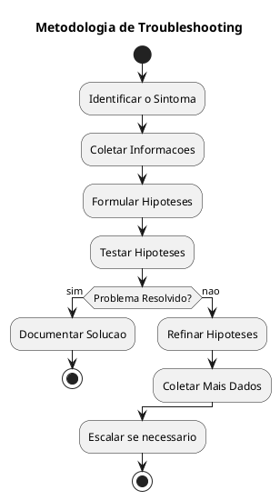
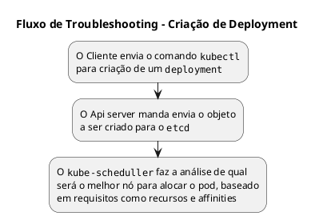
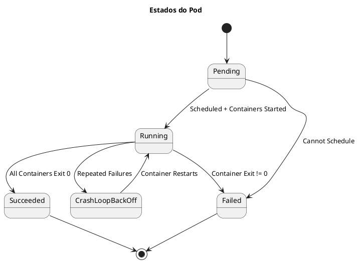
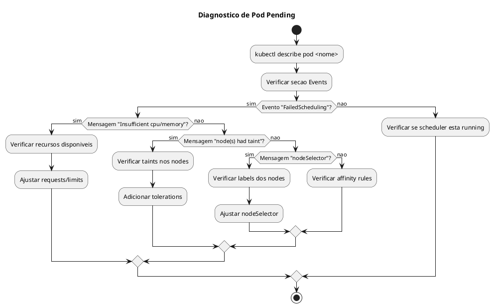
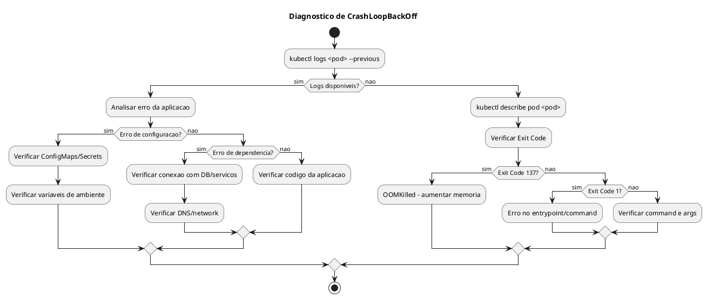
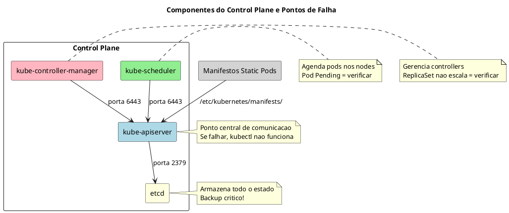
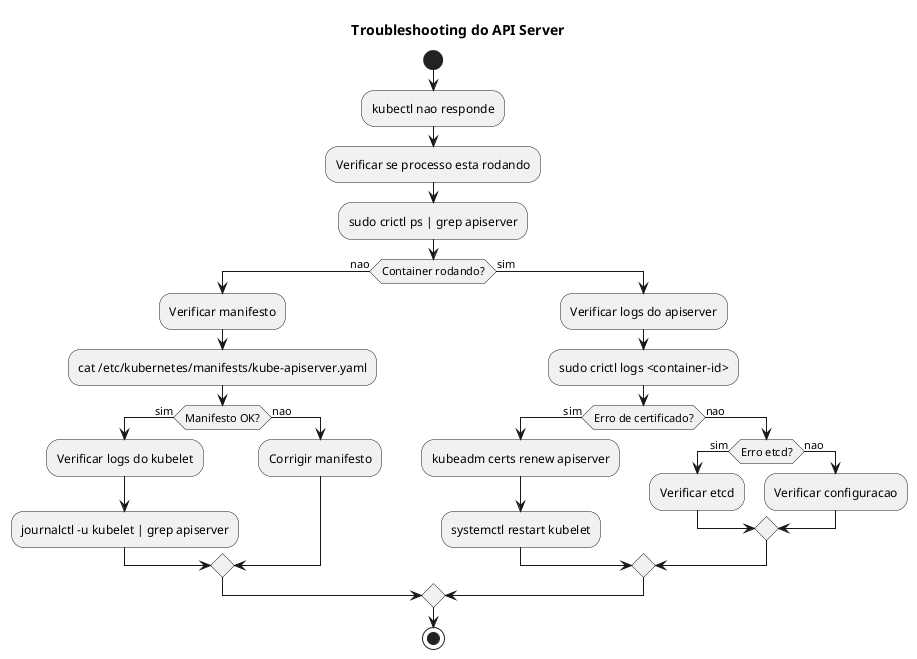
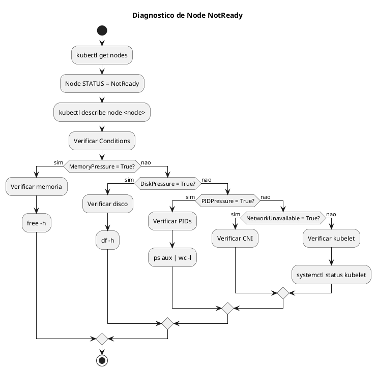
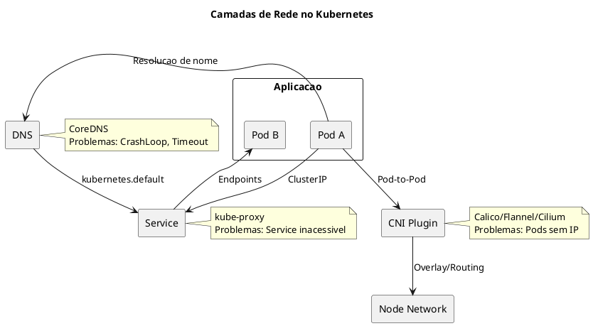

# Troubleshooting no Kubernetes

> **Certificacoes**: CKA (30%)

```admonish warning title="Topico Critico para o Exame"
Troubleshooting representa **30% do exame CKA**. Este e o topico com maior peso na certificacao. Domine cada secao deste guia!
```

## Metodologia de Troubleshooting

### Abordagem Sistematica



### Fluxo de Criação de Deployment

Entender o fluxo de criação ajuda a identificar onde pode estar o problema:



### Perguntas Iniciais

1. **O que mudou?** - Alguma alteracao recente no cluster?
2. **Qual o escopo?** - Afeta um pod, um node, ou todo o cluster?
3. **Quando comecou?** - Correlacionar com eventos/deploys
4. **E reproduzivel?** - Consistente ou intermitente?

### Comandos Essenciais de Diagnostico

```bash
# Estado geral do cluster
kubectl cluster-info
kubectl get nodes -o wide
kubectl get pods -A -o wide

# Eventos recentes (muito importante!)
kubectl get events --sort-by='.lastTimestamp'
kubectl get events -A --sort-by='.lastTimestamp'

# Descricao detalhada de recursos
kubectl describe <recurso> <nome>

# Logs de pods
kubectl logs <pod-name> [-c container] [--previous]

# Logs do sistema
journalctl -u kubelet -f
journalctl -u containerd -f
```

## Troubleshooting de Aplicacoes

### Ciclo de Vida do Pod



### Estados do Pod e Significados

| Estado | Significado | Onde Investigar |
|--------|-------------|-----------------|
| **Pending** | Aguardando agendamento | scheduler, recursos, taints |
| **ContainerCreating** | Baixando imagem ou montando volumes | eventos, imagem, secrets |
| **Running** | Containers executando | logs da aplicacao |
| **CrashLoopBackOff** | Container reiniciando repetidamente | logs, comando/entrypoint |
| **Error** | Container falhou | logs, exit code |
| **ImagePullBackOff** | Falha ao baixar imagem | registry, credenciais |
| **ErrImagePull** | Erro ao puxar imagem | nome da imagem, tag |
| **Completed** | Job finalizado com sucesso | - |
| **Terminating** | Pod sendo deletado | finalizers, preStop hooks |

### Pod em Pending



**Comandos de Diagnostico:**

```bash
# Verificar eventos do pod
kubectl describe pod <pod-name> | grep -A 20 Events

# Verificar recursos disponiveis nos nodes
kubectl describe nodes | grep -A 5 "Allocated resources"

# Verificar taints nos nodes
kubectl get nodes -o custom-columns=NAME:.metadata.name,TAINTS:.spec.taints

# Verificar labels nos nodes
kubectl get nodes --show-labels

# Verificar se scheduler esta funcionando
kubectl get pods -n kube-system -l component=kube-scheduler
```

**Solucoes Comuns:**

```yaml
{{#include ../assets/maintenance/troubleshooting-example-1.yaml}}
```

### Pod em CrashLoopBackOff



**Comandos de Diagnostico:**

```bash
# Ver logs do container anterior (que crashou)
kubectl logs <pod-name> --previous
kubectl logs <pod-name> -c <container-name> --previous

# Ver detalhes do pod
kubectl describe pod <pod-name>

# Verificar exit code
kubectl get pod <pod-name> -o jsonpath='{.status.containerStatuses[0].lastState.terminated.exitCode}'

# Ver eventos
kubectl get events --field-selector involvedObject.name=<pod-name>

# Executar shell no container para debug (se possivel)
kubectl exec -it <pod-name> -- /bin/sh
```

**Exit Codes Comuns:**

| Exit Code | Significado | Acao |
|-----------|-------------|------|
| 0 | Sucesso | Normal para Jobs |
| 1 | Erro generico da aplicacao | Verificar logs |
| 126 | Comando nao pode ser executado | Verificar permissoes |
| 127 | Comando nao encontrado | Verificar PATH/comando |
| 128+n | Sinal n recebido | Ex: 137 = SIGKILL (OOM) |
| 137 | OOMKilled (128+9) | Aumentar limite de memoria |
| 139 | Segmentation fault (128+11) | Bug na aplicacao |
| 143 | SIGTERM (128+15) | Terminacao graceful |

### Pod em ImagePullBackOff

```bash
# Verificar eventos
kubectl describe pod <pod-name> | grep -A 5 Events

# Verificar nome da imagem
kubectl get pod <pod-name> -o jsonpath='{.spec.containers[*].image}'

# Verificar se o secret de registry existe
kubectl get secrets | grep docker

# Verificar configuracao do secret
kubectl get secret <regcred> -o jsonpath='{.data.\.dockerconfigjson}' | base64 -d

# Testar pull da imagem manualmente no node
sudo crictl pull <image-name>
```

**Causas Comuns:**

1. Nome da imagem incorreto ou tag nao existe
2. Registry privado sem credenciais
3. Secret `imagePullSecrets` nao configurado
4. Problemas de rede com o registry

**Solucao com Secret de Registry:**

```yaml
{{#include ../assets/secrets/secret-regcred-1.yaml}}
```

### Pod Terminating (Stuck)

```bash
# Verificar se ha finalizers
kubectl get pod <pod-name> -o jsonpath='{.metadata.finalizers}'

# Remover finalizers (forcadamente)
kubectl patch pod <pod-name> -p '{"metadata":{"finalizers":null}}'

# Forcar delecao
kubectl delete pod <pod-name> --grace-period=0 --force

# Verificar preStop hooks
kubectl get pod <pod-name> -o jsonpath='{.spec.containers[*].lifecycle}'
```

## Troubleshooting do Control Plane

### Arquitetura do Control Plane



### Verificacao Rapida do Control Plane

```bash
# Verificar status dos componentes
kubectl get componentstatuses  # Depreciado mas ainda funciona
kubectl get cs

# Verificar pods do control plane
kubectl get pods -n kube-system

# Verificar com crictl (quando kubectl nao funciona)
sudo crictl ps | grep -E "apiserver|etcd|scheduler|controller"

# Verificar manifestos dos static pods
ls -la /etc/kubernetes/manifests/

# Verificar certificados
sudo kubeadm certs check-expiration
```

### kube-apiserver Nao Responde



**Comandos de Diagnostico:**

```bash
# Verificar se container esta rodando
sudo crictl ps -a | grep kube-apiserver

# Ver logs do apiserver
sudo crictl logs <container-id>

# Verificar manifesto
sudo cat /etc/kubernetes/manifests/kube-apiserver.yaml

# Verificar sintaxe do manifesto
sudo cat /etc/kubernetes/manifests/kube-apiserver.yaml | python3 -c "import yaml,sys; yaml.safe_load(sys.stdin)"

# Verificar porta
sudo ss -tlnp | grep 6443

# Verificar certificados
sudo openssl x509 -in /etc/kubernetes/pki/apiserver.crt -text -noout | grep -A 2 "Validity"

# Testar conexao direta
curl -k https://localhost:6443/healthz
curl -k https://localhost:6443/livez
curl -k https://localhost:6443/readyz
```

**Problemas Comuns:**

| Problema | Sintoma | Solucao |
|----------|---------|---------|
| Certificado expirado | x509 certificate has expired | `kubeadm certs renew all` |
| Manifesto invalido | Pod nao inicia | Verificar YAML syntax |
| etcd indisponivel | connection refused 2379 | Verificar etcd |
| Porta em uso | bind: address already in use | Verificar processo |
| Memoria insuficiente | OOMKilled | Aumentar recursos |

### etcd Nao Funciona

```bash
# Verificar status do etcd
sudo crictl ps | grep etcd

# Ver logs
sudo crictl logs <etcd-container-id>

# Verificar health com etcdctl
sudo ETCDCTL_API=3 etcdctl \
  --endpoints=https://127.0.0.1:2379 \
  --cacert=/etc/kubernetes/pki/etcd/ca.crt \
  --cert=/etc/kubernetes/pki/etcd/healthcheck-client.crt \
  --key=/etc/kubernetes/pki/etcd/healthcheck-client.key \
  endpoint health

# Verificar membros do cluster etcd
sudo ETCDCTL_API=3 etcdctl \
  --endpoints=https://127.0.0.1:2379 \
  --cacert=/etc/kubernetes/pki/etcd/ca.crt \
  --cert=/etc/kubernetes/pki/etcd/healthcheck-client.crt \
  --key=/etc/kubernetes/pki/etcd/healthcheck-client.key \
  member list

# Verificar espaco em disco
df -h /var/lib/etcd
```

**Problemas Comuns do etcd:**

| Problema | Sintoma | Solucao |
|----------|---------|---------|
| Disco cheio | "no space left" | Limpar disco, compactar etcd |
| Corrupcao | "database space exceeded" | Restaurar backup |
| Rede | "connection refused" | Verificar firewall |
| Certificado | "certificate signed by unknown authority" | Verificar certs |

### kube-scheduler Nao Agenda Pods

```bash
# Verificar se scheduler esta rodando
kubectl get pods -n kube-system -l component=kube-scheduler

# Ver logs
kubectl logs -n kube-system kube-scheduler-<node-name>

# Ou via crictl
sudo crictl logs <scheduler-container-id>

# Verificar manifesto
cat /etc/kubernetes/manifests/kube-scheduler.yaml

# Verificar eventos de pods Pending
kubectl get events --field-selector reason=FailedScheduling

# Debug mode - simular scheduling
kubectl get pod <pending-pod> -o yaml | kubectl create --dry-run=server -f -
```

**Sintomas de Scheduler com Problema:**

- Pods ficam em `Pending` indefinidamente
- Eventos mostram `FailedScheduling` sem node disponivel
- Eventos nao aparecem (scheduler nao esta processando)

### kube-controller-manager Nao Funciona

```bash
# Verificar status
kubectl get pods -n kube-system -l component=kube-controller-manager

# Ver logs
kubectl logs -n kube-system kube-controller-manager-<node-name>

# Verificar manifesto
cat /etc/kubernetes/manifests/kube-controller-manager.yaml

# Verificar controllers especificos
kubectl get deploy <deployment> -o yaml | grep -A 5 status
```

**Sintomas de Controller Manager com Problema:**

- ReplicaSet nao cria pods
- Deployment nao atualiza
- Nodes nao sao marcados como `NotReady` quando falham
- Garbage collection nao funciona

## Troubleshooting de Worker Nodes

### Node NotReady



**Comandos de Diagnostico no Node:**

```bash
# Verificar status do kubelet
sudo systemctl status kubelet
sudo journalctl -u kubelet -f --no-pager | tail -100

# Verificar status do container runtime
sudo systemctl status containerd
sudo journalctl -u containerd -f

# Verificar recursos do sistema
free -h
df -h
top -bn1 | head -20

# Verificar conectividade com control plane
curl -k https://<control-plane-ip>:6443/healthz

# Verificar certificados do kubelet
sudo openssl x509 -in /var/lib/kubelet/pki/kubelet-client-current.pem -text -noout | grep -A 2 "Validity"

# Verificar configuracao do kubelet
cat /var/lib/kubelet/config.yaml
```

### kubelet Nao Funciona

```bash
# Verificar status do servico
sudo systemctl status kubelet

# Ver logs detalhados
sudo journalctl -u kubelet -f
sudo journalctl -u kubelet --since "10 minutes ago"

# Verificar configuracao
cat /var/lib/kubelet/config.yaml
cat /etc/kubernetes/kubelet.conf

# Verificar argumentos do kubelet
ps aux | grep kubelet

# Reiniciar kubelet
sudo systemctl restart kubelet

# Verificar se containerd esta funcionando
sudo crictl info
```

**Problemas Comuns do kubelet:**

| Problema | Log/Sintoma | Solucao |
|----------|-------------|---------|
| Swap habilitado | "swap is enabled" | `swapoff -a` |
| Container runtime indisponivel | "container runtime is not running" | Reiniciar containerd |
| Certificado expirado | "certificate has expired" | Renovar certificados |
| Config invalida | "failed to load config" | Verificar config.yaml |
| Porta em uso | "bind: address already in use" | Verificar processo na porta |

### kube-proxy Nao Funciona

```bash
# Verificar pods do kube-proxy
kubectl get pods -n kube-system -l k8s-app=kube-proxy -o wide

# Ver logs
kubectl logs -n kube-system -l k8s-app=kube-proxy

# Verificar ConfigMap
kubectl get cm kube-proxy -n kube-system -o yaml

# Verificar regras iptables (se usando iptables mode)
sudo iptables -t nat -L KUBE-SERVICES
sudo iptables -t nat -L | grep <service-cluster-ip>

# Verificar IPVS (se usando ipvs mode)
sudo ipvsadm -Ln

# Verificar modo do kube-proxy
kubectl get cm kube-proxy -n kube-system -o jsonpath='{.data.config\.conf}' | grep mode
```

**Sintomas de kube-proxy com Problema:**

- Services nao funcionam (ClusterIP inacessivel)
- NodePort nao responde
- Conexoes entre pods via service falham

## Troubleshooting de Rede

### Visao Geral dos Problemas de Rede



### DNS Nao Funciona

```bash
# Verificar pods do CoreDNS
kubectl get pods -n kube-system -l k8s-app=kube-dns

# Ver logs do CoreDNS
kubectl logs -n kube-system -l k8s-app=kube-dns

# Verificar ConfigMap
kubectl get cm coredns -n kube-system -o yaml

# Testar DNS de dentro de um pod
kubectl run test-dns --image=busybox:1.28 --rm -it --restart=Never -- nslookup kubernetes.default

# Testar resolucao de servico
kubectl run test-dns --image=busybox:1.28 --rm -it --restart=Never -- nslookup <service-name>.<namespace>.svc.cluster.local

# Verificar endpoints do service DNS
kubectl get endpoints kube-dns -n kube-system

# Verificar Service do DNS
kubectl get svc kube-dns -n kube-system
```

**Problemas Comuns de DNS:**

| Problema | Sintoma | Solucao |
|----------|---------|---------|
| CoreDNS CrashLoop | Pods nao resolvem nomes | Ver logs, verificar loop |
| DNS timeout | Resolucao lenta | Verificar network policies |
| Service nao resolve | "NXDOMAIN" | Verificar nome do service |
| External DNS falha | Nomes externos nao resolvem | Verificar forward config |

**Verificar Loop de DNS:**

```bash
# Se /etc/resolv.conf do host aponta para 127.0.0.53
# Editar ConfigMap do CoreDNS
kubectl edit cm coredns -n kube-system

# Mudar forward para upstream real
# forward . 8.8.8.8 8.8.4.4
```

### Pod-to-Pod Communication Falha

```bash
# Criar pod de teste
kubectl run test-net --image=nicolaka/netshoot --rm -it -- bash

# De dentro do pod, testar conectividade
ping <outro-pod-ip>
curl <outro-pod-ip>:<porta>

# Verificar se CNI esta funcionando
kubectl get pods -n kube-system | grep -E "calico|flannel|cilium|weave"

# Verificar logs do CNI
kubectl logs -n kube-system -l k8s-app=calico-node

# Verificar interfaces de rede no node
ip addr show
ip route show

# Verificar CNI config
cat /etc/cni/net.d/*.conf
```

### Service Nao Funciona

```bash
# Verificar se service existe
kubectl get svc <service-name>

# Verificar endpoints
kubectl get endpoints <service-name>

# Se endpoints vazio, verificar selector
kubectl get svc <service-name> -o yaml | grep -A 5 selector
kubectl get pods --show-labels | grep <label>

# Testar acesso ao service
kubectl run test --image=busybox:1.28 --rm -it --restart=Never -- wget -qO- <service-name>:<port>

# Verificar iptables
sudo iptables -t nat -L KUBE-SERVICES | grep <service-cluster-ip>

# Debug com netshoot
kubectl run debug --image=nicolaka/netshoot --rm -it -- bash
# nc -zv <service-name> <port>
# curl -v <service-name>:<port>
```

**Checklist de Service:**

- [ ] Service tem endpoints? (`kubectl get endpoints`)
- [ ] Pods tem labels corretos? (match com selector)
- [ ] Pods estao Running?
- [ ] Porta correta no service e no pod?
- [ ] NetworkPolicy bloqueando?
- [ ] kube-proxy funcionando?

### NodePort/LoadBalancer Nao Funciona

```bash
# Verificar NodePort
kubectl get svc <service> -o jsonpath='{.spec.ports[0].nodePort}'

# Testar acesso externo
curl http://<node-ip>:<node-port>

# Verificar firewall no node
sudo iptables -L INPUT | grep <node-port>

# Verificar se externalTrafficPolicy esta correto
kubectl get svc <service> -o jsonpath='{.spec.externalTrafficPolicy}'

# Para LoadBalancer, verificar status
kubectl get svc <service> -o jsonpath='{.status.loadBalancer}'
```

## Logs Importantes

### Localizacao dos Logs

| Componente | Localizacao | Comando |
|------------|-------------|---------|
| kubelet | journald | `journalctl -u kubelet` |
| containerd | journald | `journalctl -u containerd` |
| kube-apiserver | /var/log/pods/ | `crictl logs <id>` |
| kube-scheduler | /var/log/pods/ | `crictl logs <id>` |
| kube-controller-manager | /var/log/pods/ | `crictl logs <id>` |
| etcd | /var/log/pods/ | `crictl logs <id>` |
| Pods | /var/log/pods/ | `kubectl logs` |

### Comandos de Logs

```bash
# Logs do kubelet
sudo journalctl -u kubelet -f
sudo journalctl -u kubelet --since "1 hour ago"
sudo journalctl -u kubelet --since "2024-01-01 00:00:00"

# Logs de pods via kubectl
kubectl logs <pod-name>
kubectl logs <pod-name> -c <container-name>
kubectl logs <pod-name> --previous
kubectl logs <pod-name> -f  # Follow
kubectl logs <pod-name> --tail=100
kubectl logs <pod-name> --since=1h
kubectl logs -l app=nginx  # Por label

# Logs via crictl (quando kubectl nao funciona)
sudo crictl ps
sudo crictl logs <container-id>
sudo crictl logs --tail=100 <container-id>

# Logs de todos os containers de um pod
kubectl logs <pod-name> --all-containers

# Logs em arquivos
ls /var/log/pods/
ls /var/log/containers/
```

## Ferramentas de Debug

### kubectl debug

```bash
# Criar pod de debug ao lado do pod com problema
kubectl debug <pod-name> -it --image=busybox --share-processes

# Debug de node
kubectl debug node/<node-name> -it --image=ubuntu

# Copiar pod com container de debug
kubectl debug <pod-name> -it --copy-to=debug-pod --container=debug --image=busybox
```

### Ephemeral Containers

```bash
# Adicionar container efemero a um pod existente
kubectl debug -it <pod-name> --image=busybox --target=<container-name>
```

### Netshoot - Container de Debug de Rede

```bash
# Pod temporario para debug de rede
kubectl run netshoot --image=nicolaka/netshoot --rm -it -- bash

# Comandos uteis dentro do netshoot
ping <ip>
curl <url>
nslookup <hostname>
dig <hostname>
traceroute <ip>
nc -zv <ip> <porta>
tcpdump -i eth0
iperf3 -c <server>
```

## Comandos Rapidos de Troubleshooting

### Checklist Rapido

```bash
# 1. Status geral
kubectl get nodes
kubectl get pods -A | grep -v Running

# 2. Eventos recentes
kubectl get events -A --sort-by='.lastTimestamp' | tail -20

# 3. Recursos de sistema
kubectl top nodes
kubectl top pods -A

# 4. Control plane
kubectl get pods -n kube-system

# 5. Descricao de recurso problematico
kubectl describe <recurso> <nome>

# 6. Logs
kubectl logs <pod> [--previous]
```

### One-Liners Uteis

```bash
# Pods nao Running
kubectl get pods -A --field-selector=status.phase!=Running

# Pods com restarts
kubectl get pods -A -o jsonpath='{range .items[*]}{.metadata.name}{" "}{.status.containerStatuses[0].restartCount}{"\n"}{end}' | awk '$2 > 0'

# Nodes com problemas
kubectl get nodes -o jsonpath='{range .items[*]}{.metadata.name}{" "}{range .status.conditions[*]}{.type}{"="}{.status}{" "}{end}{"\n"}{end}'

# Eventos de Warning
kubectl get events -A --field-selector type=Warning

# Pods por node
kubectl get pods -A -o wide --field-selector spec.nodeName=<node-name>

# Ver todos os recursos de um namespace
kubectl api-resources --verbs=list --namespaced -o name | xargs -n1 kubectl get --show-kind -n <namespace>
```

## Dicas para o Exame CKA

```admonish tip title="Dicas Criticas - 30% do Exame!"
1. **Memorize a sequencia**: `kubectl describe` -> `kubectl logs` -> `kubectl get events`

2. **Conheca os logs do sistema**: `journalctl -u kubelet` e crucial

3. **Saiba usar crictl**: Quando kubectl nao funciona, use `sudo crictl ps` e `sudo crictl logs`

4. **Verifique manifestos**: `/etc/kubernetes/manifests/` para static pods

5. **DNS primeiro**: Muitos problemas sao de DNS - sempre teste com `nslookup`

6. **Exit codes**: 137 = OOMKilled, 1 = erro na aplicacao

7. **Eventos sao seu amigo**: `kubectl get events --sort-by='.lastTimestamp'`

8. **Pratique**: Quebre coisas em um cluster de teste e conserte
```

## Cenarios Comuns do Exame

### Cenario 1: Pod nao Inicia

```bash
# Passo 1: Ver status
kubectl get pod <pod-name>

# Passo 2: Descrever
kubectl describe pod <pod-name>

# Passo 3: Ver eventos
kubectl get events --field-selector involvedObject.name=<pod-name>

# Passo 4: Ver logs (se container iniciou)
kubectl logs <pod-name> --previous
```

### Cenario 2: Node NotReady

```bash
# Passo 1: Descrever node
kubectl describe node <node-name>

# Passo 2: SSH no node
ssh <node-name>

# Passo 3: Verificar kubelet
sudo systemctl status kubelet
sudo journalctl -u kubelet -f

# Passo 4: Verificar containerd
sudo systemctl status containerd
sudo crictl ps
```

### Cenario 3: Servico Inacessivel

```bash
# Passo 1: Verificar service
kubectl get svc <service-name>
kubectl get endpoints <service-name>

# Passo 2: Verificar pods
kubectl get pods -l <selector-do-service>

# Passo 3: Testar de dentro do cluster
kubectl run test --image=busybox:1.28 --rm -it -- wget -qO- <service>:<port>

# Passo 4: Verificar kube-proxy
kubectl logs -n kube-system -l k8s-app=kube-proxy
```

### Cenario 4: Control Plane Down

```bash
# Passo 1: SSH no control plane
ssh <control-plane-node>

# Passo 2: Verificar containers
sudo crictl ps -a

# Passo 3: Ver logs do componente problematico
sudo crictl logs <container-id>

# Passo 4: Verificar manifesto
sudo cat /etc/kubernetes/manifests/<componente>.yaml

# Passo 5: Verificar kubelet
sudo journalctl -u kubelet | grep <componente>
```

## Referencias

- [Documentacao Oficial - Troubleshoot Clusters](https://kubernetes.io/docs/tasks/debug/debug-cluster/)
- [Documentacao Oficial - Troubleshoot Applications](https://kubernetes.io/docs/tasks/debug/debug-application/)
- [Documentacao Oficial - Debug Pods](https://kubernetes.io/docs/tasks/debug/debug-application/debug-pods/)
- [Documentacao Oficial - Debug Services](https://kubernetes.io/docs/tasks/debug/debug-application/debug-service/)
- [Documentacao Oficial - Node Health](https://kubernetes.io/docs/tasks/debug/debug-cluster/monitor-node-health/)
