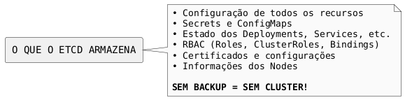
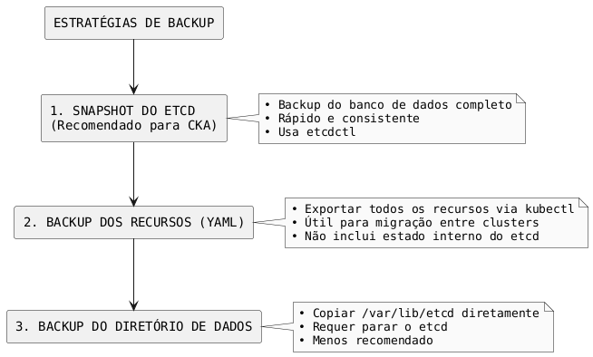
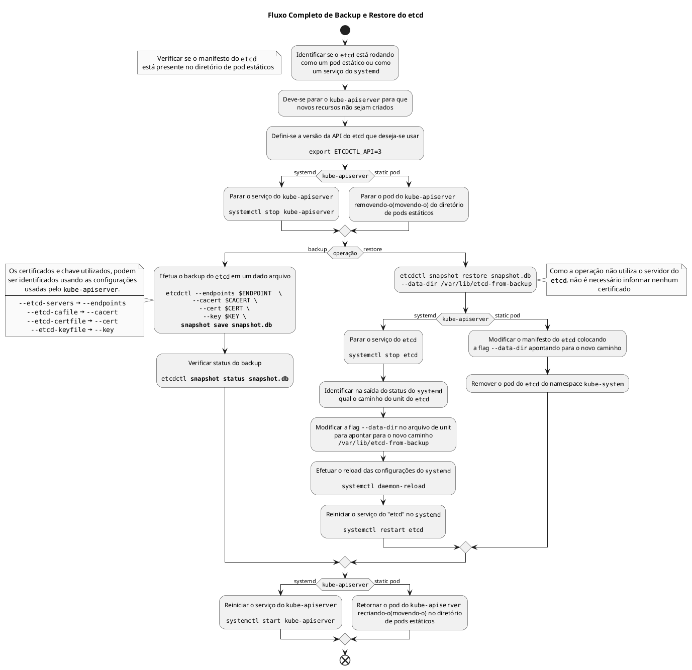
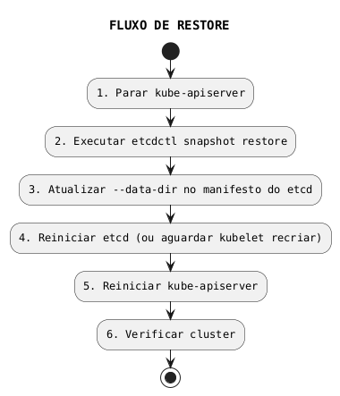

# Backup e Restore

## Conceitos Fundamentais

### Por que Backup do etcd?

O etcd armazena **todo o estado do cluster Kubernetes**. Perder o etcd significa perder todo o cluster.



### Estratégias de Backup



### Fluxo Completo de Backup e Restore

O diagrama abaixo mostra o fluxo de decisões para realizar backup ou restore do etcd, considerando se está rodando como static pod ou serviço systemd:



---

## Identificar Configuração do etcd

### etcd como Static Pod (kubeadm)

```bash
# Verificar manifesto do etcd
cat /etc/kubernetes/manifests/etcd.yaml

# Identificar configurações importantes:
# --data-dir: onde os dados são armazenados
# --listen-client-urls: endpoint para conexão
# --cert-file: certificado do servidor
# --key-file: chave do servidor
# --trusted-ca-file: CA certificate
```

### Extrair Informações do Manifesto

```bash
# Data directory
grep "data-dir" /etc/kubernetes/manifests/etcd.yaml
# Geralmente: /var/lib/etcd

# Certificados (para conectar ao etcd)
grep -E "cert-file|key-file|trusted-ca-file" /etc/kubernetes/manifests/etcd.yaml
```

### etcd como Serviço systemd

```bash
# Ver status do serviço
systemctl status etcd

# Ver configuração
cat /etc/systemd/system/etcd.service

# Ou verificar unit file
systemctl cat etcd
```

---

## Variáveis de Ambiente

### Configurar ETCDCTL_API

```admonish important title="Importante"
Sempre use a API versão 3 para operações de backup e restore.
```

```bash
export ETCDCTL_API=3

# Verificar versão
etcdctl version
```

### Definir Certificados como Variáveis

```bash
# Facilita os comandos
export ETCDCTL_CACERT=/etc/kubernetes/pki/etcd/ca.crt
export ETCDCTL_CERT=/etc/kubernetes/pki/etcd/server.crt
export ETCDCTL_KEY=/etc/kubernetes/pki/etcd/server.key
export ETCDCTL_ENDPOINTS=https://127.0.0.1:2379

# Agora os comandos ficam mais simples
etcdctl member list
```

---

## Backup do etcd

### Passo 1: Criar Snapshot

```bash
# Definir variáveis
export ETCDCTL_API=3

# Criar snapshot (com certificados inline)
etcdctl snapshot save /tmp/etcd-backup.db \
  --endpoints=https://127.0.0.1:2379 \
  --cacert=/etc/kubernetes/pki/etcd/ca.crt \
  --cert=/etc/kubernetes/pki/etcd/server.crt \
  --key=/etc/kubernetes/pki/etcd/server.key

# Ou usando variáveis de ambiente (se configuradas)
etcdctl snapshot save /tmp/etcd-backup.db
```

### Passo 2: Verificar Snapshot

```bash
# Ver status do backup
etcdctl snapshot status /tmp/etcd-backup.db

# Com mais detalhes (tabela)
etcdctl snapshot status /tmp/etcd-backup.db --write-out=table

# Output exemplo:
# +----------+----------+------------+------------+
# |   HASH   | REVISION | TOTAL KEYS | TOTAL SIZE |
# +----------+----------+------------+------------+
# | a1b2c3d4 |    12345 |       1234 |     2.5 MB |
# +----------+----------+------------+------------+
```

### Script de Backup Automatizado

```bash
#!/bin/bash
# backup-etcd.sh

BACKUP_DIR="/backup/etcd"
TIMESTAMP=$(date +%Y%m%d_%H%M%S)
BACKUP_FILE="${BACKUP_DIR}/etcd-snapshot-${TIMESTAMP}.db"

export ETCDCTL_API=3

# Criar diretório se não existir
mkdir -p ${BACKUP_DIR}

# Criar snapshot
etcdctl snapshot save ${BACKUP_FILE} \
  --endpoints=https://127.0.0.1:2379 \
  --cacert=/etc/kubernetes/pki/etcd/ca.crt \
  --cert=/etc/kubernetes/pki/etcd/server.crt \
  --key=/etc/kubernetes/pki/etcd/server.key

# Verificar se backup foi criado
if [ -f ${BACKUP_FILE} ]; then
  echo "Backup criado: ${BACKUP_FILE}"
  etcdctl snapshot status ${BACKUP_FILE} --write-out=table
else
  echo "ERRO: Backup falhou!"
  exit 1
fi

# Manter apenas os últimos 7 backups
ls -t ${BACKUP_DIR}/etcd-snapshot-*.db | tail -n +8 | xargs -r rm
```

---

## Restore do etcd

### Fluxo de Restore



### Passo 1: Parar kube-apiserver (Static Pod)

```bash
# Mover manifesto para parar o pod
mv /etc/kubernetes/manifests/kube-apiserver.yaml /tmp/

# Verificar se parou
crictl ps | grep kube-apiserver
# Não deve retornar nada

# Aguardar alguns segundos
sleep 10
```

### Passo 2: Restore do Snapshot

```admonish important title="Importante"
O restore **NÃO** precisa de certificados, pois não conecta ao servidor etcd - ele apenas restaura os dados localmente.
```

```bash
export ETCDCTL_API=3

# Restore para NOVO diretório
etcdctl snapshot restore /tmp/etcd-backup.db \
  --data-dir=/var/lib/etcd-from-backup
```

### Passo 3: Atualizar Manifesto do etcd

```bash
# Editar manifesto do etcd
vi /etc/kubernetes/manifests/etcd.yaml

# Alterar o data-dir de:
#   --data-dir=/var/lib/etcd
# Para:
#   --data-dir=/var/lib/etcd-from-backup

# Também atualizar o volume hostPath se necessário:
# volumes:
# - hostPath:
#     path: /var/lib/etcd-from-backup  # Alterar aqui também
#     type: DirectoryOrCreate
#   name: etcd-data
```

### Passo 4: Atualizar Volume Mount

```yaml
{{#include ../assets/maintenance/backup-e-restore-example-1.yaml}}
```

### Passo 5: Reiniciar etcd

```bash
# Para static pods, o kubelet irá recriar automaticamente
# Aguardar o pod reiniciar

# Verificar se etcd está rodando
crictl ps | grep etcd

# Se não reiniciar automaticamente, reiniciar kubelet
systemctl restart kubelet
```

### Passo 6: Restaurar kube-apiserver

```bash
# Mover manifesto de volta
mv /tmp/kube-apiserver.yaml /etc/kubernetes/manifests/

# Aguardar iniciar
sleep 30

# Verificar
crictl ps | grep kube-apiserver
```

### Passo 7: Verificar Cluster

```bash
# Testar kubectl
kubectl get nodes
kubectl get pods -A

# Verificar membros do etcd
etcdctl member list \
  --endpoints=https://127.0.0.1:2379 \
  --cacert=/etc/kubernetes/pki/etcd/ca.crt \
  --cert=/etc/kubernetes/pki/etcd/server.crt \
  --key=/etc/kubernetes/pki/etcd/server.key
```

---

## Restore com etcd systemd

### Se etcd roda como serviço systemd

```bash
# 1. Parar kube-apiserver
systemctl stop kube-apiserver

# 2. Parar etcd
systemctl stop etcd

# 3. Restore
export ETCDCTL_API=3
etcdctl snapshot restore /tmp/etcd-backup.db \
  --data-dir=/var/lib/etcd-from-backup

# 4. Atualizar configuração do etcd
# Editar /etc/systemd/system/etcd.service ou equivalente
# Alterar --data-dir para /var/lib/etcd-from-backup

# 5. Corrigir permissões
chown -R etcd:etcd /var/lib/etcd-from-backup

# 6. Reload e restart
systemctl daemon-reload
systemctl restart etcd

# 7. Reiniciar kube-apiserver
systemctl start kube-apiserver
```

---

## Backup de Recursos (Alternativa)

### Exportar Todos os Recursos

```bash
# Backup de todos os namespaces
kubectl get all --all-namespaces -o yaml > cluster-backup.yaml

# Backup por tipo de recurso
kubectl get deployments -A -o yaml > deployments.yaml
kubectl get services -A -o yaml > services.yaml
kubectl get configmaps -A -o yaml > configmaps.yaml
kubectl get secrets -A -o yaml > secrets.yaml
kubectl get pv -o yaml > pv.yaml
kubectl get pvc -A -o yaml > pvc.yaml
```

### Usando Velero (Ferramenta de Backup)

```bash
# Instalar Velero
velero install --provider aws --bucket my-bucket ...

# Criar backup
velero backup create my-backup

# Listar backups
velero backup get

# Restaurar
velero restore create --from-backup my-backup
```

---

## Comandos Essenciais

| Operação | Comando |
|----------|---------|
| **Criar snapshot** | `etcdctl snapshot save <file>` |
| **Verificar snapshot** | `etcdctl snapshot status <file>` |
| **Restore snapshot** | `etcdctl snapshot restore <file> --data-dir=<path>` |
| **Listar membros** | `etcdctl member list` |
| **Health check** | `etcdctl endpoint health` |

---

## Troubleshooting

### Erro: "context deadline exceeded"

```bash
# Certificados incorretos ou etcd não acessível
# Verificar:
curl -k https://127.0.0.1:2379/health

# Verificar se etcd está rodando
crictl ps | grep etcd
```

### Erro: "permission denied" no Restore

```bash
# Corrigir permissões do novo diretório
chown -R root:root /var/lib/etcd-from-backup

# Se etcd roda como usuário específico
chown -R etcd:etcd /var/lib/etcd-from-backup
```

### etcd Não Inicia Após Restore

```bash
# Verificar logs
crictl logs $(crictl ps -a | grep etcd | awk '{print $1}')

# Ou via kubelet
journalctl -u kubelet | grep etcd

# Verificar se data-dir existe e tem permissões corretas
ls -la /var/lib/etcd-from-backup
```

### kubectl Não Funciona Após Restore

```bash
# Verificar se kube-apiserver está rodando
crictl ps | grep kube-apiserver

# Verificar logs do apiserver
crictl logs $(crictl ps | grep kube-apiserver | awk '{print $1}')

# Aguardar e tentar novamente
sleep 60
kubectl get nodes
```

---

## Dicas para o Exame CKA

```plantuml,format=png
@startuml
skinparam monochrome true
skinparam shadowing false
skinparam defaultFontName Monospaced

rectangle "DICAS CKA - BACKUP/RESTORE" as dicas {
  rectangle "BACKUP" as bkp
  rectangle "RESTORE" as rst
  rectangle "LEMBRE-SE" as lembrese
}

note right of bkp
  export ETCDCTL_API=3
  etcdctl snapshot save backup.db \
    --endpoints=https://127.0.0.1:2379 \
    --cacert=/etc/kubernetes/pki/etcd/ca.crt \
    --cert=/etc/kubernetes/pki/etcd/server.crt \
    --key=/etc/kubernetes/pki/etcd/server.key
end note

note right of rst
  etcdctl snapshot restore backup.db \
    --data-dir=/var/lib/etcd-from-backup
end note

note right of lembrese
  • Backup PRECISA de certificados
  • Restore NÃO precisa de certificados
  • Atualizar --data-dir no manifesto do etcd
  • Verificar volumes (hostPath) também
  • Parar apiserver antes, reiniciar depois
  
  **ENCONTRAR CERTIFICADOS:**
  cat /etc/kubernetes/manifests/etcd.yaml
end note

@enduml
```



---

## Referências

- [etcd](../cluster-components/etcd.md)
- [ETCDCTL](../security/etcdctl.md)
- [Cluster Upgrade](cluster-upgrade.md)
- [kube-apiserver](../cluster-components/kube-apiserver.md)
- [High Availability](fundamentals/high-availability.md)
