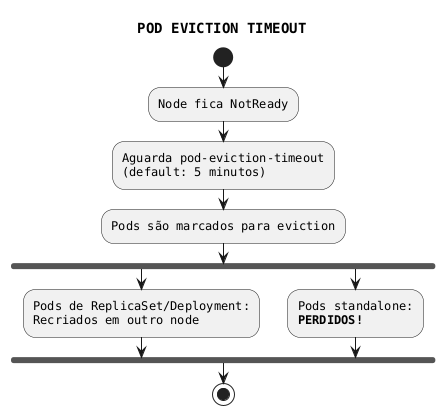
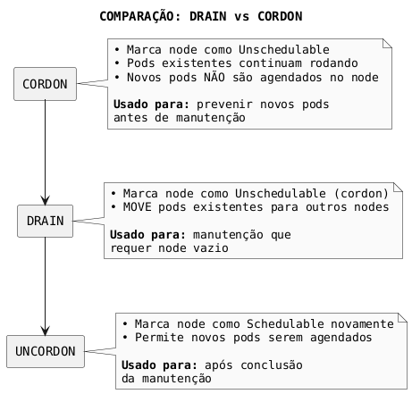
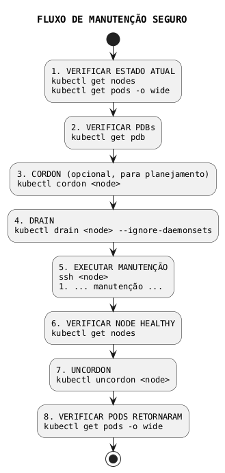
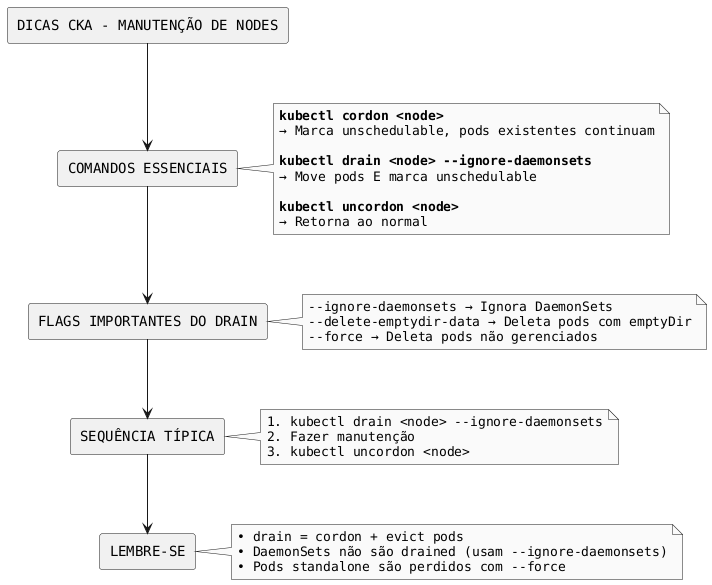

# Manutenção de Nodes

## Conceitos Fundamentais

### Pod Eviction Timeout

Se um node ficar **NotReady por mais de 5 minutos** (padrão), o controller-manager irá marcar os pods para eviction.



### Drain vs Cordon vs Uncordon



---

## Comandos de Manutenção

### kubectl cordon

```bash
# Marcar node como unschedulable
kubectl cordon <node-name>

# Verificar status (mostra SchedulingDisabled)
kubectl get nodes
# NAME     STATUS                     ROLES    AGE   VERSION
# node-1   Ready,SchedulingDisabled   <none>   10d   v1.30.0

# Pods existentes continuam rodando
kubectl get pods -o wide
```

### kubectl drain

```bash
# Drain básico (pode falhar se houver pods problemáticos)
kubectl drain <node-name>

# Drain ignorando DaemonSets (recomendado)
kubectl drain <node-name> --ignore-daemonsets

# Drain forçando delete de pods com local storage
kubectl drain <node-name> --ignore-daemonsets --delete-emptydir-data

# Drain forçando delete de pods standalone
kubectl drain <node-name> --ignore-daemonsets --force

# Drain com todas as flags (mais seguro para manutenção)
kubectl drain <node-name> \
  --ignore-daemonsets \
  --delete-emptydir-data \
  --force \
  --grace-period=30
```

### kubectl uncordon

```bash
# Retornar node ao scheduling normal
kubectl uncordon <node-name>

# Verificar status
kubectl get nodes
# NAME     STATUS   ROLES    AGE   VERSION
# node-1   Ready    <none>   10d   v1.30.0
```

---

## Flags do Drain

| Flag | Descrição |
|------|-----------|
| `--ignore-daemonsets` | Ignora pods de DaemonSets (eles não são evacuados) |
| `--delete-emptydir-data` | Deleta pods que usam emptyDir (dados locais perdidos) |
| `--force` | Força delete de pods não gerenciados por controllers |
| `--grace-period=<sec>` | Tempo para pods terminarem graciosamente |
| `--timeout=<duration>` | Tempo máximo para aguardar drain completar |
| `--dry-run` | Mostra o que seria feito sem executar |

---

## Cenários de Manutenção

### Cenário 1: Atualização do Sistema Operacional

```bash
# 1. Cordon para prevenir novos pods
kubectl cordon worker-1

# 2. Drain para mover pods existentes
kubectl drain worker-1 --ignore-daemonsets --delete-emptydir-data

# 3. SSH no node e fazer manutenção
ssh worker-1
sudo apt update && sudo apt upgrade -y
sudo reboot

# 4. Aguardar node voltar
kubectl get nodes
# Aguardar até STATUS = Ready,SchedulingDisabled

# 5. Uncordon para retomar scheduling
kubectl uncordon worker-1
```

### Cenário 2: Manutenção de Hardware

```bash
# 1. Drain com timeout maior para workloads pesados
kubectl drain worker-2 \
  --ignore-daemonsets \
  --delete-emptydir-data \
  --timeout=300s

# 2. Realizar manutenção física

# 3. Após node voltar online
kubectl uncordon worker-2
```

### Cenário 3: Substituição de Node

```bash
# 1. Drain completamente
kubectl drain old-worker --ignore-daemonsets --delete-emptydir-data --force

# 2. Remover node do cluster
kubectl delete node old-worker

# 3. No node (opcional): resetar kubeadm
ssh old-worker
sudo kubeadm reset

# 4. Adicionar novo node
# (no novo node)
kubeadm join <control-plane>:6443 --token <token> ...
```

---

## Tratando Erros Comuns no Drain

### Erro: Pods com Local Storage

```bash
# Erro:
# cannot delete Pods with local storage (volumes)

# Solução: Usar --delete-emptydir-data
kubectl drain <node> --ignore-daemonsets --delete-emptydir-data
```

### Erro: Pods Não Gerenciados

```bash
# Erro:
# cannot delete Pods not managed by ReplicationController, ReplicaSet, Job, DaemonSet or StatefulSet

# Solução: Usar --force (pods serão perdidos!)
kubectl drain <node> --ignore-daemonsets --force
```

### Erro: DaemonSet Pods

```bash
# Erro:
# cannot delete DaemonSet-managed Pods

# Solução: Usar --ignore-daemonsets
kubectl drain <node> --ignore-daemonsets
```

### Erro: PodDisruptionBudget

```bash
# Erro:
# Cannot evict pod as it would violate the pod's disruption budget

# Soluções:
# 1. Aguardar PDB ser satisfeito
# 2. Aumentar réplicas temporariamente
# 3. Usar --disable-eviction (cuidado!)
kubectl drain <node> --ignore-daemonsets --disable-eviction
```

---

## Pod Disruption Budget (PDB)

PDB protege aplicações durante operações de manutenção.

### Criar PDB

```yaml
{{#include ../assets/maintenance/pdb-app.yaml}}
```

### Verificar PDB

```bash
# Listar PDBs
kubectl get pdb

# Detalhes
kubectl describe pdb app-pdb
```

---

## Fluxo de Manutenção Seguro



---

## Comandos Úteis

```bash
# Ver status dos nodes
kubectl get nodes

# Ver pods em um node específico
kubectl get pods -A --field-selector spec.nodeName=<node>

# Ver eventos relacionados ao node
kubectl get events --field-selector involvedObject.name=<node>

# Verificar recursos do node
kubectl describe node <node> | grep -A 5 "Allocated resources"

# Ver taints do node
kubectl describe node <node> | grep Taints
```

---

## Dicas para o Exame CKA



---

## Referências

- [Cluster Upgrade](cluster-upgrade.md)
- [Scheduling](../workloads/scheduling.md)
- [DaemonSet](../workloads/daemonset.md)
- [Troubleshooting](troubleshooting.md)
