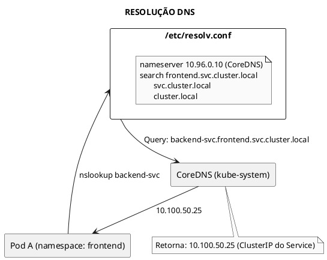
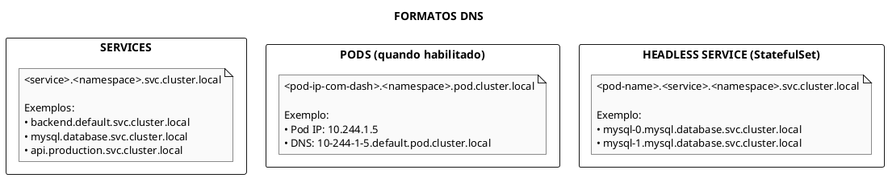
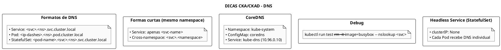

# DNS no Kubernetes

## Conceitos Fundamentais

### Como DNS Funciona no Kubernetes

O Kubernetes executa um serviço DNS (CoreDNS) que automaticamente cria registros DNS para Services e, opcionalmente, para Pods. Isso permite descoberta de serviços por nome.



### Formato dos Nomes DNS



### Formas Abreviadas

```plaintext
# Mesmo namespace - apenas nome do service
curl http://backend

# Outro namespace - service.namespace
curl http://backend.production

# FQDN completo (necessário em alguns casos)
curl http://backend.production.svc.cluster.local
```

---

## CoreDNS

### O que é CoreDNS?

CoreDNS é o servidor DNS padrão do Kubernetes desde a versão 1.13. Roda como Deployment no namespace `kube-system`.

```bash
# Ver pods do CoreDNS
kubectl get pods -n kube-system -l k8s-app=kube-dns

# Ver service do CoreDNS
kubectl get svc -n kube-system kube-dns

# Ver deployment
kubectl get deployment -n kube-system coredns
```

### Corefile - Configuração do CoreDNS

```bash
# Ver configuração atual
kubectl get configmap coredns -n kube-system -o yaml
```

```plaintext
# Corefile padrão
.:53 {
    errors
    health {
       lameduck 5s
    }
    ready
    kubernetes cluster.local in-addr.arpa ip6.arpa {
       pods insecure
       fallthrough in-addr.arpa ip6.arpa
       ttl 30
    }
    prometheus :9153
    forward . /etc/resolv.conf {
       max_concurrent 1000
    }
    cache 30
    loop
    reload
    loadbalance
}
```

### Plugins Importantes do CoreDNS

| Plugin | Descrição |
|--------|-----------|
| `kubernetes` | Resolve nomes de Services/Pods do cluster |
| `forward` | Encaminha queries externas para DNS upstream |
| `cache` | Cache de respostas DNS |
| `errors` | Log de erros |
| `health` | Endpoint de health check (:8080/health) |
| `ready` | Endpoint de readiness (:8181/ready) |
| `prometheus` | Métricas Prometheus (:9153) |

### Habilitar DNS para Pods

Por padrão, Pods não têm registro DNS automático. Para habilitar:

```yaml
{{#include ../assets/dns/coredns-configmap-pods.yaml}}
```

---

## resolv.conf nos Pods

### Configuração Automática

Kubernetes configura automaticamente `/etc/resolv.conf` nos Pods:

```bash
kubectl exec <pod> -- cat /etc/resolv.conf
```

```plaintext
# Exemplo de resolv.conf
nameserver 10.96.0.10          # IP do Service kube-dns
search default.svc.cluster.local svc.cluster.local cluster.local
options ndots:5
```

### Campos do resolv.conf

| Campo | Descrição |
|-------|-----------|
| `nameserver` | IP do CoreDNS (ClusterIP do kube-dns) |
| `search` | Sufixos para busca de nomes curtos |
| `ndots:5` | Nomes com menos de 5 dots usam search |

### Como Search Funciona

```plaintext
# Query: "backend"
# ndots:5 - nome tem 0 dots, então adiciona sufixos

Tentativas em ordem:
1. backend.default.svc.cluster.local
2. backend.svc.cluster.local
3. backend.cluster.local
4. backend (absoluto)
```

---

## DNS Policy

### Tipos de dnsPolicy

```yaml
{{#include ../assets/dns/pod-dns-policy.yaml}}
```

| Policy | Descrição |
|--------|-----------|
| `ClusterFirst` | (Padrão) Usa CoreDNS primeiro, fallback para DNS do node |
| `Default` | Herda DNS do node (resolv.conf do host) |
| `ClusterFirstWithHostNet` | Para Pods com hostNetwork: true |
| `None` | Permite configuração manual via dnsConfig |

### Configuração Manual (dnsConfig)

```yaml
{{#include ../assets/dns/pod-custom-dns.yaml}}
```

---

## Headless Services e StatefulSets

### Headless Service (clusterIP: None)

```yaml
{{#include ../assets/dns/service-headless.yaml}}
```

### DNS com StatefulSet

```yaml
{{#include ../assets/dns/statefulset-mysql.yaml}}
```

```plaintext
# DNS gerado para cada Pod do StatefulSet:
mysql-0.mysql.database.svc.cluster.local
mysql-1.mysql.database.svc.cluster.local
mysql-2.mysql.database.svc.cluster.local
```

---

## Comandos para Troubleshooting

### Verificar DNS

```bash
# Pod temporário para teste DNS
kubectl run dns-test --rm -it --image=busybox:1.28 -- nslookup kubernetes

# Com mais detalhes
kubectl run dns-test --rm -it --image=busybox:1.28 -- nslookup kubernetes.default

# Testar service em outro namespace
kubectl run dns-test --rm -it --image=busybox:1.28 -- nslookup backend.production.svc.cluster.local
```

### Debug com dnsutils

```bash
# Pod com ferramentas DNS
kubectl run dnsutils --image=registry.k8s.io/e2e-test-images/jessie-dnsutils:1.3 --restart=Never -- sleep infinity

# Executar comandos
kubectl exec dnsutils -- nslookup kubernetes
kubectl exec dnsutils -- dig kubernetes.default.svc.cluster.local
kubectl exec dnsutils -- cat /etc/resolv.conf
```

### Verificar CoreDNS

```bash
# Logs do CoreDNS
kubectl logs -n kube-system -l k8s-app=kube-dns

# Status do deployment
kubectl get deployment coredns -n kube-system

# Endpoints
kubectl get endpoints kube-dns -n kube-system

# Verificar ConfigMap
kubectl describe configmap coredns -n kube-system
```

---

## Problemas Comuns

### DNS Não Resolve

```bash
# 1. Verificar se CoreDNS está rodando
kubectl get pods -n kube-system -l k8s-app=kube-dns

# 2. Verificar service kube-dns
kubectl get svc kube-dns -n kube-system

# 3. Verificar endpoints
kubectl get endpoints kube-dns -n kube-system

# 4. Verificar logs
kubectl logs -n kube-system -l k8s-app=kube-dns

# 5. Verificar resolv.conf no Pod
kubectl exec <pod> -- cat /etc/resolv.conf
```

### Service Não Encontrado

```bash
# Verificar se service existe
kubectl get svc <service-name> -n <namespace>

# Verificar se tem endpoints
kubectl get endpoints <service-name> -n <namespace>

# Testar com FQDN completo
nslookup <service>.<namespace>.svc.cluster.local
```

### ndots Alto Causa Lentidão

```yaml
{{#include ../assets/dns/pod-ndots-config.yaml}}
```

---

## Customização do CoreDNS

### Adicionar Forward para Domínio Específico

```yaml
{{#include ../assets/dns/coredns-forward-domain.yaml}}
```

### Usar ConfigMap Adicional

```yaml
{{#include ../assets/dns/coredns-custom-configmap.yaml}}
```

---

## Dicas para os Exames



---

## Referências

- [Networking](./index.md)
- [Service](service.md)
- [StatefulSet](../workloads/statefulset.md)
- [NetworkPolicy](../security/network-policy.md)
