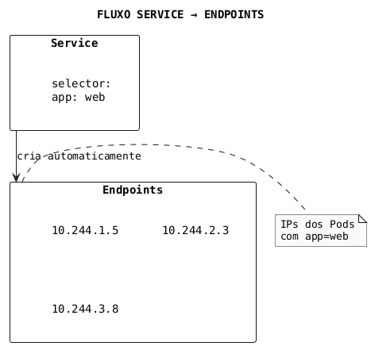
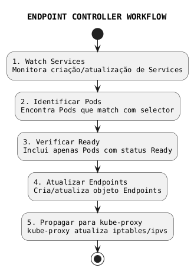
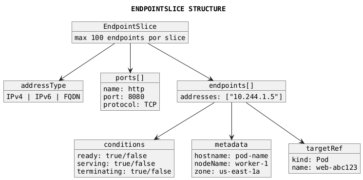

# Endpoints e EndpointSlices

```admonish info title="Certificações"
CKA (10%), CKAD (5%)
```

## Conceitos Fundamentais

### O que são Endpoints

Endpoints são objetos que armazenam os endereços IP e portas dos Pods que correspondem a um Service. Eles são criados automaticamente quando um Service é criado com um selector.



### Endpoints vs EndpointSlices

| Característica | Endpoints | EndpointSlices |
|----------------|-----------|----------------|
| **Limite de IPs** | ~1000 (soft limit) | 100 por slice (configurável) |
| **Escalabilidade** | Limitada | Alta |
| **Atualizações** | Objeto inteiro | Parciais por slice |
| **Informação do Node** | Não | Sim |
| **Suporte Dual-Stack** | Limitado | Nativo |
| **API Version** | v1 | discovery.k8s.io/v1 |

### Como o Controller Funciona



---

## Comandos Essenciais

### Visualizar Endpoints

```bash
# Listar todos os endpoints
kubectl get endpoints
kubectl get ep  # forma curta

# Ver endpoints de um service específico
kubectl get endpoints <service-name>

# Detalhes do endpoint
kubectl describe endpoints <service-name>

# Ver endpoints em formato YAML
kubectl get endpoints <service-name> -o yaml

# Ver endpoints de todos os namespaces
kubectl get endpoints --all-namespaces
kubectl get ep -A
```

### Visualizar EndpointSlices

```bash
# Listar EndpointSlices
kubectl get endpointslices
kubectl get endpointslice  # singular também funciona

# Ver EndpointSlices de um service
kubectl get endpointslices -l kubernetes.io/service-name=<service>

# Detalhes do EndpointSlice
kubectl describe endpointslice <name>

# Ver em formato YAML
kubectl get endpointslice <name> -o yaml
```

### Debugging com Endpoints

```bash
# Verificar se endpoints tem IPs (service funcional)
kubectl get ep <service> -o wide

# Ver endpoints vazios (problema comum)
kubectl get ep | grep "<none>"

# Comparar Service selector com Pod labels
kubectl get svc <service> -o jsonpath='{.spec.selector}'
kubectl get pods -l <selector-key>=<selector-value>

# Verificar pods ready
kubectl get pods -l <selector> -o wide
```

---

## Exemplos Práticos

### Endpoint Automático (via Service)

Quando você cria um Service com selector, os Endpoints são criados automaticamente:

```yaml
{{#include ../assets/service/endpoint-web-service-deployment.yaml}}
```

```bash
# Verificar endpoints criados automaticamente
kubectl get endpoints web-service

# Output:
# NAME          ENDPOINTS                                      AGE
# web-service   10.244.1.5:8080,10.244.2.3:8080,10.244.3.8:8080   5m
```

### Endpoint Manual (Headless Service sem Selector)

Para serviços externos ou recursos fora do cluster:

```yaml
{{#include ../assets/service/external-database-endpoint.yaml}}
```

### ExternalName Service (Alternativa)

Para apontar para DNS externo:

```yaml
{{#include ../assets/service/external-api.yaml}}
```

### EndpointSlice Manual

```yaml
{{#include ../assets/service/endpointslice-manual.yaml}}
```

### Endpoint com Múltiplas Portas

```yaml
{{#include ../assets/service/app-service-multiport.yaml}}
```

---

## EndpointSlices em Detalhes

### Estrutura do EndpointSlice



### Condições dos Endpoints

```yaml
{{#include ../assets/service/endpointslice-conditions.yaml}}
```

### Topologia e Zone-Aware Routing

```yaml
{{#include ../assets/service/topology-service.yaml}}
```

---

## Troubleshooting

### Problema: Endpoints Vazios

```bash
# Sintoma
kubectl get endpoints my-service
# NAME         ENDPOINTS   AGE
# my-service   <none>      5m

# Diagnóstico
# 1. Verificar selector do Service
kubectl get svc my-service -o jsonpath='{.spec.selector}'

# 2. Verificar se existem Pods com labels correspondentes
kubectl get pods -l app=my-app --show-labels

# 3. Verificar se Pods estão Ready
kubectl get pods -l app=my-app -o wide

# Causas comuns:
# - Selector do Service não bate com labels dos Pods
# - Pods não estão Ready (readinessProbe falhando)
# - Pods não existem ou estão em outro namespace
```

### Problema: Pod Não Aparece nos Endpoints

```bash
# Verificar status do Pod
kubectl describe pod <pod-name>

# Verificar readinessProbe
kubectl get pod <pod-name> -o jsonpath='{.spec.containers[0].readinessProbe}'

# Verificar eventos
kubectl get events --field-selector involvedObject.name=<pod-name>

# Solução comum: ajustar readinessProbe
# Se o probe falhar, o Pod não será adicionado aos endpoints
```

### Problema: Endpoint com IP Errado

```bash
# Verificar IP do Pod
kubectl get pod <pod-name> -o jsonpath='{.status.podIP}'

# Verificar EndpointSlice
kubectl get endpointslice -l kubernetes.io/service-name=<service>

# Verificar se Pod foi recriado (novo IP)
kubectl describe pod <pod-name> | grep -A5 "Events:"
```

### Problema: Service Externo Não Funciona

```bash
# Para endpoints manuais, verificar:
# 1. Nome do Endpoints = Nome do Service
kubectl get ep,svc

# 2. Portas correspondem
kubectl get ep <name> -o yaml
kubectl get svc <name> -o yaml

# 3. IPs são alcançáveis do cluster
kubectl run test --rm -it --image=busybox -- ping <external-ip>
```

### Verificar Conectividade via Endpoints

```bash
# Testar cada endpoint individualmente
kubectl get endpoints my-service -o jsonpath='{.subsets[*].addresses[*].ip}'

# Para cada IP
kubectl run test --rm -it --image=busybox -- wget -qO- http://<endpoint-ip>:<port>

# Ou usando port-forward para debug
kubectl port-forward pod/<pod-name> 8080:80
```

---

## Dicas para o Exame

### CKA

```admonish tip title="Dicas CKA"
1. **Debugging de Services**: Sempre verificar endpoints quando Service não funciona
   - `kubectl get ep <service>` - primeiro comando de troubleshooting
   
2. **Endpoints vazios**: Problema #1 em Services
   - Verifique labels e selectors
   - Verifique se Pods estão Ready
   
3. **Endpoints manuais**: Para recursos externos
   - Nome do Endpoints DEVE ser igual ao nome do Service
   
4. **Comandos rápidos**:
   - `kubectl get ep -A` - ver todos endpoints
   - `kubectl describe ep <name>` - detalhes completos
```

### CKAD

```admonish tip title="Dicas CKAD"
1. **ReadinessProbe afeta Endpoints**:
   - Pod não Ready = não aparece nos endpoints
   - Importante para rolling updates
   
2. **Serviços externos**: Conhecer ExternalName como alternativa
   
3. **Debugging rápido**:
   ```bash
   # Ver endpoints + pods + service de uma vez
   kubectl get ep,svc,pods -l app=myapp
   ```
```

### Comandos Úteis para o Exame

```bash
# Ver endpoints de todos os services
kubectl get ep

# Ver endpoints de um service específico com detalhes
kubectl get ep <service> -o wide

# Verificar se service tem endpoints (troubleshooting)
kubectl get ep <service> -o jsonpath='{.subsets[*].addresses[*].ip}'

# Ver EndpointSlices (novo formato)
kubectl get endpointslice

# Debug completo de networking
kubectl get svc,ep,pods -l app=<label>
```

---

## Referências

- [Kubernetes - Endpoints](https://kubernetes.io/docs/concepts/services-networking/service/#endpoints)
- [Kubernetes - EndpointSlices](https://kubernetes.io/docs/concepts/services-networking/endpoint-slices/)
- [Debugging Services](https://kubernetes.io/docs/tasks/debug/debug-application/debug-service/)

### Arquivos Relacionados

- [Service](service.md) - Services que criam Endpoints
- [Networking](./index.md) - Conceitos de rede
- [DNS](dns.md) - Resolução de nomes
- [Troubleshooting](../maintenance/troubleshooting.md) - Diagnóstico de problemas
