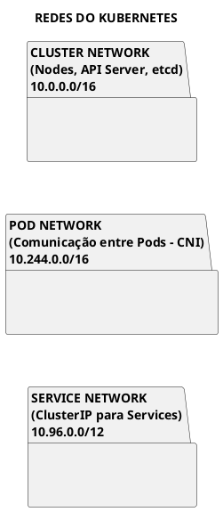
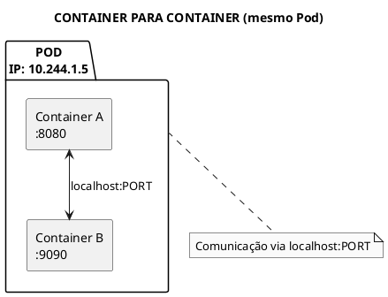
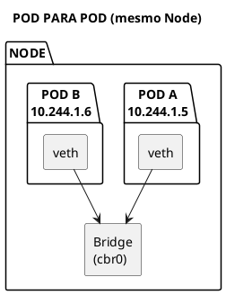
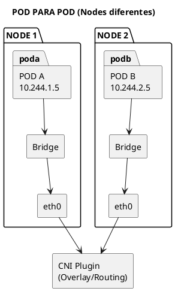
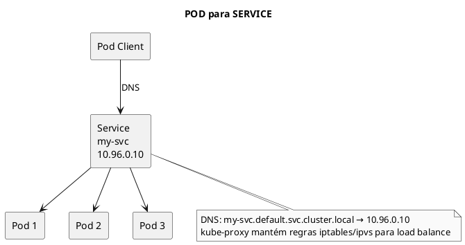
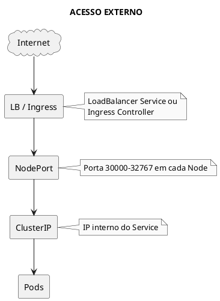
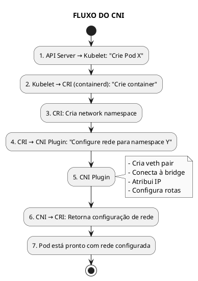
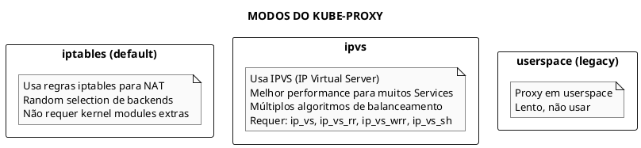
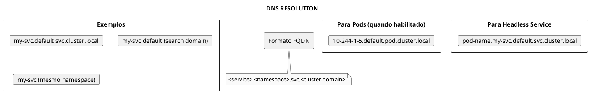
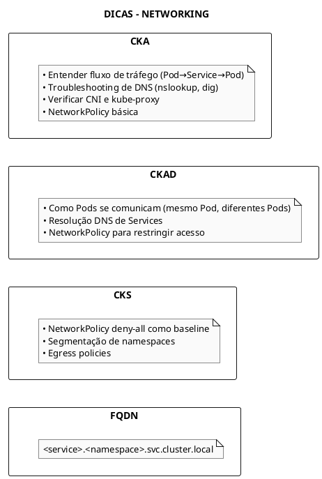

# Networking no Kubernetes

## Conceitos Fundamentais

### Modelo de Rede do Kubernetes

O Kubernetes implementa um modelo de rede flat onde:

1. **Todo Pod tem um IP único** no cluster
2. **Pods podem comunicar sem NAT** entre si
3. **Nodes podem comunicar com Pods** sem NAT
4. **O IP que o Pod vê é o mesmo** que outros veem



---

## Tipos de Comunicação

### 1. Container para Container (mesmo Pod)

Containers no mesmo Pod compartilham o namespace de rede - mesmo IP.



```yaml
{{#include ../assets/service/multi-container-pod.yaml}}
```

```bash
# Verificar namespace de rede
sudo lsns -t net

# Verificar interfaces no namespace
sudo ip netns exec <netns> ip addr
```

### 2. Pod para Pod (mesmo Node)



```bash
# Pod A pode acessar Pod B diretamente pelo IP
kubectl exec pod-a -- curl 10.244.1.6:8080
```

### 3. Pod para Pod (Nodes diferentes)



### 4. Pod para Service



```bash
# Resolução DNS dentro do Pod
kubectl exec my-pod -- nslookup my-service
kubectl exec my-pod -- nslookup my-service.default.svc.cluster.local

# /etc/resolv.conf é gerado pelo kubelet
kubectl exec my-pod -- cat /etc/resolv.conf
# nameserver 10.96.0.10  (CoreDNS)
# search default.svc.cluster.local svc.cluster.local cluster.local
```

### 5. Externo para Service



---

## CNI - Container Network Interface

### O que é CNI?

CNI é uma especificação e conjunto de bibliotecas para configurar interfaces de rede em containers Linux.



### CNI Plugins Populares

| Plugin | Descrição | Recursos |
|--------|-----------|----------|
| **Calico** | L3 networking, BGP | NetworkPolicy, eBPF |
| **Cilium** | eBPF-based | L7 policy, observability |
| **Flannel** | Simple overlay | Simples, VXLAN |
| **Weave** | Mesh networking | Encryption, multicast |
| **Canal** | Flannel + Calico | Overlay + Policy |

### Configuração CNI

```bash
# Localização das configurações
ls /etc/cni/net.d/

# Exemplo de configuração
cat /etc/cni/net.d/10-calico.conflist

# Binários CNI
ls /opt/cni/bin/
```

### Verificar CNI

```bash
# Ver qual CNI está instalado
kubectl get pods -n kube-system | grep -E "calico|cilium|flannel|weave"

# Ver configuração
kubectl get cm -n kube-system | grep -i cni
```

---

## kube-proxy

### Modos de Operação



### Ver Regras iptables

```bash
# Ver regras de um Service
sudo iptables -t nat -L KUBE-SERVICES -n | grep my-service

# Ver todas as regras do kube-proxy
sudo iptables-save | grep -i kube
```

---

## DNS no Kubernetes

### CoreDNS



### Verificar DNS

```bash
# Testar resolução DNS
kubectl run dnstest --image=busybox:1.28 --rm -it --restart=Never -- nslookup kubernetes

# Ver CoreDNS pods
kubectl get pods -n kube-system -l k8s-app=kube-dns

# Ver ConfigMap do CoreDNS
kubectl get cm coredns -n kube-system -o yaml
```

---

## Network Policies

### Conceito

NetworkPolicy controla tráfego entre Pods. Por padrão, todo tráfego é permitido.

```yaml
{{#include ../assets/service/network-policy-deny-all.yaml}}
```

### Permitir Tráfego Específico

```yaml
{{#include ../assets/service/network-policy-allow-web.yaml}}
```

---

## Troubleshooting

### Pod Não Conecta

```bash
# Verificar IP do Pod
kubectl get pod -o wide

# Testar conectividade básica
kubectl exec pod-a -- ping <pod-b-ip>

# Verificar DNS
kubectl exec pod-a -- nslookup kubernetes

# Verificar Service
kubectl get endpoints my-service
```

### CNI com Problema

```bash
# Verificar pods do CNI
kubectl get pods -n kube-system

# Logs do CNI
kubectl logs -n kube-system -l k8s-app=calico-node

# Verificar configuração
cat /etc/cni/net.d/*.conf
```

### kube-proxy com Problema

```bash
# Verificar kube-proxy
kubectl get pods -n kube-system -l k8s-app=kube-proxy

# Logs
kubectl logs -n kube-system -l k8s-app=kube-proxy

# Verificar iptables
sudo iptables -t nat -L -n | grep -i kube
```

---

## Dicas para os Exames



---

## Referências

- [DNS](./DNS.md)
- [NetworkPolicy](./Security/NetworkPolicy.md)
- [Service](./networking/service.md)
- [Ingress](./Ingress.md)
- [kube-proxy](./cluster-components/kube-proxy.md)
