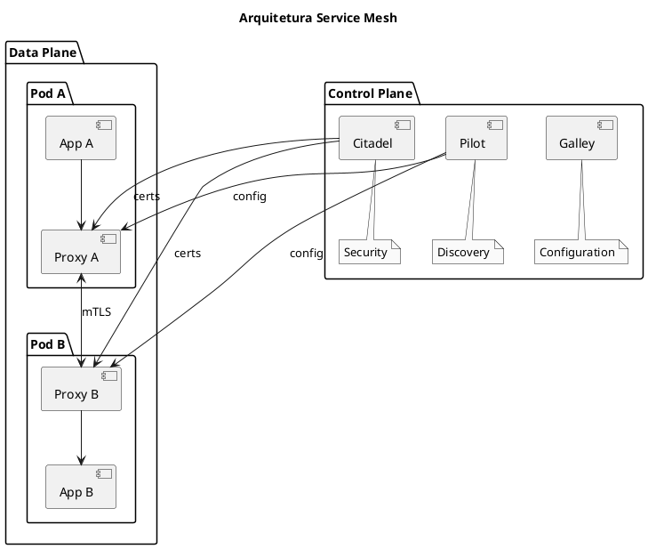

# Service Mesh

<span class="badge badge-kcsa">KCSA</span> <span class="badge badge-cks">CKS</span>

---

## O que é Service Mesh?

```admonish info title="Service Mesh"
Service Mesh é uma camada de infraestrutura dedicada a gerenciar comunicação entre microservices. Fornece observabilidade, segurança e controle de tráfego de forma transparente para as aplicações.
```

### Características

| Aspecto | Descrição |
|---------|-----------|
| **mTLS** | Criptografia automática entre serviços |
| **Observabilidade** | Métricas, traces, logs |
| **Traffic Management** | Roteamento, balanceamento, circuit breaker |
| **Policy** | Autorização, rate limiting |

### Arquitetura



---

## Istio

### Componentes

| Componente | Função |
|------------|--------|
| **istiod** | Control plane unificado (Pilot + Citadel + Galley) |
| **Envoy** | Sidecar proxy (data plane) |
| **Ingress Gateway** | Entrada de tráfego externo |
| **Egress Gateway** | Saída para serviços externos |

### Instalação

```bash
# Download istioctl
curl -L https://istio.io/downloadIstio | sh -
cd istio-*
export PATH=$PWD/bin:$PATH

# Instalar perfil demo
istioctl install --set profile=demo -y

# Habilitar injection no namespace
kubectl label namespace default istio-injection=enabled

# Verificar instalação
kubectl get pods -n istio-system
istioctl verify-install
```

### Perfis de Instalação

| Perfil | Use case |
|--------|----------|
| `demo` | Exploração, todos recursos |
| `default` | Produção básica |
| `minimal` | Controle plane mínimo |
| `empty` | Apenas CRDs |

---

## mTLS Automático

```admonish tip title="mTLS"
Istio fornece mTLS automático entre todos os serviços no mesh. Cada workload recebe um certificado SPIFFE.
```

### Verificar mTLS

```bash
# Ver política atual
kubectl get peerauthentication -A

# Verificar se mTLS está ativo
istioctl x describe pod <pod-name>

# Ver certificados
istioctl proxy-config secret <pod-name>
```

### Configurar mTLS Strict

```yaml
{{#include ../assets/service-mesh/peer-authentication-strict.yaml}}
```

### Modos de mTLS

| Modo | Descrição |
|------|-----------|
| `PERMISSIVE` | Aceita mTLS e plain text (default) |
| `STRICT` | Apenas mTLS |
| `DISABLE` | Sem mTLS |

---

## Authorization Policies

### Deny All por Default

```yaml
{{#include ../assets/service-mesh/authz-deny-all.yaml}}
```

### Allow Específico

```yaml
{{#include ../assets/service-mesh/authz-allow-frontend.yaml}}
```

### Deny por IP

```yaml
{{#include ../assets/service-mesh/authz-deny-ips.yaml}}
```

---

## Traffic Management

### VirtualService

```yaml
{{#include ../assets/service-mesh/virtualservice.yaml}}
```

### DestinationRule

```yaml
{{#include ../assets/service-mesh/destinationrule.yaml}}
```

### Circuit Breaker

```yaml
{{#include ../assets/service-mesh/circuit-breaker.yaml}}
```

---

## Observabilidade

### Métricas (Prometheus)

```bash
# Istio gera métricas automaticamente
# Acessar Prometheus
kubectl port-forward -n istio-system svc/prometheus 9090:9090

# Métricas importantes:
# - istio_requests_total
# - istio_request_duration_milliseconds
# - istio_tcp_connections_opened_total
```

### Tracing (Jaeger)

```bash
# Acessar Jaeger UI
kubectl port-forward -n istio-system svc/tracing 16686:80

# Propagação de headers necessária:
# x-request-id, x-b3-traceid, x-b3-spanid, etc.
```

### Dashboard (Kiali)

```bash
# Acessar Kiali
kubectl port-forward -n istio-system svc/kiali 20001:20001

# Visualiza:
# - Topology do mesh
# - Health dos serviços
# - Configurações Istio
```

---

## Ingress Gateway

```yaml
{{#include ../assets/service-mesh/ingress-gateway.yaml}}
```

---

## Outras Service Meshes

### Linkerd

```bash
# Instalar Linkerd
curl -sL run.linkerd.io/install | sh
linkerd install | kubectl apply -f -

# Injetar em namespace
kubectl annotate namespace default linkerd.io/inject=enabled

# Dashboard
linkerd viz install | kubectl apply -f -
linkerd viz dashboard
```

### Cilium Service Mesh

```bash
# Instalar Cilium com service mesh
cilium install --set kubeProxyReplacement=strict

# Habilitar Hubble para observabilidade
cilium hubble enable --ui
```

### Comparação

| Aspecto | Istio | Linkerd | Cilium |
|---------|-------|---------|--------|
| **Complexidade** | Alta | Média | Baixa |
| **Performance** | Boa | Melhor | Melhor |
| **Features** | Mais completo | Essencial | eBPF-native |
| **mTLS** | ✅ | ✅ | ✅ |
| **Observability** | ✅ | ✅ | ✅ |

---

## Comandos Úteis

```bash
# Istio
istioctl analyze                        # Verificar configuração
istioctl proxy-status                   # Status dos proxies
istioctl proxy-config cluster <pod>     # Config do Envoy
istioctl dashboard kiali                # Abrir Kiali

# Ver sidecar injection
kubectl get namespace -L istio-injection

# Logs do proxy
kubectl logs <pod> -c istio-proxy

# Ver configuração aplicada
kubectl get virtualservice,destinationrule,gateway -A
```

---

## Troubleshooting

### Sidecar não injetado

```bash
# Verificar label do namespace
kubectl get namespace <ns> --show-labels

# Adicionar label
kubectl label namespace <ns> istio-injection=enabled

# Forçar reinício dos pods
kubectl rollout restart deployment -n <ns>
```

### mTLS não funciona

```bash
# Verificar política
kubectl get peerauthentication -A

# Verificar se mesh está em modo permissive
istioctl x describe pod <pod>

# Debug com curl
kubectl exec <pod> -c istio-proxy -- curl -v http://service
```

---

## Dicas para o Exame KCSA

```admonish tip title="Dicas KCSA - Service Mesh"
1. **mTLS é automático** no Istio (mode PERMISSIVE por default)
2. **PeerAuthentication** controla mTLS
3. **AuthorizationPolicy** controla acesso entre serviços
4. **Sidecar injection** via label no namespace
5. **Observabilidade** é um benefício chave
```

### Conceitos para Memorizar

- Service Mesh adiciona camada de segurança entre serviços
- mTLS criptografa tráfego automaticamente
- Policies podem ser aplicadas sem mudar código
- Control plane gerencia configuração, data plane processa tráfego

---

## Referências

- [Istio Documentation](https://istio.io/docs/)
- [Linkerd Documentation](https://linkerd.io/docs/)
- [mTLS](mtls.md) - Mutual TLS
- [Cilium](../security/cilium.md) - CNI com service mesh
