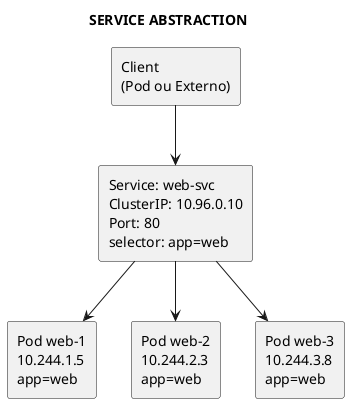
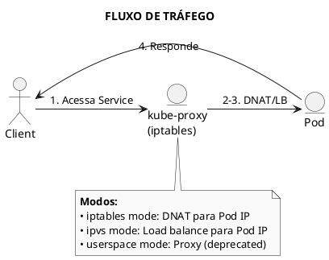
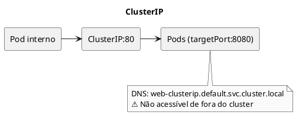
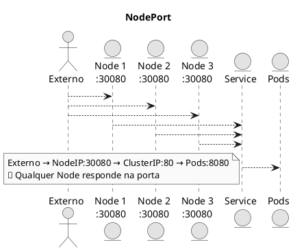
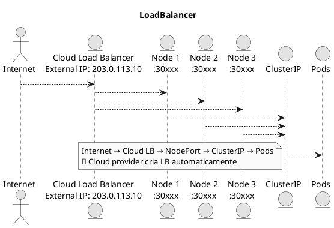
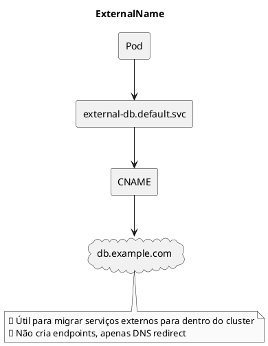
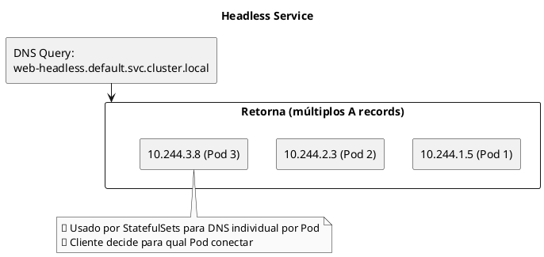
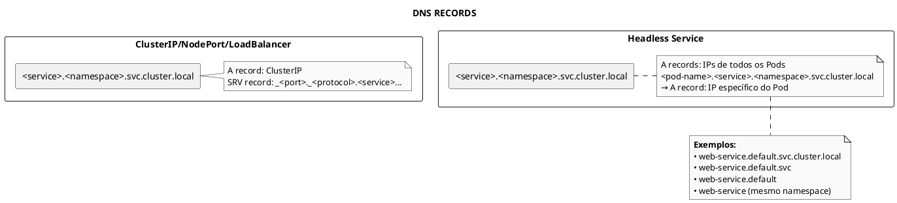

# Services

```admonish info title="Certificações"
CKA (20%), CKAD (15%), KCNA (10%)
```

## Conceitos Fundamentais

### O que são Services

Services são abstrações que definem uma política de acesso lógico para um conjunto de Pods. Eles permitem comunicação estável entre componentes, independente de mudanças nos IPs dos Pods.



### Tipos de Services

| Tipo | Descrição | Acessível de |
|------|-----------|--------------|
| **ClusterIP** | IP virtual interno (padrão) | Dentro do cluster |
| **NodePort** | Porta em cada Node (30000-32767) | Externo via Node IP |
| **LoadBalancer** | Load balancer externo (cloud) | Externo via LB IP |
| **ExternalName** | CNAME DNS para serviço externo | DNS redirect |
| **Headless** | Sem ClusterIP, retorna IPs dos Pods | Dentro do cluster |

### Como Services Funcionam



---

## Tipos de Services em Detalhes

### ClusterIP (Padrão)

Cria um IP virtual acessível apenas dentro do cluster.

```yaml
{{#include ../assets/service/web-clusterip.yaml}}
```



### NodePort

Expõe o Service em uma porta de cada Node.

```yaml
{{#include ../assets/service/web-nodeport.yaml}}
```



### LoadBalancer

Provisiona um load balancer externo (requer cloud provider).

```yaml
{{#include ../assets/service/web-loadbalancer.yaml}}
```




### Service LoadBalancer

```yaml
{{#include ../assets/service/service-loadbalancer.yaml}}
```
### ExternalName

Cria um alias DNS para serviço externo.

```yaml
{{#include ../assets/service/external-db.yaml}}
```



### Headless Service

Service sem ClusterIP - retorna IPs dos Pods diretamente.

```yaml
{{#include ../assets/service/web-headless.yaml}}
```



---

## Comandos Essenciais

### Gerenciamento de Services

```bash
# Listar Services
kubectl get services
kubectl get svc          # forma curta

# Listar com mais detalhes
kubectl get svc -o wide

# Ver Services de todos os namespaces
kubectl get svc -A

# Descrever Service
kubectl describe svc <name>

# Ver YAML do Service
kubectl get svc <name> -o yaml
```

### Criar Services

```bash
# Expor Deployment como Service
kubectl expose deployment <name> --port=80 --target-port=8080

# Expor Pod
kubectl expose pod <name> --port=80 --target-port=8080

# Criar NodePort
kubectl expose deployment <name> --type=NodePort --port=80

# Criar LoadBalancer
kubectl expose deployment <name> --type=LoadBalancer --port=80

# Criar via arquivo
kubectl apply -f service.yaml

# Criar com dry-run
kubectl expose deployment <name> --port=80 --dry-run=client -o yaml > svc.yaml
```

### Deletar Services

```bash
# Deletar Service
kubectl delete svc <name>

# Deletar por arquivo
kubectl delete -f service.yaml

# Deletar múltiplos
kubectl delete svc svc1 svc2 svc3
```

### Debugging de Services

```bash
# Ver endpoints do Service
kubectl get endpoints <service-name>
kubectl get ep <service-name>

# Testar DNS do Service
kubectl run test --rm -it --image=busybox -- nslookup <service-name>

# Testar conectividade
kubectl run test --rm -it --image=busybox -- wget -qO- http://<service-name>

# Ver regras iptables (no node)
sudo iptables -t nat -L KUBE-SERVICES

# Ver range de IPs dos Services
kubectl cluster-info dump | grep service-cluster-ip-range

# Ver CIDR dos Pods
kubectl cluster-info dump | grep cluster-cidr
```

---

## Exemplos Práticos

### Service Completo com Deployment

```yaml
{{#include ../assets/service/web-deployment-service.yaml}}
```

### Service com Múltiplas Portas

```yaml
{{#include ../assets/service/multi-port-service.yaml}}
```

### Service para External IPs

```yaml
{{#include ../assets/service/external-ip-service.yaml}}
```

### Session Affinity

```yaml
{{#include ../assets/service/sticky-service.yaml}}
```

### Service sem Selector (Endpoints Manuais)

```yaml
{{#include ../assets/service/external-service-endpoints.yaml}}
```

---

## DNS e Service Discovery

### Formato DNS



### Variáveis de Ambiente

Services injetam variáveis nos Pods do mesmo namespace:

```bash
# Dentro de um Pod
env | grep -i <SERVICE_NAME>

# Exemplo para service "web-service"
WEB_SERVICE_SERVICE_HOST=10.96.0.10
WEB_SERVICE_SERVICE_PORT=80
WEB_SERVICE_PORT=tcp://10.96.0.10:80
```

---

## Troubleshooting

### Problema: Service Não Funciona

```bash
# 1. Verificar se Service existe
kubectl get svc <name>

# 2. Verificar endpoints
kubectl get endpoints <name>
# Se <none>, problema com selector ou pods não ready

# 3. Verificar selector
kubectl get svc <name> -o jsonpath='{.spec.selector}'

# 4. Verificar pods com selector
kubectl get pods -l app=<selector-value>

# 5. Verificar se pods estão Ready
kubectl get pods -l app=<selector-value> -o wide
```

### Problema: Endpoints Vazios

```bash
# Causas comuns:
# - Selector não corresponde aos labels dos Pods
# - Pods não estão Ready
# - Pods estão em namespace diferente

# Verificar labels dos pods
kubectl get pods --show-labels

# Verificar readiness dos pods
kubectl describe pod <name> | grep -A5 "Conditions:"
```

### Problema: NodePort Não Acessível

```bash
# 1. Verificar a porta
kubectl get svc <name> -o jsonpath='{.spec.ports[0].nodePort}'

# 2. Verificar se porta está no range correto (30000-32767)

# 3. Testar de dentro do cluster primeiro
kubectl run test --rm -it --image=busybox -- wget -qO- http://<node-ip>:<nodeport>

# 4. Verificar firewall do node
sudo iptables -L -n | grep <nodeport>
```

### Problema: DNS Não Resolve

```bash
# Testar resolução DNS
kubectl run test --rm -it --image=busybox -- nslookup <service-name>

# Verificar CoreDNS
kubectl get pods -n kube-system -l k8s-app=kube-dns

# Ver logs do CoreDNS
kubectl logs -n kube-system -l k8s-app=kube-dns

# Verificar ConfigMap do CoreDNS
kubectl get cm coredns -n kube-system -o yaml
```

---

## Dicas para o Exame

### CKA

```admonish tip title="Dicas CKA"
1. **Expor rapidamente**:
   ```bash
   kubectl expose deployment <name> --port=80 --type=NodePort
   ```

2. **Debug de Services**: Sempre verificar endpoints primeiro
   ```bash
   kubectl get ep <service>
   ```

3. **Lembrar ranges**:
   - NodePort: 30000-32767
   - ClusterIP: definido pelo cluster (geralmente 10.96.0.0/12)

4. **Headless Service**: `clusterIP: None`
```

### CKAD

```admonish tip title="Dicas CKAD"
1. **Criar Service rápido**:
   ```bash
   kubectl expose pod <name> --port=80 --target-port=8080
   ```

2. **Múltiplas portas requerem names**

3. **DNS simplificado**: Use apenas `<service-name>` no mesmo namespace

4. **Session Affinity**: `sessionAffinity: ClientIP`
```

### Comandos Úteis para o Exame

```bash
# Criar Service rapidamente
kubectl expose deployment web --port=80 --target-port=8080 --type=ClusterIP

# Gerar YAML sem criar
kubectl expose deployment web --port=80 --dry-run=client -o yaml > svc.yaml

# Ver endpoints + service + pods
kubectl get svc,ep,pods -l app=web

# Testar DNS
kubectl run test --rm -it --image=busybox -- nslookup <service>

# Ver todos services e suas portas
kubectl get svc -o custom-columns=NAME:.metadata.name,TYPE:.spec.type,PORTS:.spec.ports[*].port
```

---

## Referências

- [Kubernetes - Services](https://kubernetes.io/docs/concepts/services-networking/service/)
- [DNS for Services and Pods](https://kubernetes.io/docs/concepts/services-networking/dns-pod-service/)
- [Debugging Services](https://kubernetes.io/docs/tasks/debug/debug-application/debug-service/)

### Arquivos Relacionados

- [Endpoints](endpoint.md) - Objetos que mapeiam IPs dos Pods
- [Networking](./index.md) - Conceitos de rede
- [DNS](dns.md) - Resolução de nomes
- [Ingress](ingress.md) - Roteamento HTTP/HTTPS
