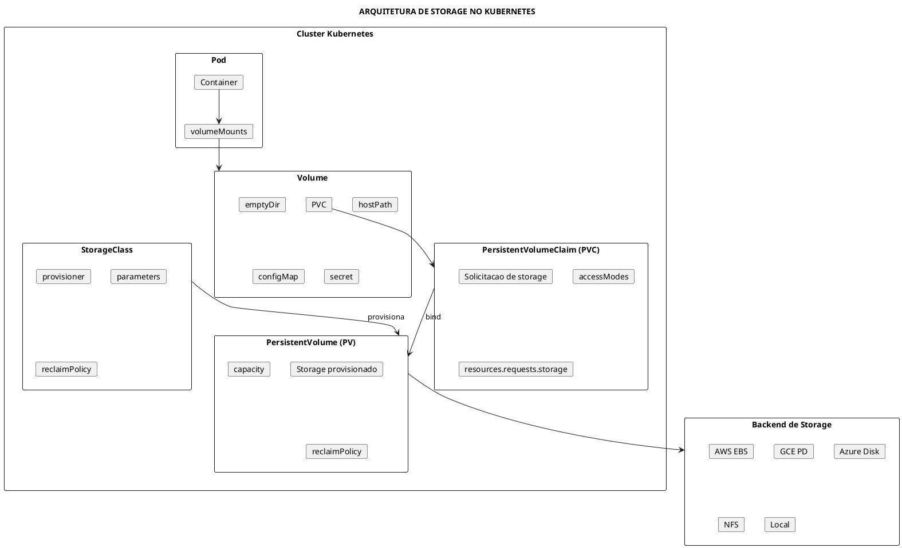
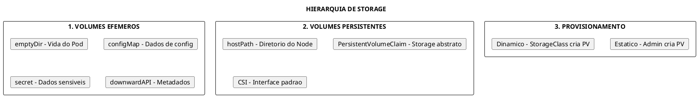
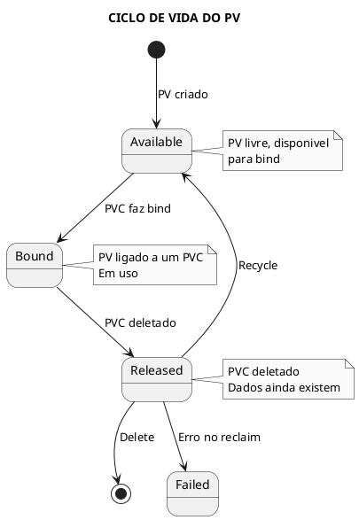
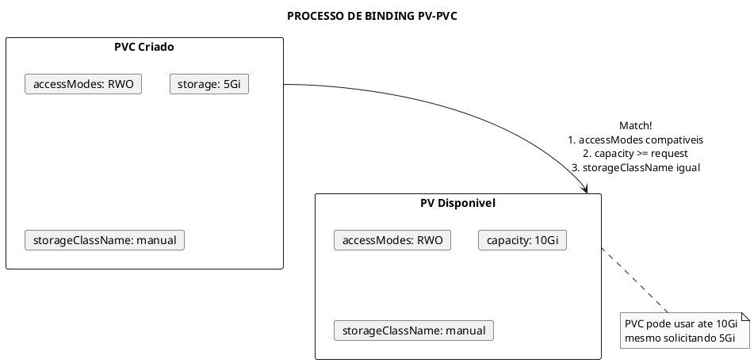
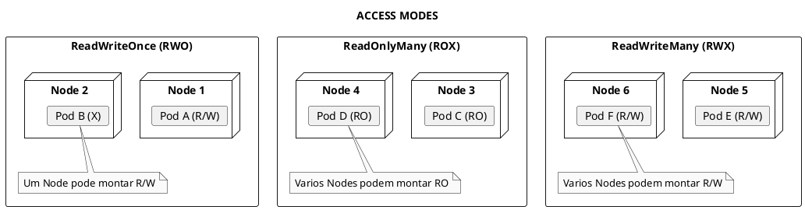
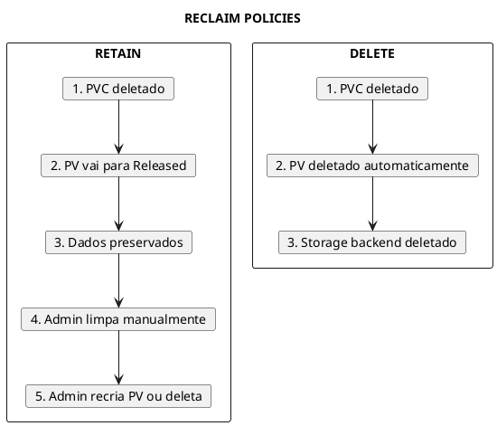
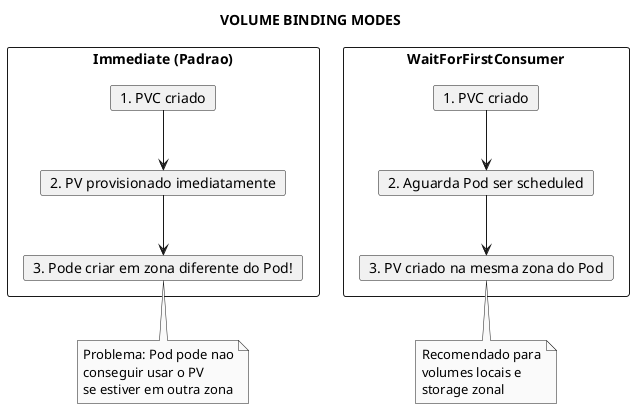
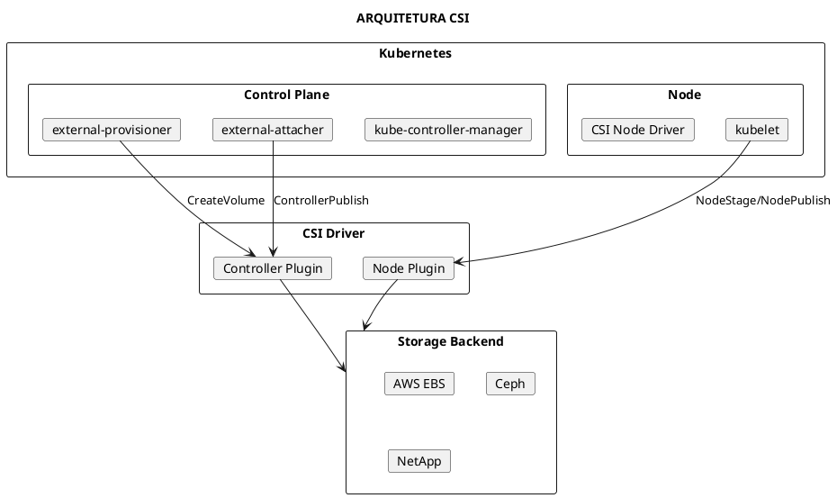
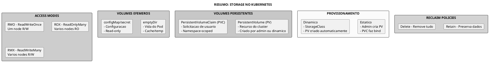

# Storage

> **Certificacoes**: CKA (10%), CKAD (10%)

## Conceitos Fundamentais

### Visao Geral do Storage no Kubernetes

O Kubernetes fornece um sistema de storage abstrato que permite separar a configuracao de storage das aplicacoes. Isso permite que desenvolvedores solicitem storage sem conhecer os detalhes da infraestrutura subjacente.



### Hierarquia de Storage



---

## Tipos de Volumes

### emptyDir

Volume temporario criado quando o Pod e atribuido a um Node. Existe enquanto o Pod existir.

**Casos de uso:**
- Cache temporario
- Compartilhar dados entre containers do mesmo Pod
- Espaco para operacoes de sort/merge

```yaml
../assets/persistent-volumes/pod-emptydir.yaml}}
```

**Opcoes do emptyDir:**

| Opcao | Descricao |
|-------|-----------|
| `medium: ""` | Usa disco do node (padrao) |
| `medium: Memory` | Usa tmpfs (RAM) |
| `sizeLimit` | Limite de tamanho |

```admonish warning title="Atencao"
Dados em emptyDir sao **perdidos** quando o Pod e removido do Node.
```


### Pod com emptyDir

```yaml
{{#include ../assets/persistentvolumes/pod-with-emptydir-volume.yaml}}
```
### hostPath

Monta um arquivo ou diretorio do filesystem do Node no Pod.

```yaml
../assets/persistent-volumes/pod-hostpath.yaml}}
```

**Tipos de hostPath:**

| Tipo | Descricao |
|------|-----------|
| `DirectoryOrCreate` | Cria diretorio se nao existir |
| `Directory` | Diretorio deve existir |
| `FileOrCreate` | Cria arquivo se nao existir |
| `File` | Arquivo deve existir |
| `Socket` | Socket UNIX deve existir |
| `CharDevice` | Character device deve existir |
| `BlockDevice` | Block device deve existir |

```admonish danger title="Risco de Seguranca"
hostPath pode expor dados sensiveis do Node. Use com cautela e apenas quando necessario.
```


### PV com hostPath

```yaml
{{#include ../assets/persistentvolumes/hostpath-persistent-volume.yaml}}
```
### configMap e secret

Montam ConfigMaps e Secrets como arquivos no Pod.

```yaml
../assets/pod/pod-pod-config-volume.yaml}}
```

---

## PersistentVolumes (PV)

### O que e um PV

PersistentVolume e um recurso de storage no cluster que foi provisionado por um administrador ou dinamicamente usando StorageClasses.



### Estrutura do PV

```yaml
../assets/persistent-volumes/pv-example.yaml}}
```

### Campos Importantes do PV

| Campo | Descricao |
|-------|-----------|
| `capacity.storage` | Tamanho do volume |
| `volumeMode` | `Filesystem` (padrao) ou `Block` |
| `accessModes` | Modos de acesso permitidos |
| `persistentVolumeReclaimPolicy` | O que fazer quando PVC e deletado |
| `storageClassName` | StorageClass associada |
| `nodeAffinity` | Restricao de nodes (volumes locais) |

---

## PersistentVolumeClaims (PVC)

### O que e um PVC

PVC e uma solicitacao de storage por um usuario. Similar a um Pod que consome recursos de Node, um PVC consome recursos de PV.

```yaml
../assets/persistent-volumes/pvc-example.yaml}}
```

### Binding PV-PVC



**Criterios de Binding:**

1. **storageClassName** deve ser igual
2. **accessModes** devem ser compativeis
3. **capacity** do PV deve ser >= request do PVC
4. **selector** (se especificado) deve match labels do PV

---

## Access Modes

### Modos de Acesso

| Modo | Abreviacao | Descricao |
|------|------------|-----------|
| `ReadWriteOnce` | RWO | Leitura/escrita por um unico Node |
| `ReadOnlyMany` | ROX | Somente leitura por varios Nodes |
| `ReadWriteMany` | RWX | Leitura/escrita por varios Nodes |
| `ReadWriteOncePod` | RWOP | Leitura/escrita por um unico Pod (K8s 1.22+) |



### Suporte por Backend

| Backend | RWO | ROX | RWX |
|---------|-----|-----|-----|
| AWS EBS | Sim | Nao | Nao |
| GCE PD | Sim | Sim | Nao |
| Azure Disk | Sim | Nao | Nao |
| Azure File | Sim | Sim | Sim |
| NFS | Sim | Sim | Sim |
| hostPath | Sim | Nao | Nao |
| Local | Sim | Nao | Nao |

---

## Reclaim Policies

### Politicas de Reclaim

O que acontece com o PV quando o PVC e deletado:

| Politica | Descricao | Uso |
|----------|-----------|-----|
| `Retain` | Mantem PV e dados. Requer limpeza manual | Producao |
| `Delete` | Deleta PV e storage backend | Dinamico |
| `Recycle` | Limpa dados (`rm -rf /volume/*`) - **Deprecado** | Legado |



---

## StorageClasses


### StorageClass Local Path

```yaml
{{#include ../assets/persistentvolumes/storageclass-localpath.yaml}}
```
### O que e StorageClass

StorageClass permite provisionamento dinamico de PVs. Define o "tipo" de storage disponivel.

```yaml
../assets/persistent-volumes/storageclass-fast-ssd.yaml}}
```

### Campos da StorageClass

| Campo | Descricao |
|-------|-----------|
| `provisioner` | Plugin CSI ou interno |
| `parameters` | Parametros do provisioner |
| `reclaimPolicy` | Retain ou Delete |
| `allowVolumeExpansion` | Permite expandir PVCs |
| `volumeBindingMode` | Immediate ou WaitForFirstConsumer |
| `mountOptions` | Opcoes de mount |

### Volume Binding Modes



### StorageClass Default

```yaml
../assets/storage/storageclass-standard.yaml}}
```

---

## Provisionamento

### Provisionamento Estatico

Administrador cria PVs manualmente. Usuario cria PVCs que fazem bind.

```yaml
../assets/persistent-volumes/static-provisioning.yaml}}
```

### Provisionamento Dinamico

StorageClass cria PVs automaticamente quando PVCs sao criados.

```yaml
../assets/persistent-volumes/dynamic-provisioning.yaml}}
```

---

## Expansao de Volume

### Requisitos para Expansao

1. StorageClass com `allowVolumeExpansion: true`
2. Provisioner que suporte expansao
3. PVC ja deve estar bound

```yaml
../assets/persistent-volumes/storageclass-expandable.yaml}}
```

### Expandindo um PVC

```bash
# Editar PVC para aumentar storage
kubectl patch pvc my-pvc -p '{"spec":{"resources":{"requests":{"storage":"20Gi"}}}}'

# Ou editar diretamente
kubectl edit pvc my-pvc
# Alterar spec.resources.requests.storage

# Verificar status
kubectl get pvc my-pvc -o yaml | grep -A5 status
```

```admonish warning title="Importante"
Para filesystems, pode ser necessario restartar o Pod para que a expansao seja aplicada.
```

---

## CSI (Container Storage Interface)

### O que e CSI

CSI e a interface padrao para expor sistemas de storage para containers. Permite que vendors criem plugins de storage sem modificar o codigo do Kubernetes.



### Componentes CSI

| Componente | Funcao |
|------------|--------|
| **CSI Driver** | Plugin que implementa a interface CSI |
| **external-provisioner** | Cria/deleta volumes |
| **external-attacher** | Attach/detach volumes aos nodes |
| **external-resizer** | Expande volumes |
| **external-snapshotter** | Cria snapshots |
| **node-driver-registrar** | Registra driver no kubelet |

### Exemplo de CSI Driver

```yaml
../assets/storage/csidriver-ebs.yaml}}
```

---

## Exemplos Praticos

### Exemplo 1: Pod com PVC Completo

```yaml
../assets/persistent-volumes/pod-with-pvc.yaml}}
```

### Exemplo 2: Deployment MySQL com Storage Persistente

```yaml
../assets/persistent-volumes/mysql-deployment.yaml}}
```

### Exemplo 3: StatefulSet com volumeClaimTemplates

```yaml
../assets/statefulset/statefulset-web.yaml}}
```

### Exemplo 4: Pod com Multiplos Volumes

```yaml
../assets/pod/pod-multi-volume-pod.yaml}}
```

---

## Comandos Uteis

### Gerenciar PersistentVolumes

```bash
# Listar PVs
kubectl get pv
kubectl get pv -o wide

# Descrever PV
kubectl describe pv <pv-name>

# Ver YAML do PV
kubectl get pv <pv-name> -o yaml

# Criar PV de arquivo
kubectl apply -f pv.yaml

# Deletar PV
kubectl delete pv <pv-name>

# Listar PVs por status
kubectl get pv --field-selector=status.phase=Available
kubectl get pv --field-selector=status.phase=Bound
kubectl get pv --field-selector=status.phase=Released
```

### Gerenciar PersistentVolumeClaims

```bash
# Listar PVCs
kubectl get pvc
kubectl get pvc -A  # todos namespaces
kubectl get pvc -o wide

# Descrever PVC
kubectl describe pvc <pvc-name>

# Ver YAML do PVC
kubectl get pvc <pvc-name> -o yaml

# Criar PVC de arquivo
kubectl apply -f pvc.yaml

# Deletar PVC
kubectl delete pvc <pvc-name>

# Ver PVC de um Pod
kubectl get pod <pod-name> -o jsonpath='{.spec.volumes[*].persistentVolumeClaim.claimName}'

# Expandir PVC
kubectl patch pvc <pvc-name> -p '{"spec":{"resources":{"requests":{"storage":"20Gi"}}}}'
```

### Gerenciar StorageClasses

```bash
# Listar StorageClasses
kubectl get sc
kubectl get storageclass

# Ver StorageClass default
kubectl get sc -o jsonpath='{.items[?(@.metadata.annotations.storageclass\.kubernetes\.io/is-default-class=="true")].metadata.name}'

# Descrever StorageClass
kubectl describe sc <sc-name>

# Ver provisioner
kubectl get sc <sc-name> -o jsonpath='{.provisioner}'

# Tornar StorageClass default
kubectl patch sc <sc-name> -p '{"metadata":{"annotations":{"storageclass.kubernetes.io/is-default-class":"true"}}}'

# Remover default
kubectl patch sc <sc-name> -p '{"metadata":{"annotations":{"storageclass.kubernetes.io/is-default-class":"false"}}}'
```

### Debug de Storage

```bash
# Ver eventos relacionados a storage
kubectl get events --field-selector reason=FailedMount
kubectl get events --field-selector reason=FailedAttachVolume

# Ver volumes de um Pod
kubectl get pod <pod-name> -o jsonpath='{.spec.volumes[*].name}'

# Ver mounts de um container
kubectl exec <pod-name> -- df -h
kubectl exec <pod-name> -- mount | grep <mountPath>

# Ver capacidade de storage em nodes
kubectl describe nodes | grep -A5 "Allocated resources"
```

---

## Troubleshooting

### Problema: PVC Stuck em Pending

```bash
# Verificar eventos do PVC
kubectl describe pvc <pvc-name>

# Causas comuns:
# 1. Nenhum PV disponivel com criterios compativeis
# 2. StorageClass nao existe
# 3. Provisioner nao esta funcionando
# 4. volumeBindingMode: WaitForFirstConsumer (aguardando Pod)

# Verificar PVs disponiveis
kubectl get pv

# Verificar StorageClass
kubectl get sc <storageclass-name>

# Verificar logs do provisioner
kubectl logs -n kube-system -l app=ebs-csi-controller
```

### Problema: Pod Stuck em ContainerCreating

```bash
# Verificar eventos do Pod
kubectl describe pod <pod-name>

# Mensagens comuns:
# - "Unable to attach or mount volumes"
# - "FailedMount"
# - "VolumeBindingNoMatch"

# Verificar se PVC esta Bound
kubectl get pvc

# Verificar se volume esta attached ao node
kubectl get volumeattachment

# Ver logs do kubelet
journalctl -u kubelet | grep -i volume
```

### Problema: Volume Nao Expande

```bash
# Verificar se StorageClass permite expansao
kubectl get sc <sc-name> -o jsonpath='{.allowVolumeExpansion}'

# Verificar status do PVC
kubectl get pvc <pvc-name> -o yaml | grep -A10 status

# Conditions comuns:
# - FileSystemResizePending: Aguardando Pod usar o volume
# - Resizing: Em processo de expansao

# Solucao: Restartar Pod para trigger resize
kubectl delete pod <pod-name>
```

### Problema: PV em Released Nao Pode Ser Reusado

```bash
# Ver status do PV
kubectl get pv <pv-name> -o yaml

# Para reusar PV com Retain policy:
# 1. Fazer backup dos dados se necessario
# 2. Limpar referencia do PVC antigo
kubectl patch pv <pv-name> -p '{"spec":{"claimRef":null}}'

# 3. PV volta para Available
kubectl get pv <pv-name>
```

### Problema: Dados Perdidos Apos Delete PVC

```bash
# Verificar reclaimPolicy do PV/StorageClass
kubectl get pv <pv-name> -o jsonpath='{.spec.persistentVolumeReclaimPolicy}'
kubectl get sc <sc-name> -o jsonpath='{.reclaimPolicy}'

# Se Delete: dados foram perdidos
# Prevencao: usar Retain para dados importantes

# Alterar policy de PV existente (nao afeta dados ja perdidos)
kubectl patch pv <pv-name> -p '{"spec":{"persistentVolumeReclaimPolicy":"Retain"}}'
```

---

## Dicas para o Exame

### CKAD

```admonish tip title="Dicas CKAD"
1. **Saber criar PVC rapidamente**:
   ```bash
   kubectl apply -f - <<EOF
   apiVersion: v1
   kind: PersistentVolumeClaim
   metadata:
     name: my-pvc
   spec:
     accessModes: [ReadWriteOnce]
     resources:
       requests:
         storage: 1Gi
   EOF
   ```

2. **Montar PVC em Pod**:
   ```yaml
../assets/storage/storage-example-6.yaml}}
```

3. **emptyDir para cache/temp**:
   ```yaml
../assets/storage/storage-example-7.yaml}}
```

4. **Nao esquecer volumeMounts no container**

5. **Verificar se PVC esta Bound antes de criar Pod**
```

### CKA

```admonish tip title="Dicas CKA"
1. **Criar PV manualmente**:
   - Saber configurar hostPath
   - Definir accessModes corretos
   - Escolher reclaimPolicy apropriada

2. **Troubleshooting de storage**:
   - PVC Pending: verificar match com PV
   - Pod ContainerCreating: verificar mount

3. **StorageClass default**:
   ```bash
   kubectl get sc -o jsonpath='{.items[?(@.metadata.annotations.storageclass\.kubernetes\.io/is-default-class=="true")].metadata.name}'
   ```

4. **Expandir PVC**:
   - StorageClass precisa ter allowVolumeExpansion: true
   - Pode precisar restart do Pod

5. **Binding modes**:
   - Immediate: bind imediato
   - WaitForFirstConsumer: aguarda Pod
```

### Comandos Rapidos para o Exame

```bash
# Criar PVC minimo
cat <<EOF | kubectl apply -f -
apiVersion: v1
kind: PersistentVolumeClaim
metadata:
  name: my-pvc
spec:
  accessModes: [ReadWriteOnce]
  resources:
    requests:
      storage: 1Gi
  storageClassName: standard
EOF

# Criar PV hostPath
cat <<EOF | kubectl apply -f -
apiVersion: v1
kind: PersistentVolume
metadata:
  name: my-pv
spec:
  capacity:
    storage: 5Gi
  accessModes: [ReadWriteOnce]
  persistentVolumeReclaimPolicy: Retain
  hostPath:
    path: /mnt/data
EOF

# Verificar binding
kubectl get pv,pvc

# Pod com PVC
kubectl run nginx --image=nginx --dry-run=client -o yaml > pod.yaml
# Adicionar volumes e volumeMounts manualmente
```

---

## Best Practices

### Producao

```admonish info title="Recomendacoes de Producao"
1. **Sempre usar StorageClass** para provisionamento dinamico
2. **Definir reclaimPolicy: Retain** para dados importantes
3. **Usar WaitForFirstConsumer** para storage zonal
4. **Habilitar allowVolumeExpansion** para flexibilidade
5. **Definir requests de storage** adequados
6. **Usar ReadWriteOncePod** quando possivel (K8s 1.22+)
7. **Implementar backups** independentes do Kubernetes
```

### Seguranca

```admonish warning title="Consideracoes de Seguranca"
1. **Evitar hostPath** em producao
2. **Usar secrets para credenciais** de storage
3. **Restringir acesso a StorageClasses** via RBAC
4. **Habilitar encryption at rest** quando disponivel
5. **Auditar uso de volumes** privilegiados
```

### Performance

```admonish tip title="Otimizacao de Performance"
1. **Escolher tipo de storage** apropriado (SSD vs HDD)
2. **Usar emptyDir com medium: Memory** para cache critico
3. **Considerar ReadOnlyMany** para dados estaticos
4. **Monitorar IOPS e throughput** do storage
5. **Usar CSI drivers** otimizados do vendor
```

---

## Resumo Visual



---

## Referencias

- [Kubernetes - Volumes](https://kubernetes.io/docs/concepts/storage/volumes/)
- [Kubernetes - Persistent Volumes](https://kubernetes.io/docs/concepts/storage/persistent-volumes/)
- [Kubernetes - Storage Classes](https://kubernetes.io/docs/concepts/storage/storage-classes/)
- [Kubernetes - CSI](https://kubernetes.io/docs/concepts/storage/volumes/#csi)
- [Kubernetes - Volume Snapshots](https://kubernetes.io/docs/concepts/storage/volume-snapshots/)

### Arquivos Relacionados

- [ConfigMap](configuration/configmap.md) - Volumes de configuracao
- [Secrets](configuration/secrets.md) - Volumes de dados sensiveis
- [StatefulSet](workloads/statefulset.md) - Workloads com storage persistente
- [Pod](workloads/pod.md) - Configuracao de volumes em Pods


---

### PV e PVC Básico

```yaml
{{#include ../assets/persistentvolumes/pv-and-pvc.yaml}}
```


---

### PV com Delete Policy

```yaml
{{#include ../assets/persistentvolumes/pv-and-pvc-delete-policy.yaml}}
```


---

### PV com Recycle Policy

```yaml
{{#include ../assets/persistentvolumes/pv-and-pvc-recycle-policy.yaml}}
```
