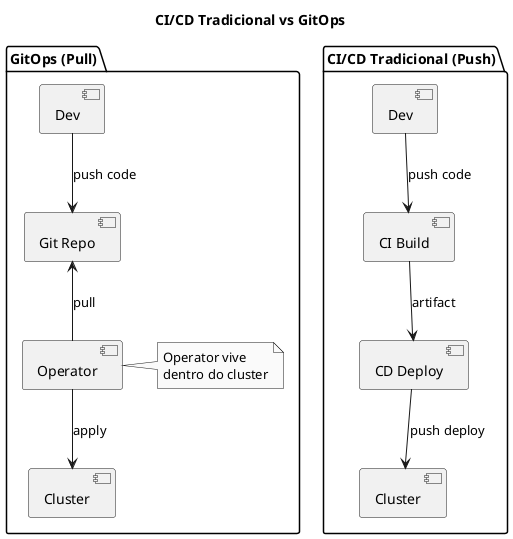
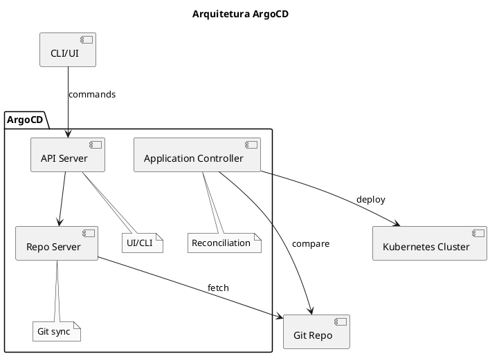

# GitOps

<span class="badge badge-kcna">KCNA</span>

---

## O que é GitOps?

```admonish info title="GitOps"
GitOps é uma prática operacional que usa Git como única fonte de verdade para infraestrutura declarativa e aplicações. Mudanças são feitas via Git (PR/MR) e automaticamente aplicadas ao cluster.
```

### Princípios do GitOps

| Princípio | Descrição |
|-----------|-----------|
| **Declarativo** | Todo sistema descrito declarativamente |
| **Versionado** | Estado desejado em Git (versionamento, audit) |
| **Automático** | Mudanças aprovadas aplicadas automaticamente |
| **Contínuo** | Agentes garantem convergência constante |

### GitOps vs CI/CD Tradicional



### Benefícios

- **Segurança**: Credenciais não saem do cluster
- **Auditoria**: Todo histórico no Git
- **Rollback**: Reverter via `git revert`
- **Consistência**: Estado sempre sincronizado
- **Self-healing**: Detecta drift automaticamente

---

## ArgoCD

```admonish tip title="ArgoCD"
ArgoCD é uma ferramenta de continuous delivery declarativa para Kubernetes, seguindo padrões GitOps.
```

### Arquitetura



### Instalação

```bash
# Criar namespace
kubectl create namespace argocd

# Instalar ArgoCD
kubectl apply -n argocd -f https://raw.githubusercontent.com/argoproj/argo-cd/stable/manifests/install.yaml

# Verificar pods
kubectl get pods -n argocd

# Expor UI (dev)
kubectl port-forward svc/argocd-server -n argocd 8080:443

# Obter senha admin
kubectl -n argocd get secret argocd-initial-admin-secret -o jsonpath="{.data.password}" | base64 -d
```

### ArgoCD CLI

```bash
# Instalar CLI
brew install argocd

# Login
argocd login localhost:8080

# Listar apps
argocd app list

# Criar app
argocd app create my-app \
  --repo https://github.com/myorg/my-app.git \
  --path k8s \
  --dest-server https://kubernetes.default.svc \
  --dest-namespace default

# Sync app
argocd app sync my-app

# Ver status
argocd app get my-app
```

### Application CRD

```yaml
{{#include ../assets/gitops/argocd-application.yaml}}
```

### App of Apps Pattern

```yaml
{{#include ../assets/gitops/argocd-app-of-apps.yaml}}
```

---

## Flux

```admonish note title="Flux"
Flux é um conjunto de ferramentas de continuous delivery para Kubernetes que mantém clusters sincronizados com Git e container registries.
```

### Componentes

| Componente | Função |
|------------|--------|
| **Source Controller** | Gerencia repositórios Git, Helm, OCI |
| **Kustomize Controller** | Reconcilia Kustomization resources |
| **Helm Controller** | Reconcilia HelmRelease resources |
| **Notification Controller** | Alertas e webhooks |
| **Image Automation** | Atualiza imagens automaticamente |

### Instalação

```bash
# Instalar Flux CLI
brew install fluxcd/tap/flux

# Verificar pré-requisitos
flux check --pre

# Bootstrap com GitHub
flux bootstrap github \
  --owner=myorg \
  --repository=fleet-infra \
  --branch=main \
  --path=clusters/my-cluster \
  --personal

# Verificar instalação
flux check
kubectl get pods -n flux-system
```

### GitRepository

```yaml
{{#include ../assets/gitops/flux-gitrepository.yaml}}
```

### Kustomization

```yaml
{{#include ../assets/gitops/flux-kustomization.yaml}}
```

### HelmRelease

```yaml
{{#include ../assets/gitops/flux-helmrelease.yaml}}
```

---

## Image Automation (Flux)

### ImageRepository

```yaml
{{#include ../assets/gitops/flux-imagerepository.yaml}}
```

### ImagePolicy

```yaml
{{#include ../assets/gitops/flux-imagepolicy.yaml}}
```

### ImageUpdateAutomation

```yaml
{{#include ../assets/gitops/flux-imageupdateautomation.yaml}}
```

---

## ArgoCD vs Flux

| Aspecto | ArgoCD | Flux |
|---------|--------|------|
| **UI** | Sim (rica) | Não (terceiros) |
| **Multi-cluster** | Nativo | Via workload |
| **RBAC** | Projetos | RBAC K8s |
| **Helm** | Sim | Sim |
| **Kustomize** | Sim | Sim |
| **Image automation** | Não nativo | Nativo |
| **Aprendizado** | Mais fácil | Mais curva |

---

## Estrutura de Repositório

### Monorepo

```
gitops-repo/
├── apps/
│   ├── base/
│   │   ├── app-a/
│   │   └── app-b/
│   └── overlays/
│       ├── dev/
│       ├── staging/
│       └── prod/
├── infrastructure/
│   ├── controllers/
│   └── configs/
└── clusters/
    ├── dev/
    ├── staging/
    └── prod/
```

### Multi-repo

```
# Repo: platform-gitops
clusters/
├── dev/
├── staging/
└── prod/

# Repo: app-a-gitops
k8s/
├── base/
└── overlays/

# Repo: app-b-gitops
k8s/
├── base/
└── overlays/
```

---

## Boas Práticas

### Secrets

```admonish warning title="Secrets no GitOps"
Nunca commite secrets em plain text! Use Sealed Secrets, SOPS, ou External Secrets.
```

#### Sealed Secrets

```yaml
{{#include ../assets/gitops/sealed-secret.yaml}}
```

#### External Secrets

```yaml
{{#include ../assets/gitops/external-secret.yaml}}
```

### Branch Strategy

```
main ──────────────────────────► prod
  │
  └──► develop ────────────────► staging
         │
         └──► feature/* ───────► dev (ephemeral)
```

---

## Comandos Úteis

```bash
# ArgoCD
argocd app list
argocd app sync <app>
argocd app diff <app>
argocd app history <app>
argocd app rollback <app> <revision>

# Flux
flux get sources git
flux get kustomizations
flux reconcile kustomization <name>
flux logs
flux events

# Verificar drift
argocd app diff my-app --local ./k8s
flux diff kustomization my-app
```

---

## Dicas para o Exame KCNA

```admonish tip title="Dicas KCNA - GitOps"
1. **Git como fonte de verdade** - princípio fundamental
2. **Pull vs Push** - GitOps usa modelo pull
3. **Reconciliation** - agentes garantem estado desejado
4. **Segurança** - credenciais ficam no cluster
5. **ArgoCD e Flux** - duas ferramentas principais CNCF
```

### Conceitos para Memorizar

- GitOps é continuous delivery declarativo
- Estado desejado vive no Git
- Operadores no cluster puxam e aplicam mudanças
- Drift é detectado e corrigido automaticamente
- Rollback é simples: `git revert`

---

## Referências

- [ArgoCD Documentation](https://argo-cd.readthedocs.io/)
- [Flux Documentation](https://fluxcd.io/docs/)
- [GitOps Principles](https://opengitops.dev/)
- [Helm](../tools/helm.md) - Package manager
- [Kustomize](../tools/kustomize.md) - Configuration customization
