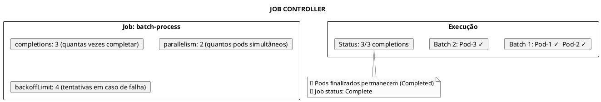
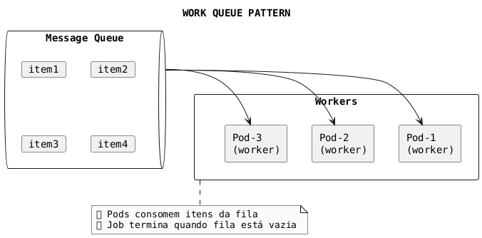

# Jobs

```admonish info title="Certificações"
CKAD (15%), CKA (10%)
```

## Conceitos Fundamentais

### O que são Jobs

Jobs são recursos para executar tarefas que devem rodar até completar com sucesso. Diferente de Pods normais que são reiniciados, Jobs terminam após concluir sua tarefa.



### Jobs vs Pods vs Deployments

| Característica | Pod | Deployment | Job |
|----------------|-----|------------|-----|
| **Propósito** | Unidade básica | Long-running | Batch/Task |
| **Reinicio** | Baseado em policy | Sempre | Até sucesso |
| **Réplicas** | 1 | N (constante) | completions |
| **Fim esperado** | Não | Não | Sim |
| **restartPolicy** | Always (default) | Always | Never/OnFailure |

### Campos Importantes

```plantuml,format=png
@startuml
skinparam monochrome true
skinparam backgroundColor white

title CAMPOS DO JOB

rectangle "spec.completions: 5" as completions
note right of completions : Quantas vezes o job deve completar com sucesso

rectangle "spec.parallelism: 2" as parallelism
note right of parallelism : Quantos pods podem rodar simultaneamente

rectangle "spec.backoffLimit: 4" as backoffLimit
note right of backoffLimit : Quantas falhas antes de considerar o job failed

rectangle "spec.activeDeadlineSeconds: 300" as deadline
note right of deadline : Tempo máximo de execução (inclui retries)

rectangle "spec.ttlSecondsAfterFinished: 100" as ttl
note right of ttl : Tempo até o job ser deletado automaticamente

rectangle "spec.template.spec.restartPolicy: Never | OnFailure" {
  note as n6
    Never: não reinicia container
    OnFailure: reinicia apenas se falhar
  end note
}

@enduml
```



---

## Comandos Essenciais

### Criar Jobs

```bash
# Criar job simples
kubectl create job <name> --image=<image> -- <command>

# Exemplo: job que executa expressão
kubectl create job math-job --image=busybox -- expr 3 + 4

# Criar job de um CronJob (executar imediatamente)
kubectl create job manual-job --from=cronjob/<cronjob-name>

# Criar com dry-run para YAML
kubectl create job my-job --image=busybox --dry-run=client -o yaml -- sleep 30 > job.yaml

# Criar via arquivo
kubectl apply -f job.yaml
```

### Gerenciar Jobs

```bash
# Listar jobs
kubectl get jobs
kubectl get job      # singular também funciona

# Listar com mais detalhes
kubectl get jobs -o wide

# Ver jobs e pods relacionados
kubectl get jobs,pods -l job-name=<name>

# Descrever job
kubectl describe job <name>

# Ver YAML do job
kubectl get job <name> -o yaml
```

### Monitorar Jobs

```bash
# Ver status do job
kubectl get job <name>

# Output:
# NAME       COMPLETIONS   DURATION   AGE
# math-job   3/3           45s        2m

# Ver pods do job
kubectl get pods -l job-name=<name>

# Ver logs do job
kubectl logs job/<name>

# Ver logs de um pod específico do job
kubectl logs <pod-name>

# Seguir logs em tempo real
kubectl logs -f job/<name>
```

### Deletar Jobs

```bash
# Deletar job (e seus pods)
kubectl delete job <name>

# Deletar mantendo pods
kubectl delete job <name> --cascade=orphan

# Deletar por arquivo
kubectl delete -f job.yaml

# Deletar jobs completed
kubectl delete jobs --field-selector status.successful=1
```

---

## Exemplos Práticos


### Job Executando Expressão

```yaml
{{#include ../assets/job/job-execute-expression.yaml}}
```
### Job Simples

```yaml
{{#include ../assets/job/simple-job.yaml}}
```

### Job com Múltiplas Completions

```yaml
{{#include ../assets/job/multi-completion-job.yaml}}
```

```plaintext
Execução com completions=5 e parallelism=2:

Tempo 0:   Pod-1 (running)  Pod-2 (running)
Tempo 5s:  Pod-1 ✓          Pod-2 ✓         Pod-3 (running)  Pod-4 (running)
Tempo 10s: Pod-3 ✓          Pod-4 ✓         Pod-5 (running)
Tempo 15s: Pod-5 ✓

Status: 5/5 completions (SUCCESS)
```

### Job com Backoff Limit

```yaml
{{#include ../assets/job/retry-job.yaml}}
```

### Job com Deadline

```yaml
{{#include ../assets/job/deadline-job.yaml}}
```

### Job com TTL (Auto-cleanup)

```yaml
{{#include ../assets/job/ttl-job.yaml}}
```

### Job com restartPolicy: OnFailure

```yaml
{{#include ../assets/job/onfailure-job.yaml}}
```

### Job de Backup

```yaml
{{#include ../assets/job/db-backup-job.yaml}}
```

### Job com Work Queue (Indexed)

```yaml
{{#include ../assets/job/indexed-job.yaml}}
```

---

## Padrões de Uso

### Work Queue Pattern



### Fixed Completion Count

```yaml
{{#include ../assets/workloads/job-example-1.yaml}}
```

### Parallel Jobs com Work Queue

```yaml
{{#include ../assets/workloads/job-example-2.yaml}}
```

---

## Troubleshooting

### Problema: Job Fica em Status "Running" Indefinidamente

```bash
# Verificar pods do job
kubectl get pods -l job-name=<job-name>

# Ver logs do pod
kubectl logs <pod-name>

# Verificar se tem activeDeadlineSeconds configurado
kubectl get job <name> -o jsonpath='{.spec.activeDeadlineSeconds}'

# Solução: adicionar activeDeadlineSeconds ou debugar o pod
```

### Problema: Job Falha Repetidamente

```bash
# Ver status das falhas
kubectl describe job <name>

# Verificar eventos
kubectl get events --field-selector involvedObject.name=<job-name>

# Ver logs dos pods que falharam
kubectl logs <pod-name> --previous

# Verificar backoffLimit
kubectl get job <name> -o jsonpath='{.spec.backoffLimit}'
```

### Problema: Pods Não Estão Sendo Criados

```bash
# Verificar eventos do job
kubectl describe job <name>

# Verificar quota de recursos
kubectl get resourcequota

# Verificar se há nodes disponíveis
kubectl get nodes

# Verificar se imagem existe
kubectl describe pod <pod-name> | grep -A10 "Events:"
```

### Status do Job

```bash
# Ver status detalhado
kubectl get job <name> -o jsonpath='{.status}'

# Campos importantes:
# .status.succeeded: pods que completaram com sucesso
# .status.failed: pods que falharam
# .status.active: pods rodando atualmente
# .status.completionTime: quando completou
```

---

## Dicas para o Exame

### CKAD

```admonish tip title="Dicas CKAD"
1. **Criar Job rápido**:
   ```bash
   kubectl create job my-job --image=busybox -- echo "hello"
   ```

2. **restartPolicy obrigatório**: Deve ser `Never` ou `OnFailure`

3. **Ver logs do Job**:
   ```bash
   kubectl logs job/<name>
   ```

4. **Criar Job de CronJob**:
   ```bash
   kubectl create job test --from=cronjob/<name>
   ```

5. **Campos importantes para exame**:
   - `completions`
   - `parallelism`
   - `backoffLimit`
   - `activeDeadlineSeconds`
```

### CKA

```admonish tip title="Dicas CKA"
1. **Monitorar Jobs**:
   ```bash
   kubectl get jobs,pods -l job-name=<name>
   ```

2. **Cleanup automático**: Use `ttlSecondsAfterFinished`

3. **Debugging**: Sempre verificar logs e eventos
```

### Comandos Úteis para o Exame

```bash
# Criar job simples
kubectl create job test --image=busybox -- echo "done"

# Criar job com dry-run
kubectl create job test --image=busybox --dry-run=client -o yaml -- sleep 10

# Ver jobs e seus pods
kubectl get jobs,pods

# Logs do job
kubectl logs job/<name>

# Deletar jobs completados
kubectl delete jobs --field-selector status.successful=1

# Criar job de cronjob existente
kubectl create job manual-run --from=cronjob/<name>
```

### Template Rápido para Job

```yaml
{{#include ../assets/job/job-template.yaml}}
```

---

## Referências

- [Kubernetes - Jobs](https://kubernetes.io/docs/concepts/workloads/controllers/job/)
- [Kubernetes - Indexed Job](https://kubernetes.io/docs/tasks/job/indexed-parallel-processing-static/)
- [Kubernetes - TTL Controller](https://kubernetes.io/docs/concepts/workloads/controllers/ttlafterfinished/)

### Arquivos Relacionados

- [CronJob](cronjob.md) - Jobs agendados
- [Pod](pod.md) - Unidade básica de execução
- [ConfigMap](../configuration/configmap.md) - Configuração para Jobs
- [Secrets](../configuration/secrets.md) - Dados sensíveis para Jobs


---

### Job com Múltiplas Completions

```yaml
{{#include ../assets/job/job-execute-expression-completions.yaml}}
```
