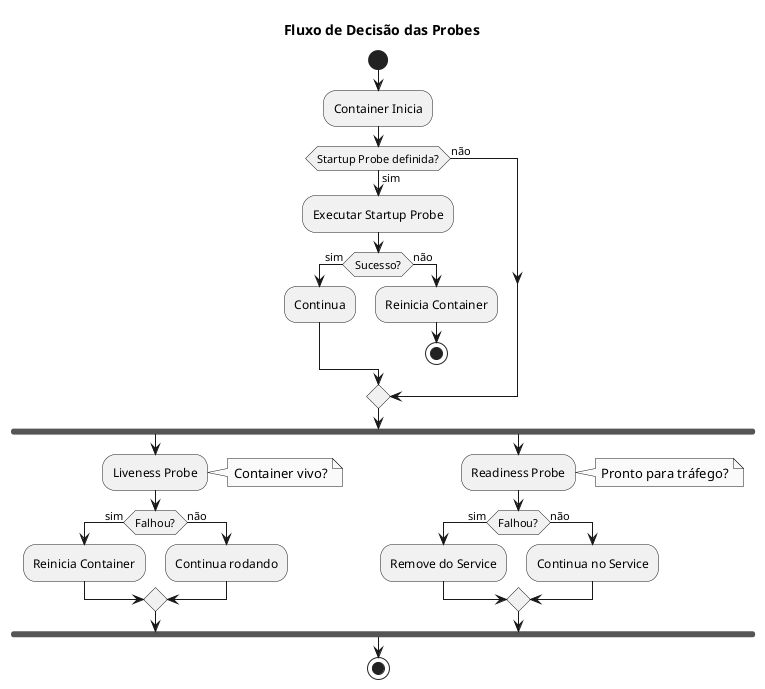

# Probes - Health Checks

<span class="badge badge-ckad">CKAD</span> <span class="badge badge-cka">CKA</span>

---

## O que são Probes?

```admonish info title="Probes"
Probes são mecanismos do Kubernetes para verificar a saúde de containers. Permitem ao kubelet saber quando reiniciar um container, quando ele está pronto para receber tráfego, ou quando a aplicação terminou de inicializar.
```

### Tipos de Probes

| Probe | Propósito | Ação em Falha |
|-------|-----------|---------------|
| **Liveness** | Container está vivo? | Reinicia container |
| **Readiness** | Container pode receber tráfego? | Remove do Service |
| **Startup** | Aplicação inicializou? | Bloqueia outras probes |

### Fluxo de Decisão



---

## Métodos de Verificação

### HTTP GET

```yaml
{{#include ../assets/probes/http-probe.yaml}}
```

### TCP Socket

```yaml
{{#include ../assets/probes/tcp-probe.yaml}}
```

### Exec Command

```yaml
{{#include ../assets/probes/exec-probe.yaml}}
```

### gRPC (v1.24+)

```yaml
{{#include ../assets/probes/grpc-probe.yaml}}
```

---

## Liveness Probe

```admonish warning title="Liveness"
Use liveness probe para detectar deadlocks ou estados irrecuperáveis. Se falhar, o container é reiniciado.
```

### Exemplo Completo

```yaml
{{#include ../assets/probes/liveness-demo.yaml}}
```

### Quando Usar

- Aplicação pode entrar em deadlock
- Processos que podem travar
- Conexões que não se recuperam automaticamente

### Quando NÃO Usar

- Aplicação ainda inicializando (use startupProbe)
- Dependência externa indisponível temporariamente (pode causar cascata de reinícios)

---

## Readiness Probe

```admonish tip title="Readiness"
Use readiness probe para controlar quando um Pod pode receber tráfego. Se falhar, o Pod é removido do Service (mas NÃO reiniciado).
```

### Exemplo Completo

```yaml
{{#include ../assets/probes/readiness-demo.yaml}}
```

### Quando Usar

- Aplicação precisa carregar dados antes de servir
- Conexão com banco de dados necessária
- Cache precisa ser populado
- Dependências externas devem estar disponíveis

### Efeito no Service

```bash
# Pod não ready = não aparece nos endpoints
kubectl get endpoints my-service

# Verificar condição Ready
kubectl get pods -o wide
kubectl describe pod <pod> | grep -A5 Conditions
```

---

## Startup Probe

```admonish note title="Startup"
Use startup probe para aplicações com inicialização lenta. Enquanto não passar, liveness e readiness não são executadas.
```

### Exemplo Completo

```yaml
{{#include ../assets/probes/startup-demo.yaml}}
```

### Quando Usar

- Aplicações Java com startup lento
- Aplicações que carregam modelos ML
- Migrações de banco de dados
- Qualquer app que precisa de mais tempo para iniciar

### Cálculo do Timeout Total

```
Tempo máximo de startup = failureThreshold × periodSeconds

Exemplo: 30 × 10 = 300 segundos (5 minutos)
```

---

## Configuração de Parâmetros

### Parâmetros Disponíveis

| Parâmetro | Default | Descrição |
|-----------|---------|-----------|
| `initialDelaySeconds` | 0 | Segundos antes da primeira probe |
| `periodSeconds` | 10 | Intervalo entre probes |
| `timeoutSeconds` | 1 | Timeout da probe |
| `successThreshold` | 1 | Sucessos para considerar OK |
| `failureThreshold` | 3 | Falhas para considerar NOT OK |

### Boas Práticas

```yaml
{{#include ../assets/probes/boas-praticas.yaml}}
```

---

## Exemplos Práticos

### Aplicação com Todas as Probes

```yaml
{{#include ../assets/probes/full-probes-demo.yaml}}
```

### Database com TCP Probe

```yaml
{{#include ../assets/probes/mysql-probe.yaml}}
```

### Worker com Exec Probe

```yaml
{{#include ../assets/probes/worker-probe.yaml}}
```

---

## Troubleshooting

### Pod reiniciando constantemente

```bash
# Ver eventos
kubectl describe pod <pod>

# Causas comuns:
# - initialDelaySeconds muito baixo
# - Endpoint /healthz não existe
# - Aplicação não responde a tempo
```

### Pod nunca fica Ready

```bash
# Verificar endpoints do service
kubectl get endpoints <service>

# Verificar condição do Pod
kubectl get pod <pod> -o jsonpath='{.status.conditions}'

# Causas comuns:
# - Readiness probe falhando
# - Dependência externa não disponível
```

### Verificar Probe Manualmente

```bash
# Exec no pod e testar endpoint
kubectl exec -it <pod> -- curl -v http://localhost:8080/healthz

# Testar TCP
kubectl exec -it <pod> -- nc -zv localhost 3306
```

---

## Dicas para o Exame CKAD

```admonish tip title="Dicas CKAD - Probes"
1. **Liveness reinicia, Readiness remove do Service**
2. **initialDelaySeconds**: Dar tempo para app iniciar
3. **Startup probe**: Para aplicações lentas
4. **httpGet é mais comum** que exec ou tcpSocket
5. **Saiba criar probes via YAML** rapidamente
```

### Comandos Rápidos

```bash
# Não há comando kubectl para criar probe
# Sempre via YAML ou editando deployment

# Editar deployment para adicionar probe
kubectl edit deployment <deployment>

# Gerar YAML base e adicionar probes
kubectl run nginx --image=nginx --dry-run=client -o yaml > pod.yaml
# Editar pod.yaml e adicionar probes
```

---

## Referências

- [Configure Liveness, Readiness and Startup Probes](https://kubernetes.io/docs/tasks/configure-pod-container/configure-liveness-readiness-startup-probes/)
- [Pods](../workloads/pod.md) - Conceitos de Pod
- [Deployments](../workloads/deployment.md) - Gerenciamento de aplicações
