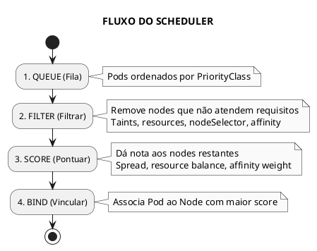
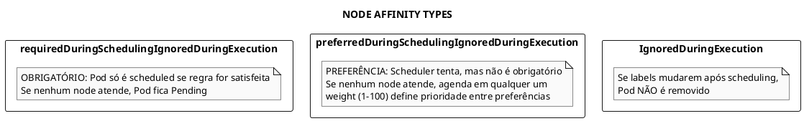
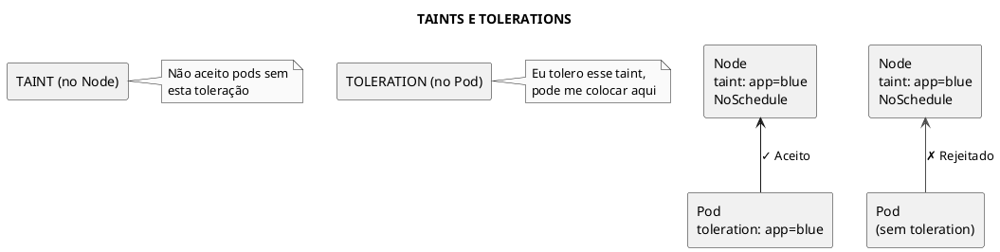
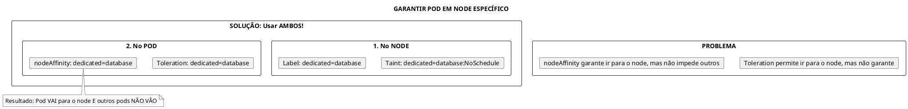
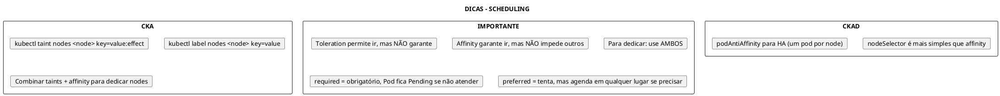

# Scheduling no Kubernetes

## Conceitos Fundamentais

### Como Funciona o Scheduling

O kube-scheduler decide em qual Node cada Pod será executado, seguindo um processo de múltiplas etapas.



### Mecanismos de Scheduling

| Mecanismo | Propósito | Escopo |
|-----------|-----------|--------|
| **nodeName** | Forçar node específico | Absoluto |
| **nodeSelector** | Selecionar por labels | Simples |
| **nodeAffinity** | Regras avançadas de node | Flexível |
| **podAffinity** | Co-localizar com pods | Inter-pod |
| **podAntiAffinity** | Separar de pods | Inter-pod |
| **taints/tolerations** | Restringir nodes | Repulsão |
| **topologySpread** | Distribuir uniformemente | Zonas/Nodes |

---

## nodeName (Scheduling Manual)

### Uso Básico

Especifica diretamente o Node - **bypassa o scheduler**.

```yaml
{{#include ../assets/scheduling/pod-manual-schedule.yaml}}
```

```admonish warning title="Limitações"
• Só funciona na criação do Pod
• Não pode ser editado depois
• Ignora taints, resources, affinity
• Se o node não existir, Pod fica Pending eternamente
```

---

## nodeSelector


### Pod com nodeSelector

```yaml
{{#include ../assets/pod/pod-with-nodeselector.yaml}}
```
### Conceito

Seleciona nodes baseado em labels. Método mais simples.

```bash
# Adicionar label ao node
kubectl label nodes worker-1 disk=ssd

# Remover label
kubectl label nodes worker-1 disk-

# Ver labels
kubectl get nodes --show-labels
```

### Usar nodeSelector

```yaml
{{#include ../assets/scheduling/pod-nodeselector.yaml}}
```

---

## Node Affinity


### Deployment com PreferredDuringScheduling

```yaml
{{#include ../assets/pod/deploy-with-nodeaffinity-preferred.yaml}}
```
### Deployment com RequiredDuringScheduling

```yaml
{{#include ../assets/pod/deploy-with-nodeaffinity-required.yaml}}
```
### Tipos de Affinity



### Required (Obrigatório)

```yaml
{{#include ../assets/scheduling/pod-affinity-required.yaml}}
```

### Preferred (Preferência)

```yaml
{{#include ../assets/scheduling/pod-affinity-preferred.yaml}}
```

### Operadores

| Operador | Descrição |
|----------|-----------|
| `In` | Valor está na lista |
| `NotIn` | Valor não está na lista |
| `Exists` | Label existe (qualquer valor) |
| `DoesNotExist` | Label não existe |
| `Gt` | Maior que (numérico) |
| `Lt` | Menor que (numérico) |

---

## Taints e Tolerations

### Conceito

**Taints** repelem Pods de Nodes. **Tolerations** permitem que Pods ignorem Taints.



### Efeitos de Taint

| Efeito | Comportamento |
|--------|---------------|
| `NoSchedule` | Novos pods sem toleration não são agendados |
| `PreferNoSchedule` | Scheduler tenta evitar, mas pode agendar |
| `NoExecute` | Pods existentes sem toleration são removidos |

### Comandos Taint

```bash
# Adicionar taint
kubectl taint nodes worker-1 app=blue:NoSchedule

# Remover taint (note o - no final)
kubectl taint nodes worker-1 app=blue:NoSchedule-

# Ver taints
kubectl describe node worker-1 | grep Taints

# Taint especial do control plane
kubectl describe node master | grep Taints
# node-role.kubernetes.io/control-plane:NoSchedule
```

### Toleration no Pod

```yaml
{{#include ../assets/scheduling/pod-tolerations.yaml}}
```

### tolerationSeconds (NoExecute)

```yaml
{{#include ../assets/workloads/scheduling-example-1.yaml}}
```

---

## Pod Affinity e Anti-Affinity

### Pod Affinity (Co-localizar)

```yaml
{{#include ../assets/scheduling/pod-affinity.yaml}}
```

### Pod Anti-Affinity (Separar)

```yaml
{{#include ../assets/scheduling/deployment-antiaffinity.yaml}}
```

### topologyKey

| topologyKey | Escopo |
|-------------|--------|
| `kubernetes.io/hostname` | Mesmo node |
| `topology.kubernetes.io/zone` | Mesma zona |
| `topology.kubernetes.io/region` | Mesma região |

---

## Topology Spread Constraints

### Distribuição Uniforme

```yaml
{{#include ../assets/scheduling/deployment-topology-spread.yaml}}
```

---

## Combinando Taints + Affinity



```yaml
{{#include ../assets/scheduling/pod-database-dedicated.yaml}}
```

---

## Priority e Preemption

### PriorityClass

```yaml
{{#include ../assets/scheduling/priorityclass.yaml}}
```

### Usar no Pod

```yaml
{{#include ../assets/scheduling/pod-priority.yaml}}
```

---

## Troubleshooting

### Pod Pending

```bash
# Ver eventos
kubectl describe pod <pod-name>

# Causas comuns:
# - Insufficient resources
# - No nodes match nodeSelector
# - Taints não tolerados
# - Affinity não satisfeita

# Ver recursos disponíveis
kubectl describe nodes | grep -A5 "Allocated resources"
```

### Verificar Scheduling

```bash
# Ver em qual node o pod está
kubectl get pod -o wide

# Ver eventos de scheduling
kubectl get events --field-selector reason=FailedScheduling
```

---

## Dicas para os Exames



---

## Referências

- [kube-scheduler](../cluster-components/kube-scheduler.md)
- [High Availability](fundamentals/high-availability.md)
- [DaemonSet](daemonset.md)
- [StatefulSet](statefulset.md)
- [Pod](pod.md)


---

### Pod com Tolerations

```yaml
{{#include ../assets/pod/pod-with-toleration.yaml}}
```
