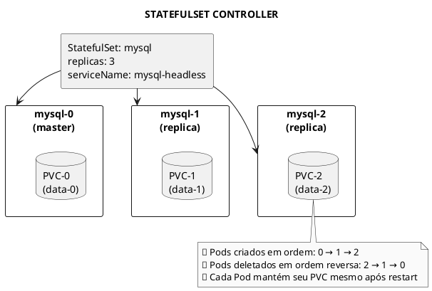
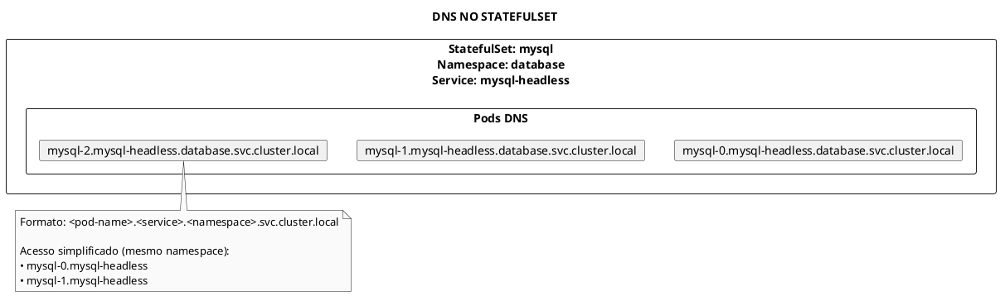
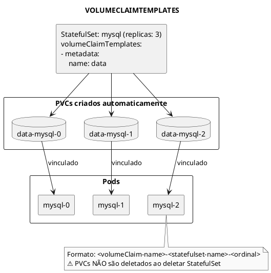

# StatefulSet

```admonish info title="Certificações"
CKA (15%), CKAD (10%)
```

## Conceitos Fundamentais

### O que é StatefulSet

StatefulSet é o workload controller para aplicações stateful. Diferente de Deployments, ele gerencia Pods com identidade persistente e estável (nome, storage).



### StatefulSet vs Deployment

| Característica | StatefulSet | Deployment |
|----------------|-------------|------------|
| **Identidade** | Estável (nome fixo) | Efêmera (nome aleatório) |
| **Storage** | PVC por Pod | PVC compartilhado |
| **Criação** | Ordenada (sequencial) | Paralela |
| **Deleção** | Ordenada (reversa) | Paralela |
| **DNS** | Individual por Pod | Via Service |
| **Uso típico** | Databases, clusters | Aplicações stateless |

### Garantias do StatefulSet

```plantuml,format=png
@startuml
skinparam monochrome true
skinparam backgroundColor white

title GARANTIAS DO STATEFULSET

rectangle "1. IDENTIDADE ESTÁVEL" as id
note right of id : Pod-0 sempre será Pod-0, mesmo após restart

rectangle "2. STORAGE PERSISTENTE" as storage
note right of storage
  PVC-0 sempre vinculado ao Pod-0
  PVC permanece mesmo se Pod for deletado
end note

rectangle "3. ORDEM DE DEPLOY/SCALE" as order
note right of order
  Scale up: 0 → 1 → 2 (sequencial)
  Scale down: 2 → 1 → 0 (reverso)
end note

rectangle "4. DNS PREVISÍVEL" as dns
note right of dns : pod-0.service.namespace.svc.cluster.local

@enduml
```



---

## Comandos Essenciais

### Gerenciar StatefulSets

```bash
# Listar StatefulSets
kubectl get statefulsets
kubectl get sts          # forma curta

# Listar com detalhes
kubectl get sts -o wide

# Ver StatefulSets em todos os namespaces
kubectl get sts -A

# Descrever StatefulSet
kubectl describe sts <name>

# Ver YAML
kubectl get sts <name> -o yaml
```

### Criar e Deletar

```bash
# Criar via arquivo (não existe kubectl create direto)
kubectl apply -f statefulset.yaml

# Deletar StatefulSet (mantém PVCs)
kubectl delete sts <name>

# Deletar StatefulSet e PVCs
kubectl delete sts <name>
kubectl delete pvc -l app=<label>

# Deletar com cascade (apenas Pods, PVCs permanecem)
kubectl delete sts <name> --cascade=orphan
```

### Escalar StatefulSet

```bash
# Escalar
kubectl scale sts <name> --replicas=5

# Escalar para 0 (antes de deletar)
kubectl scale sts <name> --replicas=0

# Patch
kubectl patch sts <name> -p '{"spec":{"replicas":5}}'
```

### Atualizar StatefulSet

```bash
# Atualizar imagem
kubectl set image sts/<name> <container>=<image>

# Rolling update acontece em ordem reversa: N-1 → ... → 1 → 0

# Ver status do rollout
kubectl rollout status sts/<name>

# Rollback
kubectl rollout undo sts/<name>

# Ver histórico
kubectl rollout history sts/<name>
```

---

## Exemplos Práticos


### StatefulSet Básico

```yaml
{{#include ../assets/statefulset/statefulset-test.yaml}}
```
### StatefulSet Básico

```yaml
{{#include ../assets/statefulset/nginx-headless-service-statefulset.yaml}}
```

### DNS dos Pods



### StatefulSet para MySQL (Primary-Replica)

```yaml
{{#include ../assets/statefulset/mysql-primary-replica.yaml}}
```

### StatefulSet com Pod Management Policy

```yaml
{{#include ../assets/statefulset/pod-management-policy.yaml}}
```

### Update Strategies

```yaml
{{#include ../assets/statefulset/update-strategy.yaml}}
```

### Partition para Canary Deployment

```yaml
{{#include ../assets/statefulset/partition-canary.yaml}}
```

### StatefulSet com Init Container

```yaml
{{#include ../assets/statefulset/init-container.yaml}}
```

---

## Volume Claim Templates



---

## Troubleshooting

### Problema: Pod Preso em Pending

```bash
# Verificar eventos do Pod
kubectl describe pod <pod-name>

# Verificar PVC
kubectl get pvc

# Verificar se há PV disponível
kubectl get pv

# Causas comuns:
# - StorageClass não existe
# - Não há PV disponível
# - PVC de Pod anterior ainda existe
```

### Problema: Pod Anterior Ainda Existe

```bash
# StatefulSet não cria Pod-N+1 até Pod-N estar Running

# Verificar status dos Pods
kubectl get pods -l app=<label>

# Se Pod anterior preso em Terminating
kubectl delete pod <pod-name> --force --grace-period=0

# Verificar se PVC está bound
kubectl get pvc
```

### Problema: Rollout Não Progride

```bash
# Verificar status
kubectl rollout status sts/<name>

# Verificar partition
kubectl get sts <name> -o jsonpath='{.spec.updateStrategy.rollingUpdate.partition}'

# Se partition > 0, apenas pods com ordinal >= partition são atualizados
```

### Deletar StatefulSet Corretamente

```bash
# 1. Escalar para 0 primeiro
kubectl scale sts <name> --replicas=0

# 2. Esperar Pods terminarem
kubectl get pods -l app=<label> -w

# 3. Deletar StatefulSet
kubectl delete sts <name>

# 4. Se necessário, deletar PVCs
kubectl delete pvc -l app=<label>
```

### Verificar Ordem dos Pods

```bash
# Ver ordinal de cada Pod
kubectl get pods -l app=<label> -o custom-columns=NAME:.metadata.name,ORDINAL:.metadata.labels.apps\.kubernetes\.io/pod-index

# Ver status detalhado
kubectl get sts <name> -o jsonpath='{.status}'
```

---

## Dicas para o Exame

### CKA

```admonish tip title="Dicas CKA"
1. **Headless Service obrigatório**: `clusterIP: None`

2. **Ordem de criação**: Pod-0 deve estar Ready antes de Pod-1 ser criado

3. **Escalar para 0 antes de deletar**: Boa prática para dados

4. **PVCs persistem**: Deletar manualmente se necessário:
   ```bash
   kubectl delete pvc -l app=<label>
   ```

5. **DNS dos Pods**:
   ```
   <pod-name>.<service>.<namespace>.svc.cluster.local
   ```
```

### CKAD

```admonish tip title="Dicas CKAD"
1. **volumeClaimTemplates**: Cria PVC automaticamente por Pod

2. **podManagementPolicy**:
   - `OrderedReady` (default): sequencial
   - `Parallel`: todos simultâneos

3. **partition**: Para canary deployments
```

### Comandos Úteis para o Exame

```bash
# Ver StatefulSets
kubectl get sts

# Escalar
kubectl scale sts <name> --replicas=5

# Ver PVCs do StatefulSet
kubectl get pvc -l app=<label>

# Testar DNS do Pod
kubectl run test --rm -it --image=busybox -- nslookup <pod>.<service>

# Ver rolling update status
kubectl rollout status sts/<name>

# Rollback
kubectl rollout undo sts/<name>
```

### Template Rápido para StatefulSet

```yaml
{{#include ../assets/statefulset/template-rapido.yaml}}
```

---

## Referências

- [Kubernetes - StatefulSet](https://kubernetes.io/docs/concepts/workloads/controllers/statefulset/)
- [Kubernetes - StatefulSet Basics](https://kubernetes.io/docs/tutorials/stateful-application/basic-stateful-set/)
- [Kubernetes - Run Replicated Stateful Application](https://kubernetes.io/docs/tasks/run-application/run-replicated-stateful-application/)

### Arquivos Relacionados

- [Storage](storage/storage.md) - PV e PVC
- [Services](../networking/service.md) - Headless Services
- [Deployment](deployment.md) - Comparação com Deployments
- [DNS](../networking/dns.md) - Resolução de nomes


