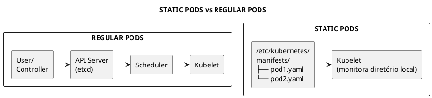
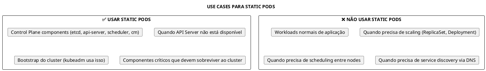
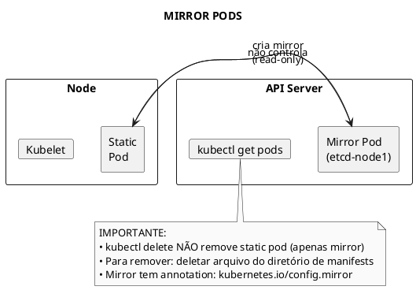

# Static Pods

```admonish info title="Certificações"
CKA (25%), CKS (10%)
```

## 📖 Conceitos Fundamentais

### O que são Static Pods

Static Pods são pods gerenciados diretamente pelo **kubelet** em um node específico, sem intervenção do API Server ou de controllers. O kubelet monitora um diretório local e cria/mantém os pods definidos nos manifests YAML desse diretório.



### Características dos Static Pods

| Característica | Descrição |
|----------------|-----------|
| **Gerenciamento** | Kubelet gerencia diretamente, não o API Server |
| **Visibilidade** | Mirror pod criado no API Server (read-only) |
| **Tipos** | APENAS Pods - não suporta outros recursos |
| **Localização** | Manifests em diretório local do node |
| **Naming** | Nome do pod + sufixo do node (ex: `etcd-master01`) |
| **Dependência** | Não depende do API Server funcionar |

### Quando usar Static Pods



### Mirror Pods

Quando o kubelet cria um Static Pod, ele também cria um **Mirror Pod** no API Server para visibilidade:



## 🔧 Configuração do Static Pod Path

### Método 1: Flag do Kubelet (SystemD)

```bash
# Ver configuração atual do kubelet
systemctl cat kubelet

# Modificar o service do kubelet
sudo vi /etc/systemd/system/kubelet.service.d/10-kubeadm.conf

# Adicionar a flag
--pod-manifest-path=/etc/kubernetes/manifests

# Reiniciar kubelet
sudo systemctl daemon-reload
sudo systemctl restart kubelet
```

### Método 2: Arquivo de Configuração (Recomendado)

```bash
# Verificar arquivo de config do kubelet
ps aux | grep kubelet | grep -- --config

# Geralmente em: /var/lib/kubelet/config.yaml
cat /var/lib/kubelet/config.yaml | grep staticPodPath
```

```yaml
{{#include ../assets/static-pods/kubelet-config.yaml}}
```

### Localização padrão (kubeadm)

```bash
# Diretório padrão do kubeadm
ls /etc/kubernetes/manifests/

# Componentes do control plane como Static Pods
etcd.yaml
kube-apiserver.yaml
kube-controller-manager.yaml
kube-scheduler.yaml
```

## 📋 Comandos Essenciais

### Identificar Static Pods

```bash
# Listar pods com sufixo do node (indica static pod)
kubectl get pods -n kube-system

# Output típico - note o sufixo do node
# etcd-master01                    1/1     Running
# kube-apiserver-master01          1/1     Running
# kube-scheduler-master01          1/1     Running

# Verificar se é static pod via annotation
kubectl get pod etcd-master01 -n kube-system -o yaml | grep -A2 annotations
# kubernetes.io/config.mirror: ...
# kubernetes.io/config.source: file

# Listar todos static pods
kubectl get pods -A -o json | jq '.items[] | select(.metadata.annotations["kubernetes.io/config.source"]=="file") | .metadata.name'
```

### Descobrir Static Pod Path

```bash
# Método 1: Verificar processo do kubelet
ps aux | grep kubelet

# Método 2: Ver config do kubelet
cat /var/lib/kubelet/config.yaml | grep staticPodPath

# Método 3: Ver unit do systemd
systemctl cat kubelet | grep manifest
```

### Criar Static Pod

```bash
# Acessar o node (ssh ou kubectl debug)
ssh node01

# Criar manifest no diretório
sudo vi /etc/kubernetes/manifests/my-static-pod.yaml
```

### Monitorar Static Pods (sem API Server)

```bash
# Usar crictl quando API Server não está disponível
crictl pods
crictl ps

# Ver logs
crictl logs <container-id>
```

## 📝 Exemplos Práticos

### Exemplo 1: Static Pod Simples

```yaml
{{#include ../assets/static-pods/static-nginx.yaml}}
```

### Exemplo 2: Static Pod com Volume Local

```yaml
{{#include ../assets/static-pods/static-logger.yaml}}
```

### Exemplo 3: Static Pod para Monitoramento de Node

```yaml
{{#include ../assets/static-pods/node-monitor.yaml}}
```

### Exemplo 4: Modificar Control Plane Component

```admonish caution title="Cuidado"
Modificar static pods do control plane pode derrubar o cluster! Sempre faça backup antes.
```

```bash
# Backup do manifest original
sudo cp /etc/kubernetes/manifests/kube-apiserver.yaml /tmp/

# Editar o manifest
sudo vi /etc/kubernetes/manifests/kube-apiserver.yaml

# Kubelet detecta mudança e recria o pod automaticamente
# Monitorar com crictl (API Server pode estar indisponível)
crictl pods | grep api
```

## 🔍 Troubleshooting

### Static Pod não inicia

```bash
# 1. Verificar se manifest está no diretório correto
ls -la /etc/kubernetes/manifests/

# 2. Verificar sintaxe YAML
cat /etc/kubernetes/manifests/my-pod.yaml | python3 -c "import yaml,sys; yaml.safe_load(sys.stdin)"

# 3. Ver logs do kubelet
journalctl -u kubelet -f

# 4. Verificar com crictl
crictl pods
crictl ps -a  # inclui containers parados
crictl logs <container-id>
```

### Não consigo deletar Static Pod com kubectl

```bash
# COMPORTAMENTO ESPERADO!
# kubectl delete remove apenas o mirror pod
# kubelet recria imediatamente

# Para remover de verdade:
sudo rm /etc/kubernetes/manifests/my-static-pod.yaml

# Kubelet detecta e remove o pod
```

### Static Pod com erro de imagem

```bash
# 1. Verificar eventos do pod
kubectl describe pod static-nginx-node01 -n default

# 2. Ver estado do container
crictl ps -a | grep static-nginx

# 3. Verificar se imagem existe
crictl images | grep nginx

# 4. Pull manual da imagem
crictl pull nginx:1.21
```

### Control Plane não inicia após modificação

```bash
# Se API Server não responde após modificação

# 1. Acessar node via SSH
ssh master01

# 2. Verificar status dos containers
crictl pods
crictl ps -a

# 3. Ver logs do componente problemático
crictl logs <container-id>

# 4. Restaurar backup do manifest
sudo cp /tmp/kube-apiserver.yaml /etc/kubernetes/manifests/

# 5. Monitorar recuperação
watch crictl ps
```

### Descobrir qual node hospeda Static Pod

```bash
# O sufixo do pod indica o node
kubectl get pod etcd-master01 -n kube-system

# Node = master01

# Ou via describe
kubectl describe pod etcd-master01 -n kube-system | grep Node:
```

## 💡 Dicas para Exame

### CKA - Cenários Comuns

```plantuml,format=png
@startuml
skinparam monochrome true
skinparam backgroundColor white

title DICAS CKA - STATIC PODS

rectangle "1️⃣ IDENTIFICAR STATIC PODS" {
  card "Procure sufixo do node no nome (etcd-master01)" as i1
  card "Annotation kubernetes.io/config.source: file" as i2
}

rectangle "2️⃣ ENCONTRAR O DIRETÓRIO" {
  card "cat /var/lib/kubelet/config.yaml | grep staticPodPath" as e1
  card "Padrão: /etc/kubernetes/manifests" as e2
}

rectangle "3️⃣ CRIAR STATIC POD" {
  card "kubectl run não funciona para static pods" as c1
  card "Criar YAML diretamente no diretório" as c2
  card "Use: kubectl run --dry-run=client -o yaml > pod.yaml\ndepois copie para o diretório de manifests" as c3
}

rectangle "4️⃣ LEMBRE-SE" {
  card "kubectl delete NÃO remove static pod" as l1
  card "Deve remover o arquivo YAML do diretório" as l2
}

@enduml
```



### Atalhos para o Exame

```bash
# Gerar YAML para static pod rapidamente
kubectl run static-test --image=nginx --dry-run=client -o yaml > /tmp/static-test.yaml

# SSH para o node e mover para manifests
scp /tmp/static-test.yaml node01:/tmp/
ssh node01 "sudo mv /tmp/static-test.yaml /etc/kubernetes/manifests/"

# Verificar criação
kubectl get pods | grep static-test
```

### Diferença: Static Pod vs DaemonSet

| Aspecto | Static Pod | DaemonSet |
|---------|------------|-----------|
| **Gerenciamento** | Kubelet local | API Server + Controller |
| **Escopo** | Node específico | Todos nodes (ou selecionados) |
| **Scheduling** | Não usa scheduler | Usa scheduler |
| **Alta disponibilidade** | Manual (copiar para cada node) | Automático |
| **Visibilidade** | Mirror pod (read-only) | Pod normal |
| **Updates** | Manual (editar arquivo) | Rolling update |
| **Use case** | Control plane | Logging, monitoring, networking |

## 📚 Referências

### Links Internos
- [Kubelet](../cluster-components/kubelet.md)
- [crictl](../tools/crictl.md)
- [kubeadm](../tools/kubeadm.md)
- [kube-apiserver](../cluster-components/kube-apiserver.md)
- [DaemonSet](daemonset.md)
- [Troubleshooting](../maintenance/troubleshooting.md)

### Documentação Oficial
- [Create static Pods](https://kubernetes.io/docs/tasks/configure-pod-container/static-pod/)
- [Kubelet Configuration](https://kubernetes.io/docs/reference/config-api/kubelet-config.v1beta1/)
- [Mirror Pods](https://kubernetes.io/docs/concepts/workloads/pods/#static-pods)

---

> **Resumo**: Static Pods são gerenciados diretamente pelo kubelet via manifests em diretório local, independente do API Server. Essenciais para bootstrap do control plane e componentes críticos. Identificados pelo sufixo do node no nome e pela annotation `kubernetes.io/config.source: file`. Para remover, delete o arquivo YAML - kubectl delete não funciona.
